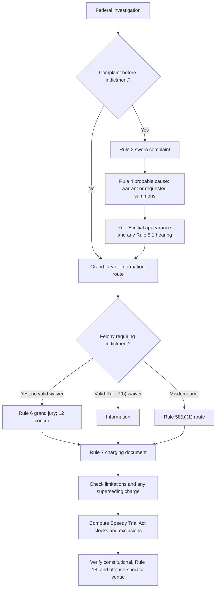

# Federal Charging and Commencement

## Verification boundary

This module supplies the nationwide federal framework from investigation through a complaint, warrant or summons, grand-jury charging, indictment or information, the principal general limitation and Speedy Trial Act clocks, preaccusation delay, and charging venue. It does not decide whether any investigative method was lawful, whether a particular charging document is sufficient, whether an offense-specific limitations or venue statute applies, whether a grand-jury disclosure exception is satisfied, or how a circuit treats a superseding indictment. Those questions require the actual offense, dates, district, record, and controlling circuit law.

## Investigation is not itself a single charging event

<!-- claim:CLM-CHARGE-001 authorities:AUTH-SCOTUS-LOVASCO-431-US-783 status:verified_current -->
Federal constitutional law does not require prosecutors to file charges as soon as probable cause exists. *Lovasco* permits good-faith investigative delay while prosecutors complete an investigation and decide whether they can and should prosecute. [*United States v. Lovasco*, 431 U.S. 783, 790–96 (1977)](https://www.govinfo.gov/content/pkg/USREPORTS-431/pdf/USREPORTS-431-783.pdf)

That rule does not validate a search, seizure, interrogation, subpoena, surveillance technique, charging motive, or agency action. Each asserted investigative defect needs its own Fourth or Fifth Amendment, statutory, rule, and remedy analysis.

## Complaint, arrest warrant, summons, and Rule 5

<!-- claim:CLM-CHARGE-002 authorities:AUTH-FRCRIM-P-3-9-18 status:verified_current -->
Rule 3 defines a complaint as a written statement of the essential facts constituting the charged offense. Except for Rule 4.1's electronic procedure, it must be made under oath before a magistrate judge or, if none is reasonably available, a state or local judicial officer. [Fed. R. Crim. P. 3](https://www.uscourts.gov/sites/default/files/document/federal-rules-of-criminal-procedure.pdf)

<!-- claim:CLM-CHARGE-003 authorities:AUTH-FRCRIM-P-3-9-18 status:verified_current -->
Under Rule 4(a), a complaint and any supporting affidavits must establish probable cause to believe both that an offense was committed and that the defendant committed it. The judge then must issue a warrant, or at a government attorney's request must issue a summons instead. [Fed. R. Crim. P. 4(a)](https://www.uscourts.gov/sites/default/files/document/federal-rules-of-criminal-procedure.pdf)

<!-- claim:CLM-CHARGE-004 authorities:AUTH-FRCRIM-P-3-9-18 status:verified_current -->
Rule 4 requires a warrant to identify the defendant with reasonable certainty, describe the charged offense, command arrest and prompt presentation, and bear the judge's signature; a summons uses the same form but commands appearance at a stated time and place. Execution, service, and return follow Rule 4(c). [Fed. R. Crim. P. 4(b)–(c)](https://www.uscourts.gov/sites/default/files/document/federal-rules-of-criminal-procedure.pdf)

<!-- claim:CLM-CHARGE-005 authorities:AUTH-FRCRIM-2025-PAMPHLET status:verified_current -->
A person making an arrest within the United States must take the defendant without unnecessary delay before a magistrate judge, or before a state or local judicial officer as Rule 5(c) provides, unless a statute provides otherwise, and subject to the exceptions in Rule 5(a)(2). When a defendant appears in response to a summons under Rule 4, a magistrate judge must proceed under Rule 5(d) or (e), as applicable. Rule 5(c) governs the place of the initial appearance and transfer to another district. [Fed. R. Crim. P. 5(a), (c)–(e) (Dec. 1, 2025 ed.)](https://www.uscourts.gov/sites/default/files/document/federal-rules-of-criminal-procedure.pdf)

<!-- claim:CLM-CHARGE-006 authorities:AUTH-FRCRIM-P-3-9-18 status:verified_current -->
When the initial appearance occurs outside the alleged-offense district, Rule 5(c)(3)(D) requires the magistrate judge to transfer the defendant if the government produces the warrant, a certified copy of the warrant, or a reliable electronic form of either, and the judge finds that the defendant is the same person named in the indictment, information, or warrant. If the defendant was arrested without a warrant, Rule 5(c)(3)(B) requires the district court where the offense was allegedly committed to first issue a warrant before the transfer, and Rule 5(c)(3)(C) requires a preliminary hearing if Rule 5.1 requires it. The rule supplies an identity finding, not a universally separate proceeding labeled an “identity hearing.” [Fed. R. Crim. P. 5(c)(3)(B)–(D)](https://www.uscourts.gov/sites/default/files/document/federal-rules-of-criminal-procedure.pdf)

<!-- claim:CLM-CHARGE-007 authorities:AUTH-FRCRIM-2025-PAMPHLET status:verified_current -->
If a defendant is charged with an offense other than a petty offense, Rule 5.1(a) requires a magistrate judge to conduct a preliminary hearing unless the defendant waives the hearing; the defendant is indicted; the government files an information under Rule 7(b) charging the defendant with a felony; the government files an information charging the defendant with a misdemeanor; or the defendant is charged with a misdemeanor and consents to trial before a magistrate judge. If the hearing is held, the magistrate judge decides whether there is probable cause to believe an offense has been committed and the defendant committed it. If the magistrate judge finds no probable cause, the magistrate judge must dismiss the complaint and discharge the defendant, and a discharge does not preclude the government from later prosecuting the defendant for the same offense. [Fed. R. Crim. P. 5.1(a), (e)–(f) (Dec. 1, 2025 ed.)](https://www.uscourts.gov/sites/default/files/document/federal-rules-of-criminal-procedure.pdf)

The fuller presentment, preliminary-hearing, counsel-attachment, and release-or-detention sequence is in [Initial Appearance and Pretrial Release or Detention](../20-pretrial/initial-appearance-and-pretrial-release.md).

## Grand jury

<!-- claim:CLM-CHARGE-008 authorities:AUTH-CONST-CHARGING-VENUE status:verified_current -->
The Fifth Amendment generally requires a grand-jury presentment or indictment before a person may be held to answer for a capital or otherwise infamous crime, subject to the amendment's land-or-naval-forces and militia exception. [U.S. Const. amend. V](https://constitution.congress.gov/constitution/amendment-5/)

<!-- claim:CLM-CHARGE-009 authorities:AUTH-FRCRIM-P-3-9-18 status:verified_current -->
Rule 6(a) requires a federal grand jury to have 16 to 23 members. [Fed. R. Crim. P. 6(a)(1)](https://www.uscourts.gov/sites/default/files/document/federal-rules-of-criminal-procedure.pdf)

<!-- claim:CLM-CHARGE-010 authorities:AUTH-FRCRIM-P-3-9-18 status:verified_current -->
While the grand jury is in session, Rule 6(d) permits government attorneys, the witness being questioned, needed interpreters, and a court reporter or recording-device operator to be present; during deliberation and voting, only jurors and any interpreter needed for an impaired juror may be present. [Fed. R. Crim. P. 6(d)](https://www.uscourts.gov/sites/default/files/document/federal-rules-of-criminal-procedure.pdf)

<!-- claim:CLM-CHARGE-011 authorities:AUTH-FRCRIM-P-3-9-18 status:verified_current -->
Except during deliberation and voting, Rule 6(e)(1) requires recording of grand-jury proceedings, but an unintentional recording failure does not invalidate a prosecution. Rule 6(e)(2) imposes secrecy on the listed participants and recipients; it does not authorize a court to impose a blanket secrecy obligation on every person. [Fed. R. Crim. P. 6(e)(1)–(2)](https://www.uscourts.gov/sites/default/files/document/federal-rules-of-criminal-procedure.pdf)

<!-- claim:CLM-CHARGE-012 authorities:AUTH-FRCRIM-P-3-9-18 status:verified_current -->
A grand jury may indict only with at least 12 jurors concurring, and the grand jury or its foreperson or deputy must return the indictment to a magistrate judge in open court, subject to the rule's video-return provision. [Fed. R. Crim. P. 6(f)](https://www.uscourts.gov/sites/default/files/document/federal-rules-of-criminal-procedure.pdf)

<!-- claim:CLM-CHARGE-013 authorities:AUTH-FRCRIM-P-3-9-18 status:verified_current -->
A magistrate judge may direct that a returned indictment remain secret until the defendant is in custody or released pending trial; the clerk then seals it, and disclosure is limited as Rule 6(e)(4) provides. [Fed. R. Crim. P. 6(e)(4)](https://www.uscourts.gov/sites/default/files/document/federal-rules-of-criminal-procedure.pdf)

## Indictment, information, waiver, joinder, and later process

<!-- claim:CLM-CHARGE-014 authorities:AUTH-FRCRIM-P-3-9-18 status:verified_current -->
Rule 7(a) requires an indictment for an offense other than criminal contempt if the offense is punishable by death or imprisonment for more than one year; an offense punishable by one year or less may be prosecuted under Rule 58(b)(1). [Fed. R. Crim. P. 7(a)](https://www.uscourts.gov/sites/default/files/document/federal-rules-of-criminal-procedure.pdf)

<!-- claim:CLM-CHARGE-015 authorities:AUTH-FRCRIM-P-3-9-18 status:verified_current -->
Rule 7(a)(1) requires indictment for an offense (other than criminal contempt) punishable by death or by imprisonment for more than one year, but under Rule 7(b) an offense punishable by imprisonment for more than one year may be prosecuted by information if the defendant, in open court and after being advised of the nature of the charge and of the defendant's rights, waives prosecution by indictment. [Fed. R. Crim. P. 7(a)(1), (b)](https://www.uscourts.gov/sites/default/files/document/federal-rules-of-criminal-procedure.pdf)

<!-- claim:CLM-CHARGE-016 authorities:AUTH-FRCRIM-P-3-9-18 status:verified_current -->
An indictment or information must be a plain, concise, and definite written statement of the essential facts constituting the offense, must be signed by a government attorney, and must give the official or customary legal citation for each count. [Fed. R. Crim. P. 7(c)(1)](https://www.uscourts.gov/sites/default/files/document/federal-rules-of-criminal-procedure.pdf)

<!-- claim:CLM-CHARGE-017 authorities:AUTH-FRCRIM-P-3-9-18 status:verified_current -->
A citation error or omission is not itself a basis to dismiss a charging document or reverse a conviction unless it misled and thereby prejudiced the defendant. [Fed. R. Crim. P. 7(c)(2)](https://www.uscourts.gov/sites/default/files/document/federal-rules-of-criminal-procedure.pdf)

<!-- claim:CLM-CHARGE-018 authorities:AUTH-FRCRIM-P-3-9-18 status:verified_current -->
Rule 7(e) expressly permits amendment of an information before verdict or finding only if no additional or different offense is charged and no substantial defense right is prejudiced. That provision is not generic authority to rewrite a grand-jury indictment. [Fed. R. Crim. P. 7(e)](https://www.uscourts.gov/sites/default/files/document/federal-rules-of-criminal-procedure.pdf)

<!-- claim:CLM-CHARGE-019 authorities:AUTH-FRCRIM-P-3-9-18 status:verified_current -->
Rule 8 permits joinder of offenses based on same-or-similar character, the same act or transaction, or a common scheme or plan, and permits joinder of defendants alleged to have participated in the same act, transaction, or series; all defendants need not appear in every count. [Fed. R. Crim. P. 8](https://www.uscourts.gov/sites/default/files/document/federal-rules-of-criminal-procedure.pdf)

<!-- claim:CLM-CHARGE-020 authorities:AUTH-FRCRIM-P-3-9-18 status:verified_current -->
After indictment, Rule 9 requires a warrant for each named defendant or, at the government's request, a summons; for a defendant named only in an information, accompanying affidavits must establish probable cause. The first appearance then proceeds under Rule 5. [Fed. R. Crim. P. 9(a), (c)(3)](https://www.uscourts.gov/sites/default/files/document/federal-rules-of-criminal-procedure.pdf)

<!-- claim:CLM-CHARGE-021 authorities:AUTH-FRCRIM-P-3-9-18,AUTH-USC-18-3281,AUTH-USC-18-3281-3282-3288-3289,AUTH-USC-18-3288,AUTH-USC-18-3289 status:verified_current -->
Rule 7 and 18 U.S.C. §§ 3281, 3282, 3288, and 3289 do not mention superseding indictments or state any “relation back” rule for them. A later charge of an offense (other than criminal contempt) punishable by death or by imprisonment for more than one year must still be prosecuted by indictment under Rule 7(a)(1); under Rule 7(b), an offense punishable by imprisonment for more than one year may be prosecuted by information if the defendant, in open court and after being advised of the nature of the charge and of the defendant's rights, waives prosecution by indictment. For a non-capital offense, § 3282(a) sets the general rule that, except as otherwise expressly provided by law, no person shall be prosecuted, tried, or punished unless the indictment is found or the information is instituted within five years after the offense was committed; these texts do not say how that period applies to a superseding indictment, so its timeliness must be determined from sources outside them. [Fed. R. Crim. P. 7(a)(1), (b)](https://www.uscourts.gov/sites/default/files/document/federal-rules-of-criminal-procedure.pdf); [18 U.S.C. § 3281](https://www.govinfo.gov/link/uscode/18/3281?link-type=html); [18 U.S.C. § 3282(a)](https://www.govinfo.gov/content/pkg/USCODE-2024-title18/pdf/USCODE-2024-title18-partII-chap213.pdf); [18 U.S.C. § 3288](https://www.govinfo.gov/link/uscode/18/3288?link-type=html); [18 U.S.C. § 3289](https://www.govinfo.gov/link/uscode/18/3289?link-type=html)

## Statutes of limitation

<!-- claim:CLM-CHARGE-022 authorities:AUTH-USC-18-3281-3282-3288-3289 status:verified_current -->
An indictment for an offense punishable by death may be found at any time without limitation under 18 U.S.C. § 3281. [18 U.S.C. § 3281](https://www.govinfo.gov/link/uscode/18/3281)

<!-- claim:CLM-CHARGE-023 authorities:AUTH-USC-18-3281-3282-3288-3289 status:verified_current -->
Except as otherwise expressly provided by law, § 3282(a) requires an indictment to be found or an information instituted within five years after a noncapital offense was committed. [18 U.S.C. § 3282(a)](https://www.govinfo.gov/content/pkg/USCODE-2024-title18/pdf/USCODE-2024-title18-partII-chap213.pdf)

<!-- claim:CLM-CHARGE-024 authorities:AUTH-USC-18-3281-3282-3288-3289,AUTH-USC-18-3281 status:verified_current -->
The five-year period in § 3282(a) is a default: it applies “[e]xcept as otherwise expressly provided by law,” covers only offenses “not capital,” and runs from when the offense “shall have been committed.” Section 3281 allows an indictment for any offense punishable by death to be found at any time without limitation, and under § 3282(b) an indictment for a chapter 109A offense that describes an accused whose name is unknown by a particular DNA profile, if found within five years after the offense, is not subject to the subsection (a) limitations period. [18 U.S.C. § 3282(a)–(b)](https://www.govinfo.gov/content/pkg/USCODE-2024-title18/pdf/USCODE-2024-title18-partII-chap213.pdf); [18 U.S.C. § 3281](https://www.govinfo.gov/link/uscode/18/3281?link-type=html)

<!-- claim:CLM-CHARGE-025 authorities:AUTH-USC-18-3288 status:verified_current -->
Under § 3288, when an indictment or information charging a felony is dismissed for any reason after the applicable limitations period has expired, a new indictment may be returned in the appropriate jurisdiction within six calendar months of the date of dismissal; within 60 days of the date the dismissal becomes final, in the event of an appeal; or, if no regular grand jury is in session there when the charge is dismissed, within six calendar months of the date the next regular grand jury is convened. The section does not permit a new indictment or information where the reason for the dismissal was the failure to file within the limitations period or some other reason that would bar a new prosecution. [18 U.S.C. § 3288](https://www.govinfo.gov/link/uscode/18/3288?link-type=html)

<!-- claim:CLM-CHARGE-026 authorities:AUTH-USC-18-3289 status:verified_current -->
Section 3289 supplies a related refiling window when an indictment or information charging a felony is dismissed for any reason before the applicable limitations period has expired and that period will expire within six calendar months of the dismissal: a new indictment may be returned within six calendar months of the expiration of the limitations period (not of the dismissal); within 60 days of the date the dismissal becomes final, in the event of an appeal; or, if no regular grand jury is in session in the appropriate jurisdiction when the limitations period expires, within six calendar months of the date the next regular grand jury is convened. It too does not permit a new indictment or information where the reason for the dismissal was the failure to file within the limitations period or some other reason that would bar a new prosecution. [18 U.S.C. § 3289](https://www.govinfo.gov/link/uscode/18/3289?link-type=html)

## Speedy Trial Act clocks and sanctions

<!-- claim:CLM-CHARGE-027 authorities:AUTH-USC-18-3161-3162 status:verified_current -->
Section 3161(b) requires that any information or indictment charging an individual with the commission of an offense be filed within 30 days from the date on which the individual was arrested or served with a summons in connection with the charges. If the individual has been charged with a felony in a district in which no grand jury has been in session during that 30-day period, the period of time for filing the indictment is extended an additional 30 days. Under § 3161(h), the periods of delay listed there are excluded in computing the time within which an information or an indictment must be filed. [18 U.S.C. § 3161(b), (h)](https://www.govinfo.gov/link/uscode/18/3161)

<!-- claim:CLM-CHARGE-028 authorities:AUTH-USC-18-3161-3162 status:verified_current -->
In any case in which a plea of not guilty is entered, § 3161(c)(1) requires that the trial of a defendant charged in an information or indictment commence within 70 days from the filing date (and making public) of the information or indictment, or from the date the defendant has appeared before a judicial officer of the court in which the charge is pending, whichever date last occurs. Under § 3161(h), the periods of delay listed there are excluded in computing the time within which the trial must commence. [18 U.S.C. § 3161(c)(1), (h)](https://www.govinfo.gov/link/uscode/18/3161)

<!-- claim:CLM-CHARGE-029 authorities:AUTH-USC-18-3161-3162 status:verified_current -->
The Speedy Trial Act is not computed by simply counting 30 or 70 calendar days: § 3161(h) excludes specified periods, and the actual calculation must use the docket, each exclusion, and any findings required for an ends-of-justice continuance. [18 U.S.C. § 3161(h)](https://www.govinfo.gov/link/uscode/18/3161)

<!-- claim:CLM-CHARGE-030 authorities:AUTH-USC-18-3161-3162,AUTH-USC-18-3162 status:verified_current -->
If the § 3161(b) charging period, as extended by § 3161(h), is violated, § 3162(a)(1) requires the complaint charge to be dismissed or otherwise dropped. If the § 3161(c) trial period, as extended by § 3161(h), is violated, § 3162(a)(2) requires dismissal of the indictment or information on the defendant's motion; the defendant has the burden of proof supporting the motion, the government has the burden of going forward with the evidence on any exclusion of time under § 3161(h)(3), and failure to move before trial or entry of a guilty or nolo plea waives that statutory dismissal right. In either setting, the statute lists factors the court must consider in deciding dismissal with or without prejudice. [18 U.S.C. § 3161(b)](https://www.govinfo.gov/link/uscode/18/3161); [18 U.S.C. § 3162(a)(1)–(2)](https://www.govinfo.gov/link/uscode/18/3162?link-type=html)

## Preaccusation delay

<!-- claim:CLM-CHARGE-031 authorities:AUTH-SCOTUS-MARION-404-US-307 status:verified_current -->
The Sixth Amendment Speedy Trial Clause applies only after a person becomes an accused through formal indictment or information or the actual restraints of arrest and holding to answer a criminal charge; it does not govern the preceding investigative interval. Statutes of limitation are the primary safeguard against stale preaccusation charges. [*United States v. Marion*, 404 U.S. 307, 313–20, 322–25 (1971)](https://www.govinfo.gov/content/pkg/USREPORTS-404/pdf/USREPORTS-404-307.pdf)

<!-- claim:CLM-CHARGE-032 authorities:AUTH-SCOTUS-MARION-404-US-307,AUTH-SCOTUS-LOVASCO-431-US-783 status:verified_current -->
The Fifth Amendment Due Process Clause has a limited role in preaccusation delay. Actual prejudice is generally necessary but not sufficient; the reasons for delay also matter, and good-faith investigative delay is not unconstitutional merely because the defense was somewhat prejudiced. [*Marion*, 404 U.S. at 324–26](https://www.govinfo.gov/content/pkg/USREPORTS-404/pdf/USREPORTS-404-307.pdf); [*Lovasco*, 431 U.S. at 789–96](https://www.govinfo.gov/content/pkg/USREPORTS-431/pdf/USREPORTS-431-783.pdf)

## Charging and trial venue

<!-- claim:CLM-CHARGE-033 authorities:AUTH-CONST-ART3-S2-C3,AUTH-CONST-AMEND-6,AUTH-FRCRIM-P-3-9-18 status:verified_current -->
Article III requires a federal criminal trial in the state where the crime was committed, subject to Congress's rule for crimes outside any state; the Sixth Amendment requires a jury from the state and district where the crime was committed. Rule 18 requires prosecution in a district where the offense was committed unless a statute or the rules permit otherwise, and requires the court to set the place of trial within the district with due regard for the convenience of the defendant, any victim, and the witnesses, and the prompt administration of justice. [U.S. Const. art. III, § 2, cl. 3](https://constitution.congress.gov/browse/article-3/section-2/clause-3/); [U.S. Const. amend. VI](https://constitution.congress.gov/constitution/amendment-6/); [Fed. R. Crim. P. 18](https://www.uscourts.gov/sites/default/files/document/federal-rules-of-criminal-procedure.pdf) [U.S. Const. art. III, § 2, cl. 3](https://constitution.congress.gov/browse/essay/artIII-S2-C3-1/ALDE_00013570/); [U.S. Const. amend. VI](https://constitution.congress.gov/browse/amendment-6/); [Fed. R. Crim. P. 18](https://www.uscourts.gov/sites/default/files/document/federal-rules-of-criminal-procedure.pdf)

<!-- claim:CLM-CHARGE-034 authorities:AUTH-USC-18-3237 status:verified_current -->
Unless Congress expressly provides otherwise, § 3237(a) permits prosecution in any district where a federal offense begun in one district and completed in another, or committed in more than one district, was begun, continued, or completed; it also supplies a specific continuing-offense rule for mail, interstate or foreign transportation, and importation offenses. Notwithstanding subsection (a), § 3237(b) lets a defendant prosecuted in a district other than the one where the defendant resides, for an offense described in Internal Revenue Code § 7203, or for an offense described in § 7201 or § 7206(1), (2), or (5) (whether or not also described in another provision of law) where venue rests solely on a mailing to the Internal Revenue Service, elect, by motion filed in the district where the prosecution was begun, to be tried in the district where the defendant resided when the alleged offense was committed, if the motion is filed within twenty days after arraignment on the indictment or information. [18 U.S.C. § 3237(a)–(b)](https://www.govinfo.gov/link/uscode/18/3237)

<!-- claim:CLM-CHARGE-035 authorities:AUTH-SCOTUS-SMITH-599-US-236 status:verified_current -->
When a conviction is reversed because trial occurred in the wrong venue or before a jury drawn from the wrong district, *Smith* holds that the Constitution permits retrial in the proper venue; the venue error does not itself require a judgment barring reprosecution. [*Smith v. United States*, 599 U.S. 236, 240–47 (2023)](https://www.supremecourt.gov/opinions/22pdf/21-1576_e29g.pdf)

## Nationwide decision path

## Record-first checklist

1. Identify the exact offense, elements, penalty range, offense-completion date, and every potentially applicable offense-specific limitations and venue statute.
2. Obtain the complaint, supporting affidavit, warrant or summons, return, arrest and service dates, Rule 5 record, and any Rule 5.1 waiver or disposition.
3. For an out-of-district arrest, preserve the warrant copy and the court's same-person finding rather than assuming a freestanding identity-hearing procedure.
4. Obtain every original, sealed, superseding, and amended charging document, its public filing or return date, and any Rule 7(b) waiver.
5. Compute limitation and Speedy Trial Act clocks separately. For the Act, create a docket-based ledger of each potentially excluded period and every required finding.
6. Map each offense's conduct elements to districts, then apply Article III, the Sixth Amendment, Rule 18, § 3237, and any offense-specific venue provision.
7. Research controlling circuit authority for charging-document sufficiency, constructive amendment or variance, superseding-indictment timeliness, preaccusation-delay tests, venue waiver, proof, standard of review, and remedy.

## Matters not yet verified in this module

- Lawfulness and remedy for any particular search, seizure, subpoena, surveillance method, interrogation, undercover operation, or investigative disclosure.
- Selective or vindictive prosecution, prosecutorial immunity, charging policy, and internal Department of Justice guidance.
- Case-specific grand-jury challenges, disclosure, misconduct, dismissal, harmless error, and privilege.
- Sufficiency of a particular count, duplicity, multiplicity, constructive amendment, variance, bill of particulars, severance, and waiver.
- The exact circuit test for whether a superseding indictment is timely, and any individual application of §§ 3288 or 3289.
- Offense-specific limitation periods, tolling, fugitivity, wartime suspension, DNA indictment application, and offense-completion disputes.
- Every Speedy Trial Act exclusion, Sixth Amendment postaccusation delay, Rule 48(b), local plan, and case-specific calculation.
- Circuit-specific preaccusation-delay formulation beyond *Marion* and *Lovasco*.
- Venue waiver, transfer, burden of proof, standard of review, harmlessness, and offense-specific venue applications.

Those issues remain open in `data/coverage_matrix.yaml`; this module verifies the nationwide organizing rules and their boundaries rather than pretending that every charging dispute has one generic answer.
