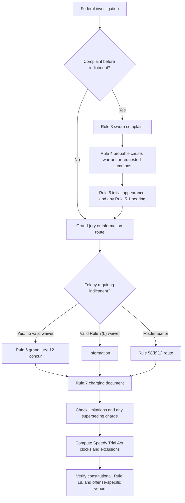

# Federal Charging and Commencement

## Verification boundary

This module supplies the nationwide federal framework from investigation through a complaint, warrant or summons, grand-jury charging, indictment or information, the principal general limitation and Speedy Trial Act clocks, preaccusation delay, and charging venue. It does not decide whether any investigative method was lawful, whether a particular charging document is sufficient, whether an offense-specific limitations or venue statute applies, whether a grand-jury disclosure exception is satisfied, or how a circuit treats a superseding indictment. Those questions require the actual offense, dates, district, record, and controlling circuit law.

## Investigation is not itself a single charging event

<!-- claim:CLM-CHARGE-001 authorities:AUTH-SCOTUS-LOVASCO-431-US-783 status:verified_current -->
Federal constitutional law does not require prosecutors to file charges as soon as probable cause exists. *Lovasco* permits good-faith investigative delay while prosecutors complete an investigation and decide whether they can and should prosecute. [*United States v. Lovasco*, 431 U.S. 783, 790–96 (1977)](https://www.govinfo.gov/content/pkg/USREPORTS-431/pdf/USREPORTS-431-783.pdf)

That rule does not validate a search, seizure, interrogation, subpoena, surveillance technique, charging motive, or agency action. Each asserted investigative defect needs its own Fourth or Fifth Amendment, statutory, rule, and remedy analysis.

## Complaint, arrest warrant, summons, and Rule 5

<!-- claim:CLM-CHARGE-002 authorities:AUTH-FRCRIM-P-3-9-18 status:verified_current -->
Rule 3 defines a complaint as a written statement of the essential facts constituting the charged offense. Except for Rule 4.1's electronic procedure, it must be made under oath before a magistrate judge or, if none is reasonably available, a state or local judicial officer. [Fed. R. Crim. P. 3](https://www.uscourts.gov/sites/default/files/document/federal-rules-of-criminal-procedure.pdf)

<!-- claim:CLM-CHARGE-003 authorities:AUTH-FRCRIM-P-3-9-18 status:verified_current -->
Under Rule 4(a), a complaint and any supporting affidavits must establish probable cause to believe both that an offense was committed and that the defendant committed it. The judge then must issue a warrant, or at a government attorney's request must issue a summons instead. [Fed. R. Crim. P. 4(a)](https://www.uscourts.gov/sites/default/files/document/federal-rules-of-criminal-procedure.pdf)

<!-- claim:CLM-CHARGE-004 authorities:AUTH-FRCRIM-P-3-9-18 status:verified_current -->
Rule 4 requires a warrant to identify the defendant with reasonable certainty, describe the charged offense, command arrest and prompt presentation, and bear the judge's signature; a summons uses the same form but commands appearance at a stated time and place. Execution, service, and return follow Rule 4(c). [Fed. R. Crim. P. 4(b)–(c)](https://www.uscourts.gov/sites/default/files/document/federal-rules-of-criminal-procedure.pdf)

<!-- claim:CLM-CHARGE-005 authorities:AUTH-FRCRIM-P-3-9-18 status:verified_current -->
An arrest within the United States ordinarily leads to a Rule 5 initial appearance without unnecessary delay, while appearance on a Rule 4 summons proceeds under Rule 5(d) or (e). Rule 5 also controls the location of the initial appearance and interdistrict transfer. [Fed. R. Crim. P. 5(a), (c)](https://www.uscourts.gov/sites/default/files/document/federal-rules-of-criminal-procedure.pdf)

<!-- claim:CLM-CHARGE-006 authorities:AUTH-FRCRIM-P-3-9-18 status:verified_current -->
When the initial appearance occurs outside the alleged-offense district, Rule 5(c)(3)(D) conditions transfer on production of the warrant or an authorized copy and a judicial finding that the defendant is the person named in the indictment, information, or warrant. The rule supplies an identity finding, not a universally separate proceeding labeled an “identity hearing.” [Fed. R. Crim. P. 5(c)(3)(D)](https://www.uscourts.gov/sites/default/files/document/federal-rules-of-criminal-procedure.pdf)

<!-- claim:CLM-CHARGE-007 authorities:AUTH-FRCRIM-P-3-9-18 status:verified_current -->
For a nonpetty offense, Rule 5.1 ordinarily requires a preliminary hearing unless an enumerated exception applies, including waiver, indictment, or specified informations. If held, the magistrate judge decides probable cause; dismissal and discharge for lack of probable cause do not preclude a later prosecution for the same offense. [Fed. R. Crim. P. 5.1(a), (e)–(f)](https://www.uscourts.gov/sites/default/files/document/federal-rules-of-criminal-procedure.pdf)

The fuller presentment, preliminary-hearing, counsel-attachment, and release-or-detention sequence is in [Initial Appearance and Pretrial Release or Detention](../20-pretrial/initial-appearance-and-pretrial-release.md).

## Grand jury

<!-- claim:CLM-CHARGE-008 authorities:AUTH-CONST-CHARGING-VENUE status:verified_current -->
The Fifth Amendment generally requires a grand-jury presentment or indictment before a person may be held to answer for a capital or otherwise infamous crime, subject to the amendment's land-or-naval-forces and militia exception. [U.S. Const. amend. V](https://constitution.congress.gov/constitution/amendment-5/)

<!-- claim:CLM-CHARGE-009 authorities:AUTH-FRCRIM-P-3-9-18 status:verified_current -->
Rule 6(a) requires a federal grand jury to have 16 to 23 members. [Fed. R. Crim. P. 6(a)(1)](https://www.uscourts.gov/sites/default/files/document/federal-rules-of-criminal-procedure.pdf)

<!-- claim:CLM-CHARGE-010 authorities:AUTH-FRCRIM-P-3-9-18 status:verified_current -->
While the grand jury is in session, Rule 6(d) permits government attorneys, the witness being questioned, needed interpreters, and a court reporter or recording-device operator to be present; during deliberation and voting, only jurors and any interpreter needed for an impaired juror may be present. [Fed. R. Crim. P. 6(d)](https://www.uscourts.gov/sites/default/files/document/federal-rules-of-criminal-procedure.pdf)

<!-- claim:CLM-CHARGE-011 authorities:AUTH-FRCRIM-P-3-9-18 status:verified_current -->
Except during deliberation and voting, Rule 6(e)(1) requires recording of grand-jury proceedings, but an unintentional recording failure does not invalidate a prosecution. Rule 6(e)(2) imposes secrecy on the listed participants and recipients; it does not authorize a court to impose a blanket secrecy obligation on every person. [Fed. R. Crim. P. 6(e)(1)–(2)](https://www.uscourts.gov/sites/default/files/document/federal-rules-of-criminal-procedure.pdf)

<!-- claim:CLM-CHARGE-012 authorities:AUTH-FRCRIM-P-3-9-18 status:verified_current -->
A grand jury may indict only with at least 12 jurors concurring, and the grand jury or its foreperson or deputy must return the indictment to a magistrate judge in open court, subject to the rule's video-return provision. [Fed. R. Crim. P. 6(f)](https://www.uscourts.gov/sites/default/files/document/federal-rules-of-criminal-procedure.pdf)

<!-- claim:CLM-CHARGE-013 authorities:AUTH-FRCRIM-P-3-9-18 status:verified_current -->
A magistrate judge may direct that a returned indictment remain secret until the defendant is in custody or released pending trial; the clerk then seals it, and disclosure is limited as Rule 6(e)(4) provides. [Fed. R. Crim. P. 6(e)(4)](https://www.uscourts.gov/sites/default/files/document/federal-rules-of-criminal-procedure.pdf)

## Indictment, information, waiver, joinder, and later process

<!-- claim:CLM-CHARGE-014 authorities:AUTH-FRCRIM-P-3-9-18 status:verified_current -->
Rule 7(a) requires an indictment for an offense other than criminal contempt if the offense is punishable by death or imprisonment for more than one year; an offense punishable by one year or less may be prosecuted under Rule 58(b)(1). [Fed. R. Crim. P. 7(a)](https://www.uscourts.gov/sites/default/files/document/federal-rules-of-criminal-procedure.pdf)

<!-- claim:CLM-CHARGE-015 authorities:AUTH-FRCRIM-P-3-9-18 status:verified_current -->
A felony otherwise requiring indictment may proceed by information only if the defendant, in open court and after advice about the nature of the charge and the defendant's rights, waives prosecution by indictment. [Fed. R. Crim. P. 7(b)](https://www.uscourts.gov/sites/default/files/document/federal-rules-of-criminal-procedure.pdf)

<!-- claim:CLM-CHARGE-016 authorities:AUTH-FRCRIM-P-3-9-18 status:verified_current -->
An indictment or information must be a plain, concise, and definite written statement of the essential facts constituting the offense, must be signed by a government attorney, and must give the official or customary legal citation for each count. [Fed. R. Crim. P. 7(c)(1)](https://www.uscourts.gov/sites/default/files/document/federal-rules-of-criminal-procedure.pdf)

<!-- claim:CLM-CHARGE-017 authorities:AUTH-FRCRIM-P-3-9-18 status:verified_current -->
A citation error or omission is not itself a basis to dismiss a charging document or reverse a conviction unless it misled and thereby prejudiced the defendant. [Fed. R. Crim. P. 7(c)(2)](https://www.uscourts.gov/sites/default/files/document/federal-rules-of-criminal-procedure.pdf)

<!-- claim:CLM-CHARGE-018 authorities:AUTH-FRCRIM-P-3-9-18 status:verified_current -->
Rule 7(e) expressly permits amendment of an information before verdict or finding only if no additional or different offense is charged and no substantial defense right is prejudiced. That provision is not generic authority to rewrite a grand-jury indictment. [Fed. R. Crim. P. 7(e)](https://www.uscourts.gov/sites/default/files/document/federal-rules-of-criminal-procedure.pdf)

<!-- claim:CLM-CHARGE-019 authorities:AUTH-FRCRIM-P-3-9-18 status:verified_current -->
Rule 8 permits joinder of offenses based on same-or-similar character, the same act or transaction, or a common scheme or plan, and permits joinder of defendants alleged to have participated in the same act, transaction, or series; all defendants need not appear in every count. [Fed. R. Crim. P. 8](https://www.uscourts.gov/sites/default/files/document/federal-rules-of-criminal-procedure.pdf)

<!-- claim:CLM-CHARGE-020 authorities:AUTH-FRCRIM-P-3-9-18 status:verified_current -->
After indictment, Rule 9 requires a warrant for each named defendant or, at the government's request, a summons; for a defendant named only in an information, accompanying affidavits must establish probable cause. The first appearance then proceeds under Rule 5. [Fed. R. Crim. P. 9(a), (c)(3)](https://www.uscourts.gov/sites/default/files/document/federal-rules-of-criminal-procedure.pdf)

<!-- claim:CLM-CHARGE-021 authorities:AUTH-FRCRIM-P-3-9-18,AUTH-USC-18-3281-3282-3288-3289 status:partially_verified -->
Neither Rule 7 nor the general limitation statutes create one universal “relation back” rule for every superseding indictment. A later felony charge must still use the constitutionally and procedurally authorized charging form, and its timeliness requires comparison of the original and superseding charges under the applicable limitations statute and controlling circuit law. [Fed. R. Crim. P. 6–7](https://www.uscourts.gov/sites/default/files/document/federal-rules-of-criminal-procedure.pdf); [18 U.S.C. ch. 213](https://uscode.house.gov/view.xhtml?edition=prelim&num=0&path=%2Fprelim%40title18%2Fpart2%2Fchapter213&req=granuleid%3AUSC-prelim-title18-chapter213)

## Statutes of limitation

<!-- claim:CLM-CHARGE-022 authorities:AUTH-USC-18-3281-3282-3288-3289 status:verified_current -->
An indictment for an offense punishable by death may be found at any time without limitation under 18 U.S.C. § 3281. [18 U.S.C. § 3281](https://uscode.house.gov/view.xhtml?edition=prelim&num=0&req=granuleid%3AUSC-prelim-title18-section3281)

<!-- claim:CLM-CHARGE-023 authorities:AUTH-USC-18-3281-3282-3288-3289 status:verified_current -->
Except as otherwise expressly provided by law, § 3282(a) requires an indictment to be found or an information instituted within five years after a noncapital offense was committed. [18 U.S.C. § 3282(a)](https://uscode.house.gov/view.xhtml?edition=prelim&num=0&req=granuleid%3AUSC-prelim-title18-section3282)

<!-- claim:CLM-CHARGE-024 authorities:AUTH-USC-18-3281-3282-3288-3289 status:partially_verified -->
The five-year rule is only a default. The charged offense may have a different federal limitations period, tolling rule, or continuing-offense rule, and calculating accrual requires identifying when the offense was complete under its elements and controlling precedent. [18 U.S.C. ch. 213](https://uscode.house.gov/view.xhtml?edition=prelim&num=0&path=%2Fprelim%40title18%2Fpart2%2Fchapter213&req=granuleid%3AUSC-prelim-title18-chapter213)

<!-- claim:CLM-CHARGE-025 authorities:AUTH-USC-18-3281-3282-3288-3289 status:verified_current -->
Section 3288 permits a new felony indictment within its stated six-calendar-month or appellate period when the prior indictment or information is dismissed after the applicable limitations period expired, but not when the dismissal reason itself bars a new prosecution. [18 U.S.C. § 3288](https://uscode.house.gov/view.xhtml?edition=prelim&num=0&req=granuleid%3AUSC-prelim-title18-section3288)

<!-- claim:CLM-CHARGE-026 authorities:AUTH-USC-18-3281-3282-3288-3289 status:verified_current -->
Section 3289 supplies a related refiling window when a felony indictment or information is dismissed before expiration and the limitations period will expire within six calendar months of dismissal; it too excludes a new prosecution when the dismissal reason itself is time-bar or another bar. [18 U.S.C. § 3289](https://uscode.house.gov/view.xhtml?req=%28title%3A18+section%3A3289+edition%3Aprelim%29)

## Speedy Trial Act clocks and sanctions

<!-- claim:CLM-CHARGE-027 authorities:AUTH-USC-18-3161-3162 status:verified_current -->
Section 3161(b) ordinarily requires an indictment or information within 30 days after the individual was arrested or served with a summons in connection with the charges; for a felony in a district where no grand jury sat during that period, the statute adds 30 days. [18 U.S.C. § 3161(b)](https://uscode.house.gov/view.xhtml?edition=prelim&num=0&req=granuleid%3AUSC-prelim-title18-section3161)

<!-- claim:CLM-CHARGE-028 authorities:AUTH-USC-18-3161-3162 status:verified_current -->
After a not-guilty plea, § 3161(c)(1) ordinarily requires trial within 70 days from the later of public filing of the indictment or information and the defendant's appearance before a judicial officer of the court where the charge is pending. [18 U.S.C. § 3161(c)(1)](https://uscode.house.gov/view.xhtml?edition=prelim&num=0&req=granuleid%3AUSC-prelim-title18-section3161)

<!-- claim:CLM-CHARGE-029 authorities:AUTH-USC-18-3161-3162 status:verified_current -->
The Speedy Trial Act is not computed by simply counting 30 or 70 calendar days: § 3161(h) excludes specified periods, and the actual calculation must use the docket, each exclusion, and any findings required for an ends-of-justice continuance. [18 U.S.C. § 3161(h)](https://uscode.house.gov/view.xhtml?edition=prelim&num=0&req=granuleid%3AUSC-prelim-title18-section3161)

<!-- claim:CLM-CHARGE-030 authorities:AUTH-USC-18-3161-3162 status:verified_current -->
If the § 3161(b) charging period, as extended by exclusions, is violated, § 3162(a)(1) requires the complaint charge to be dismissed or otherwise dropped. If the trial period is violated, § 3162(a)(2) requires dismissal of the indictment or information on a timely defense motion; failure to move before trial or a guilty or nolo plea waives that statutory dismissal right. In either setting, the statute gives factors for deciding dismissal with or without prejudice. [18 U.S.C. § 3162(a)](https://uscode.house.gov/view.xhtml?req=%28title%3A18+section%3A3162+edition%3Aprelim%29)

## Preaccusation delay

<!-- claim:CLM-CHARGE-031 authorities:AUTH-SCOTUS-MARION-404-US-307 status:verified_current -->
The Sixth Amendment Speedy Trial Clause applies only after a person becomes an accused through formal indictment or information or the actual restraints of arrest and holding to answer a criminal charge; it does not govern the preceding investigative interval. Statutes of limitation are the primary safeguard against stale preaccusation charges. [*United States v. Marion*, 404 U.S. 307, 313–20, 322–25 (1971)](https://www.govinfo.gov/content/pkg/USREPORTS-404/pdf/USREPORTS-404-307.pdf)

<!-- claim:CLM-CHARGE-032 authorities:AUTH-SCOTUS-MARION-404-US-307,AUTH-SCOTUS-LOVASCO-431-US-783 status:verified_current -->
The Fifth Amendment Due Process Clause has a limited role in preaccusation delay. Actual prejudice is generally necessary but not sufficient; the reasons for delay also matter, and good-faith investigative delay is not unconstitutional merely because the defense was somewhat prejudiced. [*Marion*, 404 U.S. at 324–26](https://www.govinfo.gov/content/pkg/USREPORTS-404/pdf/USREPORTS-404-307.pdf); [*Lovasco*, 431 U.S. at 789–96](https://www.govinfo.gov/content/pkg/USREPORTS-431/pdf/USREPORTS-431-783.pdf)

## Charging and trial venue

<!-- claim:CLM-CHARGE-033 authorities:AUTH-CONST-CHARGING-VENUE,AUTH-FRCRIM-P-3-9-18 status:verified_current -->
Article III requires a federal criminal trial in the state where the crime was committed, subject to Congress's rule for crimes outside any state; the Sixth Amendment requires a jury from the state and district where the crime was committed. Rule 18 implements the ordinary district rule and requires due regard to convenience and prompt administration when setting the place of trial within the district. [U.S. Const. art. III, § 2, cl. 3](https://constitution.congress.gov/browse/essay/artIII-S2-C3-1/ALDE_00013570/); [U.S. Const. amend. VI](https://constitution.congress.gov/browse/amendment-6/); [Fed. R. Crim. P. 18](https://www.uscourts.gov/sites/default/files/document/federal-rules-of-criminal-procedure.pdf)

<!-- claim:CLM-CHARGE-034 authorities:AUTH-USC-18-3237 status:verified_current -->
Unless Congress expressly provides otherwise, § 3237(a) permits prosecution in any district where a federal offense begun in one district and completed in another, or committed in more than one district, was begun, continued, or completed; it also supplies a specific continuing-offense rule for mail, interstate or foreign transportation, and importation offenses. [18 U.S.C. § 3237(a)](https://uscode.house.gov/view.xhtml?edition=prelim&num=0&req=granuleid%3AUSC-prelim-title18-section3237)

<!-- claim:CLM-CHARGE-035 authorities:AUTH-SCOTUS-SMITH-599-US-236 status:verified_current -->
When a conviction is reversed because trial occurred in the wrong venue or before a jury drawn from the wrong district, *Smith* holds that the Constitution permits retrial in the proper venue; the venue error does not itself require a judgment barring reprosecution. [*Smith v. United States*, 599 U.S. 236, 240–47 (2023)](https://www.supremecourt.gov/opinions/22pdf/21-1576_e29g.pdf)

## Nationwide decision path

## Record-first checklist

1. Identify the exact offense, elements, penalty range, offense-completion date, and every potentially applicable offense-specific limitations and venue statute.
2. Obtain the complaint, supporting affidavit, warrant or summons, return, arrest and service dates, Rule 5 record, and any Rule 5.1 waiver or disposition.
3. For an out-of-district arrest, preserve the warrant copy and the court's same-person finding rather than assuming a freestanding identity-hearing procedure.
4. Obtain every original, sealed, superseding, and amended charging document, its public filing or return date, and any Rule 7(b) waiver.
5. Compute limitation and Speedy Trial Act clocks separately. For the Act, create a docket-based ledger of each potentially excluded period and every required finding.
6. Map each offense's conduct elements to districts, then apply Article III, the Sixth Amendment, Rule 18, § 3237, and any offense-specific venue provision.
7. Research controlling circuit authority for charging-document sufficiency, constructive amendment or variance, superseding-indictment timeliness, preaccusation-delay tests, venue waiver, proof, standard of review, and remedy.

## Matters not yet verified in this module

- Lawfulness and remedy for any particular search, seizure, subpoena, surveillance method, interrogation, undercover operation, or investigative disclosure.
- Selective or vindictive prosecution, prosecutorial immunity, charging policy, and internal Department of Justice guidance.
- Case-specific grand-jury challenges, disclosure, misconduct, dismissal, harmless error, and privilege.
- Sufficiency of a particular count, duplicity, multiplicity, constructive amendment, variance, bill of particulars, severance, and waiver.
- The exact circuit test for whether a superseding indictment is timely, and any individual application of §§ 3288 or 3289.
- Offense-specific limitation periods, tolling, fugitivity, wartime suspension, DNA indictment application, and offense-completion disputes.
- Every Speedy Trial Act exclusion, Sixth Amendment postaccusation delay, Rule 48(b), local plan, and case-specific calculation.
- Circuit-specific preaccusation-delay formulation beyond *Marion* and *Lovasco*.
- Venue waiver, transfer, burden of proof, standard of review, harmlessness, and offense-specific venue applications.

Those issues remain open in `data/coverage_matrix.yaml`; this module verifies the nationwide organizing rules and their boundaries rather than pretending that every charging dispute has one generic answer.
