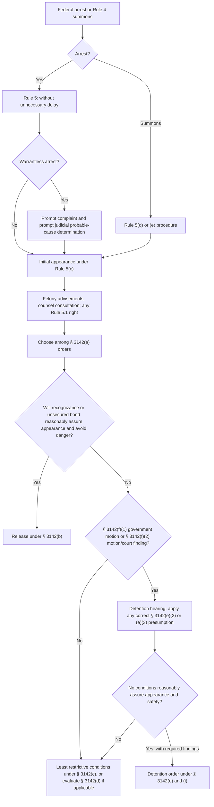

# Initial Appearance and Pretrial Release or Detention

## Verification boundary

This module replaces the legacy pretrial chart with the nationwide Rule 5, Rule 5.1, and 18 U.S.C. § 3142 framework. It separates presentment delay, warrantless-arrest probable-cause review, and confession admissibility; they are related events with different legal tests. It does not decide a particular defendant's release, a district's local practice, a circuit-specific flight burden, review under § 3145, or whether counsel must be present at a particular proceeding beyond the attachment rule decided in *Rothgery*.

## Three clocks that must not be merged

<!-- claim:CLM-PRETRIAL-001 authorities:AUTH-FRCRIM-P-5-5-1 status:verified_current -->
For an arrest within the United States, Rule 5(a)(1)(A) requires the arresting person to take the defendant without unnecessary delay before a magistrate judge, or a qualifying state or local judicial officer under Rule 5(c), unless a statute provides otherwise. The rule does not establish a 48-hour presentment threshold. [Fed. R. Crim. P. 5(a)(1)(A)](https://www.uscourts.gov/sites/default/files/2025-02/federal-rules-of-criminal-procedure-dec-1-2024.pdf)

<!-- claim:CLM-PRETRIAL-002 authorities:AUTH-SCOTUS-MCLAUGHLIN-500-US-44 status:verified_current -->
The 48-hour framework in County of Riverside v. McLaughlin concerns the Fourth Amendment requirement of a prompt judicial probable-cause determination after a warrantless arrest. A determination within 48 hours generally satisfies promptness, although an arrested person may prove unreasonable delay; after 48 hours the government must show a bona fide emergency or other extraordinary circumstance. [*County of Riverside v. McLaughlin*, 500 U.S. 44, 56–57 (1991)](https://www.govinfo.gov/content/pkg/USREPORTS-500/pdf/USREPORTS-500-44.pdf)

<!-- claim:CLM-PRETRIAL-003 authorities:AUTH-SCOTUS-CORLEY-556-US-303 status:verified_current -->
For a federal confession, 18 U.S.C. § 3501(c) supplies a six-hour safe harbor against exclusion solely for presentment delay when the confession is voluntary. If the confession falls outside that window, allowing for reasonable transportation and distance, the court applies the McNabb–Mallory inquiry into whether the delay was unnecessary or unreasonable. [*Corley v. United States*, 556 U.S. 303, 309–10, 322 (2009)](https://www.supremecourt.gov/opinions/boundvolumes/556bv.pdf)

These are not interchangeable rules: Rule 5 asks whether presentment was unnecessarily delayed; *McLaughlin* addresses prompt probable-cause review of a warrantless arrest; and *Corley* addresses whether a federal confession may be excluded because of presentment delay.

## Rule 5 initial appearance

<!-- claim:CLM-PRETRIAL-004 authorities:AUTH-FRCRIM-P-5-5-1 status:verified_current -->
After a warrantless arrest, a complaint satisfying Rule 4(a)'s probable-cause requirement must be promptly filed in the district where the offense allegedly occurred. [Fed. R. Crim. P. 5(b)](https://www.uscourts.gov/sites/default/files/2025-02/federal-rules-of-criminal-procedure-dec-1-2024.pdf)

<!-- claim:CLM-PRETRIAL-005 authorities:AUTH-FRCRIM-P-5-5-1 status:verified_current -->
Rule 5(c) determines the place and transfer procedure for the initial appearance. The ordinary location depends on whether the arrest occurred in the charging district, another district, or after extradition; the chart therefore cannot assume every arrest goes immediately before a magistrate in the charging district. [Fed. R. Crim. P. 5(c)](https://www.uscourts.gov/sites/default/files/2025-02/federal-rules-of-criminal-procedure-dec-1-2024.pdf)

<!-- claim:CLM-PRETRIAL-006 authorities:AUTH-FRCRIM-P-5-5-1 status:verified_current -->
In a felony case, Rule 5(d)(1) requires advice concerning: the complaint and any filed affidavit; retained or appointed counsel; circumstances for pretrial release; any preliminary-hearing right; the right not to make a statement and the possible use of a statement; and consular notification for a noncitizen. [Fed. R. Crim. P. 5(d)(1)](https://www.uscourts.gov/sites/default/files/2025-02/federal-rules-of-criminal-procedure-dec-1-2024.pdf)

<!-- claim:CLM-PRETRIAL-007 authorities:AUTH-FRCRIM-P-5-5-1 status:verified_current -->
The judge must allow a reasonable opportunity to consult counsel and must release or detain the defendant as statutes and rules provide. Rule 5 itself does not make Sixth Amendment attachment a statutory trigger for a detention hearing. [Fed. R. Crim. P. 5(d)(2)–(3)](https://www.uscourts.gov/sites/default/files/2025-02/federal-rules-of-criminal-procedure-dec-1-2024.pdf)

<!-- claim:CLM-PRETRIAL-008 authorities:AUTH-FRCRIM-P-5-5-1 status:verified_current -->
A preliminary hearing is conditional, not an unqualified right in every case. Rule 5.1 ordinarily requires one for a nonpetty offense, but lists exceptions including waiver, indictment, specified informations, and a consenting misdemeanor defendant; absent an extension, the outside date is 14 days after initial appearance for a defendant in custody and 21 days for a released defendant. [Fed. R. Crim. P. 5.1(a), (c)](https://www.uscourts.gov/sites/default/files/2025-02/federal-rules-of-criminal-procedure-dec-1-2024.pdf)

## Sixth Amendment attachment is a separate question

<!-- claim:CLM-PRETRIAL-009 authorities:AUTH-SCOTUS-ROTHGERY-554-US-191 status:verified_current -->
Rothgery held that an initial appearance before a judicial officer at which the defendant learns the formal accusation and liberty is restricted initiates adversary judicial proceedings and triggers attachment of the Sixth Amendment right to counsel; prosecutor awareness or participation is not required. [*Rothgery v. Gillespie County*, 554 U.S. 191, 194–95, 213 (2008)](https://www.supremecourt.gov/opinions/boundvolumes/554bv.pdf)

<!-- claim:CLM-PRETRIAL-010 authorities:AUTH-SCOTUS-ROTHGERY-554-US-191,AUTH-USC-18-3142 status:verified_current -->
Attachment and critical-stage analysis are distinct. Rothgery did not hold that attachment itself creates a § 3142 detention hearing, nor did it decide the scope of counsel's required presence at every postattachment proceeding; § 3142(f), not attachment, defines when a detention hearing is held. [*Rothgery*, 554 U.S. at 212 & nn.15–17](https://www.supremecourt.gov/opinions/boundvolumes/554bv.pdf); [18 U.S.C. § 3142(f)](https://uscode.house.gov/view.xhtml?req=%28title%3A18+section%3A3142+edition%3Aprelim%29)

## Release and detention structure

<!-- claim:CLM-PRETRIAL-011 authorities:AUTH-USC-18-3142 status:verified_current -->
Section 3142(a) supplies four possible pretrial orders: release on personal recognizance or unsecured appearance bond; release on conditions; temporary detention under subsection (d); or detention under subsection (e). [18 U.S.C. § 3142(a)](https://uscode.house.gov/view.xhtml?req=%28title%3A18+section%3A3142+edition%3Aprelim%29)

<!-- claim:CLM-PRETRIAL-012 authorities:AUTH-USC-18-3142 status:verified_current -->
Section 3142(b) makes recognizance or unsecured-bond release the starting rule unless the judicial officer determines that it will not reasonably assure appearance or will endanger another person or the community. [18 U.S.C. § 3142(b)](https://uscode.house.gov/view.xhtml?req=%28title%3A18+section%3A3142+edition%3Aprelim%29)

<!-- claim:CLM-PRETRIAL-013 authorities:AUTH-USC-18-3142 status:verified_current -->
If subsection (b) is insufficient, subsection (c) requires the least restrictive further condition or combination that will reasonably assure appearance and safety. A financial condition may not be imposed if it results in pretrial detention. [18 U.S.C. § 3142(c)(1)–(2)](https://uscode.house.gov/view.xhtml?req=%28title%3A18+section%3A3142+edition%3Aprelim%29)

## The § 3142(f) hearing gate

<!-- claim:CLM-PRETRIAL-014 authorities:AUTH-USC-18-3142 status:verified_current -->
On the government's motion, § 3142(f)(1) requires a detention hearing in a case involving: a crime of violence, § 1591 offense, or qualifying terrorism offense; an offense with a maximum of life imprisonment or death; a qualifying drug offense with a ten-year maximum; a qualifying felony after two described prior convictions; or another felony involving a minor victim, a firearm, destructive device or dangerous weapon, or § 2250 failure to register. [18 U.S.C. § 3142(f)(1)](https://uscode.house.gov/view.xhtml?req=%28title%3A18+section%3A3142+edition%3Aprelim%29)

<!-- claim:CLM-PRETRIAL-015 authorities:AUTH-USC-18-3142 status:verified_current -->
On the government's motion or the court's own motion, § 3142(f)(2) requires a hearing in a case involving a serious risk of flight or a serious risk that the person will obstruct or attempt to obstruct justice, or threaten, injure, or intimidate a prospective witness or juror. [18 U.S.C. § 3142(f)(2)](https://uscode.house.gov/view.xhtml?req=%28title%3A18+section%3A3142+edition%3Aprelim%29)

<!-- claim:CLM-PRETRIAL-016 authorities:AUTH-USC-18-3142 status:verified_current -->
A § 3142(f) category triggers a hearing, not mandatory detention. The hearing ordinarily occurs immediately at first appearance, subject to statutory continuances; the person has counsel and the specified opportunities to testify, present and cross-examine witnesses, and present information by proffer or otherwise. [18 U.S.C. § 3142(f)](https://uscode.house.gov/view.xhtml?req=%28title%3A18+section%3A3142+edition%3Aprelim%29)

## Decision, burdens, and presumptions

<!-- claim:CLM-PRETRIAL-017 authorities:AUTH-USC-18-3142 status:verified_current -->
After the subsection (f) hearing, § 3142(e)(1) requires detention only if the judicial officer finds that no condition or combination will reasonably assure the person's appearance and the safety of another person and the community. Subsection (e)(1) is the detention rule; it is not a rebuttable-presumption category. [18 U.S.C. § 3142(e)(1)](https://uscode.house.gov/view.xhtml?req=%28title%3A18+section%3A3142+edition%3Aprelim%29)

<!-- claim:CLM-PRETRIAL-018 authorities:AUTH-USC-18-3142 status:verified_current -->
The facts supporting a detention finding based on inability to reasonably assure safety must be established by clear and convincing evidence. Section 3142(f) does not state the burden of proof for a flight-based detention finding, so this nationwide module does not assign one without controlling circuit authority. [18 U.S.C. § 3142(f)](https://uscode.house.gov/view.xhtml?req=%28title%3A18+section%3A3142+edition%3Aprelim%29)

<!-- claim:CLM-PRETRIAL-019 authorities:AUTH-USC-18-3142 status:verified_current -->
Section 3142(e)(2) creates a safety-only rebuttable presumption in a subsection (f)(1) case only when the person has a described prior conviction, committed that prior offense while on pretrial release, and is within five years of the later of that conviction or release from imprisonment. It is not the ten-year-drug-offense presumption. [18 U.S.C. § 3142(e)(2)](https://uscode.house.gov/view.xhtml?req=%28title%3A18+section%3A3142+edition%3Aprelim%29)

<!-- claim:CLM-PRETRIAL-020 authorities:AUTH-USC-18-3142 status:verified_current -->
Section 3142(e)(3) creates a rebuttable presumption concerning both appearance and safety upon probable cause for the specifically listed drug, firearm, terrorism, trafficking, and minor-victim offenses. A § 924(c) offense appears in this subsection, but the complete statutory list and thresholds control. [18 U.S.C. § 3142(e)(3)](https://uscode.house.gov/view.xhtml?req=%28title%3A18+section%3A3142+edition%3Aprelim%29)

<!-- claim:CLM-PRETRIAL-021 authorities:AUTH-USC-18-3142 status:verified_current -->
Both statutory presumptions are subject to rebuttal. Their application does not itself produce an automatic detention order; the judicial officer must apply the statute's hearing, factors, and no-adequate-condition framework. The nationwide effect of rebuttal on the burdens of production and persuasion is not resolved here. [18 U.S.C. § 3142(e)–(g)](https://uscode.house.gov/view.xhtml?req=%28title%3A18+section%3A3142+edition%3Aprelim%29)

<!-- claim:CLM-PRETRIAL-022 authorities:AUTH-USC-18-3142 status:verified_current -->
The § 3142(c) conditions menu includes third-party custody and restrictions on travel, associations, intoxicants, and controlled substances, among other options; it also permits any other reasonably necessary condition. The judicial officer must select conditions under the least-restrictive rule rather than treat the legacy chart's short list as mandatory or exhaustive. [18 U.S.C. § 3142(c)(1)(B)](https://uscode.house.gov/view.xhtml?req=%28title%3A18+section%3A3142+edition%3Aprelim%29)

## Corrected decision path

## Record-first checklist

1. Identify the arrest authority, warrant status, arrest time, district of arrest, charging district, complaint and affidavit, and initial-appearance time.
2. Keep Rule 5 presentment, *McLaughlin* probable-cause timing, and *Corley* confession admissibility on separate timelines.
3. Record every Rule 5(d) advisement and the opportunity to consult counsel.
4. Determine whether Rule 5.1 requires a preliminary hearing and calculate the applicable custody or release deadline.
5. Start with § 3142(b), then test § 3142(c) and any § 3142(d) issue before reaching detention.
6. For detention, identify the exact § 3142(f) trigger, the authorized movant, any § 3142(e) presumption, the § 3142(g) evidence, and the required findings and order.
7. Research the controlling circuit and local rules for the flight burden, evidentiary practice, reopening, review under § 3145, and counsel-presence questions not decided by *Rothgery*.

## Matters not yet verified in this module

- A nationwide burden of proof for flight-based detention; § 3142 states clear and convincing evidence only for the safety finding.
- Circuit-specific operation of a rebutted presumption, permissible hearsay or proffers, reopening, and review under § 3145.
- Whether a particular initial appearance or detention hearing is a critical stage requiring counsel's presence under the Sixth Amendment.
- Any individual presentment remedy, confession ruling, probable-cause violation, release condition, detention finding, or appellate remedy.
- District-specific forms, standing orders, filing practices, and calendars.

Those applications remain open in `data/coverage_matrix.yaml`; the module verifies the corrected nationwide structure, not every pretrial subject in the project specification.
