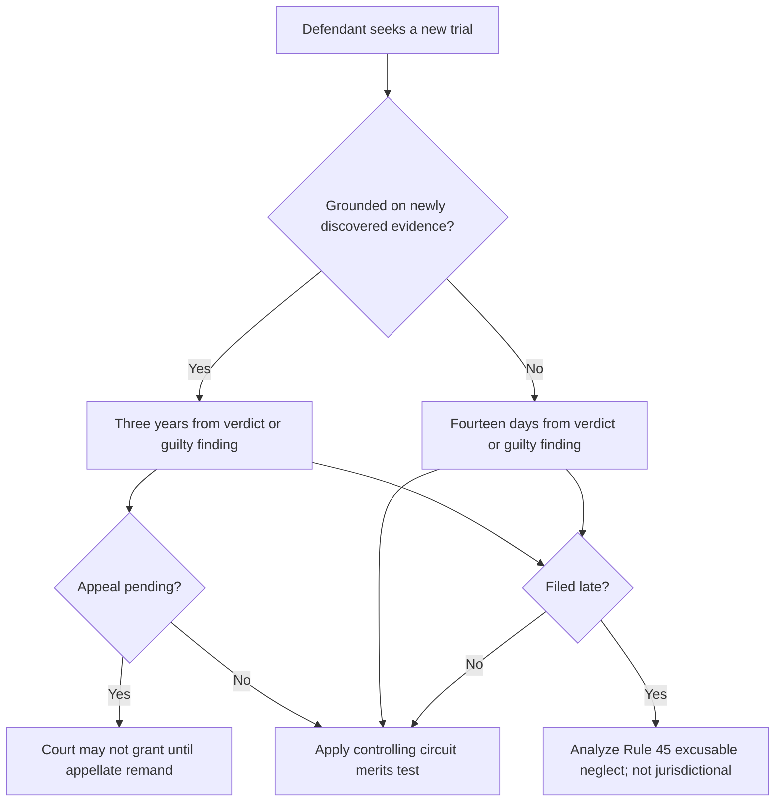

# Federal Rule of Criminal Procedure 33 — New Trial

## Verification boundary

This module verifies the nationwide structure of Rule 33: subsection (a), the two separate tracks in subsection (b), Rule 45 time computation and extension, the effect of a pending appeal stated in Rule 33(b)(1), and the Supreme Court's classification of the deadline. Circuit-specific merits tests remain open and must not be inferred from this module.

## Controlling concept and available relief

<!-- claim:CLM-R33-001 authorities:AUTH-FRCRIM-P-33 status:verified_current -->
On the defendant's motion, a district court may vacate any judgment and grant a new trial when the interest of justice requires it. [Fed. R. Crim. P. 33(a)](https://www.govinfo.gov/content/pkg/USCODE-2024-title18/pdf/USCODE-2024-title18-app.pdf)

This authorization in subsection (a) is distinct from subsection (b)'s filing rules. “Interest of justice” supplies the general remedial standard; it is not a third filing track.

<!-- claim:CLM-R33-002 authorities:AUTH-FRCRIM-P-33 status:verified_current -->
After a nonjury trial, the court may take additional testimony and enter a new judgment. [Fed. R. Crim. P. 33(a)](https://www.govinfo.gov/content/pkg/USCODE-2024-title18/pdf/USCODE-2024-title18-app.pdf)

## Who may invoke it and proper proceeding

<!-- claim:CLM-R33-011 authorities:AUTH-FRCRIM-P-1,AUTH-FRCRIM-P-33 status:verified_current -->
Rule 33 operates as a motion in the federal criminal proceeding and is decided by the district court that conducted the trial. [Fed. R. Crim. P. 1(a)(1), 33](https://www.govinfo.gov/content/pkg/USCODE-2024-title18/pdf/USCODE-2024-title18-app.pdf)

Rule 33 itself contains no administrative-exhaustion or certificate-of-appealability procedure. This observation about the rule's text does not decide whether a different remedy is available or whether another doctrine applies to the underlying issue.

<!-- claim:CLM-R33-010 authorities:AUTH-FRCRIM-P-33,AUTH-SCOTUS-US-V-SMITH-331-US-469 status:verified_current -->
A court may not use Rule 33 to order a new trial on its own initiative after the applicable motion period has expired. [United States v. Smith, 331 U.S. 469, 473–76 (1947)](https://www.govinfo.gov/content/pkg/USREPORTS-331/pdf/USREPORTS-331-469.pdf)

## Track one: newly discovered evidence

<!-- claim:CLM-R33-003 authorities:AUTH-FRCRIM-P-33 status:verified_current -->
A motion grounded on newly discovered evidence must be filed within three years after the verdict or finding of guilty. [Fed. R. Crim. P. 33(b)(1)](https://www.govinfo.gov/content/pkg/USCODE-2024-title18/pdf/USCODE-2024-title18-app.pdf)

<!-- claim:CLM-R33-004 authorities:AUTH-FRCRIM-P-33 status:verified_current -->
If an appeal is pending, the district court may not grant a newly-discovered-evidence motion until the appellate court remands the case. [Fed. R. Crim. P. 33(b)(1)](https://www.govinfo.gov/content/pkg/USCODE-2024-title18/pdf/USCODE-2024-title18-app.pdf)

The rule bars a grant while the appeal is pending; it does not say that the motion cannot be filed. Avoid calling this restriction jurisdictional. Any request for an indicative ruling or remand must also be checked against current Rules 12.1 and 37 and the controlling circuit's practice before use.

The phrase “newly discovered evidence” determines access to this track, but the rule does not define a nationwide elements test. The controlling circuit's published cases must supply the tests for diligence, cumulative or impeachment evidence, materiality, probable effect, recantation, and false-testimony theories.

## Track two: every other ground

<!-- claim:CLM-R33-005 authorities:AUTH-FRCRIM-P-33 status:verified_current -->
A Rule 33 motion based on any ground other than newly discovered evidence must be filed within fourteen days after the verdict or finding of guilty. [Fed. R. Crim. P. 33(b)(2)](https://www.govinfo.gov/content/pkg/USCODE-2024-title18/pdf/USCODE-2024-title18-app.pdf)

<!-- claim:CLM-R33-006 authorities:AUTH-FRCRIM-P-33 status:verified_current -->
Both Rule 33 filing periods run from the verdict or finding of guilty, not from sentencing, entry of judgment, or completion of an appeal. [Fed. R. Crim. P. 33(b)](https://www.govinfo.gov/content/pkg/USCODE-2024-title18/pdf/USCODE-2024-title18-app.pdf)

The legacy draft assigns categories such as trial error, jury misconduct, prosecutorial misconduct, and weight of evidence to this track. Those classifications and their merits standards remain unverified until the controlling circuit authorities are reconciled.

## Computing and extending time

<!-- claim:CLM-R33-007 authorities:AUTH-FRCRIM-P-45 status:verified_current -->
For a Rule 33 period stated in days, Rule 45 excludes the triggering day, counts every intervening day, and carries the deadline to the next non-weekend, non-holiday day when the last day falls on a Saturday, Sunday, or legal holiday. [Fed. R. Crim. P. 45(a)(1)](https://www.govinfo.gov/content/pkg/USCODE-2024-title18/pdf/USCODE-2024-title18-app.pdf)

<!-- claim:CLM-R33-008 authorities:AUTH-FRCRIM-P-45 status:verified_current -->
Rule 45(b)(1) permits an extension on a timely motion for good cause and permits a post-deadline extension when the failure to act resulted from excusable neglect; Rule 45(b)(2)'s current exception applies to Rule 35, not Rule 33. [Fed. R. Crim. P. 45(b)](https://www.govinfo.gov/content/pkg/USCODE-2024-title18/pdf/USCODE-2024-title18-app.pdf)

The legacy draft's categorical “barred” label is therefore removed. Whether a late filing can proceed depends on a supported excusable-neglect determination under current Rule 45 and controlling precedent. Local filing rules and court orders still require separate review.

<!-- claim:CLM-R33-009 authorities:AUTH-SCOTUS-EBERHART-546-US-12 status:verified_current -->
Rule 33's filing deadline is a nonjurisdictional claim-processing rule: a properly raised timeliness objection must be enforced, but the objection can be forfeited. [Eberhart v. United States, 546 U.S. 12, 13, 15–19 (2005) (per curiam)](https://www.govinfo.gov/content/pkg/USREPORTS-546/pdf/USREPORTS-546-12.pdf)

Eberhart used the former numerical deadline and former Rule 45 text. Cite the case for the jurisdiction/forfeiture classification, but cite the current rules for filing periods and extensions.

## Procedural checklist

1. Record the exact verdict or guilty-finding date and obtain the docket entry.
2. Identify the actual ground for relief before selecting the three-year or fourteen-day track.
3. Compute the period under Rule 45 and check local electronic-filing rules, holidays, and any inaccessibility order.
4. If late, develop the excusable-neglect record rather than treating lateness as a jurisdictional defect.
5. If an appeal is pending and the ground is newly discovered evidence, distinguish filing from granting and research the circuit's indicative-ruling/remand procedure.
6. Research the controlling circuit's current published merits test for the precise ground.
7. Preserve the evidence, discovery chronology, diligence proof, trial record, and requested relief.

## Decision path

## Matters not yet verified in this module

- Circuit-specific newly-discovered-evidence and recantation tests.
- Standards for weight-of-evidence, trial-error, and misconduct grounds.
- Hearing and counsel standards.
- Appellate review and government-appeal rules.
- Interaction with a notice of appeal, Rule 37, Appellate Rule 12.1, and collateral-review finality in specific procedural postures.
- Eleventh Circuit application and district local rules.

Those matters remain `not_started` or `researching` in `data/coverage_matrix.yaml`; this module does not claim they are complete.
