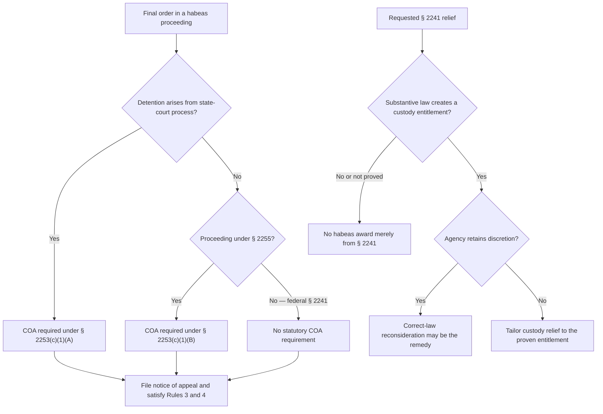

# 28 U.S.C. § 2241 — Appeal, Certificate of Appealability, and Relief

## Verification boundary

This module verifies the nationwide statutory COA classification and the basic remedial boundary for a final § 2241 order. It does not decide whether a petition satisfies § 2255(e), whether an execution claim is cognizable, whether administrative remedies were exhausted, or whether venue, respondent, custody, transfer, mootness, or a particular requested remedy is proper in a specific circuit and record.

## Start with the source of the detention

<!-- claim:CLM-2241-001 authorities:AUTH-USC-28-2253 status:verified_current -->
Section 2253(a) makes a final order in a district-court habeas proceeding subject to review in the court of appeals for that circuit. [28 U.S.C. § 2253(a)](https://uscode.house.gov/view.xhtml?edition=prelim&num=0&req=granuleid%3AUSC-prelim-title28-section2253)

<!-- claim:CLM-2241-002 authorities:AUTH-USC-28-2253 status:verified_current -->
Section 2253(c)(1) requires a certificate of appealability only for a final habeas order in which the detention complained of arises from process issued by a state court, or for a final order in a § 2255 proceeding. [28 U.S.C. § 2253(c)(1)](https://uscode.house.gov/view.xhtml?edition=prelim&num=0&req=granuleid%3AUSC-prelim-title28-section2253)

The filing label alone does not answer the COA question. Identify the process from which the complained-of detention arises.

<!-- claim:CLM-2241-003 authorities:AUTH-USC-28-2253 status:verified_current -->
A federal-process § 2241 appeal that is not a § 2255 proceeding falls outside both categories in § 2253(c)(1), so § 2253 does not require a COA for that appeal. [28 U.S.C. § 2253(c)(1)](https://uscode.house.gov/view.xhtml?edition=prelim&num=0&req=granuleid%3AUSC-prelim-title28-section2253)

<!-- claim:CLM-2241-004 authorities:AUTH-USC-28-2253,AUTH-CA3-BRUCE-868-F3D-170 status:verified_current -->
The same classification applies when a federal prisoner invokes § 2255(e)'s saving clause: the character of the underlying challenge does not convert the § 2241 proceeding into a § 2255 proceeding for § 2253(c). In *Bruce v. Warden Lewisburg USP*, a precedential saving-clause appeal, the Third Circuit held that § 2253(c)'s COA requirements do not apply to an appeal from denial of a § 2241 petition. [*Bruce v. Warden Lewisburg USP*, 868 F.3d 170, 177 n.3 (3d Cir. 2017)](https://www2.ca3.uscourts.gov/opinarch/144284p.pdf)

<!-- claim:CLM-2241-005 authorities:AUTH-USC-28-2253 status:verified_current -->
When the detention complained of arises from state-court process, § 2253(c)(1)(A) requires a COA to appeal the final habeas order even if the petition was filed under § 2241. [28 U.S.C. § 2253(c)(1)(A)](https://uscode.house.gov/view.xhtml?edition=prelim&num=0&req=granuleid%3AUSC-prelim-title28-section2253)

## Appellate Rule 22 does not change the statutory categories

<!-- claim:CLM-2241-006 authorities:AUTH-FRAP-3-4-22 status:verified_current -->
Appellate Rule 22(b)(1) tracks § 2253(c): it requires a COA for state-process habeas and § 2255 proceedings. Rule 22(b)(3) separately says that a state, the United States, or their representative does not need a COA when that government actor appeals; subsection (b)(3) is not the source of the no-COA rule for a federal prisoner's § 2241 appeal. [Fed. R. App. P. 22(b)](https://www.uscourts.gov/sites/default/files/document/federal-rules-of-appellate-procedure.pdf)

<!-- claim:CLM-2241-007 authorities:AUTH-FRAP-3-4-22 status:verified_current -->
The absence of a COA requirement does not perfect an appeal. Rule 3 requires a notice of appeal filed with the district clerk, and Rule 4(a)(1) supplies a thirty-day default and a sixty-day period when a listed United States party, officer, or employee is a party; the actual parties and posture must be checked before calendaring. [Fed. R. App. P. 3(a)(1), 4(a)(1)](https://www.uscourts.gov/sites/default/files/document/federal-rules-of-appellate-procedure.pdf)

## The remedy must answer unlawful custody

<!-- claim:CLM-2241-008 authorities:AUTH-USC-28-2241,AUTH-USC-28-2243 status:verified_current -->
Section 2241(c)(3) extends the writ to custody that violates the Constitution, laws, or treaties of the United States, and § 2243 directs the court to dispose of the matter as law and justice require. Sections 2241(c)(3) and 2243 authorize custody-focused habeas relief; they do not independently create a substantive entitlement to credits, release, placement, or another benefit. [28 U.S.C. § 2241(c)(3)](https://uscode.house.gov/view.xhtml?edition=prelim&req=granuleid%3AUSC-prelim-title28-section2241); [28 U.S.C. § 2243](https://uscode.house.gov/view.xhtml?edition=prelim&req=granuleid%3AUSC-prelim-title28-part6)

<!-- claim:CLM-2241-009 authorities:AUTH-SCOTUS-PREISER-411-US-475 status:verified_current -->
For a state prisoner challenging the fact or duration of physical confinement and seeking immediate or speedier release, Preiser v. Rodriguez identifies habeas—not § 1983—as the sole federal remedy. [*Preiser v. Rodriguez*, 411 U.S. 475, 489–500 (1973)](https://www.govinfo.gov/content/pkg/USREPORTS-411/pdf/USREPORTS-411-475.pdf)

<!-- claim:CLM-2241-010 authorities:AUTH-SCOTUS-WILKINSON-544-US-74 status:verified_current -->
For state-prisoner § 1983 claims, Wilkinson v. Dotson holds that a procedural challenge lies outside habeas's core when success would not necessarily spell immediate or speedier release, as where success produces only a new discretionary parole review. That § 1983 holding does not itself establish a damages or injunctive cause of action against federal actors. [*Wilkinson v. Dotson*, 544 U.S. 74, 81–82 (2005)](https://www.govinfo.gov/content/pkg/USREPORTS-544/pdf/USREPORTS-544-74.pdf)

<!-- claim:CLM-2241-011 authorities:AUTH-USC-28-2243,AUTH-USC-28-2255 status:verified_current -->
Section 2255(b) expressly authorizes the sentencing court to vacate and set aside the judgment and then discharge, resentence, grant a new trial, or correct the sentence. Section 2243 instead uses the instruction to dispose of the habeas matter as law and justice require. A successful saving-clause § 2241 petition therefore should not be described automatically as “functioning like” § 2255 with the same remedial menu; the particular relief requires claim-specific and controlling-circuit authority. [28 U.S.C. §§ 2243, 2255(b)](https://uscode.house.gov/view.xhtml?req=%28title%3A28+section%3A2255+edition%3Aprelim%29)

<!-- claim:CLM-2241-012 authorities:AUTH-CA9-RODRIGUEZ-COPENHAVER-823-F3D-1238 status:verified_current -->
When the Bureau retains statutory discretion but used an unlawful decision process, the habeas remedy may be lawful reconsideration rather than an order awarding the discretionary placement. In Rodriguez v. Copenhaver, the Ninth Circuit directed the Bureau to reconsider a nunc pro tunc designation request without relying on the improper letter; it did not order the designation itself. [*Rodriguez v. Copenhaver*, 823 F.3d 1238, 1243 (9th Cir. 2016)](https://cdn.ca9.uscourts.gov/datastore/opinions/2016/05/25/14-16399.pdf)

<!-- claim:CLM-2241-013 authorities:AUTH-USC-28-2241,AUTH-USC-28-2243,AUTH-CA9-RODRIGUEZ-COPENHAVER-823-F3D-1238 status:verified_current -->
The available execution-of-sentence remedy consequently depends on the underlying statute, the proven entitlement, and whether the decisionmaker retains discretion. Recalculation, restoration, release, or reconsideration cannot be promised as interchangeable outcomes merely because the pleading invokes § 2241. [28 U.S.C. §§ 2241(c)(3), 2243](https://uscode.house.gov/view.xhtml?edition=prelim&req=granuleid%3AUSC-prelim-title28-part6); [*Rodriguez*, 823 F.3d at 1243](https://cdn.ca9.uscourts.gov/datastore/opinions/2016/05/25/14-16399.pdf)

## Decision path

## Matters not yet verified in this module

- Saving-clause availability after *Jones v. Hendrix* for any particular claim.
- Circuit-specific cognizability, exhaustion, waiver, standard of review, and remedy rules.
- Immediate-custodian, district-of-confinement, substitution, transfer, and dismissal mechanics.
- Mootness after transfer, release, recalculation, or other changed circumstances.
- A particular notice-of-appeal deadline, postjudgment motion interaction, stay, release pending appeal, or local appellate rule.
- Entitlement to a specific credit calculation, placement, designation, disciplinary restoration, prerelease transfer, supervised-release transfer, vacatur, or release.

Those items remain open in `data/coverage_matrix.yaml`; this bounded correction does not validate the legacy § 2241 framework as a whole.
