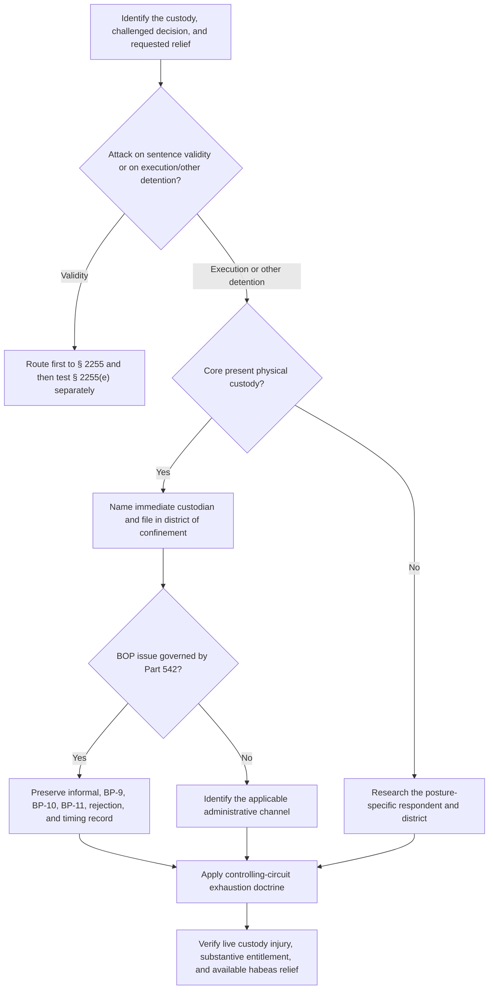

# 28 U.S.C. § 2241 — Filing, Custodian, District, and Administrative Exhaustion

## Verification boundary

This module verifies the nationwide statutory filing rules, the Supreme Court's default rule for a core challenge to present physical custody, and the current text of the Bureau of Prisons Administrative Remedy Program. Exhaustion doctrine, waiver and excuse, the consequence of a defect, transfer, substitution, execution-claim cognizability, and the merits remain circuit- and record-specific where stated.

## Start with the statute and the custody posture

<!-- claim:CLM-2241F-001 authorities:AUTH-USC-28-2241 status:verified_current -->
Section 2241(a) authorizes the Supreme Court, its Justices, district courts, and circuit judges to grant writs of habeas corpus “within their respective jurisdictions”; the quoted limitation is central to identifying the court that can act on the custodian. [28 U.S.C. § 2241(a)](https://uscode.house.gov/view.xhtml?edition=prelim&req=granuleid%3AUSC-prelim-title28-section2241)

<!-- claim:CLM-2241F-002 authorities:AUTH-USC-28-2241 status:verified_current -->
Section 2241(b) permits the Supreme Court, a Justice, or a circuit judge to decline an application and transfer it to the district court having jurisdiction; it does not supply a general transfer rule for every district-court filing defect. [28 U.S.C. § 2241(b)](https://uscode.house.gov/view.xhtml?edition=prelim&req=granuleid%3AUSC-prelim-title28-section2241)

<!-- claim:CLM-2241F-003 authorities:AUTH-USC-28-2241 status:verified_current -->
Section 2241(c) lists five custody categories, including custody under or by color of United States authority, commitment for trial before a federal court, and custody violating the Constitution or federal law or treaties. A federal post-conviction petition must fit the statutory text; the existence of federal custody alone does not establish that a particular execution claim is cognizable or meritorious. [28 U.S.C. § 2241(c)](https://uscode.house.gov/view.xhtml?edition=prelim&req=granuleid%3AUSC-prelim-title28-section2241)

<!-- claim:CLM-2241F-004 authorities:AUTH-USC-28-2241 status:verified_current -->
Section 2241(d) creates concurrent filing districts and a discretionary transfer rule for a person in custody under a state-court judgment in a State containing multiple federal judicial districts. It is not the source of the ordinary federal-prisoner district-of-confinement rule. [28 U.S.C. § 2241(d)](https://uscode.house.gov/view.xhtml?edition=prelim&req=granuleid%3AUSC-prelim-title28-section2241)

<!-- claim:CLM-2241F-005 authorities:AUTH-USC-28-2241 status:verified_current -->
Section 2241(e) addresses specified alien enemy-combatant detention and transfer decisions. Its specialized text should not be treated as a general limitation on an ordinary federal sentence-execution petition, and constitutional applications outside this module require their own authority. [28 U.S.C. § 2241(e)](https://uscode.house.gov/view.xhtml?edition=prelim&req=granuleid%3AUSC-prelim-title28-section2241)

## The application and local filing package

<!-- claim:CLM-2241F-006 authorities:AUTH-USC-28-2242 status:verified_current -->
Section 2242 requires a written application signed and verified by the person seeking relief or someone acting on that person's behalf; it must allege the facts concerning detention, identify by whom the person is detained, and, if known, state the custodian's authority. [28 U.S.C. § 2242](https://uscode.house.gov/view.xhtml?edition=prelim&req=granuleid%3AUSC-prelim-title28-section2242)

<!-- claim:CLM-2241F-007 authorities:AUTH-USC-28-2242 status:verified_current -->
Section 2242 permits amendment or supplementation as provided in the rules of procedure applicable to civil actions, but that permission does not resolve relation back, exhaustion, respondent, transfer, successive-application, or local-rule questions. [28 U.S.C. § 2242](https://uscode.house.gov/view.xhtml?edition=prelim&req=granuleid%3AUSC-prelim-title28-section2242)

<!-- claim:CLM-2241F-008 authorities:AUTH-AO-242,AUTH-USC-28-2242 status:verified_current -->
AO 242 is the federal judiciary's national petition form for § 2241 and asks for the conviction or detention information, grounds, facts, administrative-remedy history, requested relief, and a declaration under penalty of perjury. The filing district's current local rules and form instructions still control the required package. [AO 242](https://www.uscourts.gov/forms-rules/forms/petition-a-writ-habeas-corpus-under-28-usc-ss-2241); [28 U.S.C. § 2242](https://uscode.house.gov/view.xhtml?edition=prelim&req=granuleid%3AUSC-prelim-title28-section2242)

<!-- claim:CLM-2241F-009 authorities:AUTH-USC-28-1914 status:verified_current -->
Section 1914(a) sets a five-dollar filing fee for an application for a writ of habeas corpus. Whether prepayment is excused and which financial declaration or trust-account materials are required must be checked under the filing court's current procedures. [28 U.S.C. § 1914(a)](https://uscode.house.gov/view.xhtml?req=%28title%3A28+section%3A1914+edition%3Aprelim%29)

<!-- claim:CLM-2241F-010 authorities:AUTH-RG-2254-1-12 status:verified_current -->
Rule 1(b) of the Rules Governing § 2254 Cases permits a district court to apply any or all of those rules to a habeas petition not covered by Rule 1(a). Their application to a § 2241 case is therefore authorized but not automatically identical in every court. [Rule 1(b), Rules Governing § 2254 Cases](https://www.uscourts.gov/sites/default/files/rules_governing_section_2254_and_2255_cases_in_the_u.s._district_courts_-_dec_1_2019.pdf)

## Core physical custody: respondent and district

<!-- claim:CLM-2241F-011 authorities:AUTH-SCOTUS-RUMSFELD-PADILLA-542-US-426 status:verified_current -->
For a core challenge to present physical custody in the United States, *Rumsfeld v. Padilla* makes the default proper respondent the immediate custodian—ordinarily the warden of the facility—not the Attorney General or another remote supervisory official. [*Rumsfeld v. Padilla*, 542 U.S. 426, 434–36 (2004)](https://www.govinfo.gov/content/pkg/USREPORTS-542/pdf/USREPORTS-542-426.pdf)

<!-- claim:CLM-2241F-012 authorities:AUTH-SCOTUS-RUMSFELD-PADILLA-542-US-426 status:verified_current -->
For that same core present-physical-custody petition, the court issuing the writ must have jurisdiction over the immediate custodian; the default filing location is therefore the district of confinement. [*Padilla*, 542 U.S. at 442–47](https://www.govinfo.gov/content/pkg/USREPORTS-542/pdf/USREPORTS-542-426.pdf)

<!-- claim:CLM-2241F-013 authorities:AUTH-SCOTUS-RUMSFELD-PADILLA-542-US-426 status:verified_current -->
*Padilla* expressly distinguished the habeas statute's immediate-custodian and territorial rules from federal subject-matter jurisdiction. A defect should not be labeled a lack of subject-matter jurisdiction without controlling authority for that characterization and posture. [*Padilla*, 542 U.S. at 434 n.7](https://www.govinfo.gov/content/pkg/USREPORTS-542/pdf/USREPORTS-542-426.pdf)

<!-- claim:CLM-2241F-014 authorities:AUTH-SCOTUS-BRADEN-410-US-484,AUTH-SCOTUS-RUMSFELD-PADILLA-542-US-426 status:verified_current -->
*Braden v. 30th Judicial Circuit Court* permitted an Alabama prisoner challenging a Kentucky detainer to proceed in Kentucky because the writ acted on the Kentucky custodian responsible for the future custody. *Padilla* treats *Braden* as a non-core-custody case, not an exception that permits every physically confined prisoner to sue a remote official. [*Braden*, 410 U.S. 484, 494–500 (1973)](https://www.govinfo.gov/content/pkg/USREPORTS-410/pdf/USREPORTS-410-484.pdf); [*Padilla*, 542 U.S. at 438–39](https://www.govinfo.gov/content/pkg/USREPORTS-542/pdf/USREPORTS-542-426.pdf)

<!-- claim:CLM-2241F-015 authorities:AUTH-SCOTUS-RUMSFELD-PADILLA-542-US-426,AUTH-SCOTUS-BRADEN-410-US-484 status:verified_current -->
The immediate-custodian and district-of-confinement rules are defaults for core present physical custody, not universal answers for detainers, future custody, military detention, immigration detention, prisoners held abroad, or a person not physically confined. Identify the custody being challenged before choosing the respondent and district. [*Padilla*, 542 U.S. at 435–40 & nn.8–9](https://www.govinfo.gov/content/pkg/USREPORTS-542/pdf/USREPORTS-542-426.pdf); [*Braden*, 410 U.S. at 494–500](https://www.govinfo.gov/content/pkg/USREPORTS-410/pdf/USREPORTS-410-484.pdf)

<!-- claim:CLM-2241F-016 authorities:AUTH-SCOTUS-EX-PARTE-ENDO-323-US-283 status:verified_current -->
When habeas jurisdiction was properly acquired at filing, a later physical transfer did not defeat it in *Ex parte Endo* because a respondent within the original district remained able to effect release. That holding does not decide every modern substitution, personal-jurisdiction, transfer, or remedy question. [*Ex parte Endo*, 323 U.S. 283, 304–07 (1944)](https://www.govinfo.gov/content/pkg/USREPORTS-323/pdf/USREPORTS-323-283.pdf)

<!-- claim:CLM-2241F-017 authorities:AUTH-SCOTUS-RUMSFELD-PADILLA-542-US-426,AUTH-SCOTUS-EX-PARTE-ENDO-323-US-283 status:verified_current -->
Record the institution, named custodian, and district on the filing date and notify the court of a later transfer. Whether the original court retains the case, substitutes a respondent, transfers it, or dismisses it requires the actual custody chain and controlling circuit procedure; neither *Padilla* nor *Endo* creates a universal automatic outcome. [*Padilla*, 542 U.S. at 441](https://www.govinfo.gov/content/pkg/USREPORTS-542/pdf/USREPORTS-542-426.pdf); [*Endo*, 323 U.S. at 304–07](https://www.govinfo.gov/content/pkg/USREPORTS-323/pdf/USREPORTS-323-283.pdf)

## Classify the claim before using the filing rule

<!-- claim:CLM-2241F-018 authorities:AUTH-USC-28-2241,AUTH-SCOTUS-JONES-HENDRIX-599-US-465 status:verified_current -->
Section 2241 remains the ordinary habeas vehicle for challenges to detention other than a federal prisoner's collateral attack on the validity of the sentence, including qualifying claims about how a sentence is carried out. A federal collateral attack on the sentence ordinarily belongs under § 2255 and cannot be relabeled an “execution” claim to avoid that statute. [*Jones v. Hendrix*, 599 U.S. 465, 473–78 (2023)](https://www.supremecourt.gov/opinions/22pdf/599us1r42_3314.pdf); [28 U.S.C. § 2241(c)](https://uscode.house.gov/view.xhtml?edition=prelim&req=granuleid%3AUSC-prelim-title28-section2241)

<!-- claim:CLM-2241F-019 authorities:AUTH-USC-28-2241,AUTH-SCOTUS-JONES-HENDRIX-599-US-465 status:verified_current -->
Classification turns on the substance of the challenged custody and requested relief, not the caption. Sentence computation, credit application, disciplinary loss of time, designation, placement, and prerelease disputes can present execution issues, but each still requires a federal custody injury, a cognizable substantive rule, exhaustion analysis, and an available habeas remedy. [*Jones*, 599 U.S. at 475–78](https://www.supremecourt.gov/opinions/22pdf/599us1r42_3314.pdf); [28 U.S.C. § 2241(c)(3)](https://uscode.house.gov/view.xhtml?edition=prelim&req=granuleid%3AUSC-prelim-title28-section2241)

<!-- claim:CLM-2241F-020 authorities:AUTH-USC-28-2241 status:verified_current -->
Section 2241 contains no one-year limitations period comparable to § 2255(f) or § 2244(d). That statutory absence should be stated narrowly; it does not establish that every delayed § 2241 claim remains live or timely under every underlying statute, equitable doctrine, administrative deadline, or circuit rule. [28 U.S.C. § 2241](https://uscode.house.gov/view.xhtml?edition=prelim&req=granuleid%3AUSC-prelim-title28-section2241)

<!-- claim:CLM-2241F-021 authorities:AUTH-USC-28-2241,AUTH-CFR-28-542 status:verified_current -->
Neither § 2241 nor 28 C.F.R. Part 542 states a nationwide judicial exhaustion prerequisite for a federal prisoner's § 2241 petition. Courts apply exhaustion doctrine through controlling precedent, so its characterization, waiver, excuse, and consequence must be verified in the governing circuit rather than inferred from the administrative regulation alone. [28 U.S.C. § 2241](https://uscode.house.gov/view.xhtml?edition=prelim&req=granuleid%3AUSC-prelim-title28-section2241); [28 C.F.R. pt. 542, subpt. B](https://www.ecfr.gov/current/title-28/chapter-V/subchapter-C/part-542/subpart-B)

<!-- claim:CLM-2241F-022 authorities:AUTH-CA9-WARD-678-F3D-1042 status:verified_current -->
As a bounded circuit example, the Ninth Circuit in *Ward v. Chavez* described § 2241 exhaustion as prudential rather than jurisdictional and subject to waiver when pursuing administrative remedies would be futile. That Ninth Circuit holding is not a nationwide permission to bypass the BOP process. [*Ward v. Chavez*, 678 F.3d 1042, 1045 (9th Cir. 2012)](https://cdn.ca9.uscourts.gov/datastore/opinions/2012/05/08/09-17016.pdf)

<!-- claim:CLM-2241F-023 authorities:AUTH-CA9-WARD-678-F3D-1042,AUTH-CFR-28-542 status:verified_current -->
Before filing, check the controlling circuit's current exhaustion rule and any claim-specific statutory exhaustion provision. If excuse or waiver is asserted, prove the concrete facts supporting the circuit's test; inconvenience, an expected adverse result, or an incomplete record should not be converted into a presumed nationwide exception. [*Ward*, 678 F.3d at 1045–46](https://cdn.ca9.uscourts.gov/datastore/opinions/2012/05/08/09-17016.pdf); [28 C.F.R. pt. 542, subpt. B](https://www.ecfr.gov/current/title-28/chapter-V/subchapter-C/part-542/subpart-B)

## Current BOP Administrative Remedy Program

<!-- claim:CLM-2241F-024 authorities:AUTH-CFR-28-542 status:verified_current -->
Except for the regulatory exceptions, § 542.13 requires an inmate first to present the issue informally to staff. CCC inmates need not attempt informal resolution, and the regulation permits specified bypasses or discretionary waiver. [28 C.F.R. § 542.13](https://www.ecfr.gov/current/title-28/chapter-V/subchapter-C/part-542/subpart-B/section-542.13)

<!-- claim:CLM-2241F-025 authorities:AUTH-CFR-28-542 status:verified_current -->
Section 542.14(a) sets a 20-calendar-day period, measured from the date on which the basis for the request occurred, to complete informal resolution and submit the BP-9; subsection (b) permits an extension when the inmate demonstrates a valid reason for delay. [28 C.F.R. § 542.14(a)–(b)](https://www.ecfr.gov/current/title-28/chapter-V/subchapter-C/part-542/subpart-B/section-542.14)

<!-- claim:CLM-2241F-026 authorities:AUTH-CFR-28-542 status:verified_current -->
Section 542.14(d) supplies special initial-filing routes for sensitive issues, DHO appeals, Control Unit and controlled-housing-status appeals, and certain decisions not originating with the Warden. The correct initial office therefore depends on the decision being challenged. [28 C.F.R. § 542.14(d)](https://www.ecfr.gov/current/title-28/chapter-V/subchapter-C/part-542/subpart-B/section-542.14)

<!-- claim:CLM-2241F-027 authorities:AUTH-CFR-28-542 status:verified_current -->
Under § 542.15(a), a dissatisfied inmate generally files a BP-10 with the Regional Director within 20 calendar days after the Warden signed the response, then a BP-11 with General Counsel within 30 calendar days after the Regional Director signed the response; General Counsel is the final administrative appeal, and valid-delay extensions may be allowed. [28 C.F.R. § 542.15(a)](https://www.ecfr.gov/current/title-28/chapter-V/subchapter-C/part-542/subpart-B/section-542.15)

<!-- claim:CLM-2241F-028 authorities:AUTH-CFR-28-542 status:verified_current -->
An administrative appeal must state the reason for appeal, include the required prior filings and responses, and may not raise an issue omitted below. Preserve the submission, exhibits, receipt, rejection notice, response, envelope or transmission proof, remedy number, and every operative date. [28 C.F.R. § 542.15(b)](https://www.ecfr.gov/current/title-28/chapter-V/subchapter-C/part-542/subpart-B/section-542.15)

<!-- claim:CLM-2241F-029 authorities:AUTH-CFR-28-542 status:verified_current -->
Section 542.17 requires a written rejection notice explaining the defect; if the defect is correctable, the notice must provide a reasonable period to cure. A rejection without an opportunity to cure may be appealed to the next level under subsection (c). [28 C.F.R. § 542.17](https://www.ecfr.gov/current/title-28/chapter-V/subchapter-C/part-542/subpart-B/section-542.17)

<!-- claim:CLM-2241F-030 authorities:AUTH-CFR-28-542 status:verified_current -->
For an accepted filing, § 542.18 sets response periods of 20 calendar days for the Warden or CCM, 30 for the Regional Director, and 40 for General Counsel, with one written extension of 20, 30, and 20 days respectively; an emergency threatening immediate health or welfare has a three-calendar-day Warden response rule. [28 C.F.R. § 542.18](https://www.ecfr.gov/current/title-28/chapter-V/subchapter-C/part-542/subpart-B/section-542.18)

<!-- claim:CLM-2241F-031 authorities:AUTH-CFR-28-542 status:verified_current -->
If no response arrives within the allotted period, including a notified extension, § 542.18 permits the inmate to treat the absence as a denial at that level. Confirm that the submission was accepted and calculate the actual response period before relying on silence. [28 C.F.R. § 542.18](https://www.ecfr.gov/current/title-28/chapter-V/subchapter-C/part-542/subpart-B/section-542.18)

<!-- claim:CLM-2241F-032 authorities:AUTH-CFR-28-542,AUTH-CA9-WARD-678-F3D-1042 status:verified_current -->
Completing the regulatory chain does not itself prove judicial exhaustion of a materially different claim. Compare the same operative issue and requested correction across each administrative level and the petition, then apply the controlling circuit's rules on fair presentation, procedural default, waiver, and excuse. [28 C.F.R. §§ 542.14(c), 542.15(b)](https://www.ecfr.gov/current/title-28/chapter-V/subchapter-C/part-542/subpart-B); [*Ward*, 678 F.3d at 1045–46](https://cdn.ca9.uscourts.gov/datastore/opinions/2012/05/08/09-17016.pdf)

<!-- claim:CLM-2241F-033 authorities:AUTH-USC-28-2241,AUTH-SCOTUS-JONES-HENDRIX-599-US-465 status:verified_current -->
Pretrial, immigration, military, state-process, and other non-federal-post-conviction uses of § 2241 have different custody, statutory-channel, exhaustion, abstention, respondent, and remedy questions. This federal sentence-execution map must not be applied to those postures without independent authority. [28 U.S.C. § 2241](https://uscode.house.gov/view.xhtml?edition=prelim&req=granuleid%3AUSC-prelim-title28-section2241); [*Jones*, 599 U.S. at 474–78](https://www.supremecourt.gov/opinions/22pdf/599us1r42_3314.pdf)

<!-- claim:CLM-2241F-034 authorities:AUTH-USC-28-2241,AUTH-CFR-28-542,AUTH-SCOTUS-RUMSFELD-PADILLA-542-US-426 status:verified_current -->
A filing-ready review therefore requires the present custody and challenged decision, execution-versus-validity classification, correct respondent and district at filing, current local form and fee rules, a complete administrative record or a supported circuit-law basis for noncompletion, a live redressable injury, and claim-specific substantive authority. No single label or checklist item substitutes for those separate findings. [28 U.S.C. § 2241](https://uscode.house.gov/view.xhtml?edition=prelim&req=granuleid%3AUSC-prelim-title28-section2241); [*Padilla*, 542 U.S. at 434–47](https://www.govinfo.gov/content/pkg/USREPORTS-542/pdf/USREPORTS-542-426.pdf); [28 C.F.R. pt. 542, subpt. B](https://www.ecfr.gov/current/title-28/chapter-V/subchapter-C/part-542/subpart-B)

## Decision path

## Matters requiring record- and circuit-specific verification

- The actual institution, custodian, district, transfer history, and local form package.
- Whether a non-core custody exception applies.
- Whether a respondent or territorial defect results in substitution, transfer, or dismissal.
- Whether the particular claim is an execution claim and is cognizable in habeas.
- The governing circuit's exhaustion characterization, excuse, waiver, default, and remedy rules.
- Any claim-specific administrative path outside 28 C.F.R. Part 542.
- The underlying merits, standard of review, redressability, and relief.

