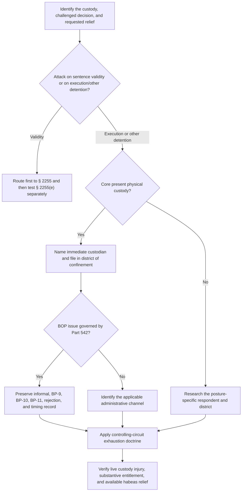

# 28 U.S.C. § 2241 — Filing, Custodian, District, and Administrative Exhaustion

## Verification boundary

This module verifies the nationwide statutory filing rules, the Supreme Court's default rule for a core challenge to present physical custody, and the current text of the Bureau of Prisons Administrative Remedy Program. Exhaustion doctrine, waiver and excuse, the consequence of a defect, transfer, substitution, execution-claim cognizability, and the merits remain circuit- and record-specific where stated.

## Start with the statute and the custody posture

<!-- claim:CLM-2241F-001 authorities:AUTH-USC-28-2241 status:verified_current -->
Section 2241(a) authorizes the Supreme Court, its Justices, district courts, and circuit judges to grant writs of habeas corpus “within their respective jurisdictions”; the quoted limitation is central to identifying the court that can act on the custodian. [28 U.S.C. § 2241(a)](https://www.govinfo.gov/link/uscode/28/2241)

<!-- claim:CLM-2241F-002 authorities:AUTH-USC-28-2241 status:verified_current -->
Section 2241(b) permits the Supreme Court, a Justice, or a circuit judge to decline an application and transfer it to the district court having jurisdiction; it does not supply a general transfer rule for every district-court filing defect. [28 U.S.C. § 2241(b)](https://www.govinfo.gov/link/uscode/28/2241)

<!-- claim:CLM-2241F-003 authorities:AUTH-USC-28-2241 status:verified_current -->
Section 2241(c) lists five custody categories, including custody under or by color of United States authority, commitment for trial before a federal court, and custody violating the Constitution or federal law or treaties. A federal post-conviction petition must fit the statutory text; the existence of federal custody alone does not establish that a particular execution claim is cognizable or meritorious. [28 U.S.C. § 2241(c)](https://www.govinfo.gov/link/uscode/28/2241)

<!-- claim:CLM-2241F-004 authorities:AUTH-USC-28-2241 status:verified_current -->
Section 2241(d) creates concurrent filing districts and a discretionary transfer rule for a person in custody under a state-court judgment in a State containing multiple federal judicial districts. It is not the source of the ordinary federal-prisoner district-of-confinement rule. [28 U.S.C. § 2241(d)](https://www.govinfo.gov/link/uscode/28/2241)

<!-- claim:CLM-2241F-005 authorities:AUTH-USC-28-2241 status:verified_current -->
Section 2241(e) withdraws court jurisdiction over a habeas application filed by or on behalf of an alien detained by the United States who has been determined by the United States to have been properly detained as an enemy combatant or is awaiting that determination, and, except as provided in section 1005(e)(2)–(3) of the Detainee Treatment Act of 2005, over any other action against the United States or its agents relating to any aspect of the detention, transfer, treatment, trial, or conditions of confinement of such an alien who is or was detained; the Code's constitutionality note refers readers to the Table of Laws Held Unconstitutional in Whole or in Part by the Supreme Court, on the Constitution Annotated website, for certain provisions of this section as added and amended by Pub. L. 109-148 and Pub. L. 109-366. Its specialized text should not be treated as a general limitation on an ordinary federal sentence-execution petition, and constitutional applications outside this module require their own authority. [28 U.S.C. § 2241(e) & Constitutionality note](https://www.govinfo.gov/link/uscode/28/2241)

## The application and local filing package

<!-- claim:CLM-2241F-006 authorities:AUTH-USC-28-2242 status:verified_current -->
Section 2242 requires a written application signed and verified by the person seeking relief or someone acting on that person's behalf; it must allege the facts concerning detention, identify by whom the person is detained, and, if known, state the custodian's authority. [28 U.S.C. § 2242](https://www.govinfo.gov/link/uscode/28/2242)

<!-- claim:CLM-2241F-007 authorities:AUTH-USC-28-2242 status:verified_current -->
Section 2242 permits amendment or supplementation as provided in the rules of procedure applicable to civil actions, but that permission does not resolve relation back, exhaustion, respondent, transfer, successive-application, or local-rule questions. [28 U.S.C. § 2242](https://www.govinfo.gov/link/uscode/28/2242)

<!-- claim:CLM-2241F-008 authorities:AUTH-AO-242,AUTH-USC-28-2242 status:verified_current -->
AO 242 is the federal judiciary's national petition form for § 2241 and asks for the conviction or detention information, grounds, facts, administrative-remedy history, requested relief, and a declaration under penalty of perjury. Its instructions say the petitioner must send copies of the decisions being challenged and of any briefs or administrative remedy forms filed, must include the $5 filing fee required by 28 U.S.C. § 1914(a) or ask to proceed in forma pauperis, and should mail the petition to the clerk for the district and division of confinement; the form names the warden or other authorized person having custody as respondent, and § 2242 requires a signed and verified application naming the custodian, if known. Local rules may also apply, for example page limits on a separate legal memorandum, and an in forma pauperis request must include the documents the court requires, so check the filing district's current local rules. [AO 242, instrs. 3–7 & caption](https://www.uscourts.gov/forms-rules/forms/petition-a-writ-habeas-corpus-under-28-usc-ss-2241); [28 U.S.C. § 2242](https://www.govinfo.gov/link/uscode/28/2242)

<!-- claim:CLM-2241F-009 authorities:AUTH-USC-28-1914 status:verified_current -->
Section 1914(a) sets a five-dollar filing fee for an application for a writ of habeas corpus. Whether prepayment is excused and which financial declaration or trust-account materials are required must be checked under the filing court's current procedures. [28 U.S.C. § 1914(a)](https://www.govinfo.gov/link/uscode/28/1914)

<!-- claim:CLM-2241F-010 authorities:AUTH-RG-2254-1-12 status:verified_current -->
Rule 1(a) of the Rules Governing § 2254 Cases makes those rules govern petitions filed under 28 U.S.C. § 2254, and Rule 1(b) provides that the district court "may apply any or all of these rules to a habeas corpus petition not covered by Rule 1(a)." Applying them to a § 2241 petition is therefore left to the district court: Rule 1(b) permits it but does not require it. [Rule 1, Rules Governing § 2254 Cases](https://www.uscourts.gov/sites/default/files/rules_governing_section_2254_and_2255_cases_in_the_u.s._district_courts_-_dec_1_2019.pdf)

## Core physical custody: respondent and district

<!-- claim:CLM-2241F-011 authorities:AUTH-SCOTUS-RUMSFELD-PADILLA-542-US-426 status:verified_current -->
For a core challenge to present physical custody in the United States, *Rumsfeld v. Padilla* makes the default proper respondent the immediate custodian—ordinarily the warden of the facility—not the Attorney General or another remote supervisory official. [*Rumsfeld v. Padilla*, 542 U.S. 426, 434–36 (2004)](https://www.govinfo.gov/content/pkg/USREPORTS-542/pdf/USREPORTS-542-426.pdf)

<!-- claim:CLM-2241F-012 authorities:AUTH-SCOTUS-RUMSFELD-PADILLA-542-US-426 status:verified_current -->
For that same core present-physical-custody petition, the court issuing the writ must have jurisdiction over the immediate custodian; the default filing location is therefore the district of confinement. [*Padilla*, 542 U.S. at 442–47](https://www.govinfo.gov/content/pkg/USREPORTS-542/pdf/USREPORTS-542-426.pdf)

<!-- claim:CLM-2241F-013 authorities:AUTH-SCOTUS-RUMSFELD-PADILLA-542-US-426 status:verified_current -->
*Padilla* expressly distinguished the habeas statute's immediate-custodian and territorial rules from federal subject-matter jurisdiction. A defect should not be labeled a lack of subject-matter jurisdiction without controlling authority for that characterization and posture. [*Padilla*, 542 U.S. at 434 n.7](https://www.govinfo.gov/content/pkg/USREPORTS-542/pdf/USREPORTS-542-426.pdf)

<!-- claim:CLM-2241F-014 authorities:AUTH-SCOTUS-BRADEN-410-US-484,AUTH-SCOTUS-RUMSFELD-PADILLA-542-US-426 status:verified_current -->
*Braden v. 30th Judicial Circuit Court* permitted an Alabama prisoner challenging a Kentucky detainer to proceed in Kentucky because the writ acted on the Kentucky custodian responsible for the future custody. *Padilla* treats *Braden* as a non-core-custody case, not an exception that permits every physically confined prisoner to sue a remote official. [*Braden*, 410 U.S. 484, 494–500 (1973)](https://www.govinfo.gov/content/pkg/USREPORTS-410/pdf/USREPORTS-410-484.pdf); [*Padilla*, 542 U.S. at 438–39](https://www.govinfo.gov/content/pkg/USREPORTS-542/pdf/USREPORTS-542-426.pdf)

<!-- claim:CLM-2241F-015 authorities:AUTH-SCOTUS-RUMSFELD-PADILLA-542-US-426,AUTH-SCOTUS-BRADEN-410-US-484 status:verified_current -->
Under *Padilla*, a § 2241 petitioner who challenges present physical custody within the United States, including domestic military detention, should name the warden as respondent and file the petition in the district of confinement. Those defaults do not answer a challenge to a form of custody other than present physical confinement, such as a detainer for confinement to be imposed in the future under *Braden*; *Padilla* also noted a long, implicitly recognized exception in the military context for an American citizen detained outside the territorial jurisdiction of any district court, who may name a supervisory official as respondent and file in the district where that respondent resides, and declined to resolve whether the Attorney General is a proper respondent for an alien detained pending deportation. Identify the custody being challenged before choosing the respondent and district. [*Padilla*, 542 U.S. at 435–39, 447 & nn.8–9, 16](https://www.govinfo.gov/content/pkg/USREPORTS-542/pdf/USREPORTS-542-426.pdf); [*Braden*, 410 U.S. at 488–89, 494–500](https://www.govinfo.gov/content/pkg/USREPORTS-410/pdf/USREPORTS-410-484.pdf)

<!-- claim:CLM-2241F-016 authorities:AUTH-SCOTUS-EX-PARTE-ENDO-323-US-283 status:verified_current -->
When habeas jurisdiction was properly acquired at filing, a later physical transfer did not defeat it in *Ex parte Endo* because a respondent within the original district remained able to effect release. That holding does not decide every modern substitution, personal-jurisdiction, transfer, or remedy question. [*Ex parte Endo*, 323 U.S. 283, 304–07 (1944)](https://www.govinfo.gov/content/pkg/USREPORTS-323/pdf/USREPORTS-323-283.pdf)

<!-- claim:CLM-2241F-017 authorities:AUTH-SCOTUS-RUMSFELD-PADILLA-542-US-426,AUTH-SCOTUS-EX-PARTE-ENDO-323-US-283,AUTH-AO-242 status:verified_current -->
When the Government moves a habeas petitioner after she properly files a petition naming her immediate custodian, the district court retains jurisdiction and may direct the writ to any respondent within its jurisdiction who has legal authority to effectuate the prisoner's release. *Endo* rested that result on a respondent who has custody of the prisoner remaining within reach of the court's process. AO 242 instructs a petitioner to notify the court in writing immediately of any change of address and warns that otherwise the court may dismiss the case. [*Padilla*, 542 U.S. at 441](https://www.govinfo.gov/content/pkg/USREPORTS-542/pdf/USREPORTS-542-426.pdf); [*Endo*, 323 U.S. at 304–07](https://www.govinfo.gov/content/pkg/USREPORTS-323/pdf/USREPORTS-323-283.pdf); [AO 242, instr. 8](https://www.uscourts.gov/forms-rules/forms/petition-a-writ-habeas-corpus-under-28-usc-ss-2241)

## Classify the claim before using the filing rule

<!-- claim:CLM-2241F-018 authorities:AUTH-USC-28-2241,AUTH-SCOTUS-JONES-HENDRIX-599-US-465 status:verified_current -->
Under Jones v. Hendrix, the saving clause in § 2255(e) preserves recourse to § 2241 for challenges to detention other than collateral attacks on a sentence. For example, a prisoner might wish to argue that he is being detained in a place or manner not authorized by the sentence, that he has unlawfully been denied parole or good-time credits, or that an administrative sanction affecting the conditions of his detention is illegal. Section 2255 is the ordinary vehicle for a collateral attack on a federal sentence, and Congress generally barred federal prisoners authorized to apply for relief by § 2255 motion from applying for a writ of habeas corpus under § 2241. AEDPA's restrictions on § 2255 are best understood as restrictions on § 2255, not as expansions of § 2241's applicability. [*Jones v. Hendrix*, 599 U.S. 465, 473–78 (2023)](https://www.supremecourt.gov/opinions/22pdf/599us1r42_2b35.pdf); [28 U.S.C. § 2241(c)](https://www.govinfo.gov/link/uscode/28/2241)

<!-- claim:CLM-2241F-019 authorities:AUTH-SCOTUS-JONES-HENDRIX-599-US-465,AUTH-AO-242,AUTH-USC-28-2241 status:verified_current -->
Under *Jones*, the saving clause ensures that § 2255(e) does not displace § 2241 when a prisoner challenges the legality of his detention without attacking the validity of his sentence, for example by arguing that he is detained in a place or manner not authorized by the sentence, has unlawfully been denied parole or good-time credits, or faces an illegal administrative sanction affecting the conditions of his detention. AO 242 likewise treats a claim that the Bureau of Prisons miscalculated a sentence or failed to properly award good time credits as a challenge to the way a sentence is being carried out. Section 2241(c) provides that the writ does not extend to a prisoner unless one of its listed conditions applies; § 2241(c)(3) covers a prisoner in custody in violation of the Constitution or laws or treaties of the United States. [*Jones*, 599 U.S. at 475–76](https://www.supremecourt.gov/opinions/22pdf/599us1r42_2b35.pdf); [AO 242, instr. 1](https://www.uscourts.gov/forms-rules/forms/petition-a-writ-habeas-corpus-under-28-usc-ss-2241); [28 U.S.C. § 2241(c)(3)](https://www.govinfo.gov/link/uscode/28/2241)

<!-- claim:CLM-2241F-020 authorities:AUTH-USC-28-2241 status:verified_current -->
Section 2241 contains no one-year limitations period comparable to § 2255(f) or § 2244(d). That statutory absence should be stated narrowly; it does not establish that every delayed § 2241 claim remains live or timely under every underlying statute, equitable doctrine, administrative deadline, or circuit rule. [28 U.S.C. § 2241](https://www.govinfo.gov/link/uscode/28/2241)

<!-- claim:CLM-2241F-021 authorities:AUTH-USC-28-2241,AUTH-CFR-28-542 status:verified_current -->
Neither § 2241 nor 28 C.F.R. Part 542 states a nationwide judicial exhaustion prerequisite for a federal prisoner's § 2241 petition. Courts apply exhaustion doctrine through controlling precedent, so its characterization, waiver, excuse, and consequence must be verified in the governing circuit rather than inferred from the administrative regulation alone. [28 U.S.C. § 2241](https://www.govinfo.gov/link/uscode/28/2241); [28 C.F.R. pt. 542, subpt. B](https://www.ecfr.gov/current/title-28/chapter-V/subchapter-C/part-542/subpart-B)

<!-- claim:CLM-2241F-022 authorities:AUTH-CA9-WARD-678-F3D-1042 status:verified_current -->
As a bounded circuit example, the Ninth Circuit in *Ward v. Chavez* described § 2241 exhaustion as prudential rather than jurisdictional and subject to waiver when pursuing administrative remedies would be futile. That Ninth Circuit holding is not a nationwide permission to bypass the BOP process. [*Ward v. Chavez*, 678 F.3d 1042, 1045 (9th Cir. 2012)](https://cdn.ca9.uscourts.gov/datastore/opinions/2012/05/08/09-17016.pdf)

<!-- claim:CLM-2241F-023 authorities:AUTH-CA9-WARD-678-F3D-1042,AUTH-CFR-28-542 status:verified_current -->
Before filing, check the controlling circuit's current rule on exhausting the BOP Administrative Remedy Program. In the Ninth Circuit, *Ward* treats § 2241 exhaustion as a prudential requirement, not a jurisdictional prerequisite, that can be waived if pursuing administrative remedies would be futile, and it found futility where the denial rested on official BOP policy, so that any further appeal would unquestionably have been denied. *Ward* is circuit authority, not a nationwide excuse rule. [*Ward*, 678 F.3d 1042](https://cdn.ca9.uscourts.gov/datastore/opinions/2012/05/08/09-17016.pdf); [28 C.F.R. pt. 542, subpt. B](https://www.ecfr.gov/current/title-28/chapter-V/subchapter-C/part-542/subpart-B)

## Current BOP Administrative Remedy Program

<!-- claim:CLM-2241F-024 authorities:AUTH-CFR-28-542 status:verified_current -->
Except as provided in § 542.13(b), an inmate must first present an issue of concern informally to staff. Inmates in CCCs are not required to attempt informal resolution, it is not required before a direct Regional or Central Office submission under § 542.14(d), and it may be waived in individual cases at the Warden's or institution Administrative Remedy Coordinator's discretion when the inmate demonstrates an acceptable reason for bypassing it. Informal resolution must be completed and the BP-9 submitted within 20 calendar days following the date on which the basis for the request occurred, but where the inmate demonstrates a valid reason for delay, an extension in filing time may be allowed. [28 C.F.R. §§ 542.13, 542.14(a)–(b)](https://www.ecfr.gov/current/title-28/chapter-V/subchapter-C/part-542/subpart-B)

<!-- claim:CLM-2241F-025 authorities:AUTH-CFR-28-542 status:verified_current -->
Section 542.14(a) sets a 20-calendar-day period, measured from the date on which the basis for the request occurred, to complete informal resolution and submit the BP-9; subsection (b) permits an extension when the inmate demonstrates a valid reason for delay. [28 C.F.R. § 542.14(a)–(b)](https://www.ecfr.gov/current/title-28/chapter-V/subchapter-C/part-542/subpart-B/section-542.14)

<!-- claim:CLM-2241F-026 authorities:AUTH-CFR-28-542 status:verified_current -->
Section 542.14(d) supplies special initial-filing routes for sensitive issues, DHO appeals, Control Unit and controlled-housing-status appeals, and certain decisions not originating with the Warden. The correct initial office therefore depends on the decision being challenged. [28 C.F.R. § 542.14(d)](https://www.ecfr.gov/current/title-28/chapter-V/subchapter-C/part-542/subpart-B/section-542.14)

<!-- claim:CLM-2241F-027 authorities:AUTH-CFR-28-542 status:verified_current -->
Under § 542.15(a), an inmate who is not satisfied with the Warden's response may submit an Appeal on the appropriate form (BP-10) to the appropriate Regional Director within 20 calendar days of the date the Warden signed the response. An inmate who is not satisfied with the Regional Director's response may submit an Appeal on the appropriate form (BP-11) to the General Counsel within 30 calendar days of the date the Regional Director signed the response. When the inmate demonstrates a valid reason for delay, these time limits may be extended. Appeal to the General Counsel is the final administrative appeal. [28 C.F.R. § 542.15(a)](https://www.ecfr.gov/current/title-28/chapter-V/subchapter-C/part-542/subpart-B/section-542.15)

<!-- claim:CLM-2241F-028 authorities:AUTH-CFR-28-542 status:verified_current -->
An administrative appeal shall state specifically the reason for appeal and be accompanied by one complete copy or duplicate original of the lower-level filings and responses, and an inmate may not raise issues not raised in the lower-level filings or combine appeals of separate lower-level responses (different case numbers) into a single appeal. The inmate shall provide two additional copies of any continuation page and exhibits with a regional appeal and three additional copies with a Central Office appeal, along with copies of exhibits used at the prior levels. [28 C.F.R. § 542.15(b)](https://www.ecfr.gov/current/title-28/chapter-V/subchapter-C/part-542/subpart-B)

<!-- claim:CLM-2241F-029 authorities:AUTH-CFR-28-542 status:verified_current -->
Section 542.17 requires a written rejection notice explaining the defect; if the defect is correctable, the notice must provide a reasonable period to cure. A rejection without an opportunity to cure may be appealed to the next level under subsection (c). [28 C.F.R. § 542.17](https://www.ecfr.gov/current/title-28/chapter-V/subchapter-C/part-542/subpart-B/section-542.17)

<!-- claim:CLM-2241F-030 authorities:AUTH-CFR-28-542 status:verified_current -->
If accepted, a Request or Appeal is considered filed on the date it is logged into the Administrative Remedy Index as received; once filed, § 542.18 sets response periods of 20 calendar days for the Warden or CCM, 30 for the Regional Director, and 40 for the General Counsel, which may be extended once by 20, 30, and 20 days respectively, with written notice to the inmate. If the Request is determined to be of an emergency nature threatening the inmate's immediate health or welfare, the Warden shall respond not later than the third calendar day after filing. [28 C.F.R. § 542.18](https://www.ecfr.gov/current/title-28/chapter-V/subchapter-C/part-542/subpart-B)

<!-- claim:CLM-2241F-031 authorities:AUTH-CFR-28-542 status:verified_current -->
If no response arrives within the allotted period, including a notified extension, § 542.18 permits the inmate to treat the absence as a denial at that level. Confirm that the submission was accepted and calculate the actual response period before relying on silence. [28 C.F.R. § 542.18](https://www.ecfr.gov/current/title-28/chapter-V/subchapter-C/part-542/subpart-B/section-542.18)

<!-- claim:CLM-2241F-032 authorities:AUTH-CFR-28-542,AUTH-AO-242,AUTH-CA9-WARD-678-F3D-1042 status:verified_current -->
Within the BOP process, an inmate may not raise in an appeal issues not raised in the lower-level filings, and AO 242 asks, for each ground in the petition, whether it was presented in all appeals that were available and, if not, why. In the Ninth Circuit, *Ward* describes exhaustion of all available judicial and administrative remedies before § 2241 relief as a prudential requirement, not a jurisdictional prerequisite, that can be waived if pursuing those remedies would be futile. [28 C.F.R. § 542.15(b)(2)](https://www.ecfr.gov/current/title-28/chapter-V/subchapter-C/part-542/subpart-B); [AO 242, items 13–14](https://www.uscourts.gov/forms-rules/forms/petition-a-writ-habeas-corpus-under-28-usc-ss-2241); [*Ward*, 678 F.3d 1042](https://cdn.ca9.uscourts.gov/datastore/opinions/2012/05/08/09-17016.pdf)

<!-- claim:CLM-2241F-033 authorities:AUTH-USC-28-2241,AUTH-AO-242 status:verified_current -->
Section 2241 also addresses postures other than federal sentence execution, including custody of a person committed for trial before a federal court, applications by persons in custody under a state-court judgment (with a venue rule in § 2241(d) for a State containing two or more federal judicial districts), and, in § 2241(e), a withdrawal of jurisdiction over alien enemy-combatant detention matters; the AO 242 instructions also list pretrial detention, awaiting extradition, and immigration custody as uses of the form. This federal sentence-execution map does not address the custody, exhaustion, abstention, respondent, and remedy questions in those postures, which require independent authority. [28 U.S.C. § 2241(c)(1), (d), (e)](https://www.govinfo.gov/link/uscode/28/2241); [AO 242, instr. 1](https://www.uscourts.gov/forms-rules/forms/petition-a-writ-habeas-corpus-under-28-usc-ss-2241)

<!-- claim:CLM-2241F-034 authorities:AUTH-USC-28-2241,AUTH-SCOTUS-JONES-HENDRIX-599-US-465,AUTH-SCOTUS-RUMSFELD-PADILLA-542-US-426,AUTH-AO-242,AUTH-CFR-28-542,AUTH-CA9-WARD-678-F3D-1042,AUTH-SCOTUS-SPENCER-523-US-1 status:verified_current -->
A filing-ready § 2241 review therefore addresses custody within § 2241(c) and the challenged decision; whether the claim attacks the sentence's validity or the legality of detention without attacking the sentence; for a challenge to present physical custody within the United States, the warden as respondent and the district of confinement; AO 242's $5 filing fee or in forma pauperis request and copies of the challenged decisions and administrative remedy forms; the BOP administrative remedy record or, in the Ninth Circuit, a futility basis under *Ward*; and, throughout the litigation, an actual injury, suffered or threatened, traceable to the defendant and likely to be redressed by a favorable judicial decision. [28 U.S.C. § 2241(c)](https://www.govinfo.gov/link/uscode/28/2241); [*Jones*, 599 U.S. at 475](https://www.supremecourt.gov/opinions/22pdf/599us1r42_2b35.pdf); [*Padilla*, 542 U.S. at 447](https://www.govinfo.gov/content/pkg/USREPORTS-542/pdf/USREPORTS-542-426.pdf); [AO 242, instrs. 5–6](https://www.uscourts.gov/forms-rules/forms/petition-a-writ-habeas-corpus-under-28-usc-ss-2241); [28 C.F.R. pt. 542, subpt. B](https://www.ecfr.gov/current/title-28/chapter-V/subchapter-C/part-542/subpart-B); [*Ward*, 678 F.3d 1042](https://cdn.ca9.uscourts.gov/datastore/opinions/2012/05/08/09-17016.pdf); [*Spencer*, 523 U.S. at 7](https://www.govinfo.gov/content/pkg/USREPORTS-523/pdf/USREPORTS-523-1.pdf)

## Decision path

## Matters requiring record- and circuit-specific verification

- The actual institution, custodian, district, transfer history, and local form package.
- Whether a non-core custody exception applies.
- Whether a respondent or territorial defect results in substitution, transfer, or dismissal.
- Whether the particular claim is an execution claim and is cognizable in habeas.
- The governing circuit's exhaustion characterization, excuse, waiver, default, and remedy rules.
- Any claim-specific administrative path outside 28 C.F.R. Part 542.
- The underlying merits, standard of review, redressability, and relief.

