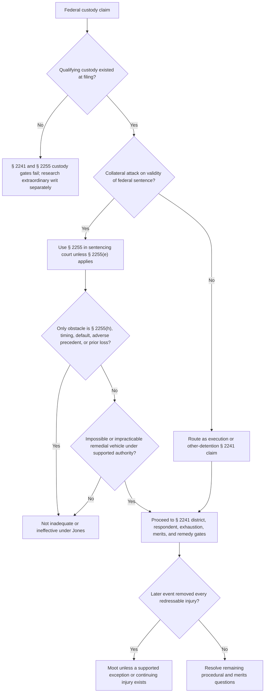

# 28 U.S.C. § 2241 — Section 2255(e) Saving Clause, Custody, and Mootness

## Verification boundary

This module states the current nationwide saving-clause rule after *Jones v. Hendrix* and the Supreme Court's filing-time custody and mootness distinctions. It does not create new saving-clause categories, decide an individual execution claim, or treat custody, Article III injury, cognizability, merits, and relief as interchangeable.

## Section 2255 is the ordinary federal collateral vehicle

<!-- claim:CLM-2241S-001 authorities:AUTH-USC-28-2255,AUTH-SCOTUS-JONES-HENDRIX-599-US-465 status:verified_current -->
Section 2255(a) directs a federal prisoner in custody under sentence to move the court that imposed the sentence to vacate, set aside, or correct it on the grounds specified there. Congress designed that motion as the ordinary substitute for a federal prisoner's habeas attack on the sentence. [28 U.S.C. § 2255(a)](https://uscode.house.gov/view.xhtml?req=%28title%3A28+section%3A2255+edition%3Aprelim%29); [*Jones v. Hendrix*, 599 U.S. 465, 473–76 (2023)](https://www.supremecourt.gov/opinions/22pdf/599us1r42_2b35.pdf)

<!-- claim:CLM-2241S-002 authorities:AUTH-USC-28-2255 status:verified_current -->
Section 2255(e) bars a habeas application by a prisoner authorized to seek § 2255 relief unless “the remedy by motion is inadequate or ineffective to test the legality of his detention.” This is the saving clause; its text concerns the adequacy or effectiveness of the remedial vehicle. [28 U.S.C. § 2255(e)](https://uscode.house.gov/view.xhtml?req=%28title%3A28+section%3A2255+edition%3Aprelim%29)

<!-- claim:CLM-2241S-003 authorities:AUTH-SCOTUS-JONES-HENDRIX-599-US-465 status:verified_current -->
*Jones v. Hendrix* holds that § 2255(e) does not permit a prisoner to use § 2241 to assert an intervening favorable interpretation of a criminal statute as an end run around § 2255(h)'s limits on second or successive motions. [*Jones*, 599 U.S. at 471–80](https://www.supremecourt.gov/opinions/22pdf/599us1r42_2b35.pdf)

<!-- claim:CLM-2241S-004 authorities:AUTH-SCOTUS-JONES-HENDRIX-599-US-465 status:verified_current -->
The result in *Jones* does not change merely because binding circuit precedent foreclosed the statutory argument at trial, on appeal, and during the first § 2255 proceeding. The saving clause does not guarantee an opportunity to take advantage of every later change in statutory interpretation. [*Jones*, 599 U.S. at 477–80](https://www.supremecourt.gov/opinions/22pdf/599us1r42_2b35.pdf)

<!-- claim:CLM-2241S-005 authorities:AUTH-USC-28-2255,AUTH-SCOTUS-JONES-HENDRIX-599-US-465 status:verified_current -->
An inability to satisfy either § 2255(h) gate does not make the § 2255 remedy inadequate or ineffective. The later filing must instead be classified and tested under § 2255(h) and the governing authorization rules. [28 U.S.C. § 2255(h)](https://uscode.house.gov/view.xhtml?req=%28title%3A28+section%3A2255+edition%3Aprelim%29); [*Jones*, 599 U.S. at 477–80](https://www.supremecourt.gov/opinions/22pdf/599us1r42_2b35.pdf)

<!-- claim:CLM-2241S-006 authorities:AUTH-SCOTUS-JONES-HENDRIX-599-US-465 status:verified_current -->
A prior adverse § 2255 decision, procedural default, expiration of § 2255(f), adverse precedent, or a preference for the district of confinement does not by itself make the motion remedy inadequate or ineffective. Those circumstances concern a claim's availability, timing, or outcome rather than the saving clause's remedial-vehicle inquiry. [*Jones*, 599 U.S. at 477–80, 480 n.3](https://www.supremecourt.gov/opinions/22pdf/599us1r42_2b35.pdf)

<!-- claim:CLM-2241S-007 authorities:AUTH-SCOTUS-JONES-HENDRIX-599-US-465 status:verified_current -->
The saving clause tests whether § 2255's motion mechanism is inadequate or ineffective to test detention, not whether the sentencing court's earlier legal answer was correct. Treating an unsuccessful result as an inadequate remedy would erase the limits Congress placed in § 2255. [*Jones*, 599 U.S. at 478–80](https://www.supremecourt.gov/opinions/22pdf/599us1r42_2b35.pdf)

## What *Jones* preserved—and what it did not invent

<!-- claim:CLM-2241S-008 authorities:AUTH-SCOTUS-JONES-HENDRIX-599-US-465 status:verified_current -->
*Jones* states that the saving clause preserves § 2241 when unusual circumstances make it impossible or impracticable to seek relief in the sentencing court, as well as for challenges to detention other than collateral attacks on a sentence. [*Jones*, 599 U.S. at 474, 478](https://www.supremecourt.gov/opinions/22pdf/599us1r42_2b35.pdf)

<!-- claim:CLM-2241S-009 authorities:AUTH-SCOTUS-JONES-HENDRIX-599-US-465 status:verified_current -->
The Court identified dissolution of the sentencing court as the clearest historical example of practical unavailability and referred to circumstances such as inability to access necessary records as an example in the pre-§ 2255 regime. These examples do not establish a broad equitable override of § 2255(h). [*Jones*, 599 U.S. at 474–75](https://www.supremecourt.gov/opinions/22pdf/599us1r42_2b35.pdf)

<!-- claim:CLM-2241S-010 authorities:AUTH-USC-28-2241,AUTH-SCOTUS-JONES-HENDRIX-599-US-465 status:verified_current -->
Challenges to the execution of a sentence or to detention other than a collateral attack on the sentence can remain within § 2241 without using § 2255(e) as a workaround. The substance of the custody claim—not the prisoner's choice of label—controls that classification. [*Jones*, 599 U.S. at 475–78](https://www.supremecourt.gov/opinions/22pdf/599us1r42_2b35.pdf); [28 U.S.C. § 2241(c)](https://uscode.house.gov/view.xhtml?edition=prelim&req=granuleid%3AUSC-prelim-title28-section2241)

<!-- claim:CLM-2241S-011 authorities:AUTH-SCOTUS-JONES-HENDRIX-599-US-465 status:verified_current -->
*Jones* does not announce a nationwide category for every prisoner described as unable, through no fault, to file a first § 2255 motion. Any claimed impossible-or-impracticable circumstance must be tied to the remedial mechanism and supported by current controlling authority, not inferred from fairness or the likely result. [*Jones*, 599 U.S. at 474–80](https://www.supremecourt.gov/opinions/22pdf/599us1r42_2b35.pdf)

<!-- claim:CLM-2241S-012 authorities:AUTH-USC-28-2255,AUTH-SCOTUS-JONES-HENDRIX-599-US-465 status:verified_current -->
Saving-clause availability is a gateway distinct from cognizability, procedural defenses, proof, merits, and remedy. Passing one question does not establish another, and failure at the gateway does not authorize a merits ruling under a hypothetical § 2255 standard. [28 U.S.C. § 2255(e)](https://uscode.house.gov/view.xhtml?req=%28title%3A28+section%3A2255+edition%3Aprelim%29); [*Jones*, 599 U.S. at 477–80](https://www.supremecourt.gov/opinions/22pdf/599us1r42_2b35.pdf)

<!-- claim:CLM-2241S-013 authorities:AUTH-SCOTUS-RUMSFELD-PADILLA-542-US-426,AUTH-SCOTUS-JONES-HENDRIX-599-US-465 status:verified_current -->
If § 2255(e) actually permits a § 2241 petition and the claim challenges present physical custody, the § 2241 immediate-custodian and district-of-confinement defaults still apply. The saving clause does not relocate the § 2241 petition to the sentencing court. [*Padilla*, 542 U.S. 426, 434–47 (2004)](https://www.govinfo.gov/content/pkg/USREPORTS-542/pdf/USREPORTS-542-426.pdf); [*Jones*, 599 U.S. at 473–78](https://www.supremecourt.gov/opinions/22pdf/599us1r42_2b35.pdf)

<!-- claim:CLM-2241S-014 authorities:AUTH-USC-28-2241,AUTH-USC-28-2255 status:verified_current -->
Sections 2241 and 2255 do not make a successful saving-clause petition automatically use § 2255's merits standard or remedial menu. The underlying right, procedural posture, governing circuit law, and scope of habeas relief must be separately established. [28 U.S.C. §§ 2241(c), 2255(b), (e)](https://uscode.house.gov/view.xhtml?req=%28title%3A28+section%3A2255+edition%3Aprelim%29)

## Custody is measured at filing

<!-- claim:CLM-2241S-015 authorities:AUTH-USC-28-2241,AUTH-USC-28-2255,AUTH-SCOTUS-MALENG-490-US-488 status:verified_current -->
Habeas and § 2255 require qualifying custody under the challenged detention or sentence when the application or motion is filed. Custody and Article III mootness are separate inquiries and must not be collapsed into a single “jurisdiction” label. [28 U.S.C. §§ 2241(c), 2255(a)](https://uscode.house.gov/view.xhtml?req=%28title%3A28+section%3A2255+edition%3Aprelim%29); [*Maleng v. Cook*, 490 U.S. 488, 490–92 (1989)](https://www.govinfo.gov/content/pkg/USREPORTS-490/pdf/USREPORTS-490-488.pdf)

<!-- claim:CLM-2241S-016 authorities:AUTH-SCOTUS-JONES-CUNNINGHAM-371-US-236 status:verified_current -->
Physical imprisonment is not the only custody. *Jones v. Cunningham* held that parole restrictions imposed significant restraints on liberty sufficient for habeas custody. A different form of nonphysical restraint must be compared with the controlling statute and case law rather than assumed equivalent. [*Jones v. Cunningham*, 371 U.S. 236, 240–43 (1963)](https://www.govinfo.gov/content/pkg/USREPORTS-371/pdf/USREPORTS-371-236.pdf)

<!-- claim:CLM-2241S-017 authorities:AUTH-SCOTUS-MALENG-490-US-488 status:verified_current -->
Once a sentence has fully expired, the possibility that its conviction will produce collateral consequences does not by itself satisfy the custody requirement for a petition attacking that expired conviction. [*Maleng*, 490 U.S. at 491–92](https://www.govinfo.gov/content/pkg/USREPORTS-490/pdf/USREPORTS-490-488.pdf)

<!-- claim:CLM-2241S-018 authorities:AUTH-SCOTUS-MALENG-490-US-488 status:verified_current -->
*Maleng* separately construed a pro se petition as attacking a current sentence enhanced by an allegedly invalid prior conviction. That construction does not place the person “in custody” under the fully expired prior conviction or automatically make the enhancement challenge cognizable. [*Maleng*, 490 U.S. at 493–94](https://www.govinfo.gov/content/pkg/USREPORTS-490/pdf/USREPORTS-490-488.pdf)

## Later events and mootness

<!-- claim:CLM-2241S-019 authorities:AUTH-SCOTUS-CARAFAS-391-US-234 status:verified_current -->
When custody existed at filing, later release does not retroactively destroy the federal court's power acquired over the habeas application. In *Carafas v. LaVallee*, the petitioner's sentence expired while the case was pending, but the filing-time custody requirement remained satisfied. [*Carafas v. LaVallee*, 391 U.S. 234, 238–40 (1968)](https://www.govinfo.gov/content/pkg/USREPORTS-391/pdf/USREPORTS-391-234.pdf)

<!-- claim:CLM-2241S-020 authorities:AUTH-SCOTUS-CARAFAS-391-US-234 status:verified_current -->
*Carafas* also held that the challenge to a criminal conviction was not moot because concrete civil disabilities and collateral consequences survived the sentence. That conviction rule does not mean collateral consequences are presumed for every administrative, disciplinary, placement, credit, or revocation decision. [*Carafas*, 391 U.S. at 237–40](https://www.govinfo.gov/content/pkg/USREPORTS-391/pdf/USREPORTS-391-234.pdf)

<!-- claim:CLM-2241S-021 authorities:AUTH-SCOTUS-SPENCER-523-US-1 status:verified_current -->
In *Spencer v. Kemna*, expiration of the parole-revocation term mooted the revocation challenge because the asserted later injuries were not concrete continuing consequences and the Court declined to presume collateral consequences for a parole revocation as it does for a criminal conviction. [*Spencer v. Kemna*, 523 U.S. 1, 7–16 (1998)](https://www.govinfo.gov/content/pkg/USREPORTS-523/pdf/USREPORTS-523-1.pdf)

<!-- claim:CLM-2241S-022 authorities:AUTH-SCOTUS-CARAFAS-391-US-234,AUTH-SCOTUS-SPENCER-523-US-1 status:verified_current -->
For an execution-of-sentence claim, ask whether a live injury remains and whether the court can still grant effective custody relief after recalculation, restoration, transfer, release, or sentence completion. Neither release nor administrative correction is automatically dispositive without that claim-and-remedy comparison. [*Carafas*, 391 U.S. at 237–40](https://www.govinfo.gov/content/pkg/USREPORTS-391/pdf/USREPORTS-391-234.pdf); [*Spencer*, 523 U.S. at 7–18](https://www.govinfo.gov/content/pkg/USREPORTS-523/pdf/USREPORTS-523-1.pdf)

<!-- claim:CLM-2241S-023 authorities:AUTH-SCOTUS-RUMSFELD-PADILLA-542-US-426,AUTH-SCOTUS-CARAFAS-391-US-234 status:verified_current -->
A transfer to another institution generally changes the physical custodian but does not by itself prove that the challenged custody injury disappeared. Respondent substitution, territorial authority, retention or transfer of the case, redressability, and any change in the challenged decision remain separate questions. [*Padilla*, 542 U.S. at 434–47](https://www.govinfo.gov/content/pkg/USREPORTS-542/pdf/USREPORTS-542-426.pdf); [*Carafas*, 391 U.S. at 237–40](https://www.govinfo.gov/content/pkg/USREPORTS-391/pdf/USREPORTS-391-234.pdf)

<!-- claim:CLM-2241S-024 authorities:AUTH-SCOTUS-CARAFAS-391-US-234,AUTH-SCOTUS-SPENCER-523-US-1 status:verified_current -->
Later release can leave a conviction challenge live under *Carafas* while mooting a completed administrative or revocation challenge under *Spencer*. Identify the exact challenged act, continuing restraint or collateral injury, requested relief, and the court's ability to redress it; do not use a categorical “release equals moot” or “collateral consequences always save the case” rule. [*Carafas*, 391 U.S. at 237–40](https://www.govinfo.gov/content/pkg/USREPORTS-391/pdf/USREPORTS-391-234.pdf); [*Spencer*, 523 U.S. at 7–18](https://www.govinfo.gov/content/pkg/USREPORTS-523/pdf/USREPORTS-523-1.pdf)

<!-- claim:CLM-2241S-025 authorities:AUTH-SCOTUS-MALENG-490-US-488 status:verified_current -->
If no qualifying custody existed at filing, routing to coram nobis is a separate extraordinary-writ inquiry, not an automatic remedy. The issuing court, continuing consequences, delay, fundamental-error standard, and circuit test remain to be verified in the dedicated extraordinary-writ module. [*Maleng*, 490 U.S. at 490–94](https://www.govinfo.gov/content/pkg/USREPORTS-490/pdf/USREPORTS-490-488.pdf)

<!-- claim:CLM-2241S-026 authorities:AUTH-USC-28-2255,AUTH-SCOTUS-JONES-HENDRIX-599-US-465 status:verified_current -->
A court-of-appeals denial of authorization under § 2255(h) does not independently make § 2255 inadequate or ineffective. The saving clause must satisfy its own post-*Jones* test and cannot operate as rehearing of the failed authorization showing. [28 U.S.C. § 2255(e), (h)](https://uscode.house.gov/view.xhtml?req=%28title%3A28+section%3A2255+edition%3Aprelim%29); [*Jones*, 599 U.S. at 477–80](https://www.supremecourt.gov/opinions/22pdf/599us1r42_2b35.pdf)

<!-- claim:CLM-2241S-027 authorities:AUTH-USC-28-2241,AUTH-USC-28-2255 status:verified_current -->
COA classification and the permissible custody remedy are addressed separately in the § 2241 appeal-and-relief module. Saving-clause availability alone neither requires a COA nor promises vacatur, resentencing, credits, placement, or release. [28 U.S.C. §§ 2241, 2255(e)](https://uscode.house.gov/view.xhtml?req=%28title%3A28+section%3A2255+edition%3Aprelim%29)

<!-- claim:CLM-2241S-028 authorities:AUTH-USC-28-2241,AUTH-USC-28-2255,AUTH-SCOTUS-JONES-HENDRIX-599-US-465,AUTH-SCOTUS-MALENG-490-US-488 status:verified_current -->
The complete router asks in order: custody at filing; validity attack versus execution or other detention; availability and classification under § 2255; the exact § 2255(e) gateway after *Jones*; correct § 2241 respondent and district; exhaustion; live redressable injury; merits; and relief. Skipping an earlier gate makes the later conclusion unreliable. [28 U.S.C. §§ 2241, 2255](https://uscode.house.gov/view.xhtml?req=%28title%3A28+section%3A2255+edition%3Aprelim%29); [*Jones*, 599 U.S. at 473–80](https://www.supremecourt.gov/opinions/22pdf/599us1r42_2b35.pdf); [*Maleng*, 490 U.S. at 490–94](https://www.govinfo.gov/content/pkg/USREPORTS-490/pdf/USREPORTS-490-488.pdf)

## Decision path

## Matters requiring record- and circuit-specific verification

- The challenged judgment, every prior § 2255 filing and disposition, and any authorization history.
- The exact intervening authority and whether the claim is statutory or constitutional.
- Any asserted impossible-or-impracticable circumstance and controlling post-*Jones* authority.
- The precise custody at filing, later custody changes, and continuing restraints.
- Whether an execution, disciplinary, placement, credit, or revocation injury remains redressable.
- The correct respondent, district, exhaustion doctrine, merits standard, and relief.
- Coram nobis or another extraordinary remedy after custody has fully ended.

