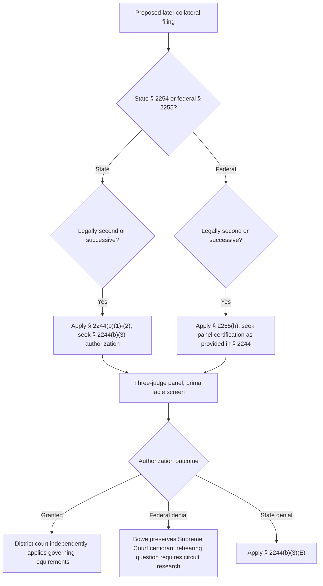

# 28 U.S.C. §§ 2244 and 2255(h) — Successive-Application Gatekeeping

## Verification boundary

This module verifies the nationwide statutory division between state-prisoner applications and federal-prisoner motions, the text of the authorization procedure, the separate substantive gates, and the two holdings in *Bowe v. United States*. It does not decide whether a particular later filing is “second or successive,” whether a proposed claim satisfies a statutory gate, or which rehearing practice a particular circuit follows.

## Keep the state and federal tracks separate

<!-- claim:CLM-2244-001 authorities:AUTH-USC-28-2244 status:verified_current -->
Sections 2244(b)(1) and (b)(2) apply by their terms to second or successive habeas applications under § 2254, and § 2244(d) applies to applications by persons in custody pursuant to state-court judgments. [28 U.S.C. § 2244(b)(1), (b)(2), (d)](https://www.govinfo.gov/link/uscode/28/2244)

<!-- claim:CLM-2244-013 authorities:AUTH-USC-28-2244 status:verified_current -->
Section 2244(d)'s one-year limitation and statutory tolling provisions govern the state-judgment track described there; they are not the limitation provisions for a federal prisoner's § 2255 motion. [28 U.S.C. § 2244(d)](https://www.govinfo.gov/link/uscode/28/2244)

<!-- claim:CLM-2244-014 authorities:AUTH-USC-28-2244,AUTH-USC-28-2255 status:verified_current -->
The state-prisoner substantive gates in § 2244(b)(2) and the federal-prisoner gates in § 2255(h) are not identically worded, so a federal § 2255(h) analysis must use § 2255(h)'s substantive requirements rather than silently substituting § 2244(b)(2). [28 U.S.C. §§ 2244(b)(2), 2255(h)](https://www.govinfo.gov/link/uscode/28/2255)

## Section 2244(b)(3) authorization procedure

<!-- claim:CLM-2244-002 authorities:AUTH-USC-28-2244 status:verified_current -->
Before a second or successive § 2254 application is filed in district court, the applicant must move in the appropriate court of appeals for an order authorizing the district court to consider it. [28 U.S.C. § 2244(b)(3)(A)](https://www.govinfo.gov/link/uscode/28/2244)

<!-- claim:CLM-2244-003 authorities:AUTH-USC-28-2244 status:verified_current -->
The court of appeals must assign the authorization motion to a three-judge panel. [28 U.S.C. § 2244(b)(3)(B)](https://www.govinfo.gov/link/uscode/28/2244)

<!-- claim:CLM-2244-004 authorities:AUTH-USC-28-2244 status:verified_current -->
The panel may authorize filing only if it determines that the applicant has made a prima facie showing that the application satisfies § 2244(b)'s requirements. [28 U.S.C. § 2244(b)(3)(C)](https://www.govinfo.gov/link/uscode/28/2244)

<!-- claim:CLM-2244-005 authorities:AUTH-USC-28-2244 status:verified_current -->
Section 2244(b)(3)(D) directs the court of appeals to grant or deny authorization not later than thirty days after the motion is filed. [28 U.S.C. § 2244(b)(3)(D)](https://www.govinfo.gov/link/uscode/28/2244)

This module records the statutory command but does not label it jurisdictional, establish a remedy for noncompliance, or assume every circuit treats it as enforceable. Those questions require controlling-circuit research.

<!-- claim:CLM-2244-006 authorities:AUTH-USC-28-2244 status:verified_current -->
For the state-prisoner authorization decision governed directly by § 2244(b)(3), subsection (E) says the grant or denial is not appealable and may not be the subject of rehearing or certiorari. [28 U.S.C. § 2244(b)(3)(E)](https://www.govinfo.gov/link/uscode/28/2244)

<!-- claim:CLM-2244-007 authorities:AUTH-USC-28-2244 status:verified_current -->
After the court of appeals authorizes a state-prisoner claim, the district court must dismiss that authorized claim unless the applicant shows that it satisfies § 2244(b)'s requirements. [28 U.S.C. § 2244(b)(4)](https://www.govinfo.gov/link/uscode/28/2244)

Subsection (b)(4) is a post-authorization screen of an authorized claim. It does not say, as the legacy draft stated, that its specific command is to dismiss every claim the court of appeals did not authorize.

## Federal-prisoner gate under § 2255(h)

<!-- claim:CLM-2244-008 authorities:AUTH-USC-28-2255 status:verified_current -->
A second or successive § 2255 motion must be certified as provided in § 2244 by a panel of the appropriate court of appeals to contain either qualifying newly discovered evidence under § 2255(h)(1) or a qualifying new rule of constitutional law under § 2255(h)(2). [28 U.S.C. § 2255(h)](https://www.govinfo.gov/link/uscode/28/2255)

Whether a later filing is “second or successive,” whether evidence is qualifying, and whether the Supreme Court has made a new constitutional rule retroactive are separate questions not resolved by this structural module.

## *Bowe v. United States*

<!-- claim:CLM-2244-009 authorities:AUTH-SCOTUS-BOWE-607-US-13 status:verified_current -->
Section 2244(b)(3)(E) does not bar Supreme Court certiorari review of a federal prisoner's request to file a successive § 2255 motion. [*Bowe v. United States*, 607 U.S. 13, 19–32 (2026)](https://www.supremecourt.gov/opinions/25pdf/607us1r04_n7ip.pdf)

<!-- claim:CLM-2244-010 authorities:AUTH-SCOTUS-BOWE-607-US-13 status:verified_current -->
Section 2244(b)(1)'s previously-presented-claim bar does not apply to successive motions filed by federal prisoners under § 2255(h). [*Bowe*, 607 U.S. at 32–38](https://www.supremecourt.gov/opinions/25pdf/607us1r04_n7ip.pdf)

<!-- claim:CLM-2244-011 authorities:AUTH-SCOTUS-BOWE-607-US-13 status:verified_current -->
The Supreme Court vacated and remanded for the Eleventh Circuit to decide Bowe's authorization request under the correct standard; the Supreme Court did not itself authorize his successive motion. [*Bowe*, 607 U.S. at 38](https://www.supremecourt.gov/opinions/25pdf/607us1r04_n7ip.pdf)

<!-- claim:CLM-2244-012 authorities:AUTH-SCOTUS-BOWE-607-US-13 status:verified_current -->
Bowe distinguished § 2244(b)(3)(E)'s rehearing language from its certiorari language and did not decide whether that rehearing bar applies to federal-prisoner authorization decisions. [*Bowe*, 607 U.S. at 29–30](https://www.supremecourt.gov/opinions/25pdf/607us1r04_n7ip.pdf)

The legacy statement that a federal authorization denial “remains non-rehearable” therefore is not preserved as a *Bowe* holding. Circuit-specific rehearing rules and precedent must be checked before stating the answer for a particular court of appeals.

## Procedural checklist

1. Identify whether the custody and underlying judgment are state or federal.
2. Obtain every earlier § 2254 application or § 2255 motion and every disposition.
3. Research whether the proposed filing is legally “second or successive”; do not equate that term with merely second in time.
4. If authorization is required, apply the correct substantive gate—§ 2244(b)(2) for the state track or § 2255(h) for the federal track.
5. Use the appropriate court of appeals' current authorization form, filing rules, and controlling cases.
6. Treat the thirty-day text as a command to the court, not as a promised decision date or a demonstrated remedy.
7. For a federal denial, preserve the distinction among ordinary appeal, rehearing, and Supreme Court certiorari after *Bowe*.
8. If authorization is granted, expect independent district-court review; authorization is not a merits judgment.

## Decision path

## Matters not yet verified in this module

- The Supreme Court and circuit doctrines defining “second or successive,” including new-judgment, ripeness, Rule 60, and recharacterization issues.
- Circuit-specific prima facie standards, authorization forms, rehearing practice, and treatment of the thirty-day command.
- The merits of either statutory substantive gate, retroactivity doctrine, limitations rules under § 2255(f), and certificates of appealability.
- District-court transfer-versus-dismissal practice for unauthorized filings.

Those matters remain open in `data/coverage_matrix.yaml`; this module does not represent the full § 2244 or § 2255 field as complete.
