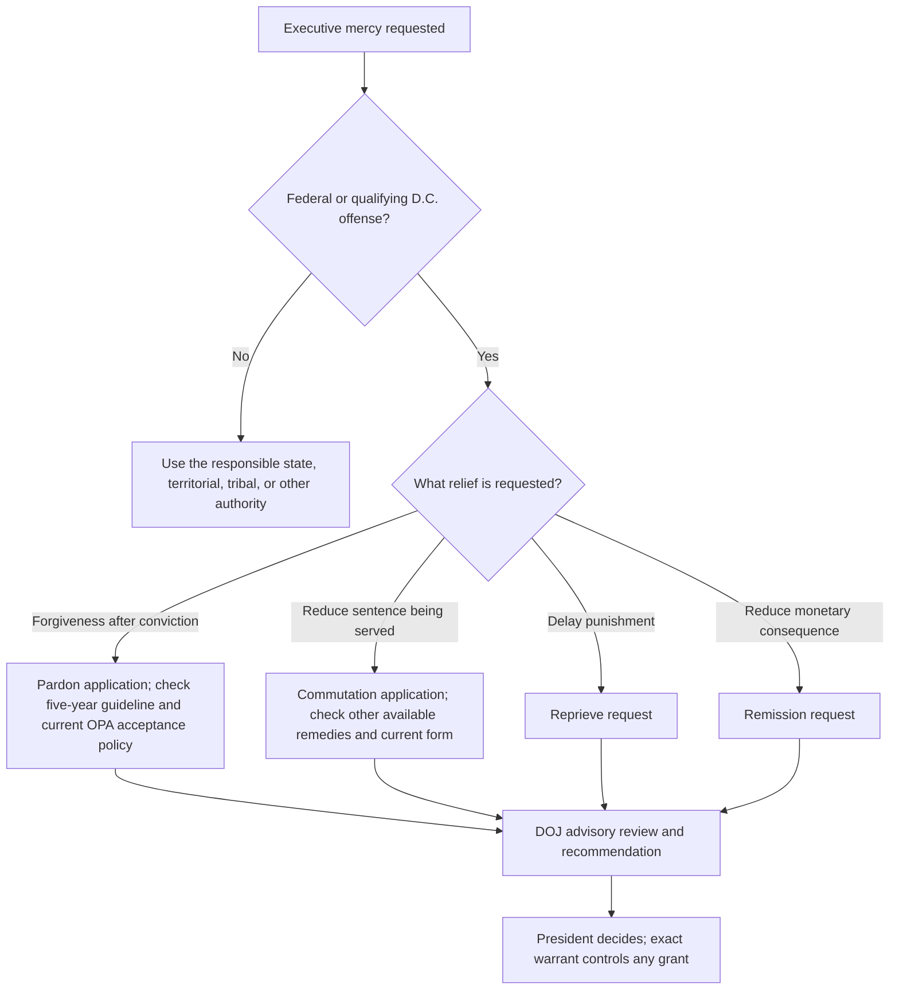

# Executive Clemency — Pardon, Commutation, Reprieve, and Remission

Presidential clemency is executive relief, not judicial error correction. This module separates the constitutional power, the Department of Justice’s advisory application process, and the legal effect of a particular presidential grant.

## Constitutional authority and scope

<!-- claim:CLM-CLEM-001 authorities:AUTH-CONST-PARDON-CLAUSE status:verified_current -->
Article II authorizes the President to grant reprieves and pardons for offenses against the United States, except in cases of impeachment. [U.S. Const. art. II, § 2, cl. 1](https://constitution.congress.gov/browse/article-2/section-2/clause-1/)

<!-- claim:CLM-CLEM-002 authorities:AUTH-CONST-PARDON-CLAUSE,AUTH-CFR-28-PART-1-CLEMENCY,AUTH-DOJ-PARDON-FAQ status:verified_current -->
The federal clemency power reaches offenses against the United States, including offenses prosecuted by the United States Attorney for the District of Columbia in the name of the United States in the D.C. Superior Court, but not state convictions; a person seeking a pardon or commutation for a state offense should contact the authorities of the state in which the conviction occurred. [U.S. Const. art. II, § 2, cl. 1](https://constitution.congress.gov/browse/article-2/section-2/clause-1/); [28 C.F.R. § 1.4](https://www.ecfr.gov/current/title-28/chapter-I/part-1); [Office of the Pardon Attorney FAQ](https://www.justice.gov/pardon/frequently-asked-questions)

<!-- claim:CLM-CLEM-003 authorities:AUTH-CFR-28-PART-1-CLEMENCY,AUTH-DOJ-PARDON-FAQ status:verified_current -->
Federal executive clemency includes pardon, commutation of sentence, reprieve, and remission of fine; the requested form must be identified because each has different functions and effects. [28 C.F.R. §§ 1.1–1.3](https://www.ecfr.gov/current/title-28/chapter-I/part-1); [Office of the Pardon Attorney FAQ](https://www.justice.gov/pardon/frequently-asked-questions)

<!-- claim:CLM-CLEM-004 authorities:AUTH-CONST-PARDON-CLAUSE,AUTH-CFR-28-PART-1-CLEMENCY status:verified_current -->
Clemency is an executive process rather than a motion asking a federal court to vacate, correct, or reduce a judgment under judicial remedial authority. [U.S. Const. art. II, § 2, cl. 1](https://constitution.congress.gov/browse/article-2/section-2/clause-1/); [28 C.F.R. pt. 1](https://www.ecfr.gov/current/title-28/chapter-I/part-1)

<!-- claim:CLM-CLEM-005 authorities:AUTH-CFR-28-PART-1-CLEMENCY status:verified_current -->
The Department of Justice clemency regulations are advisory only: they create no enforceable rights in applicants and do not restrict the President’s constitutional authority. [28 C.F.R. § 1.11](https://www.ecfr.gov/current/title-28/chapter-I/part-1)

<!-- claim:CLM-CLEM-006 authorities:AUTH-DOJ-PARDON-FAQ,AUTH-CFR-28-PART-1-CLEMENCY status:verified_current -->
The President may grant or deny clemency without a Department of Justice recommendation, and compliance with the Department’s application process is not a constitutional limit on presidential action. [DOJ, Frequently Asked Questions](https://www.justice.gov/pardon/frequently-asked-questions); [28 C.F.R. § 1.11](https://www.ecfr.gov/current/title-28/chapter-I/part-1)

<!-- claim:CLM-CLEM-007 authorities:AUTH-CFR-28-PART-1-CLEMENCY,AUTH-DOJ-PARDON-FAQ status:verified_current -->
The Office of the Pardon Attorney process covers qualifying federal and specified District of Columbia Code offenses; territorial and state offenses must be directed to the separately responsible official. [28 C.F.R. § 1.4](https://www.ecfr.gov/current/title-28/chapter-I/part-1); [DOJ, Frequently Asked Questions](https://www.justice.gov/pardon/frequently-asked-questions)

## Current Department of Justice process

<!-- claim:CLM-CLEM-008 authorities:AUTH-CFR-28-PART-1-CLEMENCY,AUTH-DOJ-PARDON-APPLY status:verified_current -->
A formal petition is addressed to the President, submitted to the Pardon Attorney on the current form, and should identify the requested relief and supply the required conviction, sentence, and supporting information; military-offense petitions use the regulation’s specified route. [28 C.F.R. § 1.1](https://www.ecfr.gov/current/title-28/chapter-I/part-1); [DOJ, Apply for Clemency](https://www.justice.gov/pardon/apply-clemency)

<!-- claim:CLM-CLEM-009 authorities:AUTH-CFR-28-PART-1-CLEMENCY status:verified_current -->
The pardon regulation states an advisory waiting guideline of at least five years after release from confinement or, if no confinement was imposed, after conviction. [28 C.F.R. § 1.2](https://www.ecfr.gov/current/title-28/chapter-I/part-1)

<!-- claim:CLM-CLEM-010 authorities:AUTH-CFR-28-PART-1-CLEMENCY status:verified_current -->
The same regulation states that a pardon petition generally should not be submitted while the petitioner is on probation, parole, or supervised release. [28 C.F.R. § 1.2](https://www.ecfr.gov/current/title-28/chapter-I/part-1)

<!-- claim:CLM-CLEM-011 authorities:AUTH-CFR-28-PART-1-CLEMENCY,AUTH-DOJ-PARDON-FAQ status:verified_current -->
The five-year rule is a Department guideline, not a jurisdictional bar: the regulations are advisory only, and the current Pardon Attorney FAQ states that the President can pardon individuals who have not yet been convicted, started serving their sentence, or finished their sentence, and that the Office will review appropriate applications in those circumstances using the pardon after completion of sentence form. [28 C.F.R. §§ 1.2, 1.11](https://www.ecfr.gov/current/title-28/chapter-I/part-1); [Office of the Pardon Attorney FAQ](https://www.justice.gov/pardon/frequently-asked-questions)

<!-- claim:CLM-CLEM-012 authorities:AUTH-CFR-28-PART-1-CLEMENCY status:verified_current -->
The commutation regulation states that no petition for commutation of sentence, including remission of fine, should be filed if other forms of judicial or administrative relief are available, except upon a showing of exceptional circumstances. It does not impose a one-year-served eligibility rule. [28 C.F.R. § 1.3](https://www.ecfr.gov/current/title-28/chapter-I/part-1)

<!-- claim:CLM-CLEM-013 authorities:AUTH-DOJ-PARDON-PROCESS,AUTH-CFR-28-PART-1-CLEMENCY status:verified_current -->
The ordinary advisory path is application or update, Department review and any investigation, Department recommendation, and presidential decision; it is not a guaranteed fixed sequence of FBI, credit-report, prosecutor, and sentencing-judge steps in every case. [DOJ, How the Clemency Process Works](https://www.justice.gov/pardon/how-clemency-works); [28 C.F.R. § 1.6](https://www.ecfr.gov/current/title-28/chapter-I/part-1)

<!-- claim:CLM-CLEM-014 authorities:AUTH-CFR-28-PART-1-CLEMENCY,AUTH-DOJ-PARDON-PROCESS status:verified_current -->
The Attorney General must cause an investigation to be made, with its scope set by what he or she deems necessary and appropriate, and the FBI, United States Attorney, or sentencing judge may be consulted in some matters; none is an automatic step in every application. [28 C.F.R. § 1.6(a)](https://www.ecfr.gov/current/title-28/chapter-I/part-1); [Office of the Pardon Attorney process page](https://www.justice.gov/pardon/how-clemency-works)

<!-- claim:CLM-CLEM-015 authorities:AUTH-DOJ-PARDON-FAQ status:verified_current -->
The ordinary clemency application process is written and provides no applicant hearing. [DOJ, Frequently Asked Questions](https://www.justice.gov/pardon/frequently-asked-questions)

<!-- claim:CLM-CLEM-016 authorities:AUTH-CFR-28-PART-1-CLEMENCY status:verified_current -->
Victim notification or contact is conditional under the governing regulation, not a universal mandatory step for every application. [28 C.F.R. § 1.6](https://www.ecfr.gov/current/title-28/chapter-I/part-1)

<!-- claim:CLM-CLEM-017 authorities:AUTH-CFR-28-PART-1-CLEMENCY,AUTH-DOJ-PARDON-PROCESS status:verified_current -->
The Attorney General’s role is advisory; the final constitutional decision belongs to the President, and a grant is communicated and governed through the presidential warrant or other grant instrument. Except in death-sentence cases, if the President does not disapprove or take other action on an adverse recommendation within 30 days after its submission, the President is presumed to concur, and the Attorney General advises the petitioner and closes the case. [28 C.F.R. §§ 1.6–1.8, 1.11](https://www.ecfr.gov/current/title-28/chapter-I/part-1); [Office of the Pardon Attorney process page](https://www.justice.gov/pardon/how-clemency-works)

<!-- claim:CLM-CLEM-018 authorities:AUTH-DOJ-PARDON-FAQ status:verified_current -->
An application can remain pending across an administration and there is no guaranteed decision date, but the FAQ lists situations in which an application is closed administratively instead of being decided by the President: the applicant withdraws, repeatedly fails to respond to a Pardon Attorney request for required information, dies, is found to no longer reside in the United States, or is released from federal prison while a commutation petition seeking only a reduced prison sentence is pending. Current status and any request for supplemental information should be checked through the Office of the Pardon Attorney. [Office of the Pardon Attorney FAQ](https://www.justice.gov/pardon/frequently-asked-questions)

<!-- claim:CLM-CLEM-019 authorities:AUTH-CFR-28-PART-1-CLEMENCY,AUTH-DOJ-PARDON-FAQ status:verified_current -->
The Office of the Pardon Attorney publicly lists each grant (name, district of conviction, year of sentencing, offense, and grant date); for denials, the FAQ says only that the Office is obliged to release existing lists of the names of persons denied clemency to anyone who requests them under the Freedom of Information Act. Deliberative communications about clemency decisions are confidential, and clemency petitions, reports, and communications are generally available only to the officials concerned unless the Attorney General judges disclosure required by law or the ends of justice. [28 C.F.R. § 1.5](https://www.ecfr.gov/current/title-28/chapter-I/part-1); [Office of the Pardon Attorney FAQ](https://www.justice.gov/pardon/frequently-asked-questions)

<!-- claim:CLM-CLEM-020 authorities:AUTH-CFR-28-PART-1-CLEMENCY,AUTH-DOJ-PARDON-FAQ status:verified_current -->
Whenever the President notifies the Attorney General that he has denied a request for clemency, the Attorney General shall so advise the petitioner and close the case. Consistent with long-standing policy, if the President does not issue a public statement concerning his action in a clemency matter, no explanation is provided by the Department of Justice. [28 C.F.R. § 1.8](https://www.ecfr.gov/current/title-28/chapter-I/part-1); [DOJ, Frequently Asked Questions](https://www.justice.gov/pardon/frequently-asked-questions)

<!-- claim:CLM-CLEM-021 authorities:AUTH-CFR-28-PART-1-CLEMENCY status:verified_current -->
Part 1 contains no provision stating that filing a clemency petition stays or tolls a judicial deadline. Part 1 therefore should not be cited as authority for a stay or tolling; any such effect must be established under the statute, rule, or court order governing the particular appeal or collateral proceeding. Section 1.3 separately advises that, absent exceptional circumstances, a commutation petition should not be filed while other judicial or administrative relief is available. [28 C.F.R. §§ 1.3, 1.11](https://www.ecfr.gov/current/title-28/chapter-I/part-1)

## Effect of a grant

<!-- claim:CLM-CLEM-022 authorities:AUTH-DOJ-PARDON-FAQ status:verified_current -->
A pardon is an act of forgiveness, not a judicial declaration of innocence. [DOJ, Frequently Asked Questions](https://www.justice.gov/pardon/frequently-asked-questions)

<!-- claim:CLM-CLEM-023 authorities:AUTH-DOJ-PARDON-FAQ status:verified_current -->
A pardon does not expunge or erase the conviction record; the conviction and the pardon may both remain reflected in official records. [DOJ, Frequently Asked Questions](https://www.justice.gov/pardon/frequently-asked-questions)

<!-- claim:CLM-CLEM-024 authorities:AUTH-DOJ-PARDON-FAQ,AUTH-CONST-PARDON-EFFECTS status:verified_current -->
A pardon may remove some federal civil disabilities, but the exact consequence depends on the disability’s source, the grant, and any independent federal, state, territorial, tribal, licensing, or private rule. [DOJ, Frequently Asked Questions](https://www.justice.gov/pardon/frequently-asked-questions); [Constitution Annotated, Legal Effect of a Pardon](https://constitution.congress.gov/browse/essay/artII-S2-C1-3-7/ALDE_00013324/)

<!-- claim:CLM-CLEM-025 authorities:AUTH-DOJ-PARDON-FAQ status:verified_current -->
Immigration consequences are not categorically eliminated by a pardon; current immigration statutes and case-specific advice are required, while a commutation has no immigration effect under the current Pardon Attorney guidance. [DOJ, Frequently Asked Questions](https://www.justice.gov/pardon/frequently-asked-questions)

<!-- claim:CLM-CLEM-026 authorities:AUTH-DOJ-PARDON-FAQ,AUTH-DOJ-FFRR-FAQ,AUTH-DOJ-PR-FFRR-2026-08-17 status:verified_current -->
DOJ's current guidance states that a full presidential pardon removes penalties and disabilities, including a firearm disability, resulting from the federal conviction, but that a person who also has a separate, independent basis for firearm prohibition, like a state conviction or a prohibiting status, may need to seek federal firearms relief. The Attorney General may also restore federal firearms rights under 18 U.S.C. § 925(c); DOJ states that relief under that process removes only applicable federal firearms disabilities and does not override independent restrictions imposed by state law. A person whose federal firearms rights have been restored should consult state, territorial, or tribal authorities about whether he or she can possess firearms under the laws where he or she lives. [Office of the Pardon Attorney FAQ](https://www.justice.gov/pardon/frequently-asked-questions); [DOJ Federal Firearm Rights Restoration FAQ](https://www.justice.gov/ffrr/federal-firearm-rights-restoration-frequently-asked-questions); [DOJ, Attorney General Blanche Launches New Process to Restore Federal Firearm Rights (Aug. 17, 2026)](https://www.justice.gov/opa/pr/attorney-general-blanche-launches-new-process-restore-federal-firearm-rights)

<!-- claim:CLM-CLEM-027 authorities:AUTH-DOJ-PARDON-FAQ status:verified_current -->
A commutation reduces a sentence being served but does not vacate the conviction, imply innocence, or automatically remove civil disabilities; it may include remission of an unpaid fine or restitution when the grant so provides. [DOJ, Frequently Asked Questions](https://www.justice.gov/pardon/frequently-asked-questions)

<!-- claim:CLM-CLEM-028 authorities:AUTH-SCOTUS-SCHICK-419-US-256,AUTH-CFR-28-PART-1-CLEMENCY status:verified_current -->
Presidential clemency may be conditioned within constitutional bounds: the pardoning power permits “the attachment of any condition which does not otherwise offend the Constitution,” but “the President may not aggravate punishment,” and a granted commutation is sent to the petitioner as a warrant of commutation. [*Schick v. Reed*, 419 U.S. 256, 266–67 (1974)](https://www.govinfo.gov/content/pkg/USREPORTS-419/pdf/USREPORTS-419-256.pdf); [28 C.F.R. § 1.7](https://www.ecfr.gov/current/title-28/chapter-I/part-1)

<!-- claim:CLM-CLEM-029 authorities:AUTH-SCOTUS-SCHICK-419-US-256,AUTH-DOJ-PARDON-FAQ status:verified_current -->
No source reviewed establishes a universal rule that a pardon automatically ends every sex-offender-registration duty or that a commutation automatically ends supervision; analyze the exact warrant and each independent federal, state, territorial, or tribal law rather than relying on a categorical legacy statement. [*Schick*, 419 U.S. at 266–68](https://www.govinfo.gov/content/pkg/USREPORTS-419/pdf/USREPORTS-419-256.pdf); [DOJ, Frequently Asked Questions](https://www.justice.gov/pardon/frequently-asked-questions)

<!-- claim:CLM-CLEM-030 authorities:AUTH-CFR-28-PART-1-CLEMENCY status:verified_current -->
For a death sentence imposed by a United States District Court, § 1.10 supplies a special advisory process: no petition for reprieve or commutation should be filed before proceedings on the direct appeal and first § 2255 petition have terminated; a commutation petition should be filed no later than 30 days after the prisoner receives the Bureau of Prisons’ notice of the scheduled execution date; and supporting papers should be filed no later than 15 days after the petition, and papers filed later may be excluded from consideration. [28 C.F.R. §§ 1.10(b), 1.11](https://www.ecfr.gov/current/title-28/chapter-I/part-1)

## Classification path

## Required individualized checks

- The exact sovereign, offense, judgment, sentence, and current custody or supervision status.
- The current Office of the Pardon Attorney form, submission instructions, and published policy on the filing date.
- Every judicial and administrative deadline, which a clemency application does not itself preserve.
- The exact grant instrument and conditions before describing release, supervision, monetary, firearm, immigration, registration, licensing, or civil-rights effects.
- State, territorial, tribal, immigration, firearm, registration, professional-licensing, and benefit law when any nonfederal consequence is at issue.
