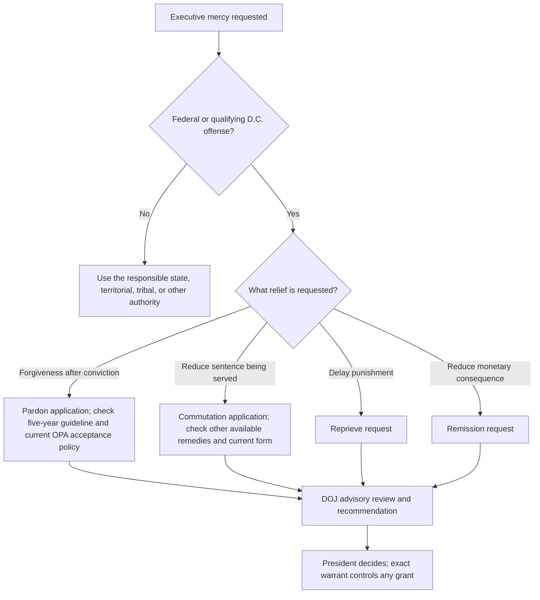

# Executive Clemency — Pardon, Commutation, Reprieve, and Remission

Presidential clemency is executive relief, not judicial error correction. This module separates the constitutional power, the Department of Justice’s advisory application process, and the legal effect of a particular presidential grant.

## Constitutional authority and scope

<!-- claim:CLM-CLEM-001 authorities:AUTH-CONST-PARDON-CLAUSE status:verified_current -->
Article II authorizes the President to grant reprieves and pardons for offenses against the United States, except in cases of impeachment. [U.S. Const. art. II, § 2, cl. 1](https://constitution.congress.gov/browse/article-2/section-2/clause-1/)

<!-- claim:CLM-CLEM-002 authorities:AUTH-CONST-PARDON-CLAUSE,AUTH-CFR-28-PART-1-CLEMENCY status:verified_current -->
The federal clemency power reaches federal offenses, not state convictions; a person seeking relief from a state conviction must use that jurisdiction’s clemency authority. [U.S. Const. art. II, § 2, cl. 1](https://constitution.congress.gov/browse/article-2/section-2/clause-1/); [28 C.F.R. § 1.4](https://www.ecfr.gov/current/title-28/chapter-I/part-1)

<!-- claim:CLM-CLEM-003 authorities:AUTH-CFR-28-PART-1-CLEMENCY,AUTH-DOJ-PARDON-FAQ status:verified_current -->
Federal executive clemency includes pardon, commutation of sentence, reprieve, and remission of a fine or forfeiture; the requested form must be identified because each has different functions and effects. [28 C.F.R. §§ 1.1–1.3](https://www.ecfr.gov/current/title-28/chapter-I/part-1); [DOJ, Frequently Asked Questions](https://www.justice.gov/pardon/frequently-asked-questions)

<!-- claim:CLM-CLEM-004 authorities:AUTH-CONST-PARDON-CLAUSE,AUTH-CFR-28-PART-1-CLEMENCY status:verified_current -->
Clemency is an executive process rather than a motion asking a federal court to vacate, correct, or reduce a judgment under judicial remedial authority. [U.S. Const. art. II, § 2, cl. 1](https://constitution.congress.gov/browse/article-2/section-2/clause-1/); [28 C.F.R. pt. 1](https://www.ecfr.gov/current/title-28/chapter-I/part-1)

<!-- claim:CLM-CLEM-005 authorities:AUTH-CFR-28-PART-1-CLEMENCY status:verified_current -->
The Department of Justice clemency regulations are advisory only: they create no enforceable rights in applicants and do not restrict the President’s constitutional authority. [28 C.F.R. § 1.11](https://www.ecfr.gov/current/title-28/chapter-I/part-1)

<!-- claim:CLM-CLEM-006 authorities:AUTH-DOJ-PARDON-FAQ,AUTH-CFR-28-PART-1-CLEMENCY status:verified_current -->
The President may grant or deny clemency without a Department of Justice recommendation, and compliance with the Department’s application process is not a constitutional limit on presidential action. [DOJ, Frequently Asked Questions](https://www.justice.gov/pardon/frequently-asked-questions); [28 C.F.R. § 1.11](https://www.ecfr.gov/current/title-28/chapter-I/part-1)

<!-- claim:CLM-CLEM-007 authorities:AUTH-CFR-28-PART-1-CLEMENCY,AUTH-DOJ-PARDON-FAQ status:verified_current -->
The Office of the Pardon Attorney process covers qualifying federal and specified District of Columbia Code offenses; territorial and state offenses must be directed to the separately responsible official. [28 C.F.R. § 1.4](https://www.ecfr.gov/current/title-28/chapter-I/part-1); [DOJ, Frequently Asked Questions](https://www.justice.gov/pardon/frequently-asked-questions)

## Current Department of Justice process

<!-- claim:CLM-CLEM-008 authorities:AUTH-CFR-28-PART-1-CLEMENCY,AUTH-DOJ-PARDON-APPLY status:verified_current -->
A formal petition is addressed to the President, submitted to the Pardon Attorney on the current form, and should identify the requested relief and supply the required conviction, sentence, and supporting information; military-offense petitions use the regulation’s specified route. [28 C.F.R. § 1.1](https://www.ecfr.gov/current/title-28/chapter-I/part-1); [DOJ, Apply for Clemency](https://www.justice.gov/pardon/apply-clemency)

<!-- claim:CLM-CLEM-009 authorities:AUTH-CFR-28-PART-1-CLEMENCY status:verified_current -->
The pardon regulation states an advisory waiting guideline of at least five years after release from confinement or, if no confinement was imposed, after conviction. [28 C.F.R. § 1.2](https://www.ecfr.gov/current/title-28/chapter-I/part-1)

<!-- claim:CLM-CLEM-010 authorities:AUTH-CFR-28-PART-1-CLEMENCY status:verified_current -->
The same regulation states that a pardon petition generally should not be submitted while the petitioner is on probation, parole, or supervised release. [28 C.F.R. § 1.2](https://www.ecfr.gov/current/title-28/chapter-I/part-1)

<!-- claim:CLM-CLEM-011 authorities:AUTH-CFR-28-PART-1-CLEMENCY,AUTH-DOJ-PARDON-FAQ status:verified_current -->
The five-year rule is a Department guideline, not a jurisdictional bar: the current Pardon Attorney FAQ states that appropriate applications may be accepted before completion of sentence even though the usual pardon form and regulatory guideline focus on post-completion applicants. [28 C.F.R. §§ 1.2, 1.11](https://www.ecfr.gov/current/title-28/chapter-I/part-1); [DOJ, Frequently Asked Questions](https://www.justice.gov/pardon/frequently-asked-questions)

<!-- claim:CLM-CLEM-012 authorities:AUTH-CFR-28-PART-1-CLEMENCY status:verified_current -->
The commutation regulation states that a petition ordinarily should not be filed while other judicial or administrative relief is available absent exceptional circumstances; it does not impose a one-year-served eligibility rule. [28 C.F.R. § 1.3](https://www.ecfr.gov/current/title-28/chapter-I/part-1)

<!-- claim:CLM-CLEM-013 authorities:AUTH-DOJ-PARDON-PROCESS,AUTH-CFR-28-PART-1-CLEMENCY status:verified_current -->
The ordinary advisory path is application or update, Department review and any investigation, Department recommendation, and presidential decision; it is not a guaranteed fixed sequence of FBI, credit-report, prosecutor, and sentencing-judge steps in every case. [DOJ, How the Clemency Process Works](https://www.justice.gov/pardon/how-clemency-works); [28 C.F.R. § 1.6](https://www.ecfr.gov/current/title-28/chapter-I/part-1)

<!-- claim:CLM-CLEM-014 authorities:AUTH-CFR-28-PART-1-CLEMENCY,AUTH-DOJ-PARDON-PROCESS status:verified_current -->
The Attorney General may conduct the investigation considered necessary and appropriate, and the FBI, United States Attorney, or sentencing judge may be consulted in some matters; none is an automatic step in every application. [28 C.F.R. § 1.6](https://www.ecfr.gov/current/title-28/chapter-I/part-1); [DOJ, How the Clemency Process Works](https://www.justice.gov/pardon/how-clemency-works)

<!-- claim:CLM-CLEM-015 authorities:AUTH-DOJ-PARDON-FAQ status:verified_current -->
The ordinary clemency application process is written and provides no applicant hearing. [DOJ, Frequently Asked Questions](https://www.justice.gov/pardon/frequently-asked-questions)

<!-- claim:CLM-CLEM-016 authorities:AUTH-CFR-28-PART-1-CLEMENCY status:verified_current -->
Victim notification or contact is conditional under the governing regulation, not a universal mandatory step for every application. [28 C.F.R. § 1.6](https://www.ecfr.gov/current/title-28/chapter-I/part-1)

<!-- claim:CLM-CLEM-017 authorities:AUTH-CFR-28-PART-1-CLEMENCY,AUTH-DOJ-PARDON-PROCESS status:verified_current -->
The Attorney General’s role is advisory; the final constitutional decision belongs to the President, and a grant is communicated and governed through the presidential warrant or other grant instrument. [28 C.F.R. §§ 1.6–1.8, 1.11](https://www.ecfr.gov/current/title-28/chapter-I/part-1); [DOJ, How the Clemency Process Works](https://www.justice.gov/pardon/how-clemency-works)

<!-- claim:CLM-CLEM-018 authorities:AUTH-DOJ-PARDON-FAQ status:verified_current -->
An application can remain pending across an administration and there is no guaranteed decision date; current status and any request for supplemental information should be checked through the Office of the Pardon Attorney. [DOJ, Frequently Asked Questions](https://www.justice.gov/pardon/frequently-asked-questions)

<!-- claim:CLM-CLEM-019 authorities:AUTH-CFR-28-PART-1-CLEMENCY,AUTH-DOJ-PARDON-FAQ status:verified_current -->
Department clemency files and deliberations are generally restricted as the regulation provides, while the Department publishes specified identifying information about grants and denials; applicants should not assume either total secrecy or public access to internal recommendations. [28 C.F.R. § 1.5](https://www.ecfr.gov/current/title-28/chapter-I/part-1); [DOJ, Frequently Asked Questions](https://www.justice.gov/pardon/frequently-asked-questions)

<!-- claim:CLM-CLEM-020 authorities:AUTH-CFR-28-PART-1-CLEMENCY,AUTH-DOJ-PARDON-FAQ status:verified_current -->
A denial ordinarily closes the Department’s pending matter, and the Department generally does not provide an applicant-specific reason unless a public statement supplies one. [28 C.F.R. § 1.8](https://www.ecfr.gov/current/title-28/chapter-I/part-1); [DOJ, Frequently Asked Questions](https://www.justice.gov/pardon/frequently-asked-questions)

<!-- claim:CLM-CLEM-021 authorities:AUTH-CFR-28-PART-1-CLEMENCY,AUTH-DOJ-PARDON-FAQ status:verified_current -->
A pending clemency request is not a universal bar to a direct appeal or collateral filing, and it does not by itself stay or toll a court deadline; each judicial deadline and the § 1.3 advisory other-remedies guideline must be handled separately. [28 C.F.R. §§ 1.3, 1.11](https://www.ecfr.gov/current/title-28/chapter-I/part-1); [DOJ, Frequently Asked Questions](https://www.justice.gov/pardon/frequently-asked-questions)

## Effect of a grant

<!-- claim:CLM-CLEM-022 authorities:AUTH-DOJ-PARDON-FAQ status:verified_current -->
A pardon is an act of forgiveness, not a judicial declaration of innocence. [DOJ, Frequently Asked Questions](https://www.justice.gov/pardon/frequently-asked-questions)

<!-- claim:CLM-CLEM-023 authorities:AUTH-DOJ-PARDON-FAQ status:verified_current -->
A pardon does not expunge or erase the conviction record; the conviction and the pardon may both remain reflected in official records. [DOJ, Frequently Asked Questions](https://www.justice.gov/pardon/frequently-asked-questions)

<!-- claim:CLM-CLEM-024 authorities:AUTH-DOJ-PARDON-FAQ,AUTH-CONST-PARDON-EFFECTS status:verified_current -->
A pardon may remove some federal civil disabilities, but the exact consequence depends on the disability’s source, the grant, and any independent federal, state, territorial, tribal, licensing, or private rule. [DOJ, Frequently Asked Questions](https://www.justice.gov/pardon/frequently-asked-questions); [Constitution Annotated, Legal Effect of a Pardon](https://constitution.congress.gov/browse/essay/artII-S2-C1-3-7/ALDE_00013324/)

<!-- claim:CLM-CLEM-025 authorities:AUTH-DOJ-PARDON-FAQ status:verified_current -->
Immigration consequences are not categorically eliminated by a pardon; current immigration statutes and case-specific advice are required, while a commutation has no immigration effect under the current Pardon Attorney guidance. [DOJ, Frequently Asked Questions](https://www.justice.gov/pardon/frequently-asked-questions)

<!-- claim:CLM-CLEM-026 authorities:AUTH-DOJ-PARDON-FAQ status:verified_current -->
The current Pardon Attorney FAQ states that a full and unconditional presidential pardon restores federal firearm rights lost solely because of the pardoned federal conviction, but state, territorial, and tribal law and any independent disqualification remain separate. [DOJ, Frequently Asked Questions](https://www.justice.gov/pardon/frequently-asked-questions)

<!-- claim:CLM-CLEM-027 authorities:AUTH-DOJ-PARDON-FAQ status:verified_current -->
A commutation reduces a sentence being served but does not vacate the conviction, imply innocence, or automatically remove civil disabilities; it may include remission of an unpaid fine or restitution when the grant so provides. [DOJ, Frequently Asked Questions](https://www.justice.gov/pardon/frequently-asked-questions)

<!-- claim:CLM-CLEM-028 authorities:AUTH-SCOTUS-SCHICK-419-US-256,AUTH-CFR-28-PART-1-CLEMENCY status:verified_current -->
Presidential clemency may be conditioned within constitutional bounds, and the warrant or grant terms control the sentence reduction and any continuing conditions; a commutation to a shorter prison term does not by itself universally eliminate a supervised-release term. [*Schick v. Reed*, 419 U.S. 256, 266–68 (1974)](https://www.govinfo.gov/content/pkg/USREPORTS-419/pdf/USREPORTS-419-256.pdf); [28 C.F.R. § 1.7](https://www.ecfr.gov/current/title-28/chapter-I/part-1)

<!-- claim:CLM-CLEM-029 authorities:AUTH-SCOTUS-SCHICK-419-US-256,AUTH-DOJ-PARDON-FAQ status:verified_current -->
No source reviewed establishes a universal rule that a pardon automatically ends every sex-offender-registration duty or that a commutation automatically ends supervision; analyze the exact warrant and each independent federal, state, territorial, or tribal law rather than relying on a categorical legacy statement. [*Schick*, 419 U.S. at 266–68](https://www.govinfo.gov/content/pkg/USREPORTS-419/pdf/USREPORTS-419-256.pdf); [DOJ, Frequently Asked Questions](https://www.justice.gov/pardon/frequently-asked-questions)

<!-- claim:CLM-CLEM-030 authorities:AUTH-CFR-28-PART-1-CLEMENCY status:verified_current -->
For a federal death sentence, § 1.10 supplies a special advisory process after direct appeal and the first § 2255 proceeding: absent good cause, the petition is due no later than 30 days after notice of the scheduled execution date and supporting papers no later than 15 days after submission. [28 C.F.R. § 1.10](https://www.ecfr.gov/current/title-28/chapter-I/part-1)

## Classification path

## Required individualized checks

- The exact sovereign, offense, judgment, sentence, and current custody or supervision status.
- The current Office of the Pardon Attorney form, submission instructions, and published policy on the filing date.
- Every judicial and administrative deadline, which a clemency application does not itself preserve.
- The exact grant instrument and conditions before describing release, supervision, monetary, firearm, immigration, registration, licensing, or civil-rights effects.
- State, territorial, tribal, immigration, firearm, registration, professional-licensing, and benefit law when any nonfederal consequence is at issue.
