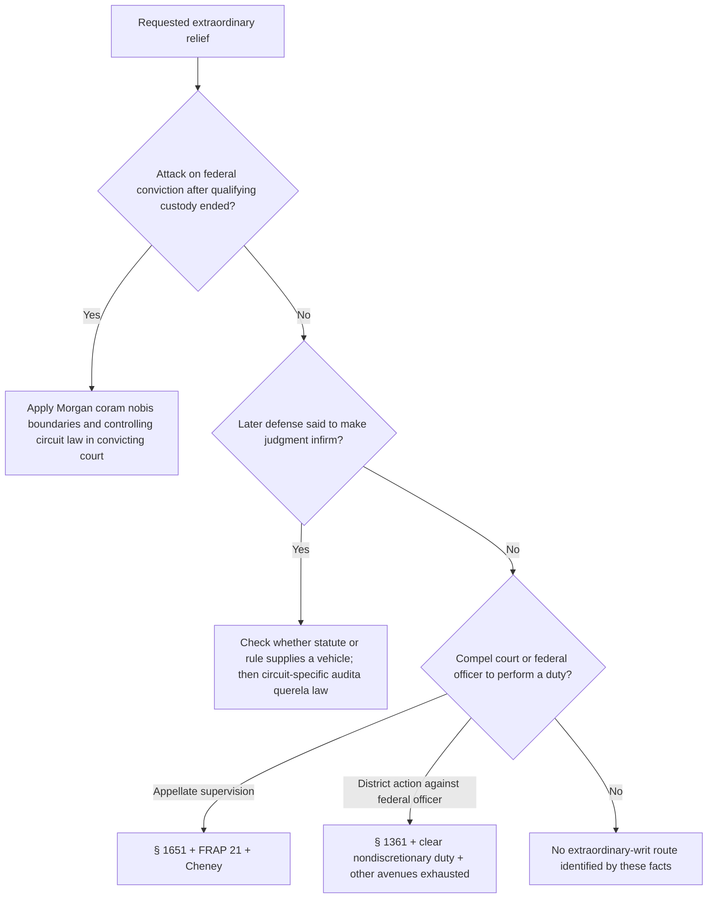

# Extraordinary Writs — Coram Nobis, Audita Querela, and Mandamus

This module classifies three different extraordinary-writ routes. The All Writs Act is auxiliary: it preserves writ authority in aid of an existing jurisdiction, but it does not create a general jurisdictional escape hatch from a governing statute, rule, appeal, or § 2255 limitation.

## All Writs Act boundary

<!-- claim:CLM-XWRIT-001 authorities:AUTH-USC-28-1651 status:verified_current -->
The All Writs Act authorizes the Supreme Court and courts established by Act of Congress to issue writs necessary or appropriate in aid of their respective jurisdictions and agreeable to the usages and principles of law. [28 U.S.C. § 1651(a)](https://www.govinfo.gov/link/uscode/28/1651)

<!-- claim:CLM-XWRIT-002 authorities:AUTH-USC-28-1651,AUTH-SCOTUS-PENN-BUREAU-474-US-34 status:verified_current -->
The words “in aid of” matter: the Act supplies instruments for a jurisdiction the court otherwise possesses; it is not an independent grant of subject-matter jurisdiction. [28 U.S.C. § 1651(a)](https://www.govinfo.gov/link/uscode/28/1651); [*Pennsylvania Bureau of Correction v. U.S. Marshals Service*, 474 U.S. 34, 41–43 (1985)](https://www.govinfo.gov/content/pkg/USREPORTS-474/pdf/USREPORTS-474-34.pdf)

<!-- claim:CLM-XWRIT-003 authorities:AUTH-SCOTUS-PENN-BUREAU-474-US-34 status:verified_current -->
A requested writ must therefore be tied to the issuing court’s existing or potential jurisdiction and to relief the court has legal authority to effect; the All Writs Act is not a general roving commission to supervise another actor. [*Pennsylvania Bureau*, 474 U.S. at 41–43](https://www.govinfo.gov/content/pkg/USREPORTS-474/pdf/USREPORTS-474-34.pdf)

<!-- claim:CLM-XWRIT-004 authorities:AUTH-SCOTUS-CARLISLE-517-US-416 status:verified_current -->
The All Writs Act cannot be used to evade or displace a specific statute or rule that governs the requested relief. [*Carlisle v. United States*, 517 U.S. 416, 428–29 (1996)](https://www.govinfo.gov/content/pkg/USREPORTS-517/pdf/USREPORTS-517-416.pdf)

## Coram nobis

<!-- claim:CLM-XWRIT-005 authorities:AUTH-SCOTUS-MORGAN-346-US-502 status:verified_current -->
*United States v. Morgan* recognizes federal coram nobis authority under § 1651 after the person has fully served the federal sentence, when the consequences of the conviction remain and the demanding writ conditions are met. [*United States v. Morgan*, 346 U.S. 502, 506–13 (1954)](https://www.govinfo.gov/content/pkg/USREPORTS-346/pdf/USREPORTS-346-502.pdf)

<!-- claim:CLM-XWRIT-006 authorities:AUTH-SCOTUS-MORGAN-346-US-502 status:verified_current -->
A federal coram nobis request is a step in the original criminal case, not a new civil habeas action, so the court that entered the federal conviction is the relevant filing court. [*Morgan*, 346 U.S. at 505 n.4, 506–07](https://www.govinfo.gov/content/pkg/USREPORTS-346/pdf/USREPORTS-346-502.pdf)

<!-- claim:CLM-XWRIT-007 authorities:AUTH-SCOTUS-MORGAN-346-US-502,AUTH-USC-28-2255 status:verified_current -->
Section 2255 did not supersede coram nobis, but § 2255 ordinarily supplies the statutory collateral vehicle while the person remains in qualifying custody under the federal judgment. [*Morgan*, 346 U.S. at 510–11](https://www.govinfo.gov/content/pkg/USREPORTS-346/pdf/USREPORTS-346-502.pdf); [28 U.S.C. § 2255(a)](https://www.govinfo.gov/link/uscode/28/2255)

<!-- claim:CLM-XWRIT-008 authorities:AUTH-SCOTUS-MORGAN-346-US-502 status:verified_current -->
Continuation of the litigation through coram nobis is allowed only under circumstances compelling action to achieve justice; ordinary disagreement with a final judgment is insufficient. [*Morgan*, 346 U.S. at 511](https://www.govinfo.gov/content/pkg/USREPORTS-346/pdf/USREPORTS-346-502.pdf)

<!-- claim:CLM-XWRIT-009 authorities:AUTH-SCOTUS-MORGAN-346-US-502 status:verified_current -->
The petitioner must show that no other remedy was available for the asserted error. [*Morgan*, 346 U.S. at 512](https://www.govinfo.gov/content/pkg/USREPORTS-346/pdf/USREPORTS-346-502.pdf)

<!-- claim:CLM-XWRIT-010 authorities:AUTH-SCOTUS-MORGAN-346-US-502 status:verified_current -->
The petitioner also must give sound reasons for failing to seek appropriate earlier relief; what satisfies that requirement depends on the record and controlling circuit law. [*Morgan*, 346 U.S. at 512](https://www.govinfo.gov/content/pkg/USREPORTS-346/pdf/USREPORTS-346-502.pdf)

<!-- claim:CLM-XWRIT-011 authorities:AUTH-SCOTUS-MORGAN-346-US-502 status:verified_current -->
The alleged error must be of the most fundamental character, not merely an ordinary correctable issue that was or could have been handled through the regular review process. [*Morgan*, 346 U.S. at 512–13](https://www.govinfo.gov/content/pkg/USREPORTS-346/pdf/USREPORTS-346-502.pdf)

<!-- claim:CLM-XWRIT-012 authorities:AUTH-SCOTUS-MORGAN-346-US-502 status:verified_current -->
Earlier proceedings are presumed correct and the coram nobis petitioner bears the burden of overcoming that presumption. [*Morgan*, 346 U.S. at 512](https://www.govinfo.gov/content/pkg/USREPORTS-346/pdf/USREPORTS-346-502.pdf)

<!-- claim:CLM-XWRIT-013 authorities:AUTH-SCOTUS-MORGAN-346-US-502 status:verified_current -->
*Morgan* treated the record-supported denial of counsel in that case as a fundamental defect, but it did not make every constitutional allegation automatically eligible for coram nobis relief. [*Morgan*, 346 U.S. at 509–13](https://www.govinfo.gov/content/pkg/USREPORTS-346/pdf/USREPORTS-346-502.pdf)

<!-- claim:CLM-XWRIT-014 authorities:AUTH-SCOTUS-MORGAN-346-US-502 status:verified_current -->
*Morgan* supplies controlling minimum boundaries, not a universal numbered four-part formulation; current circuit precedent must be checked for the circuit’s elements, treatment of delay, prejudice, waiver, and remedy. [*Morgan*, 346 U.S. at 511–13](https://www.govinfo.gov/content/pkg/USREPORTS-346/pdf/USREPORTS-346-502.pdf)

<!-- claim:CLM-XWRIT-015 authorities:AUTH-SCOTUS-MORGAN-346-US-502 status:verified_current -->
*Morgan* relied on continuing consequences to explain why post-sentence relief could matter, but the required type and proof of collateral consequences must be taken from controlling circuit law rather than assumed nationwide. [*Morgan*, 346 U.S. at 512–13](https://www.govinfo.gov/content/pkg/USREPORTS-346/pdf/USREPORTS-346-502.pdf)

<!-- claim:CLM-XWRIT-016 authorities:AUTH-SCOTUS-MORGAN-346-US-502,AUTH-SCOTUS-MALENG-490-US-488 status:verified_current -->
The end of custody does not make coram nobis an automatic fallback: the petitioner must still identify the challenged federal conviction, a live legally cognizable consequence, a fundamental error, lack of another remedy, sound reasons for delay, and all circuit requirements. [*Morgan*, 346 U.S. at 511–13](https://www.govinfo.gov/content/pkg/USREPORTS-346/pdf/USREPORTS-346-502.pdf); [*Maleng v. Cook*, 490 U.S. 488, 490–94 (1989)](https://www.govinfo.gov/content/pkg/USREPORTS-490/pdf/USREPORTS-490-488.pdf)

<!-- claim:CLM-XWRIT-017 authorities:AUTH-USC-28-2253,AUTH-SCOTUS-MORGAN-346-US-502 status:verified_current -->
The certificate-of-appealability gate in § 2253(c)(1) covers state-process habeas and § 2255 proceedings, not a federal coram nobis appeal, which *Morgan* treats as a continuation of the criminal case. [28 U.S.C. § 2253(c)(1)](https://www.govinfo.gov/link/uscode/28/2253); [*Morgan*, 346 U.S. at 505 n.4](https://www.govinfo.gov/content/pkg/USREPORTS-346/pdf/USREPORTS-346-502.pdf)

<!-- claim:CLM-XWRIT-018 authorities:AUTH-USC-28-2255,AUTH-SCOTUS-MALENG-490-US-488 status:verified_current -->
Before routing to coram nobis, determine whether qualifying custody under the challenged federal judgment existed at filing; incarceration and supervised release can support § 2255, while collateral consequences of a fully expired sentence alone do not satisfy the habeas custody requirement. [28 U.S.C. § 2255(a)](https://www.govinfo.gov/link/uscode/28/2255); [*Maleng*, 490 U.S. at 490–94](https://www.govinfo.gov/content/pkg/USREPORTS-490/pdf/USREPORTS-490-488.pdf)

<!-- claim:CLM-XWRIT-019 authorities:AUTH-SCOTUS-DENEDO-556-US-904,AUTH-USC-28-1651 status:verified_current -->
*United States v. Denedo* confirms in the military-justice setting that coram nobis is a continuation of the original proceeding and must be in aid of an existing jurisdiction; its military jurisdiction analysis should not be converted into a freestanding district-court merits test. [*United States v. Denedo*, 556 U.S. 904, 911–17 (2009)](https://www.govinfo.gov/app/details/USREPORTS-556/USREPORTS-556-904); [28 U.S.C. § 1651(a)](https://www.govinfo.gov/link/uscode/28/1651)

## Audita querela

<!-- claim:CLM-XWRIT-020 authorities:AUTH-CA9-CARRINGTON-503-F3D-888 status:verified_current -->
The common-law writ of audita querela historically addressed a judgment correct when rendered that later became infirm because of a defense or discharge arising after judgment. [*Carrington v. United States*, 503 F.3d 888, 890 (9th Cir. 2007)](https://cdn.ca9.uscourts.gov/datastore/opinions/2007/09/11/0536143.pdf)

<!-- claim:CLM-XWRIT-021 authorities:AUTH-USC-28-1651,AUTH-CA9-CARRINGTON-503-F3D-888 status:verified_current -->
The Ninth Circuit treats surviving common-law writs as gap fillers under the All Writs Act, not alternatives to an existing statutory post-conviction vehicle. [28 U.S.C. § 1651(a)](https://www.govinfo.gov/link/uscode/28/1651); [*Carrington*, 503 F.3d at 890](https://cdn.ca9.uscourts.gov/datastore/opinions/2007/09/11/0536143.pdf)

<!-- claim:CLM-XWRIT-022 authorities:AUTH-CA9-CARRINGTON-503-F3D-888 status:verified_current -->
In the Ninth Circuit, audita querela is unavailable when the claim is cognizable under § 2255; this is a labeled Ninth Circuit rule, not a claim that every circuit uses identical wording. [*Carrington*, 503 F.3d at 890](https://cdn.ca9.uscourts.gov/datastore/opinions/2007/09/11/0536143.pdf)

<!-- claim:CLM-XWRIT-023 authorities:AUTH-CA9-CARRINGTON-503-F3D-888 status:verified_current -->
The statutory restrictions on second-or-successive § 2255 motions do not themselves create the remedial gap needed for audita querela in the Ninth Circuit. [*Carrington*, 503 F.3d at 890](https://cdn.ca9.uscourts.gov/datastore/opinions/2007/09/11/0536143.pdf)

<!-- claim:CLM-XWRIT-024 authorities:AUTH-CA9-CARRINGTON-503-F3D-888 status:verified_current -->
The nonretroactivity of a later legal development likewise did not create an audita-querela gap in *Carrington*. [*Carrington*, 503 F.3d at 890](https://cdn.ca9.uscourts.gov/datastore/opinions/2007/09/11/0536143.pdf)

<!-- claim:CLM-XWRIT-025 authorities:AUTH-USC-28-1651,AUTH-SCOTUS-CARLISLE-517-US-416,AUTH-CA9-CARRINGTON-503-F3D-888 status:verified_current -->
No Supreme Court authority reviewed here establishes a nationwide criminal audita-querela elements test; availability, cognizability, any genuine statutory gap, and the requested relief require current controlling circuit authority, while the All Writs Act cannot displace an applicable statute or rule. [28 U.S.C. § 1651(a)](https://www.govinfo.gov/link/uscode/28/1651); [*Carlisle*, 517 U.S. at 428–29](https://www.govinfo.gov/content/pkg/USREPORTS-517/pdf/USREPORTS-517-416.pdf); [*Carrington*, 503 F.3d at 890](https://cdn.ca9.uscourts.gov/datastore/opinions/2007/09/11/0536143.pdf)

## Mandamus

<!-- claim:CLM-XWRIT-026 authorities:AUTH-USC-28-1651,AUTH-FRAP-21 status:verified_current -->
A court-of-appeals petition seeking mandamus or prohibition directed to a district judge invokes the appellate court’s All Writs Act authority and follows Federal Rule of Appellate Procedure 21. [28 U.S.C. § 1651(a)](https://www.govinfo.gov/link/uscode/28/1651); [Fed. R. App. P. 21](https://www.uscourts.gov/sites/default/files/document/federal-rules-of-appellate-procedure.pdf)

<!-- claim:CLM-XWRIT-027 authorities:AUTH-USC-28-1361 status:verified_current -->
Section 1361 separately gives district courts original jurisdiction over an action in the nature of mandamus to compel an officer or employee of the United States or an agency to perform a duty owed to the plaintiff. [28 U.S.C. § 1361](https://www.govinfo.gov/link/uscode/28/1361)

<!-- claim:CLM-XWRIT-028 authorities:AUTH-USC-28-1361,AUTH-SCOTUS-HECKLER-RINGER-466-US-602 status:verified_current -->
District-court mandamus under § 1361 requires exhaustion of other available avenues and a clear nondiscretionary duty; it does not authorize a court to direct how an officer exercises lawful discretion. [28 U.S.C. § 1361](https://www.govinfo.gov/link/uscode/28/1361); [*Heckler v. Ringer*, 466 U.S. 602, 616–17 (1984)](https://www.govinfo.gov/content/pkg/USREPORTS-466/pdf/USREPORTS-466-602.pdf)

<!-- claim:CLM-XWRIT-029 authorities:AUTH-SCOTUS-CHENEY-542-US-367 status:verified_current -->
Appellate mandamus requires that the petitioner have no other adequate means to obtain the requested relief. [*Cheney v. U.S. District Court*, 542 U.S. 367, 380–81 (2004)](https://www.supremecourt.gov/opinions/boundvolumes/542bv.pdf)

<!-- claim:CLM-XWRIT-030 authorities:AUTH-SCOTUS-CHENEY-542-US-367 status:verified_current -->
The petitioner also must show a clear and indisputable right to issuance of the writ. [*Cheney*, 542 U.S. at 381](https://www.supremecourt.gov/opinions/boundvolumes/542bv.pdf)

<!-- claim:CLM-XWRIT-031 authorities:AUTH-SCOTUS-CHENEY-542-US-367 status:verified_current -->
Even when the first two mandamus conditions are shown, the issuing court must independently be satisfied that the writ is appropriate under the circumstances. [*Cheney*, 542 U.S. at 381](https://www.supremecourt.gov/opinions/boundvolumes/542bv.pdf)

<!-- claim:CLM-XWRIT-032 authorities:AUTH-SCOTUS-CHENEY-542-US-367,AUTH-SCOTUS-WILL-389-US-90 status:verified_current -->
Mandamus is not a substitute for an available appeal, and that boundary is especially important for interlocutory intervention in criminal cases. [*Cheney*, 542 U.S. at 380–81](https://www.supremecourt.gov/opinions/boundvolumes/542bv.pdf); [*Will v. United States*, 389 U.S. 90, 96–98 (1967)](https://www.govinfo.gov/content/pkg/USREPORTS-389/pdf/USREPORTS-389-90.pdf)

<!-- claim:CLM-XWRIT-033 authorities:AUTH-FRAP-21 status:verified_current -->
Rule 21 requires a petition filed with the circuit clerk, service on all parties, a copy provided to the trial-court judge, a statement of the issues and necessary facts, reasons the writ should issue, and essential record parts; the appellate court may deny the petition without an answer or order an answer and set further proceedings. [Fed. R. App. P. 21(a)–(b)](https://www.uscourts.gov/sites/default/files/document/federal-rules-of-appellate-procedure.pdf)

<!-- claim:CLM-XWRIT-034 authorities:AUTH-FRAP-21,AUTH-SCOTUS-CHENEY-542-US-367 status:verified_current -->
Rule 21 creates no automatic evidentiary hearing and states no universal notice-of-appeal-style filing period; docket facts, prejudice from delay, local circuit rules, fees, emergency procedures, and any equitable timeliness doctrine must be checked immediately. [Fed. R. App. P. 21](https://www.uscourts.gov/sites/default/files/document/federal-rules-of-appellate-procedure.pdf); [*Cheney*, 542 U.S. at 380–81](https://www.supremecourt.gov/opinions/boundvolumes/542bv.pdf)

## Classification path

## Required record and local-law checks

- The exact judgment, requested relief, custody and supervision history, and present collateral consequence.
- Every earlier appeal and collateral filing, the reason an ordinary vehicle is unavailable, and the explanation for delay.
- Current circuit law on coram nobis elements, consequences, waiver, diligence, harmlessness, and remedy.
- Current circuit law recognizing or rejecting audita querela for the exact claim.
- The duty or district-court act sought, other adequate remedies, docket history, and whether the requested result is discretionary.
- Current appellate and local rules, filing fee or in-forma-pauperis procedure, service, emergency relief, and record requirements.
