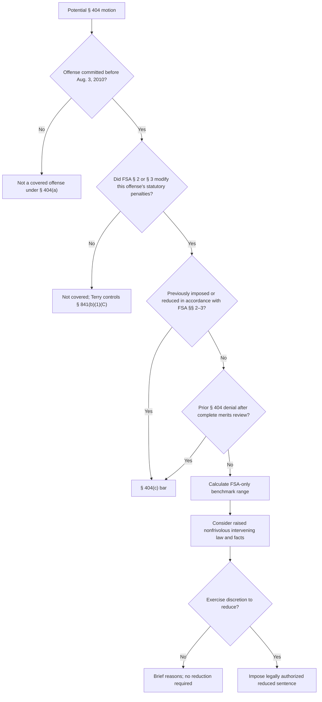

# First Step Act § 404 — Retroactive Fair Sentencing Act Relief

## Verification boundary

This module verifies the nationwide statutory framework and the Supreme Court holdings in *Dorsey*, *Terry*, and *Concepcion*. It does not decide a particular conviction's statute and penalty provision, a multi-count sentencing-package issue, a disputed drug-quantity record, a prior-order bar, the governing circuit's hearing or appellate rules, or the sentence a court should select.

## What Congress changed

<!-- claim:CLM-FSA404-001 authorities:AUTH-PL-115-391-SEC-404 status:verified_current -->
Section 404(a) defines a covered offense as a violation of a federal criminal statute whose statutory penalties were modified by Fair Sentencing Act § 2 or § 3 and that was committed before August 3, 2010. [First Step Act § 404(a)](https://www.govinfo.gov/content/pkg/PLAW-115publ391/pdf/PLAW-115publ391.pdf)

<!-- claim:CLM-FSA404-002 authorities:AUTH-PL-111-220-SECS-2-3 status:verified_historical -->
Fair Sentencing Act § 2 raised the crack quantities in 21 U.S.C. §§ 841(b)(1) and 960(b) from 5 to 28 grams for the lower mandatory-minimum tier and from 50 to 280 grams for the higher tier; § 3 removed the crack-specific mandatory-minimum sentence from 21 U.S.C. § 844(a). [Fair Sentencing Act §§ 2–3](https://www.govinfo.gov/content/pkg/PLAW-111publ220/pdf/PLAW-111publ220.pdf)

<!-- claim:CLM-FSA404-003 authorities:AUTH-PL-115-391-SEC-404 status:verified_current -->
For a covered offense, the sentencing court may act on a motion by the defendant, the Bureau of Prisons Director, the attorney for the Government, or the court and may impose a reduced sentence as if Fair Sentencing Act §§ 2 and 3 had been in effect when the offense was committed. [First Step Act § 404(b)](https://www.govinfo.gov/content/pkg/PLAW-115publ391/pdf/PLAW-115publ391.pdf)

<!-- claim:CLM-FSA404-004 authorities:AUTH-PL-115-391-SEC-404 status:verified_current -->
Section 404(c) bars the court from entertaining the motion if the sentence was previously imposed or reduced in accordance with the Fair Sentencing Act amendments, or if a previous § 404 motion was denied after December 21, 2018 following a complete review on the merits. [First Step Act § 404(c)](https://www.govinfo.gov/content/pkg/PLAW-115publ391/pdf/PLAW-115publ391.pdf)

<!-- claim:CLM-FSA404-005 authorities:AUTH-PL-115-391-SEC-404,AUTH-SCOTUS-CONCEPCION-597-US-481 status:verified_current -->
Eligibility does not require a reduction: § 404(c) expressly preserves the court's discretion to deny or limit relief. [First Step Act § 404(c)](https://www.govinfo.gov/content/pkg/PLAW-115publ391/pdf/PLAW-115publ391.pdf); [*Concepcion v. United States*, 597 U.S. 481, 501–02 (2022)](https://www.supremecourt.gov/opinions/21pdf/20-1650_new_4gci.pdf)

## Dorsey and the temporal boundary

<!-- claim:CLM-FSA404-006 authorities:AUTH-SCOTUS-DORSEY-567-US-260 status:verified_historical -->
Dorsey held that the Fair Sentencing Act's lower mandatory minimums apply to a pre-August 3, 2010 offender sentenced on or after that date. [*Dorsey v. United States*, 567 U.S. 260, 264, 281 (2012)](https://www.supremecourt.gov/opinions/boundvolumes/567bv.pdf)

<!-- claim:CLM-FSA404-007 authorities:AUTH-PL-115-391-SEC-404,AUTH-SCOTUS-DORSEY-567-US-260 status:verified_current -->
Section 404 is not textually limited to defendants whose sentences were already final before August 3, 2010. Its definition turns on the offense date, the statute and statutory penalties, and the § 404(c) bars; Dorsey answers the separate pipeline question for pre-Act conduct followed by post-Act sentencing. [First Step Act § 404(a), (c)](https://www.govinfo.gov/content/pkg/PLAW-115publ391/pdf/PLAW-115publ391.pdf); [*Dorsey*, 567 U.S. at 264](https://www.supremecourt.gov/opinions/boundvolumes/567bv.pdf)

## Terry and covered-offense classification

<!-- claim:CLM-FSA404-008 authorities:AUTH-SCOTUS-TERRY-593-US-486 status:verified_current -->
Terry held that the Fair Sentencing Act did not modify the statutory penalties for the petitioner's 21 U.S.C. § 841(b)(1)(C) offense, whose statutory range remained unchanged, so that offense was not covered by § 404. [*Terry v. United States*, 593 U.S. 486, 492–94 (2021)](https://www.supremecourt.gov/opinions/20pdf/20-5904_i4dk.pdf)

<!-- claim:CLM-FSA404-009 authorities:AUTH-PL-115-391-SEC-404,AUTH-SCOTUS-TERRY-593-US-486 status:verified_current -->
Covered-offense classification asks whether Fair Sentencing Act § 2 or § 3 modified the statutory penalties for the offense of conviction; a Guidelines change, sentencing conduct, or a crack-cocaine label alone does not satisfy § 404(a). [First Step Act § 404(a)](https://www.govinfo.gov/content/pkg/PLAW-115publ391/pdf/PLAW-115publ391.pdf); [*Terry*, 593 U.S. at 492–94](https://www.supremecourt.gov/opinions/20pdf/20-5904_i4dk.pdf)

The statutory amendments also reached 21 U.S.C. § 960(b). A nationwide eligibility screen must therefore identify the actual conviction provision rather than hard-code only §§ 841 and 844.

## Procedural vehicle and Concepcion

<!-- claim:CLM-FSA404-010 authorities:AUTH-USC-18-3582,AUTH-SCOTUS-CONCEPCION-597-US-481 status:verified_current -->
Section 3582(c)(1)(B) is the gateway allowing a term of imprisonment to be modified when another statute expressly permits it; it adds no substantive or procedural limits of its own to a § 404 motion. [18 U.S.C. § 3582(c)(1)(B)](https://uscode.house.gov/view.xhtml?req=%28title%3A18+section%3A3582%28c%29+edition%3Aprelim%29); [*Concepcion*, 597 U.S. at 497 n.5](https://www.supremecourt.gov/opinions/21pdf/20-1650_new_4gci.pdf)

<!-- claim:CLM-FSA404-011 authorities:AUTH-SCOTUS-CONCEPCION-597-US-481 status:verified_current -->
When deciding whether and how much to reduce a sentence under § 404, a district court may consider intervening changes of law or fact, including post-sentencing conduct and nonretroactive legal changes. [*Concepcion*, 597 U.S. at 486, 493–500](https://www.supremecourt.gov/opinions/21pdf/20-1650_new_4gci.pdf)

<!-- claim:CLM-FSA404-012 authorities:AUTH-SCOTUS-CONCEPCION-597-US-481 status:verified_current -->
The court must consider the parties' nonfrivolous arguments, but it may reject unpersuasive arguments without a detailed explanation and need provide only a brief statement of reasons. [*Concepcion*, 597 U.S. at 500–02](https://www.supremecourt.gov/opinions/21pdf/20-1650_new_4gci.pdf)

<!-- claim:CLM-FSA404-013 authorities:AUTH-PL-115-391-SEC-404,AUTH-SCOTUS-CONCEPCION-597-US-481 status:verified_current -->
Concepcion does not require the court to reduce a sentence because of an intervening change or any other argument; it requires consideration, not persuasion or a particular result. [*Concepcion*, 597 U.S. at 501–02](https://www.supremecourt.gov/opinions/21pdf/20-1650_new_4gci.pdf)

<!-- claim:CLM-FSA404-014 authorities:AUTH-PL-115-391-SEC-404,AUTH-SCOTUS-CONCEPCION-597-US-481 status:verified_current -->
The benchmark Guidelines range may be recalculated only to reflect retroactive application of Fair Sentencing Act §§ 2 and 3. The court may then consider post-sentencing conduct or nonretroactive legal changes when selecting or rejecting a reduction, using the correctly calculated range as the benchmark. [*Concepcion*, 597 U.S. at 498 & n.6](https://www.supremecourt.gov/opinions/21pdf/20-1650_new_4gci.pdf)

<!-- claim:CLM-FSA404-015 authorities:AUTH-USC-18-3582,AUTH-SCOTUS-CONCEPCION-597-US-481 status:verified_current -->
A § 404 matter remains a sentence-modification proceeding, not a categorical plenary resentencing. Its information-consideration rule is broad, but the statutory authorization, the § 404(c) bars, and the benchmark-range limitation still control. [18 U.S.C. § 3582(c)(1)(B)](https://uscode.house.gov/view.xhtml?req=%28title%3A18+section%3A3582%28c%29+edition%3Aprelim%29); [*Concepcion*, 597 U.S. at 496–98 & nn.4–6](https://www.supremecourt.gov/opinions/21pdf/20-1650_new_4gci.pdf)

## Other reductions, filing gates, and relief ceiling

<!-- claim:CLM-FSA404-016 authorities:AUTH-PL-115-391-SEC-404 status:verified_current -->
A prior § 3582(c)(2) Guidelines reduction is not automatically a § 404(c) bar. The prior order and sentence must be examined to determine whether the sentence was imposed or reduced in accordance with Fair Sentencing Act §§ 2 and 3 or whether a prior § 404 merits denial supplies the actual bar. [First Step Act § 404(c)](https://www.govinfo.gov/content/pkg/PLAW-115publ391/pdf/PLAW-115publ391.pdf)

<!-- claim:CLM-FSA404-017 authorities:AUTH-PL-115-391-SEC-404 status:verified_current -->
Section 404 itself states no filing deadline and no prior-request or administrative-exhaustion requirement; it authorizes the listed movants to proceed in the court that imposed the sentence. [First Step Act § 404(b)–(c)](https://www.govinfo.gov/content/pkg/PLAW-115publ391/pdf/PLAW-115publ391.pdf)

<!-- claim:CLM-FSA404-018 authorities:AUTH-PL-115-391-SEC-404,AUTH-SCOTUS-CONCEPCION-597-US-481 status:verified_current -->
Section 404 does not erase an amended statutory minimum or make an unrelated legal rule retroactive. Any requested sentence must be authorized under the Fair Sentencing Act's amended statutory framework or under a separately established legal basis. [First Step Act § 404(b)](https://www.govinfo.gov/content/pkg/PLAW-115publ391/pdf/PLAW-115publ391.pdf); [*Concepcion*, 597 U.S. at 498 n.6](https://www.supremecourt.gov/opinions/21pdf/20-1650_new_4gci.pdf)

## Record-first checklist

1. Obtain the indictment, plea or verdict, judgment, presentence report where lawfully available, sentencing findings, and every prior reduction order.
2. Identify the offense date, statute of conviction, penalty subsection, and whether Fair Sentencing Act § 2 or § 3 modified that offense's statutory penalties.
3. Apply both § 404(c) bars to the actual prior orders; do not treat every earlier reduction as disqualifying.
4. Calculate the Fair Sentencing Act benchmark without folding unrelated, nonretroactive changes into the range.
5. Separately organize intervening-law and intervening-fact arguments for discretionary consideration.
6. Research the controlling circuit and district rules for appointment, briefing, presence, hearing, appeal timing, standard of review, multi-count packages, supervised release, and the required explanation.

## Decision path

## Matters not yet verified in this module

- Circuit-specific burdens, multi-count and sentencing-package doctrines, hearing or presence rights, and standards of appellate review.
- The correct appellate deadline and any local motion or standing-order process in a particular case.
- Whether § 3553(a) is a mandatory decisional checklist in every circuit, as distinct from permissible consideration of the same subjects.
- Eligibility or the available reduction for any individual judgment, including § 960, conspiracy, attempt, supervised-release, and mixed-count cases.
- Whether a particular earlier order was “in accordance with” the Fair Sentencing Act or was a complete merits review under § 404(c).
- Any transfer of *Concepcion*'s holding to compassionate-release motions; *Concepcion* decided a § 404 motion.

These questions remain open in `data/coverage_matrix.yaml`; the legacy framework is not validated as a whole.
