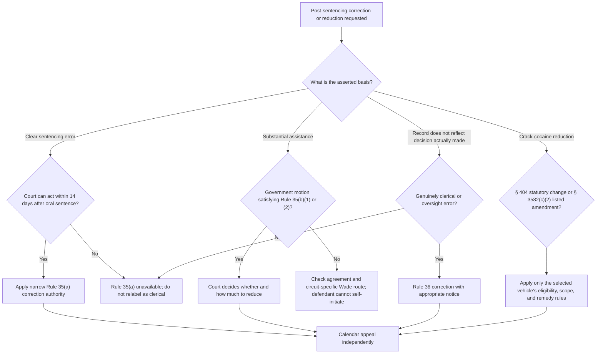

# Rules 35 and 36 — Sentence Correction, Assistance, Record Error, and Appeals

Rules 35(a), 35(b), and 36 solve different problems. Rule 35(a) provides a fourteen-day clear-error correction power; Rule 35(b) permits a government-initiated substantial-assistance reduction; Rule 36 makes the record accurately reflect the decision already made. None is a general resentencing motion.

## Finality and classification

<!-- claim:CLM-R3536-001 authorities:AUTH-USC-18-3582,AUTH-FRCRIM-P-35-36 status:verified_current -->
Under § 3582(b), a federal judgment of conviction that includes imprisonment "constitutes a final judgment for all other purposes" even though the sentence can later be modified under § 3582(c), corrected under Rule 35 and § 3742, or appealed and modified under § 3742 if outside the guideline range. Rule 36 separately permits correction of a clerical error or an error in the record arising from oversight or omission without supplying a substantive sentence-modification power. [18 U.S.C. § 3582(b)](https://www.govinfo.gov/link/uscode/18/3582); [Fed. R. Crim. P. 36](https://www.uscourts.gov/sites/default/files/2025-02/federal-rules-of-criminal-procedure-dec-1-2024.pdf)

<!-- claim:CLM-R3536-002 authorities:AUTH-USC-18-3582,AUTH-FRCRIM-P-35-36 status:verified_current -->
Section 3582(c)(1)(B) permits modification only to the extent expressly allowed by statute or Rule 35; the cross-reference does not enlarge Rule 35’s own trigger, timing, movant, or scope. [18 U.S.C. § 3582(c)(1)(B)](https://www.govinfo.gov/link/uscode/18/3582); [Fed. R. Crim. P. 35](https://www.uscourts.gov/sites/default/files/2025-02/federal-rules-of-criminal-procedure-dec-1-2024.pdf)

<!-- claim:CLM-R3536-003 authorities:AUTH-FRCRIM-P-35-36 status:verified_current -->
Rules 35 and 36 authorize three distinct acts: correction, within 14 days after sentencing (which Rule 35(c) defines as the oral announcement of the sentence), of a sentence that resulted from arithmetical, technical, or other clear error under Rule 35(a); reduction under Rule 35(b), on the government's motion made within one year of sentencing (or later only in the circumstances listed in Rule 35(b)(2)), for the defendant's substantial assistance in investigating or prosecuting another person; and correction under Rule 36 of a clerical error in a judgment, order, or other part of the record, or of an error in the record arising from oversight or omission. [Fed. R. Crim. P. 35–36](https://www.uscourts.gov/sites/default/files/2025-02/federal-rules-of-criminal-procedure-dec-1-2024.pdf)

## Rule 35(a): clear sentencing error

<!-- claim:CLM-R3536-004 authorities:AUTH-FRCRIM-P-35-36 status:verified_current -->
Within fourteen days after sentencing, the court may correct a sentence that resulted from arithmetical, technical, or other clear error. [Fed. R. Crim. P. 35(a)](https://www.uscourts.gov/sites/default/files/2025-02/federal-rules-of-criminal-procedure-dec-1-2024.pdf)

<!-- claim:CLM-R3536-005 authorities:AUTH-FRCRIM-P-35-36 status:verified_current -->
For Rule 35, “sentencing” means the oral announcement of the sentence, not entry of the written judgment. [Fed. R. Crim. P. 35(c)](https://www.uscourts.gov/sites/default/files/2025-02/federal-rules-of-criminal-procedure-dec-1-2024.pdf)

<!-- claim:CLM-R3536-006 authorities:AUTH-FRCRIM-P-35-36,AUTH-FRCRIM-P-35-ADVISORY-NOTES status:verified_current -->
Rule 35(a)'s correction authority is narrow. The 1991 committee note, written when the provision was Rule 35(c) (the 2002 note says former Rule 35(c) "is now located in Rule 35(a)"), says the authority "is intended to be very narrow and to extend only to those cases in which an obvious error or mistake has occurred in the sentence." It "is not intended to afford the court the opportunity to reconsider the application or interpretation of the sentencing guidelines or for the court simply to change its mind about the appropriateness of the sentence," and it should not "be used to reopen issues previously resolved at the sentencing hearing through the exercise of the court’s discretion with regard to the application of the sentencing guidelines." [Fed. R. Crim. P. 35 advisory committee's notes to 1991 and 2002 amendments, 18 U.S.C. app. at 146 (2024)](https://www.govinfo.gov/content/pkg/USCODE-2024-title18/pdf/USCODE-2024-title18-app.pdf)

<!-- claim:CLM-R3536-007 authorities:AUTH-FRCRIM-P-35-36,AUTH-FRCRIM-P-35-ADVISORY-NOTES status:verified_current -->
Within 14 days after sentencing, the court may correct a sentence that resulted from arithmetical, technical, or other clear error, and Rule 35(c) defines "sentencing" as "the oral announcement of the sentence," so the 14 days run from the oral announcement. The advisory committee's note to the 1991 amendment, written when this authority was Rule 35(c), says it "is intended to be very narrow and to extend only to those cases in which an obvious error or mistake has occurred in the sentence," and contemplates that the order correcting the sentence "must be entered within" the period then allowed. The 2002 note states that former Rule 35(c) "is now located in Rule 35(a)," and the 2009 amendment expanded the period from 7 to 14 days. [Fed. R. Crim. P. 35(a), (c)](https://www.uscourts.gov/sites/default/files/2025-02/federal-rules-of-criminal-procedure-dec-1-2024.pdf); [Fed. R. Crim. P. 35 advisory committee's notes to 1991, 2002, and 2009 amendments, 18 U.S.C. app. at 146–47 (2024)](https://www.govinfo.gov/content/pkg/USCODE-2024-title18/pdf/USCODE-2024-title18-app.pdf)

<!-- claim:CLM-R3536-008 authorities:AUTH-FRCRIM-P-35-36,AUTH-FRCRIM-P-45,AUTH-FRCRIM-P-35-ADVISORY-NOTES status:verified_current -->
Because Rule 35(a) authorizes "the court" to correct the sentence and does not require a party's motion, the court may act on its own within the rule's authority and time. The 1991 committee note to the provision now in Rule 35(a) recognizes that "the court could sua sponte make the correction" and, although the rule does not expressly address advance notice to the parties or whether the defendant should be present, contemplates that the court will act in accordance with Rules 32 and 43 with regard to any corrections in the sentence. [Fed. R. Crim. P. 35(a)](https://www.uscourts.gov/sites/default/files/2025-02/federal-rules-of-criminal-procedure-dec-1-2024.pdf); [Fed. R. Crim. P. 35 advisory committee's note to 1991 amendment, 18 U.S.C. app. at 146 (2024)](https://www.govinfo.gov/content/pkg/USCODE-2024-title18/pdf/USCODE-2024-title18-app.pdf)

<!-- claim:CLM-R3536-009 authorities:AUTH-FRCRIM-P-45,AUTH-FRCRIM-P-35-36 status:verified_current -->
Criminal Rule 45(b)(2) forbids extending the time to take any action under Rule 35 "except as stated in that rule," so an ordinary Rule 45(b)(1) excusable-neglect extension does not apply to Rule 35(a). Rule 62(d)(4) supplies an emergency exception: after a Criminal Rules emergency is declared, if emergency conditions provide good cause, a court may extend the time to take action under Rule 35 "as reasonably necessary." [Fed. R. Crim. P. 45(b)(2)](https://www.govinfo.gov/content/pkg/USCODE-2024-title18/pdf/USCODE-2024-title18-app.pdf); [Fed. R. Crim. P. 35(a), 62(d)(4)](https://www.uscourts.gov/sites/default/files/2025-02/federal-rules-of-criminal-procedure-dec-1-2024.pdf)

<!-- claim:CLM-R3536-010 authorities:AUTH-FRAP-3-4-22,AUTH-FRCRIM-P-35-36 status:verified_current -->
A notice of appeal does not divest the district court of authority to correct under Rule 35(a), and a Rule 35(a) motion does not invalidate a notice filed before disposition; the Rule 35(a) clock and appeal clock therefore require separate calculation. [Fed. R. App. P. 4(b)(5)](https://www.uscourts.gov/sites/default/files/document/federal-rules-of-appellate-procedure.pdf); [Fed. R. Crim. P. 35(a)](https://www.uscourts.gov/sites/default/files/2025-02/federal-rules-of-criminal-procedure-dec-1-2024.pdf)

<!-- claim:CLM-R3536-011 authorities:AUTH-FRCRIM-P-35-36,AUTH-FRCRIM-P-45 status:verified_current -->
Apart from Rule 62(d)(4)'s emergency extension, the national rules supply no equitable-tolling or party-motion exception to Rule 35(a)'s 14-day period: Rule 45(b)(2) bars extending time under Rule 35 except as that rule states, and Rule 62(d)(4) applies only after a Criminal Rules emergency is declared, letting a court, if emergency conditions provide good cause, extend the time "as reasonably necessary." Whether the 14-day limit is jurisdictional, a claim-processing rule, or another kind of limit is a question of controlling circuit precedent that these rules do not answer. [Fed. R. Crim. P. 35(a), 62(d)(4)](https://www.uscourts.gov/sites/default/files/2025-02/federal-rules-of-criminal-procedure-dec-1-2024.pdf); [Fed. R. Crim. P. 45(b)(2)](https://www.govinfo.gov/content/pkg/USCODE-2024-title18/pdf/USCODE-2024-title18-app.pdf)

<!-- claim:CLM-R3536-012 authorities:AUTH-FRCRIM-P-35-36,AUTH-FRCRIM-P-35-ADVISORY-NOTES status:verified_current -->
Rule 35(a) authorizes the court to correct a sentence that resulted from arithmetical, technical, or other clear error. The 1991 committee note (written when the provision was Rule 35(c), now Rule 35(a) per the 2002 note) says the authority extends "only to those cases in which an obvious error or mistake has occurred in the sentence"; it is not intended to let the court "reconsider the application or interpretation of the sentencing guidelines," and it should not "be used to reopen issues previously resolved at the sentencing hearing through the exercise of the court’s discretion with regard to the application of the sentencing guidelines." [Fed. R. Crim. P. 35(a)](https://www.uscourts.gov/sites/default/files/2025-02/federal-rules-of-criminal-procedure-dec-1-2024.pdf); [Fed. R. Crim. P. 35 advisory committee's notes to 1991 and 2002 amendments, 18 U.S.C. app. at 146 (2024)](https://www.govinfo.gov/content/pkg/USCODE-2024-title18/pdf/USCODE-2024-title18-app.pdf)

## Rule 35(b): substantial assistance

<!-- claim:CLM-R3536-013 authorities:AUTH-FRCRIM-P-35-36 status:verified_current -->
Only the government may make a Rule 35(b) substantial-assistance motion; a defendant’s own filing cannot substitute for the required government motion. [Fed. R. Crim. P. 35(b)(1)–(2)](https://www.uscourts.gov/sites/default/files/2025-02/federal-rules-of-criminal-procedure-dec-1-2024.pdf)

<!-- claim:CLM-R3536-014 authorities:AUTH-FRCRIM-P-35-36 status:verified_current -->
On a government motion made within one year after sentencing, the court may reduce the sentence if the defendant, after sentencing, provided substantial assistance in investigating or prosecuting another person. [Fed. R. Crim. P. 35(b)(1)](https://www.uscourts.gov/sites/default/files/2025-02/federal-rules-of-criminal-procedure-dec-1-2024.pdf)

<!-- claim:CLM-R3536-015 authorities:AUTH-FRCRIM-P-35-36 status:verified_current -->
A government motion made more than one year after sentencing may proceed under Rule 35(b)(2)(A) when the substantial assistance involved information the defendant did not know until one year or more after sentencing. [Fed. R. Crim. P. 35(b)(2)(A)](https://www.uscourts.gov/sites/default/files/2025-02/federal-rules-of-criminal-procedure-dec-1-2024.pdf)

<!-- claim:CLM-R3536-016 authorities:AUTH-FRCRIM-P-35-36 status:verified_current -->
Rule 35(b)(2)(B) covers information the defendant gave the government within the first year that did not become useful to the government until more than one year after sentencing. [Fed. R. Crim. P. 35(b)(2)(B)](https://www.uscourts.gov/sites/default/files/2025-02/federal-rules-of-criminal-procedure-dec-1-2024.pdf)

<!-- claim:CLM-R3536-017 authorities:AUTH-FRCRIM-P-35-36 status:verified_current -->
Rule 35(b)(2)(C) covers information whose usefulness could not reasonably have been anticipated by the defendant until more than one year after sentencing and that the defendant promptly gave the government after its usefulness became reasonably apparent. [Fed. R. Crim. P. 35(b)(2)(C)](https://www.uscourts.gov/sites/default/files/2025-02/federal-rules-of-criminal-procedure-dec-1-2024.pdf)

<!-- claim:CLM-R3536-018 authorities:AUTH-FRCRIM-P-35-36 status:verified_current -->
Rule 35(b)(4), not subsection (b)(3), provides that when acting under Rule 35(b), the court may reduce the sentence to a level below the minimum sentence established by statute. [Fed. R. Crim. P. 35(b)(4)](https://www.uscourts.gov/sites/default/files/2025-02/federal-rules-of-criminal-procedure-dec-1-2024.pdf)

<!-- claim:CLM-R3536-019 authorities:AUTH-FRCRIM-P-35-36 status:verified_current -->
Rule 35(b)(3), not subsection (b)(4), provides that in evaluating whether the defendant has provided substantial assistance, the court may consider the defendant's presentence assistance; presentence assistance alone does not satisfy Rule 35(b)(1), which requires assistance provided after sentencing. [Fed. R. Crim. P. 35(b)(1), (b)(3)](https://www.uscourts.gov/sites/default/files/2025-02/federal-rules-of-criminal-procedure-dec-1-2024.pdf)

<!-- claim:CLM-R3536-020 authorities:AUTH-FRCRIM-P-35-36 status:verified_current -->
Even after a qualifying government motion, Rule 35(b) says the court “may” reduce the sentence; the existence and amount of a reduction remain judicial decisions within the rule and controlling law. [Fed. R. Crim. P. 35(b)(1)–(2)](https://www.uscourts.gov/sites/default/files/2025-02/federal-rules-of-criminal-procedure-dec-1-2024.pdf)

<!-- claim:CLM-R3536-021 authorities:AUTH-SCOTUS-WADE-504-US-181 status:verified_current -->
*Wade v. United States* held in the § 3553(e) and Guideline § 5K1.1 context that district courts may review a government refusal to file a substantial-assistance motion and grant a remedy if the refusal was based on an unconstitutional motive; accepting the government's concession, the Court also said relief would be available if the refusal "was not rationally related to any legitimate Government end." A showing of assistance is necessary but not sufficient, since the government may refuse based on "its rational assessment of the cost and benefit," and generalized allegations of improper motive do not entitle a defendant to a remedy, discovery, or a hearing. [*Wade v. United States*, 504 U.S. 181, 185–87 (1992)](https://www.govinfo.gov/content/pkg/USREPORTS-504/pdf/USREPORTS-504-181.pdf)

<!-- claim:CLM-R3536-022 authorities:AUTH-SCOTUS-WADE-504-US-181 status:verified_current -->
*Wade* also holds that a claim of substantial assistance, standing alone, does not entitle the defendant to relief, discovery, or an evidentiary hearing; a substantial threshold showing of improper motive is required. [*Wade*, 504 U.S. at 186](https://www.govinfo.gov/content/pkg/USREPORTS-504/pdf/USREPORTS-504-181.pdf)

<!-- claim:CLM-R3536-023 authorities:AUTH-SCOTUS-WADE-504-US-181,AUTH-FRCRIM-P-35-36 status:verified_current -->
Because *Wade* itself did not decide a Rule 35(b) dispute, application of its refusal-to-move framework to a post-sentencing Rule 35(b) request must be supported by current controlling circuit precedent. [*Wade*, 504 U.S. at 183–87](https://www.govinfo.gov/content/pkg/USREPORTS-504/pdf/USREPORTS-504-181.pdf); [Fed. R. Crim. P. 35(b)](https://www.uscourts.gov/sites/default/files/2025-02/federal-rules-of-criminal-procedure-dec-1-2024.pdf)

<!-- claim:CLM-R3536-024 authorities:AUTH-SCOTUS-SANTOBELLO-404-US-257,AUTH-SCOTUS-PUCKETT-556-US-129,AUTH-FRCRIM-P-35-36 status:verified_current -->
An alleged government promise to make or consider a Rule 35(b) motion presents a distinct agreement question: under *Santobello*, a prosecutor's promise must be fulfilled when a plea rests in any significant degree on it, "so that it can be said to be part of the inducement or consideration," and *Puckett* treats plea bargains as "essentially contracts," applies plain-error review to a forfeited breach claim, and recognizes rescission or specific performance as possible remedies. Neither case involved a Rule 35(b) motion or a post-sentencing cooperation promise, so applying them to such a promise extends their holdings. That question is not resolved merely by labeling the cooperation substantial. [*Santobello v. New York*, 404 U.S. 257, 262–63 (1971)](https://www.govinfo.gov/content/pkg/USREPORTS-404/pdf/USREPORTS-404-257.pdf); [*Puckett v. United States*, 556 U.S. 129, 133–34, 137 (2009)](https://www.govinfo.gov/content/pkg/USREPORTS-556/pdf/USREPORTS-556-129.pdf); [Fed. R. Crim. P. 35(b)](https://www.uscourts.gov/sites/default/files/2025-02/federal-rules-of-criminal-procedure-dec-1-2024.pdf)

<!-- claim:CLM-R3536-025 authorities:AUTH-FRCRIM-P-35-36,AUTH-FRCRIM-P-45,AUTH-FRCRIM-P-35-ADVISORY-NOTES status:verified_current -->
Rule 35(b)(1) requires the government's motion within one year of sentencing, and on a later motion Rule 35(b)(2) allows a reduction if the defendant's substantial assistance "involved" one of its three categories (the 2002 committee note adds that a court "does not lose jurisdiction to consider a Rule 35(b)(2) motion simply because other information, not covered by any of the three provisions in Rule 35(b)(2), is presented in the motion"); the rule states no period within which the court must decide a properly filed motion; the 1991 committee note says that although "no specific time limit is set on the court's ruling," the government bears the burden "to request and justify a delay in the court's ruling." Docket delay, prejudice, and any extraordinary remedy require separate current authority. [Fed. R. Crim. P. 35(b)](https://www.uscourts.gov/sites/default/files/2025-02/federal-rules-of-criminal-procedure-dec-1-2024.pdf); [Fed. R. Crim. P. 35 advisory committee's notes to 1991 and 2002 amendments, 18 U.S.C. app. at 145, 147 (2024)](https://www.govinfo.gov/content/pkg/USCODE-2024-title18/pdf/USCODE-2024-title18-app.pdf)

## Rule 36: clerical record correction

<!-- claim:CLM-R3536-026 authorities:AUTH-FRCRIM-P-35-36 status:verified_current -->
After giving any notice it considers appropriate, the court may at any time correct a clerical error in a judgment, order, or other part of the record, or an error in the record arising from oversight or omission. [Fed. R. Crim. P. 36](https://www.uscourts.gov/sites/default/files/2025-02/federal-rules-of-criminal-procedure-dec-1-2024.pdf)

<!-- claim:CLM-R3536-027 authorities:AUTH-FRCRIM-P-35-36 status:verified_current -->
Rule 36 corrects the record; it does not authorize a new substantive sentencing decision or a second decision on an issue the court actually resolved. [Fed. R. Crim. P. 36](https://www.uscourts.gov/sites/default/files/2025-02/federal-rules-of-criminal-procedure-dec-1-2024.pdf)

<!-- claim:CLM-R3536-028 authorities:AUTH-CA2-WERBER-51-F3D-342,AUTH-CA11-PORTILLO-363-F3D-1161,AUTH-FRCRIM-P-35-36 status:verified_current -->
Rule 36 may be used to conform a written judgment to an unambiguous sentence actually pronounced and to correct minor, mechanical clerical errors; it may not be used to amend the oral sentence itself or to implement the court's unexpressed sentencing intentions. [*United States v. Werber*, 51 F.3d 342 (2d Cir. 1995)](https://www.courtlistener.com/opinion/692969/united-states-v-werber/); [*United States v. Portillo*, 363 F.3d 1161, 1164–65 (11th Cir. 2004)](https://www.courtlistener.com/opinion/76508/united-states-v-byron-leonel-portillo/); [Fed. R. Crim. P. 36](https://www.uscourts.gov/sites/default/files/2025-02/federal-rules-of-criminal-procedure-dec-1-2024.pdf)

<!-- claim:CLM-R3536-029 authorities:AUTH-CA2-WERBER-51-F3D-342,AUTH-CA11-PORTILLO-363-F3D-1161,AUTH-FRCRIM-P-35-36 status:verified_current -->
A correction that changes the court's substantive sentencing decision or attempts to correct an error of law is outside Rule 36. Published circuit authority applies that limit to an attempt to implement an unexpressed sentencing intention, to grant a Guidelines departure the court mistakenly failed to grant, or otherwise to alter the sentence rather than correct its transcription. [*United States v. Werber*, 51 F.3d 342 (2d Cir. 1995)](https://www.courtlistener.com/opinion/692969/united-states-v-werber/); [*United States v. Portillo*, 363 F.3d 1161, 1164–65 (11th Cir. 2004)](https://www.courtlistener.com/opinion/76508/united-states-v-byron-leonel-portillo/); [Fed. R. Crim. P. 36](https://www.uscourts.gov/sites/default/files/2025-02/federal-rules-of-criminal-procedure-dec-1-2024.pdf)

<!-- claim:CLM-R3536-030 authorities:AUTH-FRCRIM-P-35-36 status:verified_current -->
Rule 36 names no movant, so it does not restrict who may alert the court, and it permits the court to correct on its own; but the correction must still be of a clerical error, or of an error in the record arising from oversight or omission, and is made "after giving any notice it considers appropriate." [Fed. R. Crim. P. 36](https://www.uscourts.gov/sites/default/files/2025-02/federal-rules-of-criminal-procedure-dec-1-2024.pdf)

<!-- claim:CLM-R3536-032 authorities:AUTH-FRCRIM-P-35-36,AUTH-FRCRIM-P-37,AUTH-FRCRIM-P-45 status:verified_current -->
Although Rule 36 says "at any time," a pending appeal can affect district-court authority; for a timely motion the court lacks authority to grant because of an appeal that has been docketed and is pending, Rule 37(a) lets the court defer, deny, or state that it would grant the motion if the court of appeals remands or that the motion raises a substantial issue. If the court so states, Rule 37(b) requires the movant to promptly notify the circuit clerk under Federal Rule of Appellate Procedure 12.1, and under Rule 37(c) the court may decide the motion if the court of appeals remands for that purpose; Rule 37 does not define when an appeal limits district-court authority, which is subject to controlling circuit law. [Fed. R. Crim. P. 36](https://www.uscourts.gov/sites/default/files/2025-02/federal-rules-of-criminal-procedure-dec-1-2024.pdf); [Fed. R. Crim. P. 37](https://www.uscourts.gov/sites/default/files/document/federal-rules-of-criminal-procedure.pdf); [Fed. R. Crim. P. 37 advisory committee's note to 2012 adoption, 18 U.S.C. app. (2024)](https://www.govinfo.gov/content/pkg/USCODE-2024-title18/pdf/USCODE-2024-title18-app.pdf)

<!-- claim:CLM-R3536-033 authorities:AUTH-FRCRIM-P-35-36 status:verified_current -->
Rule 36 itself requires only such notice as the court considers appropriate and does not create an automatic hearing, response, national form, or universal burden formulation; a material dispute about the record requires current circuit and local procedure. [Fed. R. Crim. P. 36](https://www.uscourts.gov/sites/default/files/2025-02/federal-rules-of-criminal-procedure-dec-1-2024.pdf)

## Crack-cocaine reduction routes

<!-- claim:CLM-R3536-034 authorities:AUTH-PL-115-391-SEC-404,AUTH-USC-18-3582,AUTH-USSG-2026-1B1-10 status:verified_current -->
A request described generally as “crack-cocaine resentencing” must be classified: First Step Act § 404 addresses covered statutory Fair Sentencing Act changes, while § 3582(c)(2) and Guideline § 1B1.10 address a listed retroactive Guidelines amendment that actually lowers the applicable range. [First Step Act § 404](https://www.govinfo.gov/content/pkg/PLAW-115publ391/pdf/PLAW-115publ391.pdf); [18 U.S.C. § 3582(c)(2)](https://www.govinfo.gov/link/uscode/18/3582); [U.S.S.G. § 1B1.10](https://www.ussc.gov/guidelines/2026-guidelines-manual/annotated-2026-chapter-1)

<!-- claim:CLM-R3536-035 authorities:AUTH-PL-115-391-SEC-404,AUTH-PL-111-220-SECS-2-3,AUTH-SCOTUS-DORSEY-567-US-260,AUTH-SCOTUS-TERRY-593-US-486 status:verified_current -->
Section 404 eligibility turns on a pre-August 3, 2010 violation whose statutory penalties were modified by Fair Sentencing Act § 2 or § 3, subject to § 404(c); *Terry* does not treat every crack-related conviction as covered. [First Step Act § 404](https://www.govinfo.gov/content/pkg/PLAW-115publ391/pdf/PLAW-115publ391.pdf); [Fair Sentencing Act §§ 2–3](https://www.govinfo.gov/content/pkg/PLAW-111publ220/pdf/PLAW-111publ220.pdf); [*Dorsey v. United States*, 567 U.S. 260, 264, 273–82 (2012)](https://www.govinfo.gov/content/pkg/USREPORTS-567/pdf/USREPORTS-567-260.pdf); [*Terry v. United States*, 593 U.S. 486, 489–94 (2021)](https://www.supremecourt.gov/opinions/20pdf/20-5904_i4dk.pdf)

<!-- claim:CLM-R3536-036 authorities:AUTH-USC-18-3582,AUTH-USSG-2026-1B1-10,AUTH-SCOTUS-DILLON-560-US-817,AUTH-SCOTUS-HUGHES-584-US-675 status:verified_current -->
Section 3582(c)(2) requires that the defendant was "sentenced to a term of imprisonment based on a sentencing range that has subsequently been lowered by the Sentencing Commission," and § 1B1.10 permits a reduction only if an amendment listed in § 1B1.10(d) applies and actually lowers the applicable guideline range; for a Rule 11(c)(1)(C) plea, *Hughes* holds the sentence is "based on" the range if it "was part of the framework the district court relied on in imposing the sentence or accepting the agreement." *Dillon*'s two steps then apply: § 1B1.10 governs eligibility and the extent of any reduction, which § 1B1.10(b)(2) generally limits to the minimum of the amended range, before the court weighs the § 3553(a) factors. [18 U.S.C. § 3582(c)(2)](https://www.govinfo.gov/link/uscode/18/3582); [U.S.S.G. § 1B1.10(a), (b)(2) (2026)](https://www.ussc.gov/guidelines/2026-guidelines-manual/annotated-2026-chapter-1); [*Dillon v. United States*, 560 U.S. 817, 826–27 (2010)](https://www.supremecourt.gov/opinions/boundvolumes/560bv.pdf); [*Hughes v. United States*, 584 U.S. 675, 685–86 (2018)](https://www.supremecourt.gov/opinions/17pdf/584us2r43_llh1.pdf)

<!-- claim:CLM-R3536-037 authorities:AUTH-PL-115-391-SEC-404,AUTH-USC-18-3582,AUTH-SCOTUS-CONCEPCION-597-US-481,AUTH-SCOTUS-DILLON-560-US-817 status:verified_current -->
Section 404 and § 3582(c)(2) are not interchangeable: *Concepcion* governs the information a court may consider within § 404’s statutory framework, while *Dillon* and § 1B1.10 constrain the distinct retroactive-amendment proceeding. [*Concepcion v. United States*, 597 U.S. 481, 495–502 (2022)](https://www.supremecourt.gov/opinions/21pdf/20-1650_new_4gci.pdf); [*Dillon*, 560 U.S. at 825–30](https://www.supremecourt.gov/opinions/boundvolumes/560bv.pdf)

## Appeal rights and review

<!-- claim:CLM-R3536-038 authorities:AUTH-FRAP-3-4-22 status:verified_current -->
In a criminal case, the defendant's notice is due within 14 days, and the government's within 30 days, after the later of entry of the judgment or order appealed or the filing of the other side's notice of appeal, and, for an appeal from a judgment of conviction, a timely motion listed in Rule 4(b)(3)(A) resets the defendant's period. An inmate's notice is timely under Rule 4(c)(1) if it is deposited in the institution's internal mail system (its legal-mail system, if it has one) on or before the last day for filing and either is accompanied by the required declaration, notarized statement, or evidence (such as a postmark or date stamp) showing deposit and prepaid postage, or the court of appeals permits the later filing of a declaration or notarized statement; when a defendant files under Rule 4(c), the government's 30 days run from the later of entry of the judgment or order appealed or the district court's docketing of the defendant's notice under Rule 4(c)(3); and under Rule 4(b)(4), the district court may extend the time by no more than 30 days from the expiration of the original period upon a finding of excusable neglect or good cause. [Fed. R. App. P. 4(b)–(c)](https://www.uscourts.gov/sites/default/files/document/federal-rules-of-appellate-procedure.pdf)

<!-- claim:CLM-R3536-039 authorities:AUTH-FRAP-3-4-22 status:verified_current -->
Rule 4(b)(3)(A) resets a defendant's criminal appeal period only for a timely motion for judgment of acquittal under Rule 29, for a new trial under Rule 33 (if based on newly discovered evidence, only if made within 14 days after entry of the judgment), or for arrest of judgment under Rule 34; it does not list a motion for reconsideration, so any effect such a motion has on finality or the appeal period depends on controlling case law, not on Rule 4(b) or a generic civil-motion rule. [Fed. R. App. P. 4(b)(3)](https://www.uscourts.gov/sites/default/files/document/federal-rules-of-appellate-procedure.pdf)

<!-- claim:CLM-R3536-040 authorities:AUTH-USC-28-1291,AUTH-USC-18-3742 status:verified_current -->
Sections 1291 and 3742 provide different appellate-jurisdiction texts; whether a particular Rule 35, Rule 36, compassionate-release, retroactive-amendment, or § 404 order proceeds under one or both requires the exact order, appellant, issue, and controlling circuit law. [28 U.S.C. § 1291](https://www.govinfo.gov/link/uscode/28/1291); [18 U.S.C. § 3742](https://www.govinfo.gov/link/uscode/18/3742)

<!-- claim:CLM-R3536-041 authorities:AUTH-USC-28-2253,AUTH-FRAP-3-4-22 status:verified_current -->
An appeal from an ordinary Rule 35, Rule 36, § 3582, or § 404 order is not a state-process habeas or § 2255 appeal and therefore does not use § 2253(c)’s certificate-of-appealability gate. [28 U.S.C. § 2253(c)(1)](https://www.govinfo.gov/link/uscode/28/2253); [Fed. R. App. P. 22(b)](https://www.uscourts.gov/sites/default/files/document/federal-rules-of-appellate-procedure.pdf)

<!-- claim:CLM-R3536-042 authorities:AUTH-SCOTUS-CHAVEZ-MEZA-585-US-109 status:verified_current -->
*Chavez-Meza* did not decide whether a § 3582(c)(2) order must meet the explanation standard that applies at an original sentencing; assuming it does, the Court held a form order sufficient because the record as a whole, including the original sentencing, showed that the judge "considered the parties' arguments and ha[d] a reasoned basis." The Court found no law or convincing reason for a presumption of a proportional reduction, and how much explanation is needed depends on the circumstances of the particular case. [*Chavez-Meza v. United States*, 585 U.S. 109, 115–19 (2018)](https://www.govinfo.gov/content/pkg/USREPORTS-585/pdf/USREPORTS-585-109.pdf)

<!-- claim:CLM-R3536-043 authorities:AUTH-SCOTUS-CONCEPCION-597-US-481 status:verified_current -->
In a § 404 proceeding, the court must consider nonfrivolous arguments and give a brief statement of reasons, but it need not accept the arguments or reduce the sentence; the benchmark range is recalculated only for Fair Sentencing Act changes. [*Concepcion*, 597 U.S. at 495–502 & n.6](https://www.supremecourt.gov/opinions/21pdf/20-1650_new_4gci.pdf)

<!-- claim:CLM-R3536-044 authorities:AUTH-USC-28-1291,AUTH-USC-18-3742,AUTH-SCOTUS-CHAVEZ-MEZA-585-US-109,AUTH-SCOTUS-CONCEPCION-597-US-481 status:verified_current -->
There is no single undifferentiated sentence-modification standard of review: classify appellate jurisdiction, legal eligibility and statutory interpretation, factual findings, discretionary relief, explanation, preservation, and harmlessness separately under current controlling circuit law. [28 U.S.C. § 1291](https://www.govinfo.gov/link/uscode/28/1291); [18 U.S.C. § 3742](https://www.govinfo.gov/link/uscode/18/3742); [*Chavez-Meza*, 585 U.S. at 115–20](https://www.govinfo.gov/content/pkg/USREPORTS-585/pdf/USREPORTS-585-109.pdf); [*Concepcion*, 597 U.S. at 501–02](https://www.supremecourt.gov/opinions/21pdf/20-1650_new_4gci.pdf)

## Decision path

## Required record and circuit checks

- Oral sentencing transcript, written judgment, statement of reasons, Guidelines calculations, and docket-entry dates.
- Exact claimed error and whether correction changes the decision or merely the record of that decision.
- Government motion, cooperation agreement, assistance timeline, information dates, and any refusal-to-move evidence.
- Current circuit law applying *Wade* to Rule 35(b), enforcing cooperation promises, and defining reviewable Rule 35(b) issues.
- Pending appeal, mandate, Rule 37 procedure, notice, hearing, and local filing requirements.
- Exact sentence-modification vehicle, eligibility, amendment, statutory penalty, prior reduction, and order.
- Appellate jurisdiction, notice deadline, preservation, issue-specific standard of review, and remedy under current circuit law.
