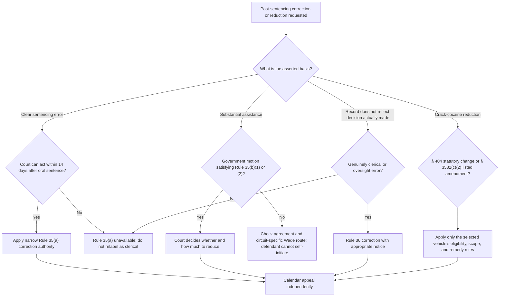

# Rules 35 and 36 — Sentence Correction, Assistance, Record Error, and Appeals

Rules 35(a), 35(b), and 36 solve different problems. Rule 35(a) provides a fourteen-day clear-error correction power; Rule 35(b) permits a government-initiated substantial-assistance reduction; Rule 36 makes the record accurately reflect the decision already made. None is a general resentencing motion.

## Finality and classification

<!-- claim:CLM-R3536-001 authorities:AUTH-USC-18-3582,AUTH-FRCRIM-P-35-36 status:verified_current -->
A federal judgment of conviction that includes imprisonment is final even though the sentence can later be corrected under Rule 35, appealed and modified under § 3742, or modified under an express § 3582(c) route. Rule 36 separately permits record correction without supplying a substantive sentence-modification power. [18 U.S.C. § 3582(b)](https://www.govinfo.gov/link/uscode/18/3582); [Fed. R. Crim. P. 36](https://www.uscourts.gov/sites/default/files/2025-02/federal-rules-of-criminal-procedure-dec-1-2024.pdf)

<!-- claim:CLM-R3536-002 authorities:AUTH-USC-18-3582,AUTH-FRCRIM-P-35-36 status:verified_current -->
Section 3582(c)(1)(B) permits modification only to the extent expressly allowed by statute or Rule 35; the cross-reference does not enlarge Rule 35’s own trigger, timing, movant, or scope. [18 U.S.C. § 3582(c)(1)(B)](https://www.govinfo.gov/link/uscode/18/3582); [Fed. R. Crim. P. 35](https://www.uscourts.gov/sites/default/files/2025-02/federal-rules-of-criminal-procedure-dec-1-2024.pdf)

<!-- claim:CLM-R3536-003 authorities:AUTH-FRCRIM-P-35-36 status:verified_current -->
Classify the requested act before filing: correction of a qualifying clear sentencing error under Rule 35(a), reduction for qualifying assistance on the government’s motion under Rule 35(b), or correction of a clerical record error under Rule 36. [Fed. R. Crim. P. 35–36](https://www.uscourts.gov/sites/default/files/2025-02/federal-rules-of-criminal-procedure-dec-1-2024.pdf)

## Rule 35(a): clear sentencing error

<!-- claim:CLM-R3536-004 authorities:AUTH-FRCRIM-P-35-36 status:verified_current -->
Within fourteen days after sentencing, the court may correct a sentence that resulted from arithmetical, technical, or other clear error. [Fed. R. Crim. P. 35(a)](https://www.uscourts.gov/sites/default/files/2025-02/federal-rules-of-criminal-procedure-dec-1-2024.pdf)

<!-- claim:CLM-R3536-005 authorities:AUTH-FRCRIM-P-35-36 status:verified_current -->
For Rule 35, “sentencing” means the oral announcement of the sentence, not entry of the written judgment. [Fed. R. Crim. P. 35(c)](https://www.uscourts.gov/sites/default/files/2025-02/federal-rules-of-criminal-procedure-dec-1-2024.pdf)

<!-- claim:CLM-R3536-006 authorities:AUTH-FRCRIM-P-35-36 status:verified_current -->
Rule 35(a)’s “other clear error” category is deliberately narrow: the official committee note rejects using it to reconsider the Guidelines application, reopen disputed issues, or change the court’s mind about sentence appropriateness. [Fed. R. Crim. P. 35 advisory committee note to 1991 amendment](https://www.govinfo.gov/content/pkg/USCODE-2024-title18/pdf/USCODE-2024-title18-app-federalru-rule35.pdf)

<!-- claim:CLM-R3536-007 authorities:AUTH-FRCRIM-P-35-36 status:verified_current -->
An arithmetic or technical mistake is not automatically correctable merely because it can be labeled that way; the sentence must have resulted from an arithmetical, technical, or other clear error within the rule’s narrow meaning. [Fed. R. Crim. P. 35(a) and advisory committee note to 1991 amendment](https://www.govinfo.gov/content/pkg/USCODE-2024-title18/pdf/USCODE-2024-title18-app-federalru-rule35.pdf)

<!-- claim:CLM-R3536-008 authorities:AUTH-FRCRIM-P-35-36 status:verified_current -->
Because Rule 35(a) authorizes “the court” to correct the sentence and does not require a party’s motion, the court may act on its own within the rule’s authority and time. [Fed. R. Crim. P. 35(a)](https://www.uscourts.gov/sites/default/files/2025-02/federal-rules-of-criminal-procedure-dec-1-2024.pdf)

<!-- claim:CLM-R3536-009 authorities:AUTH-FRCRIM-P-45,AUTH-FRCRIM-P-35-36 status:verified_current -->
Criminal Rule 45 forbids extending the time to act under Rule 35 except as Rule 35 itself permits; do not import an ordinary Rule 45 excusable-neglect extension into Rule 35(a). [Fed. R. Crim. P. 45(b)(2)](https://www.uscourts.gov/sites/default/files/document/federal-rules-of-criminal-procedure.pdf); [Fed. R. Crim. P. 35(a)](https://www.uscourts.gov/sites/default/files/2025-02/federal-rules-of-criminal-procedure-dec-1-2024.pdf)

<!-- claim:CLM-R3536-010 authorities:AUTH-FRAP-3-4-22,AUTH-FRCRIM-P-35-36 status:verified_current -->
A notice of appeal does not divest the district court of authority to correct under Rule 35(a), and a Rule 35(a) motion does not invalidate a notice filed before disposition; the Rule 35(a) clock and appeal clock therefore require separate calculation. [Fed. R. App. P. 4(b)(5)](https://www.uscourts.gov/sites/default/files/document/federal-rules-of-appellate-procedure.pdf); [Fed. R. Crim. P. 35(a)](https://www.uscourts.gov/sites/default/files/2025-02/federal-rules-of-criminal-procedure-dec-1-2024.pdf)

<!-- claim:CLM-R3536-011 authorities:AUTH-FRCRIM-P-35-36,AUTH-FRCRIM-P-45 status:verified_current -->
The national rules supply no equitable-tolling or party-motion exception to the fourteen-day act-by-court period; whether controlling circuit precedent calls that limit jurisdictional, claim-processing, or another type of authority limit must be verified rather than generalized. [Fed. R. Crim. P. 35(a), 45(b)(2)](https://www.uscourts.gov/sites/default/files/document/federal-rules-of-criminal-procedure.pdf)

<!-- claim:CLM-R3536-012 authorities:AUTH-FRCRIM-P-35-36 status:verified_current -->
Rule 35(a) authorizes correction of the qualifying error, not a plenary resentencing or reconsideration of every original sentencing issue. [Fed. R. Crim. P. 35(a) advisory committee note to 1991 amendment](https://www.govinfo.gov/content/pkg/USCODE-2024-title18/pdf/USCODE-2024-title18-app-federalru-rule35.pdf)

## Rule 35(b): substantial assistance

<!-- claim:CLM-R3536-013 authorities:AUTH-FRCRIM-P-35-36 status:verified_current -->
Only the government may make a Rule 35(b) substantial-assistance motion; a defendant’s own filing cannot substitute for the required government motion. [Fed. R. Crim. P. 35(b)(1)–(2)](https://www.uscourts.gov/sites/default/files/2025-02/federal-rules-of-criminal-procedure-dec-1-2024.pdf)

<!-- claim:CLM-R3536-014 authorities:AUTH-FRCRIM-P-35-36 status:verified_current -->
On a government motion made within one year after sentencing, the court may reduce the sentence if the defendant, after sentencing, provided substantial assistance in investigating or prosecuting another person. [Fed. R. Crim. P. 35(b)(1)](https://www.uscourts.gov/sites/default/files/2025-02/federal-rules-of-criminal-procedure-dec-1-2024.pdf)

<!-- claim:CLM-R3536-015 authorities:AUTH-FRCRIM-P-35-36 status:verified_current -->
A government motion made more than one year after sentencing may proceed under Rule 35(b)(2)(A) when the substantial assistance involved information the defendant did not know until one year or more after sentencing. [Fed. R. Crim. P. 35(b)(2)(A)](https://www.uscourts.gov/sites/default/files/2025-02/federal-rules-of-criminal-procedure-dec-1-2024.pdf)

<!-- claim:CLM-R3536-016 authorities:AUTH-FRCRIM-P-35-36 status:verified_current -->
Rule 35(b)(2)(B) covers information the defendant gave the government within the first year that did not become useful to the government until more than one year after sentencing. [Fed. R. Crim. P. 35(b)(2)(B)](https://www.uscourts.gov/sites/default/files/2025-02/federal-rules-of-criminal-procedure-dec-1-2024.pdf)

<!-- claim:CLM-R3536-017 authorities:AUTH-FRCRIM-P-35-36 status:verified_current -->
Rule 35(b)(2)(C) covers information whose usefulness could not reasonably have been anticipated by the defendant until more than one year after sentencing and that the defendant promptly gave the government after its usefulness became reasonably apparent. [Fed. R. Crim. P. 35(b)(2)(C)](https://www.uscourts.gov/sites/default/files/2025-02/federal-rules-of-criminal-procedure-dec-1-2024.pdf)

<!-- claim:CLM-R3536-018 authorities:AUTH-FRCRIM-P-35-36 status:verified_current -->
Rule 35(b)(3)—not subsection (b)(4)—authorizes a reduction below a statutory minimum. [Fed. R. Crim. P. 35(b)(3)](https://www.uscourts.gov/sites/default/files/2025-02/federal-rules-of-criminal-procedure-dec-1-2024.pdf)

<!-- claim:CLM-R3536-019 authorities:AUTH-FRCRIM-P-35-36 status:verified_current -->
Rule 35(b)(4)—not subsection (b)(3)—allows the court, when evaluating substantial assistance, to consider the defendant’s presentence assistance. [Fed. R. Crim. P. 35(b)(4)](https://www.uscourts.gov/sites/default/files/2025-02/federal-rules-of-criminal-procedure-dec-1-2024.pdf)

<!-- claim:CLM-R3536-020 authorities:AUTH-FRCRIM-P-35-36 status:verified_current -->
Even after a qualifying government motion, Rule 35(b) says the court “may” reduce the sentence; the existence and amount of a reduction remain judicial decisions within the rule and controlling law. [Fed. R. Crim. P. 35(b)(1)–(2)](https://www.uscourts.gov/sites/default/files/2025-02/federal-rules-of-criminal-procedure-dec-1-2024.pdf)

<!-- claim:CLM-R3536-021 authorities:AUTH-SCOTUS-WADE-504-US-181 status:verified_current -->
*Wade v. United States* held in the § 3553(e) and Guideline § 5K1.1 context that a government refusal to file a substantial-assistance motion can be reviewed for an unconstitutional motive and that relief may also be appropriate when refusal is not rationally related to a legitimate governmental end. [*Wade v. United States*, 504 U.S. 181, 185–86 (1992)](https://www.govinfo.gov/content/pkg/USREPORTS-504/pdf/USREPORTS-504-181.pdf)

<!-- claim:CLM-R3536-022 authorities:AUTH-SCOTUS-WADE-504-US-181 status:verified_current -->
*Wade* also holds that a claim of substantial assistance, standing alone, does not entitle the defendant to relief, discovery, or an evidentiary hearing; a substantial threshold showing of improper motive is required. [*Wade*, 504 U.S. at 186](https://www.govinfo.gov/content/pkg/USREPORTS-504/pdf/USREPORTS-504-181.pdf)

<!-- claim:CLM-R3536-023 authorities:AUTH-SCOTUS-WADE-504-US-181,AUTH-FRCRIM-P-35-36 status:verified_current -->
Because *Wade* itself did not decide a Rule 35(b) dispute, application of its refusal-to-move framework to a post-sentencing Rule 35(b) request must be supported by current controlling circuit precedent. [*Wade*, 504 U.S. at 183–87](https://www.govinfo.gov/content/pkg/USREPORTS-504/pdf/USREPORTS-504-181.pdf); [Fed. R. Crim. P. 35(b)](https://www.uscourts.gov/sites/default/files/2025-02/federal-rules-of-criminal-procedure-dec-1-2024.pdf)

<!-- claim:CLM-R3536-024 authorities:AUTH-SCOTUS-SANTOBELLO-404-US-257,AUTH-SCOTUS-PUCKETT-556-US-129,AUTH-FRCRIM-P-35-36 status:verified_current -->
An alleged government promise to make or consider a Rule 35(b) motion presents a distinct plea- or cooperation-agreement construction, breach, preservation, prejudice, and remedy question; it is not resolved merely by labeling the cooperation substantial. [*Santobello v. New York*, 404 U.S. 257, 262–63 (1971)](https://www.govinfo.gov/content/pkg/USREPORTS-404/pdf/USREPORTS-404-257.pdf); [*Puckett v. United States*, 556 U.S. 129, 135–43 (2009)](https://www.govinfo.gov/content/pkg/USREPORTS-556/pdf/USREPORTS-556-129.pdf); [Fed. R. Crim. P. 35(b)](https://www.uscourts.gov/sites/default/files/2025-02/federal-rules-of-criminal-procedure-dec-1-2024.pdf)

<!-- claim:CLM-R3536-025 authorities:AUTH-FRCRIM-P-35-36 status:verified_current -->
Rule 35(b) fixes when the government must make its motion but states no national period within which the court must decide a properly filed motion; docket delay, prejudice, and any extraordinary remedy require separate current authority. [Fed. R. Crim. P. 35(b)](https://www.uscourts.gov/sites/default/files/2025-02/federal-rules-of-criminal-procedure-dec-1-2024.pdf)

## Rule 36: clerical record correction

<!-- claim:CLM-R3536-026 authorities:AUTH-FRCRIM-P-35-36 status:verified_current -->
After giving any notice it considers appropriate, the court may at any time correct a clerical error in a judgment, order, or other part of the record, or an error in the record arising from oversight or omission. [Fed. R. Crim. P. 36](https://www.uscourts.gov/sites/default/files/2025-02/federal-rules-of-criminal-procedure-dec-1-2024.pdf)

<!-- claim:CLM-R3536-027 authorities:AUTH-FRCRIM-P-35-36 status:verified_current -->
Rule 36 corrects the record; it does not authorize a new substantive sentencing decision or a second decision on an issue the court actually resolved. [Fed. R. Crim. P. 36](https://www.uscourts.gov/sites/default/files/2025-02/federal-rules-of-criminal-procedure-dec-1-2024.pdf)

<!-- claim:CLM-R3536-028 authorities:AUTH-FRCRIM-P-35-36 status:verified_current -->
The controlling question is whether the proposed correction makes the judgment, order, or record accurately express the decision already made; a clerical correction can have practical legal consequences without becoming a license to change that underlying decision. [Fed. R. Crim. P. 36](https://www.uscourts.gov/sites/default/files/2025-02/federal-rules-of-criminal-procedure-dec-1-2024.pdf)

<!-- claim:CLM-R3536-029 authorities:AUTH-FRCRIM-P-35-36 status:verified_current -->
Recalculating a deliberately imposed Guidelines range, resolving a disputed statutory interpretation, or changing an intended sentence is substantive and therefore outside Rule 36. [Fed. R. Crim. P. 36](https://www.uscourts.gov/sites/default/files/2025-02/federal-rules-of-criminal-procedure-dec-1-2024.pdf)

<!-- claim:CLM-R3536-030 authorities:AUTH-FRCRIM-P-35-36 status:verified_current -->
Rule 36 does not restrict who may alert the court and permits the court to correct on its own, but the correction still must remain clerical and any notice the court considers appropriate must be given. [Fed. R. Crim. P. 36](https://www.uscourts.gov/sites/default/files/2025-02/federal-rules-of-criminal-procedure-dec-1-2024.pdf)

<!-- claim:CLM-R3536-031 authorities:AUTH-FRCRIM-P-35-36 status:verified_current -->
A Rule 36 request belongs on the existing criminal docket containing the judgment, order, or record at issue; it is not an independent civil collateral action. [Fed. R. Crim. P. 36](https://www.uscourts.gov/sites/default/files/2025-02/federal-rules-of-criminal-procedure-dec-1-2024.pdf)

<!-- claim:CLM-R3536-032 authorities:AUTH-FRCRIM-P-37,AUTH-FRCRIM-P-35-36 status:verified_current -->
Although Rule 36 says “at any time,” a pending appeal can affect district-court authority; Rule 37 supplies deny, defer, and indicative-ruling options for a timely motion the court lacks authority to grant because an appeal is pending, subject to controlling circuit law. [Fed. R. Crim. P. 36–37](https://www.uscourts.gov/sites/default/files/document/federal-rules-of-criminal-procedure.pdf)

<!-- claim:CLM-R3536-033 authorities:AUTH-FRCRIM-P-35-36 status:verified_current -->
Rule 36 itself requires only such notice as the court considers appropriate and does not create an automatic hearing, response, national form, or universal burden formulation; a material dispute about the record requires current circuit and local procedure. [Fed. R. Crim. P. 36](https://www.uscourts.gov/sites/default/files/2025-02/federal-rules-of-criminal-procedure-dec-1-2024.pdf)

## Crack-cocaine reduction routes

<!-- claim:CLM-R3536-034 authorities:AUTH-PL-115-391-SEC-404,AUTH-USC-18-3582,AUTH-USSG-2025-1B1-10 status:verified_current -->
A request described generally as “crack-cocaine resentencing” must be classified: First Step Act § 404 addresses covered statutory Fair Sentencing Act changes, while § 3582(c)(2) and Guideline § 1B1.10 address a listed retroactive Guidelines amendment that actually lowers the applicable range. [First Step Act § 404](https://www.govinfo.gov/content/pkg/PLAW-115publ391/pdf/PLAW-115publ391.pdf); [18 U.S.C. § 3582(c)(2)](https://www.govinfo.gov/link/uscode/18/3582); [U.S.S.G. § 1B1.10](https://www.ussc.gov/guidelines/2025-guidelines-manual/annotated-2025-chapter-1)

<!-- claim:CLM-R3536-035 authorities:AUTH-PL-115-391-SEC-404,AUTH-PL-111-220-SECS-2-3,AUTH-SCOTUS-DORSEY-567-US-260,AUTH-SCOTUS-TERRY-593-US-486 status:verified_current -->
Section 404 eligibility turns on a pre-August 3, 2010 violation whose statutory penalties were modified by Fair Sentencing Act § 2 or § 3, subject to § 404(c); *Terry* does not treat every crack-related conviction as covered. [First Step Act § 404](https://www.govinfo.gov/content/pkg/PLAW-115publ391/pdf/PLAW-115publ391.pdf); [Fair Sentencing Act §§ 2–3](https://www.govinfo.gov/content/pkg/PLAW-111publ220/pdf/PLAW-111publ220.pdf); [*Dorsey v. United States*, 567 U.S. 260, 264, 273–82 (2012)](https://www.govinfo.gov/content/pkg/USREPORTS-567/pdf/USREPORTS-567-260.pdf); [*Terry v. United States*, 593 U.S. 486, 489–94 (2021)](https://www.supremecourt.gov/opinions/20pdf/20-5904_i4dk.pdf)

<!-- claim:CLM-R3536-036 authorities:AUTH-USC-18-3582,AUTH-USSG-2025-1B1-10,AUTH-SCOTUS-DILLON-560-US-817,AUTH-SCOTUS-HUGHES-584-US-675 status:verified_current -->
Section 3582(c)(2) requires a Commission-lowered range, a retroactively listed amendment, and an actual lower amended range under § 1B1.10; *Dillon*’s two steps and *Hughes*’s framework-based Rule 11(c)(1)(C) analysis then apply. [18 U.S.C. § 3582(c)(2)](https://www.govinfo.gov/link/uscode/18/3582); [U.S.S.G. § 1B1.10](https://www.ussc.gov/guidelines/2025-guidelines-manual/annotated-2025-chapter-1); [*Dillon v. United States*, 560 U.S. 817, 825–30 (2010)](https://www.supremecourt.gov/opinions/boundvolumes/560bv.pdf); [*Hughes v. United States*, 584 U.S. 675, 685–91 (2018)](https://www.supremecourt.gov/opinions/17pdf/584us2r43_llh1.pdf)

<!-- claim:CLM-R3536-037 authorities:AUTH-PL-115-391-SEC-404,AUTH-USC-18-3582,AUTH-SCOTUS-CONCEPCION-597-US-481,AUTH-SCOTUS-DILLON-560-US-817 status:verified_current -->
Section 404 and § 3582(c)(2) are not interchangeable: *Concepcion* governs the information a court may consider within § 404’s statutory framework, while *Dillon* and § 1B1.10 constrain the distinct retroactive-amendment proceeding. [*Concepcion v. United States*, 597 U.S. 481, 495–502 (2022)](https://www.supremecourt.gov/opinions/21pdf/20-1650_new_4gci.pdf); [*Dillon*, 560 U.S. at 825–30](https://www.supremecourt.gov/opinions/boundvolumes/560bv.pdf)

## Appeal rights and review

<!-- claim:CLM-R3536-038 authorities:AUTH-FRAP-3-4-22 status:verified_current -->
In a criminal case, the defendant’s notice ordinarily is due within fourteen days after entry of the judgment or order appealed, the government’s within thirty days, a confined filer may use Rule 4(c), and the district court may grant no more than thirty additional days for good cause or excusable neglect under Rule 4(b)(4). [Fed. R. App. P. 4(b)–(c)](https://www.uscourts.gov/sites/default/files/document/federal-rules-of-appellate-procedure.pdf)

<!-- claim:CLM-R3536-039 authorities:AUTH-FRAP-3-4-22 status:verified_current -->
The finality and tolling effect of a post-order reconsideration request is not supplied by a generic civil-motion rule; calendar the underlying criminal appeal deadline and verify current controlling circuit law before assuming reconsideration preserves the appeal. [Fed. R. App. P. 4(b)](https://www.uscourts.gov/sites/default/files/document/federal-rules-of-appellate-procedure.pdf)

<!-- claim:CLM-R3536-040 authorities:AUTH-USC-28-1291,AUTH-USC-18-3742 status:verified_current -->
Sections 1291 and 3742 provide different appellate-jurisdiction texts; whether a particular Rule 35, Rule 36, compassionate-release, retroactive-amendment, or § 404 order proceeds under one or both requires the exact order, appellant, issue, and controlling circuit law. [28 U.S.C. § 1291](https://www.govinfo.gov/link/uscode/28/1291); [18 U.S.C. § 3742](https://www.govinfo.gov/link/uscode/18/3742)

<!-- claim:CLM-R3536-041 authorities:AUTH-USC-28-2253,AUTH-FRAP-3-4-22 status:verified_current -->
An appeal from an ordinary Rule 35, Rule 36, § 3582, or § 404 order is not a state-process habeas or § 2255 appeal and therefore does not use § 2253(c)’s certificate-of-appealability gate. [28 U.S.C. § 2253(c)(1)](https://www.govinfo.gov/link/uscode/28/2253); [Fed. R. App. P. 22(b)](https://www.uscourts.gov/sites/default/files/document/federal-rules-of-appellate-procedure.pdf)

<!-- claim:CLM-R3536-042 authorities:AUTH-SCOTUS-CHAVEZ-MEZA-585-US-109,AUTH-SCOTUS-DILLON-560-US-817 status:verified_current -->
In a § 3582(c)(2) proceeding, the order and broader record must reveal enough to show a reasoned basis and consideration of the parties’ arguments, but the necessary explanation is contextual and there is no presumption of a proportional reduction. [*Chavez-Meza v. United States*, 585 U.S. 109, 115–20 (2018)](https://www.govinfo.gov/content/pkg/USREPORTS-585/pdf/USREPORTS-585-109.pdf); [*Dillon*, 560 U.S. at 825–30](https://www.supremecourt.gov/opinions/boundvolumes/560bv.pdf)

<!-- claim:CLM-R3536-043 authorities:AUTH-SCOTUS-CONCEPCION-597-US-481 status:verified_current -->
In a § 404 proceeding, the court must consider nonfrivolous arguments and give a brief statement of reasons, but it need not accept the arguments or reduce the sentence; the benchmark range is recalculated only for Fair Sentencing Act changes. [*Concepcion*, 597 U.S. at 495–502 & n.6](https://www.supremecourt.gov/opinions/21pdf/20-1650_new_4gci.pdf)

<!-- claim:CLM-R3536-044 authorities:AUTH-USC-28-1291,AUTH-USC-18-3742,AUTH-SCOTUS-CHAVEZ-MEZA-585-US-109,AUTH-SCOTUS-CONCEPCION-597-US-481 status:verified_current -->
There is no single undifferentiated sentence-modification standard of review: classify appellate jurisdiction, legal eligibility and statutory interpretation, factual findings, discretionary relief, explanation, preservation, and harmlessness separately under current controlling circuit law. [28 U.S.C. § 1291](https://www.govinfo.gov/link/uscode/28/1291); [18 U.S.C. § 3742](https://www.govinfo.gov/link/uscode/18/3742); [*Chavez-Meza*, 585 U.S. at 115–20](https://www.govinfo.gov/content/pkg/USREPORTS-585/pdf/USREPORTS-585-109.pdf); [*Concepcion*, 597 U.S. at 501–02](https://www.supremecourt.gov/opinions/21pdf/20-1650_new_4gci.pdf)

## Decision path

## Required record and circuit checks

- Oral sentencing transcript, written judgment, statement of reasons, Guidelines calculations, and docket-entry dates.
- Exact claimed error and whether correction changes the decision or merely the record of that decision.
- Government motion, cooperation agreement, assistance timeline, information dates, and any refusal-to-move evidence.
- Current circuit law applying *Wade* to Rule 35(b), enforcing cooperation promises, and defining reviewable Rule 35(b) issues.
- Pending appeal, mandate, Rule 37 procedure, notice, hearing, and local filing requirements.
- Exact sentence-modification vehicle, eligibility, amendment, statutory penalty, prior reduction, and order.
- Appellate jurisdiction, notice deadline, preservation, issue-specific standard of review, and remedy under current circuit law.
