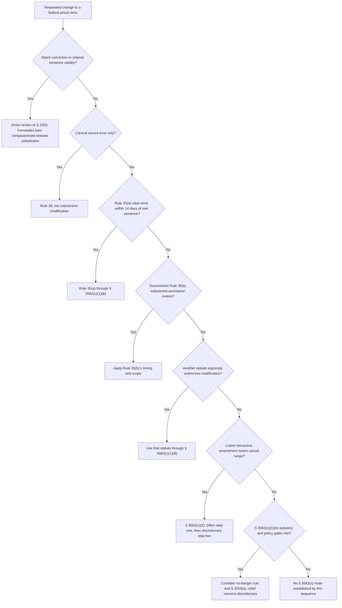

# 18 U.S.C. § 3582 — Sentence-Modification Remedy Router

## Verification boundary

This module verifies the nationwide organization of the sentence-modification mechanisms in § 3582(c), Rules 35 and 36, current Guidelines §§ 1B1.10 and 1B1.13, and the controlling Supreme Court boundaries. It does not decide an individual motion, resolve circuit-specific issue-exhaustion or appellate-review questions, calculate a particular amended range, or validate the legacy 669-line procedural framework as a whole.

## Start with the source of authority

<!-- claim:CLM-3582-001 authorities:AUTH-USC-18-3582 status:verified_current -->
An imposed term of imprisonment is final and may be modified only through the three doors in § 3582(c): subsection (c)(1)(A), subsection (c)(1)(B), or subsection (c)(2). Each door has different eligibility, procedure, and limits. [18 U.S.C. § 3582(b)–(c)](https://uscode.house.gov/view.xhtml?req=%28title%3A18+section%3A3582%28c%29+edition%3Aprelim%29)

<!-- claim:CLM-3582-002 authorities:AUTH-USC-18-3582 status:verified_current -->
Subsections (a) and (b) govern imposition and finality, subsection (d) imposes specified Bureau of Prisons notice and assistance duties, and subsection (e) concerns certain nonassociation orders. None is an additional sentence-reduction door. [18 U.S.C. § 3582(a), (b), (d), (e)](https://uscode.house.gov/view.xhtml?req=%28title%3A18+section%3A3582+edition%3Aprelim%29)

Claims about conviction validity, ordinary sentencing error outside Rule 35(a), Bureau of Prisons computation or execution, and placement are not interchangeable with § 3582(c) motions. A conviction-validity claim belongs in direct review or § 2255 as applicable; an execution claim may require the administrative-remedy and § 2241 framework; and a placement request is not itself a reduction of the imposed prison term.

<!-- claim:CLM-3582-003 authorities:AUTH-SCOTUS-FERNANDEZ-608-US-SLIP status:verified_current -->
*Fernandez* holds that the supposed invalidity of a conviction cannot constitute an extraordinary and compelling reason under § 3582(c)(1)(A); § 2255 is Congress's designated collateral vehicle for a federal prisoner attacking conviction validity. [*Fernandez v. United States*, 608 U.S. ___, slip op. 8–10 (2026)](https://www.supremecourt.gov/opinions/25pdf/24-556_8m58.pdf)

## Rule 35, Rule 36, and § 3582(c)(1)(B)

<!-- claim:CLM-3582-004 authorities:AUTH-FRCRIM-P-35-36 status:verified_current -->
Rule 35(a) authorizes the sentencing court to correct an arithmetical, technical, or other clear error within 14 days after sentencing; Rule 35(c) defines “sentencing” as the oral announcement of the sentence. [Fed. R. Crim. P. 35(a), (c)](https://www.uscourts.gov/sites/default/files/2025-02/federal-rules-of-criminal-procedure-dec-1-2024.pdf)

<!-- claim:CLM-3582-005 authorities:AUTH-FRCRIM-P-35-36 status:verified_current -->
Rule 35(b) requires a government motion based on substantial assistance. A motion within one year is governed by Rule 35(b)(1); a later motion must fit one of Rule 35(b)(2)'s three information-timing categories. The court may consider presentence assistance and may reduce below a statutory minimum. [Fed. R. Crim. P. 35(b)](https://www.uscourts.gov/sites/default/files/2025-02/federal-rules-of-criminal-procedure-dec-1-2024.pdf)

<!-- claim:CLM-3582-006 authorities:AUTH-FRCRIM-P-35-36 status:verified_current -->
Rule 36 separately permits correction at any time of a clerical error in a judgment, order, or other part of the record, or an error arising from oversight or omission. It does not authorize a substantive resentencing and is not a § 3582(c) reduction door. [Fed. R. Crim. P. 36](https://www.uscourts.gov/sites/default/files/2025-02/federal-rules-of-criminal-procedure-dec-1-2024.pdf)

<!-- claim:CLM-3582-007 authorities:AUTH-USC-18-3582 status:verified_current -->
Section 3582(c)(1)(B) is a connector: it permits modification only to the extent Rule 35 or another statute expressly permits. The outside rule or statute supplies the movant, deadline, eligibility, scope, and discretionary limits. [18 U.S.C. § 3582(c)(1)(B)](https://uscode.house.gov/view.xhtml?req=%28title%3A18+section%3A3582%28c%29+edition%3Aprelim%29)

The separately verified [First Step Act § 404 module](first-step-act-section-404.md) is one example of an express statutory modification authority using the (c)(1)(B) connector. Its covered-offense and prior-order rules cannot be borrowed into other § 3582 tracks.

## Section 3582(c)(1)(A)

### Filing gate and statutory decision sequence

<!-- claim:CLM-3582-008 authorities:AUTH-USC-18-3582 status:verified_current -->
The Bureau of Prisons Director may move under § 3582(c)(1)(A). A defendant may move after fully exhausting administrative appeal of the Bureau's failure to file, or after 30 days from the warden's receipt of the defendant's request, whichever occurs first. [18 U.S.C. § 3582(c)(1)(A)](https://uscode.house.gov/view.xhtml?req=%28title%3A18+section%3A3582%28c%29+edition%3Aprelim%29)

The statute does not answer every issue-exhaustion, waiver, or emergency question that can arise in litigation. Those questions require controlling circuit authority and the actual request, receipt date, response, and motion.

<!-- claim:CLM-3582-009 authorities:AUTH-USC-18-3582,AUTH-USSG-2025-1B1-13 status:verified_current -->
For the ordinary compassionate-release path, the court must consider the applicable § 3553(a) factors and find an extraordinary and compelling reason, consistency with the applicable Commission policy statement, and the policy statement's no-danger requirement. The court may reduce the prison term and may substitute probation or supervised release, with conditions, for no longer than the unserved portion. [18 U.S.C. § 3582(c)(1)(A)](https://uscode.house.gov/view.xhtml?req=%28title%3A18+section%3A3582%28c%29+edition%3Aprelim%29); [U.S.S.G. § 1B1.13(a) (2025)](https://www.ussc.gov/guidelines/2025-guidelines-manual/annotated-2025-chapter-1)

<!-- claim:CLM-3582-010 authorities:AUTH-USC-18-3582 status:verified_current -->
The separate age-70 route requires age 70 or older, at least 30 years served on a sentence imposed under 18 U.S.C. § 3559(c), and a Bureau of Prisons determination that the defendant is not dangerous. It is not the ordinary age-based circumstance in § 1B1.13(b)(2). [18 U.S.C. § 3582(c)(1)(A)(ii)](https://uscode.house.gov/view.xhtml?req=%28title%3A18+section%3A3582%28c%29+edition%3Aprelim%29)

### Current policy statement and controlling limits

<!-- claim:CLM-3582-011 authorities:AUTH-USSG-2025-1B1-13 status:verified_current -->
The current policy statement lists medical circumstances, age, family circumstances, abuse while in custody, and other circumstances similar in gravity in § 1B1.13(b)(1) through (5). The exact elements of the selected category must be proved; sympathy or seriousness alone is not a category. [U.S.S.G. § 1B1.13(b)(1)–(5) (2025)](https://www.ussc.gov/guidelines/2025-guidelines-manual/annotated-2025-chapter-1)

<!-- claim:CLM-3582-012 authorities:AUTH-USSG-2025-1B1-13 status:verified_current -->
Rehabilitation cannot by itself establish an extraordinary and compelling reason, although it may be considered in combination with other circumstances. [U.S.S.G. § 1B1.13(d) (2025)](https://www.ussc.gov/guidelines/2025-guidelines-manual/annotated-2025-chapter-1)

<!-- claim:CLM-3582-013 authorities:AUTH-USSG-2025-1B1-13 status:verified_current -->
The current policy statement requires a finding that the defendant is not a danger to another person or the community under the § 3142(g) factors. This policy-statement finding is separate from extraordinary-and-compelling eligibility. [U.S.S.G. § 1B1.13(a)(2) (2025)](https://www.ussc.gov/guidelines/2025-guidelines-manual/annotated-2025-chapter-1)

<!-- claim:CLM-3582-014 authorities:AUTH-USC-18-3582 status:verified_current -->
Even when the eligibility and policy-statement requirements are satisfied, the court must consider the applicable § 3553(a) factors and retains discretion to deny or limit the reduction. [18 U.S.C. § 3582(c)(1)(A)](https://uscode.house.gov/view.xhtml?req=%28title%3A18+section%3A3582%28c%29+edition%3Aprelim%29)

<!-- claim:CLM-3582-015 authorities:AUTH-SCOTUS-RUTHERFORD-608-US-SLIP status:verified_current -->
*Rutherford* holds that when Congress declines to make a sentencing amendment retroactive, the resulting disparity cannot serve as an extraordinary and compelling reason under § 3582(c)(1)(A)(i). Combining that disparity with other nonqualifying considerations does not convert it into a qualifying eligibility reason. [*Rutherford v. United States*, 608 U.S. ___, slip op. 8–17 (2026)](https://www.supremecourt.gov/opinions/25pdf/24-820_97be.pdf)

<!-- claim:CLM-3582-016 authorities:AUTH-USSG-2025-1B1-13,AUTH-SCOTUS-RUTHERFORD-608-US-SLIP status:verified_current -->
Section 1B1.13(b)(6) remains printed in the 2025 Guidelines Manual, but it cannot be used to create eligibility from the kind of deliberately nonretroactive sentencing change barred by *Rutherford*. The Supreme Court's statutory holding controls over inconsistent guideline application. [U.S.S.G. § 1B1.13(b)(6) (2025)](https://www.ussc.gov/guidelines/2025-guidelines-manual/annotated-2025-chapter-1); [*Rutherford*, slip op. 2, 15–17](https://www.supremecourt.gov/opinions/25pdf/24-820_97be.pdf)

<!-- claim:CLM-3582-017 authorities:AUTH-USSG-2025-1B1-13,AUTH-SCOTUS-RUTHERFORD-608-US-SLIP status:partially_verified -->
Section 1B1.13(c), as presently printed, permits a legal change to inform the extent of a reduction after some independent extraordinary and compelling reason has established eligibility. *Rutherford* resolved eligibility and did not supply a general license to use nonretroactive changes at that later step; later controlling decisions and the precise requested use must be checked. [U.S.S.G. § 1B1.13(c) (2025)](https://www.ussc.gov/guidelines/2025-guidelines-manual/annotated-2025-chapter-1); [*Rutherford*, slip op. 17](https://www.supremecourt.gov/opinions/25pdf/24-820_97be.pdf)

## Section 3582(c)(2)

<!-- claim:CLM-3582-018 authorities:AUTH-USC-18-3582 status:verified_current -->
Section 3582(c)(2) applies to a defendant sentenced based on a sentencing range that the Commission later lowered under 28 U.S.C. § 994(o), when a reduction is consistent with applicable Commission policy. The defendant or Bureau Director may move, and the court may act on its own motion; the compassionate-release warden-request gate does not apply. [18 U.S.C. § 3582(c)(2)](https://uscode.house.gov/view.xhtml?req=%28title%3A18+section%3A3582%28c%29+edition%3Aprelim%29)

<!-- claim:CLM-3582-019 authorities:AUTH-USSG-2025-1B1-10 status:verified_current -->
Eligibility requires an amendment listed in current § 1B1.10(d) and an actual lowering of the defendant's applicable guideline range. An amendment's effective date or favorable treatment at new sentencings does not by itself make it retroactive under § 3582(c)(2). [U.S.S.G. § 1B1.10(a), (d) (2025)](https://www.ussc.gov/guidelines/2025-guidelines-manual/annotated-2025-chapter-1)

<!-- claim:CLM-3582-020 authorities:AUTH-SCOTUS-HUGHES-584-US-675 status:verified_current -->
A Rule 11(c)(1)(C) agreement does not automatically defeat § 3582(c)(2) eligibility. Under *Hughes*, the sentence is based on the guideline range when that range was part of the framework the court relied on in imposing sentence or accepting the agreement. [*Hughes v. United States*, 584 U.S. 675, 685–91 (2018)](https://www.supremecourt.gov/opinions/17pdf/584us2r43_llh1.pdf)

<!-- claim:CLM-3582-021 authorities:AUTH-SCOTUS-DILLON-560-US-817 status:verified_current -->
*Dillon* establishes a two-step inquiry. First, the court determines whether and to what extent § 1B1.10 authorizes a reduction; second, if a reduction is authorized, the court considers applicable § 3553(a) factors and decides whether the authorized reduction is warranted. [*Dillon v. United States*, 560 U.S. 817, 826–27 (2010)](https://www.supremecourt.gov/opinions/boundvolumes/560bv.pdf)

<!-- claim:CLM-3582-022 authorities:AUTH-USSG-2025-1B1-10,AUTH-SCOTUS-DILLON-560-US-817 status:verified_current -->
At step one, the court substitutes only the listed amendment and leaves all other guideline-application decisions unaffected. A § 3582(c)(2) proceeding does not impose a new sentence in the usual sense and is not a plenary resentencing. [U.S.S.G. § 1B1.10(b)(1) (2025)](https://www.ussc.gov/guidelines/2025-guidelines-manual/annotated-2025-chapter-1); [*Dillon*, 560 U.S. at 825–27, 831](https://www.supremecourt.gov/opinions/boundvolumes/560bv.pdf)

<!-- claim:CLM-3582-023 authorities:AUTH-USSG-2025-1B1-10 status:verified_current -->
The ordinary § 1B1.10 floor is the bottom of the amended guideline range. A qualifying original substantial-assistance reduction permits a comparably lower term, and no reduction may be below time already served. [U.S.S.G. § 1B1.10(b)(2) (2025)](https://www.ussc.gov/guidelines/2025-guidelines-manual/annotated-2025-chapter-1)

<!-- claim:CLM-3582-024 authorities:AUTH-USSG-2025-1B1-10,AUTH-SCOTUS-DILLON-560-US-817 status:verified_current -->
At the discretionary step, the court considers applicable § 3553(a) factors; the policy commentary also directs consideration of public safety and permits consideration of post-sentencing conduct. Eligibility therefore does not guarantee any reduction. [U.S.S.G. § 1B1.10 cmt. n.1(B) (2025)](https://www.ussc.gov/guidelines/2025-guidelines-manual/annotated-2025-chapter-1); [*Dillon*, 560 U.S. at 827](https://www.supremecourt.gov/opinions/boundvolumes/560bv.pdf)

Section 1B1.10(e) contains amendment-specific delayed-effective-date provisions. The dates presently printed for Amendments 782 and 821 have passed; do not convert those historical dates into a generic waiting period for every listed amendment.

## After an order

<!-- claim:CLM-3582-025 authorities:AUTH-FRAP-3-4-22 status:verified_current -->
For a defendant's criminal appeal, Rule 4(b)(1)(A) ordinarily requires a notice of appeal within 14 days after entry of the judgment or order being appealed, and Rule 3(a)(1) requires filing with the district clerk. The actual order, entry date, party, and any deadline-affecting event must be checked. [Fed. R. App. P. 3(a)(1), 4(b)(1)(A)](https://www.uscourts.gov/sites/default/files/document/federal-rules-of-appellate-procedure.pdf)

<!-- claim:CLM-3582-026 authorities:AUTH-FRAP-3-4-22 status:verified_current -->
Rule 4(c) governs timely inmate filing, and Rule 4(b)(4) allows the district court, upon good cause or excusable neglect, to extend the criminal appeal period by no more than 30 days from the original deadline. The possible extension is not part of the ordinary filing period. [Fed. R. App. P. 4(b)(4), (c)](https://www.uscourts.gov/sites/default/files/document/federal-rules-of-appellate-procedure.pdf)

## Decision path

## Record-first checklist

1. Identify the exact relief requested: vacatur, clerical correction, Rule 35 correction, substantial-assistance reduction, express statutory modification, compassionate release, retroactive-guideline reduction, or execution relief.
2. Obtain the oral-sentencing transcript, judgment, statement of reasons, plea agreement, presentence report where lawfully available, guideline calculation, amendment, prior reduction orders, and current docket.
3. For (c)(1)(A), preserve the request, warden-receipt proof, response, administrative appeals, current evidence, release plan, dangerousness evidence, and § 3553(a) record.
4. For (c)(2), identify the amendment number, verify current § 1B1.10(d) listing, reconstruct the actual original guideline framework, substitute only the amendment, and apply every floor and timing rule.
5. For an appeal, calendar from the actual entry date under current Rule 4 and verify circuit and district requirements rather than relying on a chart.

## Matters not yet verified in this module

- Circuit-specific treatment of issue exhaustion, waiver or forfeiture of the (c)(1)(A) filing gate, emergency requests, hearings, appointment, burdens, reasons, reconsideration, and standards of review.
- The application of *Rutherford* and § 1B1.13(c) to a particular asserted legal change after an independently valid eligibility reason.
- Individual § 1B1.13 category facts, dangerousness, § 3553(a), amendment eligibility, guideline calculations, mandatory-minimum interactions, substantial-assistance comparisons, and relief amount.
- Whether a particular order is appealable, who may appeal, the correct deadline, or whether an inmate filing, extension, or local rule applies.
- The detailed BOP request-content regulation, BOP program statement, local forms, sealing rules, and evidence sufficiency.

Those questions remain open in `data/coverage_matrix.yaml`. The legacy prose file remains a research inventory rather than a validated authority.
