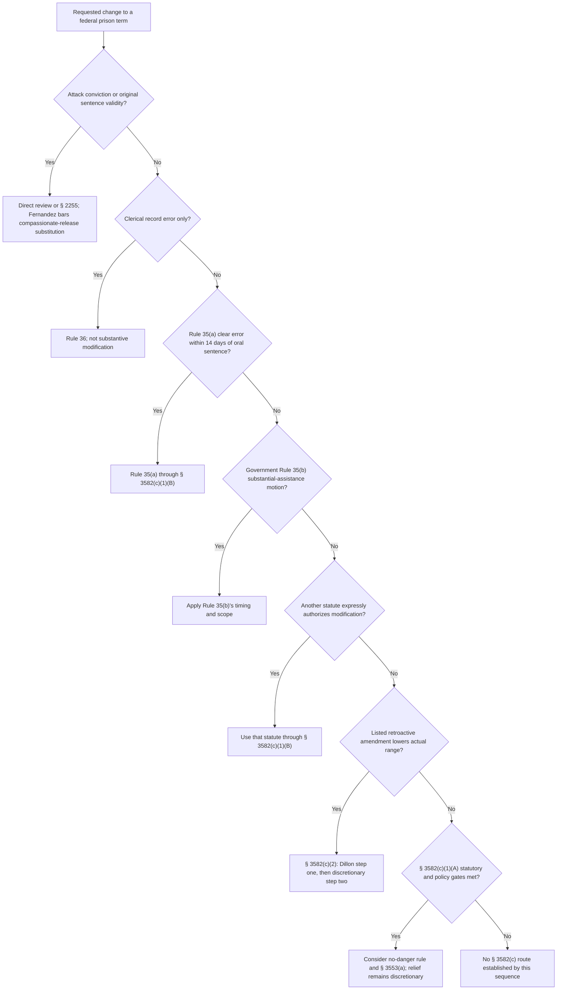

# 18 U.S.C. § 3582 — Sentence-Modification Remedy Router

## Verification boundary

This module verifies the nationwide organization of the sentence-modification mechanisms in § 3582(c), Rules 35 and 36, current Guidelines §§ 1B1.10 and 1B1.13, and the controlling Supreme Court boundaries. It does not decide an individual motion, resolve circuit-specific issue-exhaustion or appellate-review questions, calculate a particular amended range, or validate the legacy 669-line procedural framework as a whole.

## Start with the source of authority

<!-- claim:CLM-3582-001 authorities:AUTH-USC-18-3582 status:verified_current -->
Under § 3582(c), the court "may not modify a term of imprisonment once it has been imposed" except through subsection (c)(1)(A) (with separate routes in clauses (i) and (ii)), subsection (c)(1)(B), or subsection (c)(2); § 3582(b) separately recognizes correction under Rule 35 and § 3742 and appeal and modification under § 3742 if the sentence is outside the guideline range, and makes the judgment final "for all other purposes." Each door has different eligibility, procedure, and limits. [18 U.S.C. § 3582(b)–(c)](https://www.govinfo.gov/link/uscode/18/3582) [18 U.S.C. § 3582(b)–(c)](https://www.govinfo.gov/link/uscode/18/3582)

<!-- claim:CLM-3582-002 authorities:AUTH-USC-18-3582 status:verified_current -->
Subsections (a) and (b) govern imposition and finality, subsection (d) imposes specified Bureau of Prisons notice and assistance duties, and subsection (e) concerns certain nonassociation orders. None is an additional sentence-reduction door. [18 U.S.C. § 3582(a), (b), (d), (e)](https://www.govinfo.gov/link/uscode/18/3582)

Claims about conviction validity, ordinary sentencing error outside Rule 35(a), Bureau of Prisons computation or execution, and placement are not interchangeable with § 3582(c) motions. A conviction-validity claim belongs in direct review or § 2255 as applicable; an execution claim may require the administrative-remedy and § 2241 framework; and a placement request is not itself a reduction of the imposed prison term.

<!-- claim:CLM-3582-003 authorities:AUTH-SCOTUS-FERNANDEZ-608-US-SLIP status:verified_current -->
*Fernandez* holds that the supposed invalidity of a conviction cannot constitute an extraordinary and compelling reason under § 3582(c)(1)(A); § 2255 is Congress's designated collateral vehicle for a federal prisoner attacking conviction validity. [*Fernandez v. United States*, 608 U.S. ___, slip op. 8–10 (2026)](https://www.supremecourt.gov/opinions/25pdf/24-556_8m58.pdf)

## Rule 35, Rule 36, and § 3582(c)(1)(B)

<!-- claim:CLM-3582-004 authorities:AUTH-FRCRIM-P-35-36 status:verified_current -->
Rule 35(a) authorizes the sentencing court to correct an arithmetical, technical, or other clear error within 14 days after sentencing; Rule 35(c) defines “sentencing” as the oral announcement of the sentence. [Fed. R. Crim. P. 35(a), (c)](https://www.uscourts.gov/sites/default/files/2025-02/federal-rules-of-criminal-procedure-dec-1-2024.pdf)

<!-- claim:CLM-3582-005 authorities:AUTH-FRCRIM-P-35-36 status:verified_current -->
Rule 35(b) requires a government motion. A motion within one year of sentencing is governed by Rule 35(b)(1), which requires that the defendant, "after sentencing, provided substantial assistance in investigating or prosecuting another person"; a later motion must fit one of Rule 35(b)(2)'s three information-timing categories. Presentence assistance may be considered only in evaluating whether the defendant has provided substantial assistance, and the court "may" reduce the sentence, including to a level below a statutory minimum. [Fed. R. Crim. P. 35(b)](https://www.uscourts.gov/sites/default/files/2025-02/federal-rules-of-criminal-procedure-dec-1-2024.pdf) [Fed. R. Crim. P. 35(b)](https://www.uscourts.gov/sites/default/files/2025-02/federal-rules-of-criminal-procedure-dec-1-2024.pdf)

<!-- claim:CLM-3582-006 authorities:AUTH-FRCRIM-P-35-36,AUTH-USC-18-3582 status:verified_current -->
Rule 36 separately permits the court, after giving any notice it considers appropriate, to correct at any time a clerical error in a judgment, order, or other part of the record, or an error in the record arising from oversight or omission. Its text reaches only those errors, not a substantive resentencing, and it is not a § 3582(c) reduction door, because § 3582(c)(1)(B) refers only to statutes and Rule 35. [Fed. R. Crim. P. 36](https://www.uscourts.gov/sites/default/files/2025-02/federal-rules-of-criminal-procedure-dec-1-2024.pdf); [18 U.S.C. § 3582(c)(1)(B)](https://www.govinfo.gov/link/uscode/18/3582) [Fed. R. Crim. P. 36](https://www.uscourts.gov/sites/default/files/2025-02/federal-rules-of-criminal-procedure-dec-1-2024.pdf)

<!-- claim:CLM-3582-007 authorities:AUTH-USC-18-3582 status:verified_current -->
Section 3582(c)(1)(B) is a connector: it permits modification only to the extent Rule 35 or another statute expressly permits. The outside rule or statute supplies the movant, deadline, eligibility, scope, and discretionary limits. [18 U.S.C. § 3582(c)(1)(B)](https://www.govinfo.gov/link/uscode/18/3582)

The separately verified [First Step Act § 404 module](first-step-act-section-404.md) is one example of an express statutory modification authority using the (c)(1)(B) connector. Its covered-offense and prior-order rules cannot be borrowed into other § 3582 tracks.

## Section 3582(c)(1)(A)

### Filing gate and statutory decision sequence

<!-- claim:CLM-3582-008 authorities:AUTH-USC-18-3582 status:verified_current -->
The Bureau of Prisons Director may move under § 3582(c)(1)(A). A defendant may move after fully exhausting administrative appeal of the Bureau's failure to file, or after 30 days from the warden's receipt of the defendant's request, whichever occurs first. [18 U.S.C. § 3582(c)(1)(A)](https://www.govinfo.gov/link/uscode/18/3582)

The statute does not answer every issue-exhaustion, waiver, or emergency question that can arise in litigation. Those questions require controlling circuit authority and the actual request, receipt date, response, and motion.

<!-- claim:CLM-3582-009 authorities:AUTH-USC-18-3582,AUTH-USSG-2026-1B1-13 status:verified_current -->
For the ordinary compassionate-release path, the court must consider the applicable § 3553(a) factors and find an extraordinary and compelling reason, consistency with the applicable Commission policy statement, and the policy statement's no-danger requirement. The court may reduce the prison term and, under the statute, "may impose a term of probation or supervised release with or without conditions that does not exceed the unserved portion of the original term of imprisonment"; § 1B1.13(a) refers only to supervised release. [18 U.S.C. § 3582(c)(1)(A)](https://www.govinfo.gov/link/uscode/18/3582); [U.S.S.G. § 1B1.13(a) (2026)](https://www.ussc.gov/guidelines/2026-guidelines-manual/annotated-2026-chapter-1) [18 U.S.C. § 3582(c)(1)(A)](https://www.govinfo.gov/link/uscode/18/3582); [U.S.S.G. § 1B1.13(a) (2026)](https://www.ussc.gov/guidelines/2026-guidelines-manual/annotated-2026-chapter-1)

<!-- claim:CLM-3582-010 authorities:AUTH-USC-18-3582,AUTH-USSG-2026-1B1-13 status:verified_current -->
The separate age-70 route in § 3582(c)(1)(A)(ii) requires age 70 or older, at least 30 years served on a sentence imposed under 18 U.S.C. § 3559(c) for the offense or offenses of current imprisonment, and a Bureau of Prisons determination that the defendant is not a danger. Like the ordinary route, it also requires a motion by the Director or by the defendant after exhaustion or the lapse of 30 days, consideration of the § 3553(a) factors, and consistency with § 1B1.13, including the court's own no-danger determination under § 1B1.13(a)(2); it is not the ordinary age-based circumstance in § 1B1.13(b)(2). [18 U.S.C. § 3582(c)(1)(A)(ii)](https://www.govinfo.gov/link/uscode/18/3582); [U.S.S.G. § 1B1.13(a), (b)(2) (2026)](https://www.ussc.gov/guidelines/2026-guidelines-manual/annotated-2026-chapter-1) [18 U.S.C. § 3582(c)(1)(A)(ii)](https://www.govinfo.gov/link/uscode/18/3582)

### Current policy statement and controlling limits

<!-- claim:CLM-3582-011 authorities:AUTH-USSG-2026-1B1-13,AUTH-SCOTUS-RUTHERFORD-608-US-SLIP status:verified_current -->
The current policy statement says extraordinary and compelling reasons exist under any of the circumstances in § 1B1.13(b) "or a combination thereof": medical circumstances, age, family circumstances, victim of abuse, other reasons similar in gravity (considered by themselves or together with reasons in (b)(1) through (4)), and an unusually long sentence under (b)(6), which remains printed but which *Rutherford* holds invalid to the extent it counsels that Congress's nonretroactive change to § 924(c), considered by itself or in combination with other factors, can make a prisoner eligible. The victim-of-abuse category requires that the defendant, while in custody serving the term of imprisonment sought to be reduced, was a victim of sexual abuse involving a "sexual act" or physical abuse resulting in "serious bodily injury," committed by, or at the direction of, a correctional officer, an employee or contractor of the Federal Bureau of Prisons, or any other individual who had custody or control over the defendant, with the misconduct established by a conviction, a civil finding or admission of liability, or an administrative finding unless those proceedings are unduly delayed or the defendant is in imminent danger; sympathy or seriousness alone is not a category. [U.S.S.G. § 1B1.13(b) (2026)](https://www.ussc.gov/guidelines/2026-guidelines-manual/annotated-2026-chapter-1); [*Rutherford v. United States*, 608 U.S. ___ (2026)](https://www.supremecourt.gov/opinions/25pdf/24-820_97be.pdf) [U.S.S.G. § 1B1.13(b)(1)–(5) (2026)](https://www.ussc.gov/guidelines/2026-guidelines-manual/annotated-2026-chapter-1)

<!-- claim:CLM-3582-012 authorities:AUTH-USSG-2026-1B1-13,AUTH-USC-28-994 status:verified_current -->
Rehabilitation cannot by itself establish an extraordinary and compelling reason, although it may be considered in combination with other circumstances. [28 U.S.C. § 994(t)](https://www.govinfo.gov/content/pkg/USCODE-2024-title28/html/USCODE-2024-title28-partIII-chap58-sec994.htm); [U.S.S.G. § 1B1.13(d) (2026)](https://www.ussc.gov/guidelines/2026-guidelines-manual/annotated-2026-chapter-1)

<!-- claim:CLM-3582-013 authorities:AUTH-USSG-2026-1B1-13,AUTH-USC-18-3142 status:verified_current -->
The current policy statement requires a finding that the defendant is not a danger to another person or the community under the § 3142(g) factors. This policy-statement finding is separate from extraordinary-and-compelling eligibility. [U.S.S.G. § 1B1.13(a)(2) (2026)](https://www.ussc.gov/guidelines/2026-guidelines-manual/annotated-2026-chapter-1); [18 U.S.C. § 3142(g)](https://www.govinfo.gov/link/uscode/18/3142)

<!-- claim:CLM-3582-014 authorities:AUTH-USC-18-3582 status:verified_current -->
Even when the eligibility and policy-statement requirements are satisfied, the court must consider the applicable § 3553(a) factors and retains discretion to deny or limit the reduction. [18 U.S.C. § 3582(c)(1)(A)](https://www.govinfo.gov/link/uscode/18/3582)

<!-- claim:CLM-3582-015 authorities:AUTH-SCOTUS-RUTHERFORD-608-US-SLIP status:verified_current -->
*Rutherford* holds that when Congress declines to make a sentencing amendment retroactive, the resulting disparity cannot serve as an extraordinary and compelling reason under § 3582(c)(1)(A)(i). Congress's nonretroactive change to § 924(c), "considered by itself or in combination with other factors," cannot make a prisoner eligible for compassionate release. [*Rutherford v. United States*, 608 U.S. ___ (2026)](https://www.supremecourt.gov/opinions/25pdf/24-820_97be.pdf) [*Rutherford v. United States*, 608 U.S. ___, slip op. 8–17 (2026)](https://www.supremecourt.gov/opinions/25pdf/24-820_97be.pdf)

<!-- claim:CLM-3582-016 authorities:AUTH-USSG-2026-1B1-13,AUTH-SCOTUS-RUTHERFORD-608-US-454 status:verified_current -->
Section 1B1.13(b)(6) remains printed in the 2026 Guidelines Manual, but it cannot be used to create eligibility from the kind of deliberately nonretroactive sentencing change barred by *Rutherford*. The Supreme Court's statutory holding controls over inconsistent guideline application. [U.S.S.G. § 1B1.13(b)(6) (2026)](https://www.ussc.gov/guidelines/2026-guidelines-manual/annotated-2026-chapter-1); [*Rutherford v. United States*, 608 U.S. 454 (2026)](https://www.supremecourt.gov/opinions/25pdf/608us2r40_o7kq.pdf)

<!-- claim:CLM-3582-017 authorities:AUTH-USSG-2026-1B1-13,AUTH-SCOTUS-RUTHERFORD-608-US-454 status:partially_verified -->
Section 1B1.13(c), as presently printed, permits a legal change to inform the extent of a reduction after some independent extraordinary and compelling reason has established eligibility. *Rutherford* resolved eligibility and did not supply a general license to use nonretroactive changes at that later step; later controlling decisions and the precise requested use must be checked. [U.S.S.G. § 1B1.13(c) (2026)](https://www.ussc.gov/guidelines/2026-guidelines-manual/annotated-2026-chapter-1); [*Rutherford v. United States*, 608 U.S. 454 (2026)](https://www.supremecourt.gov/opinions/25pdf/608us2r40_o7kq.pdf)

<!-- claim:CLM-3582-027 authorities:AUTH-SCOTUS-FERNANDEZ-608-US-411 status:verified_current -->
A federal prisoner who collaterally attacks the validity of his conviction "must proceed through 28 U.S.C. § 2255, not 18 U.S.C. § 3582"; "the supposed invalidity of a conviction is not among the 'extraordinary and compelling reasons' that justify compassionate release" under 18 U.S.C. § 3582(c)(1)(A). Whether a motion challenges a conviction "turns on the nature of the arguments presented," even if the prisoner does not ask to have the conviction vacated or set aside. *Fernandez* also held that a compassionate-release motion is not a vehicle for raising an actual-innocence claim. It left open whether a freestanding actual-innocence claim may be brought under § 2255. [*Fernandez v. United States*, 608 U.S. 411, 415, 423, 427–428, 430 (2026)](https://www.supremecourt.gov/opinions/25pdf/608us2r39_5iek.pdf)

## Section 3582(c)(2)

<!-- claim:CLM-3582-018 authorities:AUTH-USC-18-3582 status:verified_current -->
Section 3582(c)(2) applies to a defendant sentenced based on a sentencing range that the Commission later lowered under 28 U.S.C. § 994(o), when a reduction is consistent with applicable Commission policy. The defendant or Bureau Director may move, and the court may act on its own motion; the compassionate-release warden-request gate does not apply. [18 U.S.C. § 3582(c)(2)](https://www.govinfo.gov/link/uscode/18/3582)

<!-- claim:CLM-3582-019 authorities:AUTH-USC-18-3582,AUTH-USSG-2026-1B1-10 status:verified_current -->
Eligibility requires an amendment listed in current § 1B1.10(d) and an actual lowering of the defendant's applicable guideline range. An amendment's effective date or favorable treatment at new sentencings does not by itself make it retroactive under § 3582(c)(2). [18 U.S.C. § 3582(c)(2)](https://www.govinfo.gov/link/uscode/18/3582); [U.S.S.G. § 1B1.10(a), (d) (2026)](https://www.ussc.gov/guidelines/2026-guidelines-manual/annotated-2026-chapter-1)

<!-- claim:CLM-3582-020 authorities:AUTH-SCOTUS-HUGHES-584-US-675 status:verified_current -->
A Rule 11(c)(1)(C) agreement does not automatically defeat § 3582(c)(2) eligibility. Under *Hughes*, the sentence is based on the guideline range when that range was part of the framework the court relied on in imposing sentence or accepting the agreement. [*Hughes v. United States*, 584 U.S. 675, 685–91 (2018)](https://www.supremecourt.gov/opinions/17pdf/584us2r43_llh1.pdf)

<!-- claim:CLM-3582-021 authorities:AUTH-SCOTUS-DILLON-560-US-817 status:verified_current -->
*Dillon* establishes a two-step inquiry. First, the court determines whether and to what extent § 1B1.10 authorizes a reduction; second, if a reduction is authorized, the court considers applicable § 3553(a) factors and decides whether the authorized reduction is warranted. [*Dillon v. United States*, 560 U.S. 817, 826–27 (2010)](https://www.supremecourt.gov/opinions/boundvolumes/560bv.pdf)

<!-- claim:CLM-3582-022 authorities:AUTH-USSG-2026-1B1-10,AUTH-SCOTUS-DILLON-560-US-817 status:verified_current -->
At step one, the court substitutes only the listed amendment and leaves all other guideline-application decisions unaffected. A § 3582(c)(2) proceeding does not impose a new sentence in the usual sense and is not a plenary resentencing. [U.S.S.G. § 1B1.10(b)(1) (2026)](https://www.ussc.gov/guidelines/2026-guidelines-manual/annotated-2026-chapter-1); [*Dillon v. United States*, 560 U.S. 817, 825–31 (2010)](https://www.govinfo.gov/content/pkg/USREPORTS-560/pdf/USREPORTS-560-817.pdf)

<!-- claim:CLM-3582-023 authorities:AUTH-USSG-2026-1B1-10 status:verified_current -->
The ordinary § 1B1.10 floor is the bottom of the amended guideline range. A qualifying original substantial-assistance reduction permits a comparably lower term, and no reduction may be below time already served. [U.S.S.G. § 1B1.10(b)(2) (2026)](https://www.ussc.gov/guidelines/2026-guidelines-manual/annotated-2026-chapter-1)

<!-- claim:CLM-3582-024 authorities:AUTH-USC-18-3551-3552-3553,AUTH-USC-18-3582,AUTH-USSG-2026-1B1-10 status:verified_current -->
At the discretionary step, the court considers applicable § 3553(a) factors; the policy commentary also directs consideration of public safety and permits consideration of post-sentencing conduct. Eligibility therefore does not guarantee any reduction. [18 U.S.C. § 3553(a)](https://www.govinfo.gov/link/uscode/18/3553); [18 U.S.C. § 3582(c)(2)](https://www.govinfo.gov/link/uscode/18/3582); [U.S.S.G. § 1B1.10 cmt. n.1(B) (2026)](https://www.ussc.gov/guidelines/2026-guidelines-manual/annotated-2026-chapter-1)

Section 1B1.10(e) contains amendment-specific delayed-effective-date provisions. The dates presently printed for Amendments 782 and 821 have passed; do not convert those historical dates into a generic waiting period for every listed amendment.

## After an order

<!-- claim:CLM-3582-025 authorities:AUTH-FRAP-3-4-22 status:verified_current -->
In a criminal case, Rule 4(b)(1)(A) requires a defendant's notice of appeal to be filed in the district court within 14 days after the later of the entry of the judgment or order being appealed or the filing of the government's notice of appeal, and Rule 3(a)(1) requires filing the notice with the district clerk. For an appeal from a judgment of conviction, a timely motion listed in Rule 4(b)(3)(A) (judgment of acquittal under Rule 29, new trial under Rule 33, or arrest of judgment under Rule 34, with a new-trial motion based on newly discovered evidence counting only if made no later than 14 days after entry of the judgment) moves the deadline to 14 days after entry of the order disposing of the last such motion, or after entry of the judgment of conviction if later, and an inmate's notice can be timely under Rule 4(c)(1) if it meets that rule's deposit conditions. [Fed. R. App. P. 3(a)(1), 4(b)(1)(A), (b)(3)(A), (c)(1)](https://www.uscourts.gov/sites/default/files/document/federal-rules-of-appellate-procedure.pdf) [Fed. R. App. P. 3(a)(1), 4(b)(1)(A)](https://www.uscourts.gov/sites/default/files/document/federal-rules-of-appellate-procedure.pdf)

<!-- claim:CLM-3582-026 authorities:AUTH-FRAP-3-4-22 status:verified_current -->
Rule 4(c) governs timely inmate filing, and Rule 4(b)(4) allows the district court, upon good cause or excusable neglect, to extend the criminal appeal period by no more than 30 days from the original deadline. The possible extension is not part of the ordinary filing period. [Fed. R. App. P. 4(b)(4), (c)](https://www.uscourts.gov/sites/default/files/document/federal-rules-of-appellate-procedure.pdf)

## Decision path

## Record-first checklist

1. Identify the exact relief requested: vacatur, clerical correction, Rule 35 correction, substantial-assistance reduction, express statutory modification, compassionate release, retroactive-guideline reduction, or execution relief.
2. Obtain the oral-sentencing transcript, judgment, statement of reasons, plea agreement, presentence report where lawfully available, guideline calculation, amendment, prior reduction orders, and current docket.
3. For (c)(1)(A), preserve the request, warden-receipt proof, response, administrative appeals, current evidence, release plan, dangerousness evidence, and § 3553(a) record.
4. For (c)(2), identify the amendment number, verify current § 1B1.10(d) listing, reconstruct the actual original guideline framework, substitute only the amendment, and apply every floor and timing rule.
5. For an appeal, calendar from the actual entry date under current Rule 4 and verify circuit and district requirements rather than relying on a chart.

## Matters not yet verified in this module

- Circuit-specific treatment of issue exhaustion, waiver or forfeiture of the (c)(1)(A) filing gate, emergency requests, hearings, appointment, burdens, reasons, reconsideration, and standards of review.
- The application of *Rutherford* and § 1B1.13(c) to a particular asserted legal change after an independently valid eligibility reason.
- Individual § 1B1.13 category facts, dangerousness, § 3553(a), amendment eligibility, guideline calculations, mandatory-minimum interactions, substantial-assistance comparisons, and relief amount.
- Whether a particular order is appealable, who may appeal, the correct deadline, or whether an inmate filing, extension, or local rule applies.
- The detailed BOP request-content regulation, BOP program statement, local forms, sealing rules, and evidence sufficiency.

Those questions remain open in `data/coverage_matrix.yaml`. The legacy prose file remains a research inventory rather than a validated authority.
