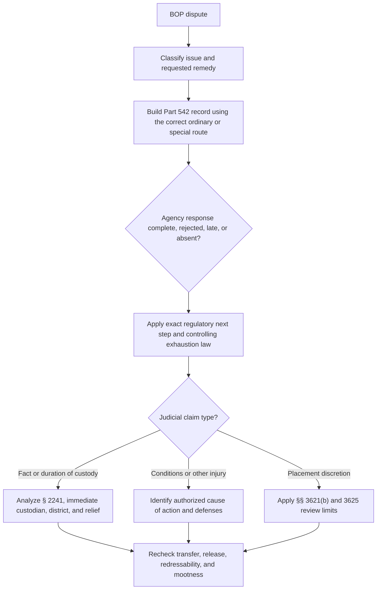

# BOP Administrative Remedies, § 2241 Review, APA Limits, and Mootness

The Bureau's Administrative Remedy Program creates a record and agency review path. It does not by itself answer whether a later claim is habeas, civil, jurisdictional, prudentially exhausted, reviewable, or moot. Those questions require the governing statute, circuit law, custody facts, and requested relief.

## Scope and initial presentation

<!-- claim:CLM-BOPAR-001 authorities:AUTH-CFR-28-542 status:verified_current -->
The Administrative Remedy Program generally permits a prisoner to seek formal review of an issue relating to any aspect of confinement, subject to the exclusions and specialized procedures in 28 C.F.R. part 542. [28 C.F.R. § 542.10](https://www.ecfr.gov/current/title-28/chapter-V/subchapter-C/part-542/subpart-B/section-542.10)

<!-- claim:CLM-BOPAR-002 authorities:AUTH-CFR-28-542 status:verified_current -->
Except where the regulation provides otherwise, a prisoner first must attempt informal resolution before submitting a formal Administrative Remedy Request. [28 C.F.R. § 542.13(a)](https://www.ecfr.gov/current/title-28/chapter-V/subchapter-C/part-542/subpart-B/section-542.13)

<!-- claim:CLM-BOPAR-003 authorities:AUTH-CFR-28-542 status:verified_current -->
The institution request, commonly called a BP-9, ordinarily must be submitted within 20 calendar days after the event giving rise to the complaint; staff must extend the filing period when the prisoner demonstrates a valid reason for delay. [28 C.F.R. § 542.14(a), (b)](https://www.ecfr.gov/current/title-28/chapter-V/subchapter-C/part-542/subpart-B/section-542.14)

<!-- claim:CLM-BOPAR-004 authorities:AUTH-CFR-28-542 status:verified_current -->
A formal request generally must contain one complaint or a reasonable number of closely related issues and must state the requested relief; unrelated claims may be rejected for separate submission. [28 C.F.R. § 542.14(c)](https://www.ecfr.gov/current/title-28/chapter-V/subchapter-C/part-542/subpart-B/section-542.14)

<!-- claim:CLM-BOPAR-005 authorities:AUTH-CFR-28-542 status:verified_current -->
A prisoner who reasonably believes an issue is sensitive and safety would be endangered by institution filing may submit directly to the Regional Director with a sensitivity explanation; if the Regional Director disagrees, the matter is returned for local filing rather than decided on the merits. [28 C.F.R. § 542.14(d)(1)](https://www.ecfr.gov/current/title-28/chapter-V/subchapter-C/part-542/subpart-B/section-542.14)

<!-- claim:CLM-BOPAR-006 authorities:AUTH-CFR-28-542 status:verified_current -->
An appeal from a Discipline Hearing Officer decision initially is submitted to the Regional Director, while placement-center and other special categories follow the routes stated in § 542.14(d). [28 C.F.R. § 542.14(d)(2)–(5)](https://www.ecfr.gov/current/title-28/chapter-V/subchapter-C/part-542/subpart-B/section-542.14)

## Appeals, responses, and rejection

<!-- claim:CLM-BOPAR-007 authorities:AUTH-CFR-28-542 status:verified_current -->
A prisoner ordinarily has 20 calendar days after the Warden signs the response to appeal to the Regional Director and 30 calendar days after the Regional Director signs the response to appeal to General Counsel; the regulation allows an extension for a demonstrated valid reason. [28 C.F.R. § 542.15(a)](https://www.ecfr.gov/current/title-28/chapter-V/subchapter-C/part-542/subpart-B/section-542.15)

<!-- claim:CLM-BOPAR-008 authorities:AUTH-CFR-28-542 status:verified_current -->
An appeal must attach the required lower-level submissions and responses and may not introduce issues that were not raised below; General Counsel's response is the final administrative appeal. [28 C.F.R. § 542.15(b)](https://www.ecfr.gov/current/title-28/chapter-V/subchapter-C/part-542/subpart-B/section-542.15)

<!-- claim:CLM-BOPAR-009 authorities:AUTH-CFR-28-542 status:verified_current -->
The ordinary response periods are 20 calendar days for the Warden, 30 for the Regional Director, and 40 for General Counsel; written extensions are allowed within the regulation's limits. [28 C.F.R. § 542.18](https://www.ecfr.gov/current/title-28/chapter-V/subchapter-C/part-542/subpart-B/section-542.18)

<!-- claim:CLM-BOPAR-010 authorities:AUTH-CFR-28-542 status:verified_current -->
If no response is received within the allotted response time, including a notified extension, the prisoner may treat the absence as a denial at that level and proceed to the next step. [28 C.F.R. § 542.18](https://www.ecfr.gov/current/title-28/chapter-V/subchapter-C/part-542/subpart-B/section-542.18)

<!-- claim:CLM-BOPAR-011 authorities:AUTH-CFR-28-542 status:verified_current -->
A coordinator may reject a submission that does not satisfy the regulation and must give written notice explaining the defect; when the defect is correctable, the notice ordinarily must provide a reasonable resubmission period. [28 C.F.R. § 542.17(a)–(b)](https://www.ecfr.gov/current/title-28/chapter-V/subchapter-C/part-542/subpart-B/section-542.17)

<!-- claim:CLM-BOPAR-012 authorities:AUTH-CFR-28-542 status:verified_current -->
A prisoner may appeal a rejection to the next level when the prisoner believes the rejection is erroneous, but the appeal must address the rejection and preserve the underlying record rather than assume a rejected filing received merits review. [28 C.F.R. § 542.17(c)](https://www.ecfr.gov/current/title-28/chapter-V/subchapter-C/part-542/subpart-B/section-542.17)

<!-- claim:CLM-BOPAR-013 authorities:AUTH-CFR-28-542 status:verified_current -->
An exhaustion record must preserve the event date, informal attempt or exception, each signed submission and attachment, receipt or tracking number, rejection and resubmission notice, response and extension, appeal, and proof of mailing or electronic submission. [28 C.F.R. §§ 542.13–542.18](https://www.ecfr.gov/current/title-28/chapter-V/subchapter-C/part-542/subpart-B)

## § 2241 classification, custodian, and exhaustion

<!-- claim:CLM-BOPAR-014 authorities:AUTH-USC-28-2241 status:verified_current -->
Section 2241 supplies habeas jurisdiction for a person “in custody” under federal authority within its terms; whether a particular prison claim challenges the fact or duration of custody, conditions, or an unreviewable discretionary placement must be classified before filing. [28 U.S.C. § 2241(c)](https://www.govinfo.gov/link/uscode/28/2241)

<!-- claim:CLM-BOPAR-015 authorities:AUTH-SCOTUS-RUMSFELD-PADILLA-542-US-426,AUTH-USC-28-2241 status:verified_current -->
For a core challenge to present physical confinement, the proper respondent ordinarily is the immediate custodian and the petition ordinarily must be filed in the district with territorial jurisdiction over that custodian. [*Rumsfeld v. Padilla*, 542 U.S. 426, 434–47 (2004)](https://www.govinfo.gov/content/pkg/USREPORTS-542/pdf/USREPORTS-542-426.pdf)

<!-- claim:CLM-BOPAR-016 authorities:AUTH-CFR-28-542,AUTH-USC-28-2241 status:verified_current -->
Part 542 prescribes the agency process but does not declare a universal jurisdictional exhaustion rule for § 2241; the source, character, exceptions, waiver, and remedy for nonexhaustion must be taken from controlling circuit law. [28 C.F.R. pt. 542, subpt. B](https://www.ecfr.gov/current/title-28/chapter-V/subchapter-C/part-542/subpart-B); [28 U.S.C. § 2241](https://www.govinfo.gov/link/uscode/28/2241)

<!-- claim:CLM-BOPAR-017 authorities:AUTH-CFR-28-542,AUTH-USC-28-2241 status:verified_current -->
Futility, irreparable injury, unavailable process, and prejudice are not self-proving labels; any asserted exception must be supported by the actual agency route, timing, requested relief, and controlling circuit standard. [28 C.F.R. §§ 542.13–542.18](https://www.ecfr.gov/current/title-28/chapter-V/subchapter-C/part-542/subpart-B); [28 U.S.C. § 2241](https://www.govinfo.gov/link/uscode/28/2241)

<!-- claim:CLM-BOPAR-018 authorities:AUTH-SCOTUS-WILSON-503-US-329,AUTH-CFR-28-542 status:verified_current -->
For § 3585 credit, *United States v. Wilson* identifies initial Bureau computation and administrative review before judicial review; a sentencing-court request cannot bypass that allocation simply by relabeling the computation as clarification. [503 U.S. 329, 333–36 (1992)](https://www.govinfo.gov/content/pkg/USREPORTS-503/pdf/USREPORTS-503-329.pdf)

## Section 3625 and legal review

<!-- claim:CLM-BOPAR-019 authorities:AUTH-USC-18-3625 status:verified_current -->
Section 3625 makes 5 U.S.C. §§ 554, 555, and 701–706 inapplicable to the making of determinations, decisions, or orders under 18 U.S.C. chapter 229, subchapter C (§§ 3621–3626). [18 U.S.C. § 3625](https://www.govinfo.gov/link/uscode/18/3625)

<!-- claim:CLM-BOPAR-020 authorities:AUTH-USC-18-3625 status:verified_current -->
The § 3625 exclusion is statutory and must be applied to the source and nature of the challenged action; it is not a license to call every BOP action unreviewable or to ignore a properly presented constitutional or ultra vires claim. [18 U.S.C. § 3625](https://www.govinfo.gov/link/uscode/18/3625)

<!-- claim:CLM-BOPAR-021 authorities:AUTH-SCOTUS-LOPER-BRIGHT-603-US-369 status:verified_current -->
After *Loper Bright Enterprises v. Raimondo*, a reviewing court must exercise independent judgment on statutory meaning rather than apply Chevron's mandatory deference framework; lawful agency discretion and § 3625's express review exclusion remain distinct questions. [603 U.S. 369, 392–413 (2024)](https://www.govinfo.gov/content/pkg/USREPORTS-603/pdf/USREPORTS-603-369.pdf)

<!-- claim:CLM-BOPAR-022 authorities:AUTH-USC-18-3621,AUTH-USC-18-3625 status:verified_current -->
Section 3621(b) separately states that a designation made under that subsection is not reviewable by any court; a court therefore must distinguish a designation choice from a claim that the Bureau used the wrong statute, ignored a mandatory condition, or violated the Constitution. [18 U.S.C. §§ 3621(b), 3625](https://www.govinfo.gov/link/uscode/18/3621)

<!-- claim:CLM-BOPAR-023 authorities:AUTH-USC-18-3621,AUTH-USC-18-3624,AUTH-USC-18-3625 status:verified_current -->
The remedy must match the proven error: recalculation, lawful reconsideration, restored process, or relief from unconstitutional custody is different from judicial selection of an institution, RRC, home-confinement address, RDAP admission, or discretionary reduction. [18 U.S.C. §§ 3621–3625](https://www.govinfo.gov/link/uscode/18/3625)

## Transfer, release, and mootness

<!-- claim:CLM-BOPAR-024 authorities:AUTH-SCOTUS-EX-PARTE-ENDO-323-US-283,AUTH-SCOTUS-RUMSFELD-PADILLA-542-US-426 status:verified_current -->
A postfiling transfer does not automatically terminate a properly filed habeas case when a respondent within the court's reach retains authority to effect relief, but substitution, jurisdiction, and circuit procedure must be assessed on the actual record. [*Ex parte Endo*, 323 U.S. 283, 304–07 (1944)](https://www.govinfo.gov/content/pkg/USREPORTS-323/pdf/USREPORTS-323-283.pdf); [*Padilla*, 542 U.S. at 440–41](https://www.govinfo.gov/content/pkg/USREPORTS-542/pdf/USREPORTS-542-426.pdf)

<!-- claim:CLM-BOPAR-025 authorities:AUTH-SCOTUS-SPENCER-523-US-1 status:verified_current -->
Release from the challenged custody does not mechanically establish either a live controversy or mootness; the claimant must identify a continuing concrete injury redressable by the court, and collateral consequences are not presumed for every custody-administration decision. [*Spencer v. Kemna*, 523 U.S. 1, 7–18 (1998)](https://www.govinfo.gov/content/pkg/USREPORTS-523/pdf/USREPORTS-523-1.pdf)

<!-- claim:CLM-BOPAR-026 authorities:AUTH-SCOTUS-SPENCER-523-US-1,AUTH-USC-28-2241 status:verified_current -->
Mootness analysis must specify the challenged calculation or decision, present custody and supervision, remaining sentence, requested order, authority of the current respondent, and whether any recognized exception is supported rather than assumed. [*Spencer*, 523 U.S. at 7–18](https://www.govinfo.gov/content/pkg/USREPORTS-523/pdf/USREPORTS-523-1.pdf); [28 U.S.C. § 2241](https://www.govinfo.gov/link/uscode/28/2241)

<!-- claim:CLM-BOPAR-027 authorities:AUTH-USC-28-2241,AUTH-USC-18-3625 status:verified_current -->
Before filing, identify jurisdiction, proper respondent, venue, custody status, administrative exhaustion, claim type, standard of review, § 3625 or other review limit, requested remedy, and a live redressable injury. [28 U.S.C. § 2241](https://www.govinfo.gov/link/uscode/28/2241); [18 U.S.C. § 3625](https://www.govinfo.gov/link/uscode/18/3625)

<!-- claim:CLM-BOPAR-028 authorities:AUTH-CFR-28-542,AUTH-USC-28-2241 status:verified_current -->
No exhaustion or merits conclusion can be drawn from a remedy tracking code alone; preserve and read every submission, response, rejection, extension, attachment, computation, decision, and subsequent custody event. [28 C.F.R. pt. 542, subpt. B](https://www.ecfr.gov/current/title-28/chapter-V/subchapter-C/part-542/subpart-B); [28 U.S.C. § 2241](https://www.govinfo.gov/link/uscode/28/2241)

## PREA-adjusted grievance rules

<!-- claim:CLM-BOPAR-029 authorities:AUTH-CFR-28-115-52 status:verified_current -->
For an administrative grievance alleging sexual abuse, the agency may not require informal resolution, impose a filing deadline, or require submission to a staff member who is the subject of the complaint; third parties may assist under the regulation. [28 C.F.R. § 115.52(b)–(e)](https://www.ecfr.gov/current/title-28/chapter-I/part-115/subpart-A/section-115.52)

<!-- claim:CLM-BOPAR-030 authorities:AUTH-CFR-28-115-52 status:verified_current -->
The agency ordinarily must issue a final decision on the merits within 90 days of initial filing, excluding the prisoner's appeal-preparation time, and may extend up to 70 days with written notice; absence of a timely response at a level may be treated as a denial at that level. [28 C.F.R. § 115.52(d)](https://www.ecfr.gov/current/title-28/chapter-I/part-115/subpart-A/section-115.52)

<!-- claim:CLM-BOPAR-031 authorities:AUTH-CFR-28-115-52 status:verified_current -->
An emergency grievance alleging a substantial risk of imminent sexual abuse must receive an initial response within 48 hours and a final agency decision within five calendar days, with documentation of the risk determination and protective action. [28 C.F.R. § 115.52(f)](https://www.ecfr.gov/current/title-28/chapter-I/part-115/subpart-A/section-115.52)

<!-- claim:CLM-BOPAR-032 authorities:AUTH-CFR-28-115-52 status:verified_current -->
Discipline for filing a sexual-abuse grievance is permitted only when the agency demonstrates bad faith; a good-faith report is protected even when the evidence is insufficient to substantiate it. [28 C.F.R. § 115.52(g)](https://www.ecfr.gov/current/title-28/chapter-I/part-115/subpart-A/section-115.52)

## Decision path

## Required records and limits

- Complete Administrative Remedy Program file at every level, including rejected and resubmitted filings.
- The underlying computation, classification, designation, discipline, program, medical, or placement record.
- Current facility, custodian, district, custody and supervision status, projected release date, and transfer history.
- Current controlling circuit authority for exhaustion, cognizability, reviewability, cause of action, remedy, and mootness.
- This module does not decide an individual case without those records and circuit-specific verification.
