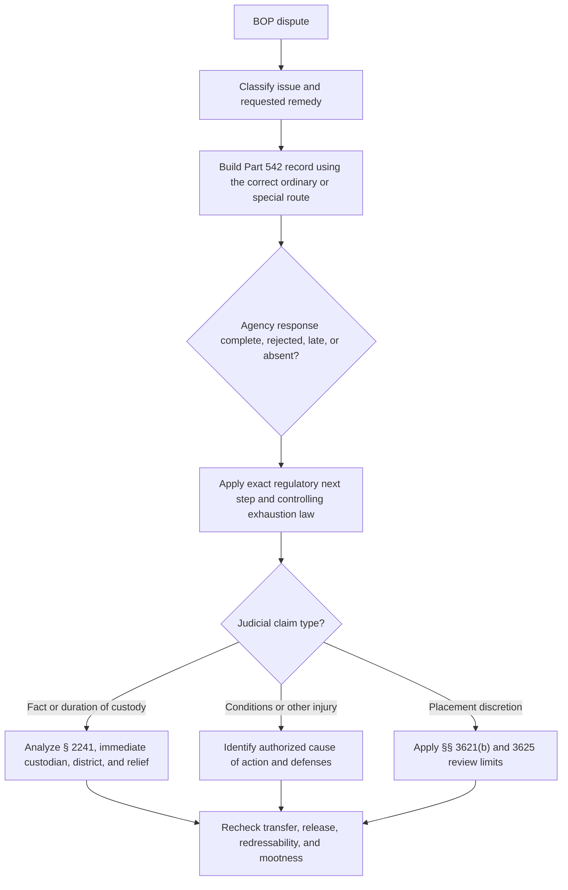

# BOP Administrative Remedies, § 2241 Review, APA Limits, and Mootness

The Bureau's Administrative Remedy Program creates a record and agency review path. It does not by itself answer whether a later claim is habeas, civil, jurisdictional, prudentially exhausted, reviewable, or moot. Those questions require the governing statute, circuit law, custody facts, and requested relief.

## Scope and initial presentation

<!-- claim:CLM-BOPAR-001 authorities:AUTH-CFR-28-542 status:verified_current -->
The Administrative Remedy Program allows a prisoner to seek formal review of an issue relating to any aspect of his or her own confinement, but not on behalf of another inmate. It covers inmates in Bureau institutions and contract Community Corrections Centers and former inmates for issues that arose during confinement, does not apply to inmates in other non-federal facilities, and refers tort, Inmate Accident Compensation, and FOIA or Privacy Act matters to their statutorily mandated procedures. [28 C.F.R. § 542.10](https://www.ecfr.gov/current/title-28/chapter-V/subchapter-C/part-542/subpart-B)

<!-- claim:CLM-BOPAR-002 authorities:AUTH-CFR-28-542 status:verified_current -->
Except where the regulation provides otherwise, a prisoner first must attempt informal resolution before submitting a formal Administrative Remedy Request. [28 C.F.R. § 542.13(a)](https://www.ecfr.gov/current/title-28/chapter-V/subchapter-C/part-542/subpart-B/section-542.13)

<!-- claim:CLM-BOPAR-003 authorities:AUTH-CFR-28-542,AUTH-BOP-PS-1330-18 status:verified_current -->
The institution request, commonly called a BP-9, must be submitted, with informal resolution completed, within 20 calendar days following the date on which the basis for the request occurred. When the prisoner demonstrates a valid reason for delay, an extension may be allowed; BOP policy says the prisoner ordinarily should submit written verification from staff of the claimed reason. [28 C.F.R. § 542.14(a)–(b)](https://www.ecfr.gov/current/title-28/chapter-V/subchapter-C/part-542/subpart-B); [BOP PS 1330.18 (Jan. 6, 2014), § 8.b](https://www.bop.gov/policy/progstat/1330_018.pdf)

<!-- claim:CLM-BOPAR-004 authorities:AUTH-CFR-28-542 status:verified_current -->
A formal request must contain a single complaint or a reasonable number of closely related issues; a form with multiple unrelated issues shall be rejected and returned without response, and each DHO or UDC incident report must be appealed on a separate form. The prisoner states the complaint in the space provided and may use up to one letter-size continuation page. [28 C.F.R. § 542.14(c)(2)–(3)](https://www.ecfr.gov/current/title-28/chapter-V/subchapter-C/part-542/subpart-B)

<!-- claim:CLM-BOPAR-005 authorities:AUTH-CFR-28-542 status:verified_current -->
A prisoner who reasonably believes the issue is sensitive and that the prisoner's safety or well-being would be placed in danger if the request became known at the institution may submit it directly to the Regional Director, clearly marked "Sensitive" with a written explanation. If the Regional Administrative Remedy Coordinator does not agree, the request is not accepted and is not returned; the prisoner is advised in writing and may file locally with the Warden, who shall allow a reasonable extension of time for the resubmission. [28 C.F.R. § 542.14(d)(1)](https://www.ecfr.gov/current/title-28/chapter-V/subchapter-C/part-542/subpart-B)

<!-- claim:CLM-BOPAR-006 authorities:AUTH-CFR-28-542 status:verified_current -->
An appeal from a Discipline Hearing Officer decision is submitted initially to the Regional Director for the region where the prisoner is currently located. Appeals of Executive Panel Reviews of Control Unit placement go directly to General Counsel, appeals of the Regional Director's review of controlled housing status placement may be filed directly with General Counsel, and requests about initial decisions that did not originate with the Warden may be filed first with the Bureau office that made the decision and appealed directly to General Counsel. [28 C.F.R. § 542.14(d)(2)–(5)](https://www.ecfr.gov/current/title-28/chapter-V/subchapter-C/part-542/subpart-B)

## Appeals, responses, and rejection

<!-- claim:CLM-BOPAR-007 authorities:AUTH-CFR-28-542,AUTH-BOP-PS-1330-18 status:verified_current -->
A prisoner who is not satisfied with the Warden's response may submit an appeal (BP-10) to the appropriate Regional Director within 20 calendar days of the date the Warden signed the response, and a prisoner who is not satisfied with the Regional Director's response may submit an appeal (BP-11) to the General Counsel within 30 calendar days of the date the Regional Director signed the response; when the prisoner demonstrates a valid reason for delay, these time limits may be extended. BOP policy says these deadlines specify the date the appeal is received in the regional office or the Central Office, and that the appropriate regional office is the one for the institution where the prisoner is confined at the time the appeal is mailed. [28 C.F.R. § 542.15(a)](https://www.ecfr.gov/current/title-28/chapter-V/subchapter-C/part-542/subpart-B); [BOP PS 1330.18 (Jan. 6, 2014), § 9.a, 9.c](https://www.bop.gov/policy/progstat/1330_018.pdf)

<!-- claim:CLM-BOPAR-008 authorities:AUTH-CFR-28-542 status:verified_current -->
An appeal must be accompanied by one complete copy or duplicate original of the lower-level filings and their responses, with the additional copies of continuation pages and exhibits that the regulation requires, and must state specifically the reason for appeal. It may not raise issues not raised in the lower-level filings or combine appeals of separate lower-level responses (different case numbers), and appeal to the General Counsel is the final administrative appeal. [28 C.F.R. § 542.15(a)–(b)](https://www.ecfr.gov/current/title-28/chapter-V/subchapter-C/part-542/subpart-B)

<!-- claim:CLM-BOPAR-009 authorities:AUTH-CFR-28-542 status:verified_current -->
A request or appeal is considered filed on the date it is logged into the Administrative Remedy Index as received, and the ordinary response periods run from filing: 20 calendar days for the Warden, 30 for the Regional Director, and 40 for General Counsel. If that time is insufficient for an appropriate decision, it may be extended once by 20 days at the institution, 30 days at the region, or 20 days at the Central Office, and staff must inform the prisoner of the extension in writing. [28 C.F.R. § 542.18](https://www.ecfr.gov/current/title-28/chapter-V/subchapter-C/part-542/subpart-B)

<!-- claim:CLM-BOPAR-010 authorities:AUTH-CFR-28-542 status:verified_current -->
If no response is received within the allotted response time, including a notified extension, the prisoner may treat the absence as a denial at that level and proceed to the next step. [28 C.F.R. § 542.18](https://www.ecfr.gov/current/title-28/chapter-V/subchapter-C/part-542/subpart-B/section-542.18)

<!-- claim:CLM-BOPAR-011 authorities:AUTH-CFR-28-542,AUTH-BOP-PS-1330-18 status:verified_current -->
A Coordinator at any level may reject a submission that is written in an obscene or abusive manner or does not meet any other requirement of part 542, and the prisoner must be given a written notice, signed by the Coordinator, explaining the reason. If the defect is correctable, the notice must give a reasonable time to correct it and resubmit; BOP policy says that period ordinarily is five calendar days at the institution, at least 10 calendar days at the CCM or regional office, and 15 calendar days at the Central Office. [28 C.F.R. § 542.17(a)–(b)](https://www.ecfr.gov/current/title-28/chapter-V/subchapter-C/part-542/subpart-B); [BOP PS 1330.18 (Jan. 6, 2014), § 11.b(2)](https://www.bop.gov/policy/progstat/1330_018.pdf)

<!-- claim:CLM-BOPAR-012 authorities:AUTH-CFR-28-542 status:verified_current -->
When a request or appeal is rejected and the prisoner is not given an opportunity to correct the defect and resubmit, the prisoner may appeal the rejection, including a rejection based on a § 542.14(d) exception, to the next appeal level. The Coordinator at that level may affirm the rejection, direct that the submission be accepted at the lower level, or accept it for filing. [28 C.F.R. § 542.17(c)](https://www.ecfr.gov/current/title-28/chapter-V/subchapter-C/part-542/subpart-B)

<!-- claim:CLM-BOPAR-013 authorities:AUTH-CFR-28-542,AUTH-BOP-PS-1330-18 status:verified_current -->
Each appeal must be accompanied by complete copies of the lower-level filings and responses and copies of exhibits used at prior levels; exhibits are not returned with the response, and because copies of exhibits must be filed for any appeal, part 542 encourages the prisoner to keep a copy of all exhibits; each level acknowledges a filing by returning a receipt. BOP policy measures appeal deadlines by the date the appeal is received at the regional office or Central Office. [28 C.F.R. §§ 542.11(a)(2), 542.14(c)(3), 542.15(b)](https://www.ecfr.gov/current/title-28/chapter-V/subchapter-C/part-542/subpart-B); [BOP PS 1330.18 (Jan. 6, 2014), § 9.a](https://www.bop.gov/policy/progstat/1330_018.pdf)

## § 2241 classification, custodian, and exhaustion

<!-- claim:CLM-BOPAR-014 authorities:AUTH-USC-28-2241 status:verified_current -->
Section 2241(a) authorizes the district courts to grant writs of habeas corpus "within their respective jurisdictions," and § 2241(c) extends the writ to a prisoner only on a listed ground, including custody "under or by color of the authority of the United States" or custody "in violation of the Constitution or laws or treaties of the United States." [28 U.S.C. § 2241(a), (c)(1), (c)(3)](https://www.govinfo.gov/link/uscode/28/2241)

<!-- claim:CLM-BOPAR-015 authorities:AUTH-SCOTUS-RUMSFELD-PADILLA-542-US-426,AUTH-USC-28-2241 status:verified_current -->
For a core challenge to present physical confinement, the proper respondent ordinarily is the immediate custodian and the petition ordinarily must be filed in the district with territorial jurisdiction over that custodian. [*Rumsfeld v. Padilla*, 542 U.S. 426, 434–47 (2004)](https://www.govinfo.gov/content/pkg/USREPORTS-542/pdf/USREPORTS-542-426.pdf)

<!-- claim:CLM-BOPAR-016 authorities:AUTH-CFR-28-542,AUTH-USC-28-2241 status:verified_current -->
Part 542 prescribes the agency process but does not declare a universal jurisdictional exhaustion rule for § 2241; the source, character, exceptions, waiver, and remedy for nonexhaustion must be taken from controlling circuit law. [28 C.F.R. pt. 542, subpt. B](https://www.ecfr.gov/current/title-28/chapter-V/subchapter-C/part-542/subpart-B); [28 U.S.C. § 2241](https://www.govinfo.gov/link/uscode/28/2241)

<!-- claim:CLM-BOPAR-017 authorities:AUTH-CA9-WARD-678-F3D-1042,AUTH-CFR-28-542,AUTH-USC-28-2241 status:verified_current -->
Neither § 2241 nor 28 C.F.R. part 542 states a nationwide exception to judicial exhaustion of the BOP Administrative Remedy Program; any waiver or excuse must come from controlling circuit law. In the Ninth Circuit, *Ward v. Chavez* treats § 2241 exhaustion as a prudential requirement, not a jurisdictional prerequisite, that may be waived if pursuing administrative remedies would be futile, and held exhaustion futile where the Warden's denial rested on official BOP policy (the Inmate Financial Responsibility Program). [*Ward v. Chavez*, 678 F.3d 1042 (9th Cir. 2012)](https://cdn.ca9.uscourts.gov/datastore/opinions/2012/05/08/09-17016.pdf); [28 C.F.R. pt. 542, subpt. B](https://www.ecfr.gov/current/title-28/chapter-V/subchapter-C/part-542/subpart-B); [28 U.S.C. § 2241](https://www.govinfo.gov/link/uscode/28/2241)

<!-- claim:CLM-BOPAR-018 authorities:AUTH-SCOTUS-WILSON-503-US-329 status:verified_current -->
For § 3585(b) credit, *United States v. Wilson* holds that a district court "cannot apply § 3585(b) at sentencing" and that the Attorney General, through the Bureau, must make the credit determination as an administrative matter; the Court noted that federal regulations have afforded prisoners administrative review of the computation of their credits and that prisoners have been able to seek judicial review of these computations after exhausting their administrative remedies. [503 U.S. 329, 333–35 (1992)](https://www.govinfo.gov/content/pkg/USREPORTS-503/pdf/USREPORTS-503-329.pdf)

## Section 3625 and legal review

<!-- claim:CLM-BOPAR-019 authorities:AUTH-USC-18-3625 status:verified_current -->
Section 3625 provides that 5 U.S.C. §§ 554, 555, and 701–706 "do not apply to the making of any determination, decision, or order under this subchapter" of 18 U.S.C. chapter 229; under its effective-date note, the section took effect Nov. 1, 1987, and applies only to offenses committed after it took effect. [18 U.S.C. § 3625](https://www.govinfo.gov/link/uscode/18/3625)

<!-- claim:CLM-BOPAR-020 authorities:AUTH-USC-18-3625 status:verified_current -->
The § 3625 exclusion is limited by its terms: it displaces only 5 U.S.C. §§ 554, 555, and 701–706, and only for "the making of any determination, decision, or order under this subchapter"; the section does not mention constitutional, ultra vires, or habeas claims. [18 U.S.C. § 3625](https://www.govinfo.gov/link/uscode/18/3625)

<!-- claim:CLM-BOPAR-021 authorities:AUTH-SCOTUS-LOPER-BRIGHT-603-US-369,AUTH-USC-18-3625 status:verified_current -->
After *Loper Bright Enterprises v. Raimondo*, courts must exercise independent judgment in deciding whether an agency has acted within its statutory authority, "as the APA requires," rather than defer to an agency interpretation simply because a statute is ambiguous, while respecting a statute's delegation of authority to an agency consistent with constitutional limits and ensuring the agency acts within it; the holdings of prior Chevron-based cases that specific agency actions are lawful remain subject to statutory stare decisis. The Court grounded that rule in the APA, and § 3625 makes 5 U.S.C. §§ 701–706 inapplicable to determinations under its subchapter. [603 U.S. 369 (2024)](https://www.supremecourt.gov/opinions/23pdf/22-451_7m58.pdf); [18 U.S.C. § 3625](https://www.govinfo.gov/link/uscode/18/3625)

<!-- claim:CLM-BOPAR-022 authorities:AUTH-USC-18-3621 status:verified_current -->
Section 3621(b) provides that "[n]otwithstanding any other provision of law, a designation of a place of imprisonment under this subsection is not reviewable by any court," and that a sentencing court's order, recommendation, or request that a person serve a term of imprisonment in a community corrections facility "shall have no binding effect" on the Bureau's authority to determine or change the place of imprisonment. [18 U.S.C. § 3621(b)](https://www.govinfo.gov/link/uscode/18/3621)

<!-- claim:CLM-BOPAR-023 authorities:AUTH-USC-18-3621,AUTH-USC-18-3624,AUTH-USC-18-3625 status:verified_current -->
The remedy must match the proven error: recalculation, lawful reconsideration, restored process, or relief from unconstitutional custody is different from judicial selection of an institution, RRC, home-confinement address, RDAP admission, or discretionary reduction. [18 U.S.C. §§ 3621–3625](https://www.govinfo.gov/link/uscode/18/3625)

## Transfer, release, and mootness

<!-- claim:CLM-BOPAR-024 authorities:AUTH-SCOTUS-EX-PARTE-ENDO-323-US-283,AUTH-SCOTUS-RUMSFELD-PADILLA-542-US-426 status:verified_current -->
A postfiling transfer does not automatically terminate a properly filed habeas case when a respondent within the court's reach retains authority to effect relief, but substitution, jurisdiction, and circuit procedure must be assessed on the actual record. [*Ex parte Endo*, 323 U.S. 283, 304–07 (1944)](https://www.govinfo.gov/content/pkg/USREPORTS-323/pdf/USREPORTS-323-283.pdf); [*Padilla*, 542 U.S. at 440–41](https://www.govinfo.gov/content/pkg/USREPORTS-542/pdf/USREPORTS-542-426.pdf)

<!-- claim:CLM-BOPAR-025 authorities:AUTH-SCOTUS-SPENCER-523-US-1 status:verified_current -->
Release from the challenged custody does not mechanically establish either a live controversy or mootness; the claimant must identify a continuing concrete injury redressable by the court, and collateral consequences are not presumed for every custody-administration decision. [*Spencer v. Kemna*, 523 U.S. 1, 7–18 (1998)](https://www.govinfo.gov/content/pkg/USREPORTS-523/pdf/USREPORTS-523-1.pdf)

<!-- claim:CLM-BOPAR-026 authorities:AUTH-SCOTUS-SPENCER-523-US-1,AUTH-USC-28-2241 status:verified_current -->
Mootness analysis must specify the challenged calculation or decision, present custody and supervision, remaining sentence, requested order, authority of the current respondent, and whether any recognized exception is supported rather than assumed. [*Spencer*, 523 U.S. at 7–18](https://www.govinfo.gov/content/pkg/USREPORTS-523/pdf/USREPORTS-523-1.pdf); [28 U.S.C. § 2241](https://www.govinfo.gov/link/uscode/28/2241)

<!-- claim:CLM-BOPAR-027 authorities:AUTH-USC-28-2241,AUTH-SCOTUS-RUMSFELD-PADILLA-542-US-426,AUTH-SCOTUS-SPENCER-523-US-1,AUTH-USC-18-3625,AUTH-BOP-PS-1330-18 status:verified_current -->
Section 2241(a) authorizes the district courts to grant the writ "within their respective jurisdictions," and § 2241(c) requires a listed ground, such as custody under federal authority or in violation of federal law; for core habeas petitions challenging present physical confinement, the immediate custodian is the proper respondent and jurisdiction lies in only one district, the district of confinement. Throughout the case the petitioner "must have suffered, or be threatened with, an actual injury traceable to the defendant and likely to be redressed by a favorable judicial decision," and § 3625 makes 5 U.S.C. §§ 554, 555, and 701–706 inapplicable to determinations under its subchapter. BOP policy notes that "[i]n many cases, courts require a proper Appeal to the General Counsel before an inmate may pursue the complaint in court." [28 U.S.C. § 2241(a), (c)](https://www.govinfo.gov/link/uscode/28/2241); [542 U.S. 426, 439, 443 (2004)](https://www.govinfo.gov/content/pkg/USREPORTS-542/pdf/USREPORTS-542-426.pdf); [523 U.S. 1, 7 (1998)](https://www.govinfo.gov/content/pkg/USREPORTS-523/pdf/USREPORTS-523-1.pdf); [18 U.S.C. § 3625](https://www.govinfo.gov/link/uscode/18/3625); [BOP PS 1330.18 (Jan. 6, 2014), § 9.a](https://www.bop.gov/policy/progstat/1330_018.pdf)

<!-- claim:CLM-BOPAR-028 authorities:AUTH-CFR-28-542,AUTH-USC-28-2241 status:verified_current -->
No exhaustion or merits conclusion can be drawn from a remedy tracking code alone; preserve and read every submission, response, rejection, extension, attachment, computation, decision, and subsequent custody event. [28 C.F.R. pt. 542, subpt. B](https://www.ecfr.gov/current/title-28/chapter-V/subchapter-C/part-542/subpart-B); [28 U.S.C. § 2241](https://www.govinfo.gov/link/uscode/28/2241)

## PREA-adjusted grievance rules

<!-- claim:CLM-BOPAR-029 authorities:AUTH-CFR-28-115-52,AUTH-BOP-PS-1330-18 status:verified_current -->
For a grievance alleging sexual abuse, the agency may not impose a time limit on submission or require informal resolution, and must ensure the prisoner can submit it without submitting it to, and that it is not referred to, a staff member who is the subject of the complaint; otherwise-applicable time limits may still apply to any portion that does not allege sexual abuse. Third parties may assist and may file on the prisoner's behalf, but the facility may require the alleged victim's agreement and may require the victim to personally pursue later steps; BOP policy says that once a grievance is filed the prisoner should follow the ordinary appeal deadlines and must personally file any subsequent appeal. [28 C.F.R. § 115.52(b)–(e)](https://www.ecfr.gov/current/title-28/chapter-I/part-115/subpart-A/section-115.52); [BOP PS 1330.18 (Jan. 6, 2014), § 16](https://www.bop.gov/policy/progstat/1330_018.pdf)

<!-- claim:CLM-BOPAR-030 authorities:AUTH-CFR-28-115-52 status:verified_current -->
The agency must issue a final decision on the merits of any portion of a grievance alleging sexual abuse within 90 days of initial filing, not counting time consumed by the prisoner in preparing any administrative appeal; if that period is insufficient for an appropriate decision, it may claim an extension of up to 70 days, with written notice giving a date by which a decision will be made. At any level, if the prisoner receives no response within the time allotted, including any properly noticed extension, the prisoner may consider the absence of a response a denial at that level. [28 C.F.R. § 115.52(d)](https://www.ecfr.gov/current/title-28/chapter-I/part-115/subpart-A/section-115.52)

<!-- claim:CLM-BOPAR-031 authorities:AUTH-CFR-28-115-52,AUTH-BOP-PS-1330-18 status:verified_current -->
After receiving an emergency grievance alleging a substantial risk of imminent sexual abuse, the agency must immediately forward it to a level of review at which immediate corrective action may be taken, provide an initial response within 48 hours, and issue a final agency decision within 5 calendar days, documenting its risk determination and the action taken. Under BOP policy the prisoner marks the BP-9 "Emergency" with a written explanation, "[b]est efforts" should be made to provide BP-10 and BP-11 responses within five calendar days, and the expedited times do not apply to grievances filed as "sensitive." [28 C.F.R. § 115.52(f)](https://www.ecfr.gov/current/title-28/chapter-I/part-115/subpart-A/section-115.52); [BOP PS 1330.18 (Jan. 6, 2014), § 16](https://www.bop.gov/policy/progstat/1330_018.pdf)

<!-- claim:CLM-BOPAR-032 authorities:AUTH-CFR-28-115-52 status:verified_current -->
The agency may discipline a prisoner for filing a grievance related to alleged sexual abuse only where the agency demonstrates that the prisoner filed the grievance in bad faith. [28 C.F.R. § 115.52(g)](https://www.ecfr.gov/current/title-28/chapter-I/part-115/subpart-A/section-115.52)

## Decision path

## Required records and limits

- Complete Administrative Remedy Program file at every level, including rejected and resubmitted filings.
- The underlying computation, classification, designation, discipline, program, medical, or placement record.
- Current facility, custodian, district, custody and supervision status, projected release date, and transfer history.
- Current controlling circuit authority for exhaustion, cognizability, reviewability, cause of action, remedy, and mootness.
- This module does not decide an individual case without those records and circuit-specific verification.
