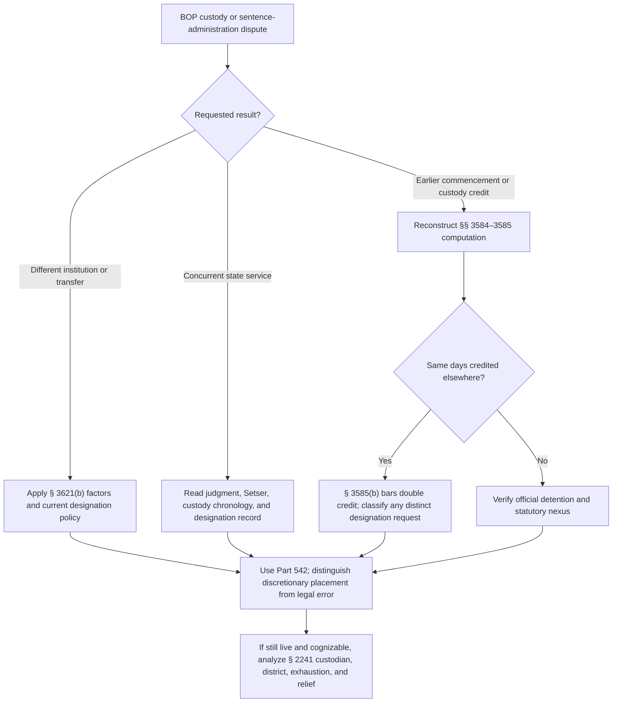

# BOP Designation, Sentence Commencement, Aggregation, and Prior-Custody Credit

The sentencing court imposes the term; the Bureau of Prisons administers its place, commencement, aggregation, and statutory credit. Keep a judgment error, a sentence-execution computation, a designation request, and a discretionary placement disagreement in separate procedural lanes.

## Custody and designation

<!-- claim:CLM-BOPSC-001 authorities:AUTH-USC-18-3621 status:verified_current -->
A person sentenced to imprisonment under Chapter 227, Subchapter D is committed to Bureau of Prisons custody until the term expires or the person is earlier released under § 3624. [18 U.S.C. § 3621(a)](https://uscode.house.gov/view.xhtml?edition=prelim&num=0&req=granuleid%3AUSC-prelim-title18-section3621)

<!-- claim:CLM-BOPSC-002 authorities:AUTH-USC-18-3621 status:verified_current -->
The Bureau designates the place of imprisonment and may select an available qualifying federal or nonfederal penal or correctional facility inside or outside the district of conviction. [18 U.S.C. § 3621(b)](https://uscode.house.gov/view.xhtml?edition=prelim&num=0&req=granuleid%3AUSC-prelim-title18-section3621)

<!-- claim:CLM-BOPSC-003 authorities:AUTH-USC-18-3621 status:verified_current -->
Designation requires consideration of facility resources, the offense, the prisoner's history and characteristics, relevant sentencing-court statements, and pertinent Sentencing Commission policy statements. [18 U.S.C. § 3621(b)(1)–(5)](https://uscode.house.gov/view.xhtml?edition=prelim&num=0&req=granuleid%3AUSC-prelim-title18-section3621)

<!-- claim:CLM-BOPSC-004 authorities:AUTH-USC-18-3621 status:verified_current -->
Subject to bed availability, security designation, programmatic, mental-health, medical, faith-based, court-recommendation, and other security considerations, the Bureau must place the prisoner as close as practicable to the primary residence and, to the extent practicable, within 500 driving miles. [18 U.S.C. § 3621(b)](https://uscode.house.gov/view.xhtml?edition=prelim&num=0&req=granuleid%3AUSC-prelim-title18-section3621)

<!-- claim:CLM-BOPSC-005 authorities:AUTH-USC-18-3621 status:verified_current -->
The proximity text also requires the Bureau, subject to the listed factors and the prisoner's stay-or-transfer preference, to transfer prisoners closer to the primary residence even when already within 500 miles; it does not create an unqualified right to a requested institution. [18 U.S.C. § 3621(b)](https://uscode.house.gov/view.xhtml?edition=prelim&num=0&req=granuleid%3AUSC-prelim-title18-section3621)

<!-- claim:CLM-BOPSC-006 authorities:AUTH-USC-18-3621 status:verified_current -->
A sentencing-court order, recommendation, or request about a community correctional facility has no binding effect on the Bureau's § 3621(b) authority. [18 U.S.C. § 3621(b)](https://uscode.house.gov/view.xhtml?edition=prelim&num=0&req=granuleid%3AUSC-prelim-title18-section3621)

<!-- claim:CLM-BOPSC-007 authorities:AUTH-USC-18-3621 status:verified_current -->
Section 3621(b) states that a designation made under that subsection is not reviewable by any court; whether a claim instead challenges a statutory computation, constitutional violation, or action outside the delegated authority must be classified separately. [18 U.S.C. § 3621(b)](https://uscode.house.gov/view.xhtml?edition=prelim&num=0&req=granuleid%3AUSC-prelim-title18-section3621)

<!-- claim:CLM-BOPSC-008 authorities:AUTH-BOP-PS-5100-08-CN3,AUTH-USC-18-3621 status:verified_current -->
BOP Program Statement 5100.08 Change Notice 3, dated May 6, 2026, is the current public agency policy for security designation, custody classification, and designation or redesignation under § 3621(b); statute and valid regulations control over operational policy. [BOP PS 5100.08 CN-3](https://www.bop.gov/policy/progstat/5100_008_cn-3.pdf)

<!-- claim:CLM-BOPSC-009 authorities:AUTH-BOP-PS-5160-05,AUTH-USC-18-3621 status:verified_current -->
Program Statement 5160.05 recognizes Bureau authority to designate a state institution for concurrent service when consistent with the federal sentencing court's intent or criminal-justice goals, but it describes a discretionary § 3621(b) determination rather than automatic retroactive credit. [BOP PS 5160.05](https://www.bop.gov/policy/progstat/5160_005.pdf)

<!-- claim:CLM-BOPSC-010 authorities:AUTH-SCOTUS-SETSER-566-US-231,AUTH-USC-18-3621 status:verified_current -->
*Setser* holds that a federal sentencing court may order its sentence concurrent with or consecutive to an anticipated state sentence; when later events make the judgment difficult to implement, the Bureau initially administers it and the prisoner may seek administrative and habeas review. [*Setser v. United States*, 566 U.S. 231, 236–44 (2012)](https://www.govinfo.gov/content/pkg/USREPORTS-566/pdf/USREPORTS-566-231.pdf)

## Multiple terms and aggregation

<!-- claim:CLM-BOPSC-011 authorities:AUTH-USC-18-3584 status:verified_current -->
Multiple imprisonment terms imposed at the same time run concurrently unless the court orders or a statute mandates consecutive service; terms imposed at different times run consecutively unless the court orders concurrency. [18 U.S.C. § 3584(a)](https://uscode.house.gov/view.xhtml?edition=prelim&f=treesort&jumpTo=true&num=0&req=%28title%3A18+section%3A3584+edition%3Aprelim%29)

<!-- claim:CLM-BOPSC-012 authorities:AUTH-USC-18-3584 status:verified_current -->
The sentencing court considers the § 3553(a) factors when choosing concurrent or consecutive terms under § 3584. [18 U.S.C. § 3584(b)](https://uscode.house.gov/view.xhtml?edition=prelim&f=treesort&jumpTo=true&num=0&req=%28title%3A18+section%3A3584+edition%3Aprelim%29)

<!-- claim:CLM-BOPSC-013 authorities:AUTH-USC-18-3584 status:verified_current -->
For administrative purposes, multiple concurrent or consecutive terms are treated as a single aggregate term; aggregation does not erase count-specific statutory commands or rewrite the judgments. [18 U.S.C. § 3584(c)](https://uscode.house.gov/view.xhtml?edition=prelim&f=treesort&jumpTo=true&num=0&req=%28title%3A18+section%3A3584+edition%3Aprelim%29)

<!-- claim:CLM-BOPSC-014 authorities:AUTH-SCOTUS-SETSER-566-US-231,AUTH-USC-18-3584 status:verified_current -->
The judgment, later state disposition, statutory consecutive command, and actual custody chronology must be reconciled; “concurrent” is not itself a grant of prohibited double credit for a period before the federal term commences. [*Setser*, 566 U.S. at 239–44](https://www.govinfo.gov/content/pkg/USREPORTS-566/pdf/USREPORTS-566-231.pdf); [18 U.S.C. §§ 3584–3585](https://uscode.house.gov/view.xhtml?req=%28title%3A18+section%3A3585+edition%3Aprelim%29)

## Commencement and prior-custody credit

<!-- claim:CLM-BOPSC-015 authorities:AUTH-USC-18-3585 status:verified_current -->
Section 3585(a) commences a federal imprisonment term on the date the defendant is received in custody awaiting transport to, or voluntarily arrives at, the official detention facility where the sentence is to be served. [18 U.S.C. § 3585(a)](https://uscode.house.gov/view.xhtml?req=%28title%3A18+section%3A3585+edition%3Aprelim%29)

<!-- claim:CLM-BOPSC-016 authorities:AUTH-SCOTUS-WILSON-503-US-329,AUTH-USC-18-3585 status:verified_current -->
The Attorney General through the Bureau, not the sentencing court at the sentencing hearing, initially computes § 3585(b) prior-custody credit after the defendant begins serving the federal sentence. [*United States v. Wilson*, 503 U.S. 329, 333–35 (1992)](https://www.govinfo.gov/content/pkg/USREPORTS-503/pdf/USREPORTS-503-329.pdf)

<!-- claim:CLM-BOPSC-017 authorities:AUTH-USC-18-3585 status:verified_current -->
Prior-custody credit covers qualifying official detention before commencement resulting from the federal offense or another charge for which the defendant was arrested after commission of that offense. [18 U.S.C. § 3585(b)(1)–(2)](https://uscode.house.gov/view.xhtml?req=%28title%3A18+section%3A3585+edition%3Aprelim%29)

<!-- claim:CLM-BOPSC-018 authorities:AUTH-USC-18-3585,AUTH-SCOTUS-WILSON-503-US-329 status:verified_current -->
Section 3585(b) forbids crediting a detention period that has been credited against another sentence; a general fairness or concurrency label cannot override that enacted anti-double-credit limit. [18 U.S.C. § 3585(b)](https://uscode.house.gov/view.xhtml?req=%28title%3A18+section%3A3585+edition%3Aprelim%29); [*Wilson*, 503 U.S. at 337](https://www.govinfo.gov/content/pkg/USREPORTS-503/pdf/USREPORTS-503-329.pdf)

<!-- claim:CLM-BOPSC-019 authorities:AUTH-SCOTUS-KORAY-515-US-50,AUTH-USC-18-3585 status:verified_current -->
*Reno v. Koray* holds that restrictive confinement in a community treatment center while “released” on bail was not “official detention” under § 3585(b). [*Reno v. Koray*, 515 U.S. 50, 56–65 (1995)](https://www.govinfo.gov/content/pkg/USREPORTS-515/pdf/USREPORTS-515-50.pdf)

<!-- claim:CLM-BOPSC-020 authorities:AUTH-SCOTUS-KORAY-515-US-50 status:verified_current -->
The Bail Reform Act's release-versus-detention classification, not merely how restrictive a location feels, controlled *Koray*; electronic monitoring, curfew, treatment, or residence conditions require the actual custody order and governing law. [*Koray*, 515 U.S. at 57–65](https://www.govinfo.gov/content/pkg/USREPORTS-515/pdf/USREPORTS-515-50.pdf)

<!-- claim:CLM-BOPSC-021 authorities:AUTH-BOP-PS-5880-28,AUTH-BOP-SENTENCE-COMPUTATIONS status:verified_current -->
The Bureau's public sentence-computation page identifies the Designation and Sentence Computation Center and current public computation manuals, including Program Statement 5880.28 for CCCA sentences; these operational materials do not displace §§ 3584–3585 or controlling decisions. [BOP Sentence Computations](https://www.bop.gov/inmates/custody_and_care/sentence_computations.jsp); [PS 5880.28](https://www.bop.gov/policy/progstat/5880_028.pdf)

<!-- claim:CLM-BOPSC-022 authorities:AUTH-USC-18-3585,AUTH-BOP-PS-5880-28 status:verified_current -->
For an offense within the current-law branch, Bureau policy does not backdate commencement to a day before the federal sentence existed; a requested earlier effective result must be analyzed through the judgment, § 3584, designation authority, and any other lawful sentencing mechanism rather than invented § 3585 credit. [18 U.S.C. § 3585(a)](https://uscode.house.gov/view.xhtml?req=%28title%3A18+section%3A3585+edition%3Aprelim%29); [PS 5880.28](https://www.bop.gov/policy/progstat/5880_028.pdf)

<!-- claim:CLM-BOPSC-023 authorities:AUTH-USC-18-3585,AUTH-BOP-PS-5160-05 status:verified_current -->
A retroactive or nunc pro tunc state-facility designation is a § 3621(b) placement determination under Bureau policy, not a second award of the same custody days under § 3585(b). [BOP PS 5160.05](https://www.bop.gov/policy/progstat/5160_005.pdf); [18 U.S.C. § 3585(b)](https://uscode.house.gov/view.xhtml?req=%28title%3A18+section%3A3585+edition%3Aprelim%29)

<!-- claim:CLM-BOPSC-024 authorities:AUTH-USC-18-3585,AUTH-SCOTUS-SETSER-566-US-231 status:verified_current -->
“Primary jurisdiction” and the effect of a writ borrowing a prisoner are custody-administration doctrines not stated in § 3585's text; the arrest, sovereign custody, writ, release, judgment, designation, and credit records plus controlling circuit law must be verified before applying those labels. [18 U.S.C. § 3585](https://uscode.house.gov/view.xhtml?req=%28title%3A18+section%3A3585+edition%3Aprelim%29); [*Setser*, 566 U.S. at 239–44](https://www.govinfo.gov/content/pkg/USREPORTS-566/pdf/USREPORTS-566-231.pdf)

<!-- claim:CLM-BOPSC-025 authorities:AUTH-USC-18-3585,AUTH-USC-18-3624,AUTH-USC-18-3632 status:verified_current -->
Prior-custody credit, good-conduct time, First Step Act time credits, RDAP reduction, and prerelease placement are distinct authorities; a computation audit must not merge their days or eligibility rules. [18 U.S.C. §§ 3585, 3624, 3632](https://uscode.house.gov/view.xhtml?req=%28title%3A18+section%3A3585+edition%3Aprelim%29)

## Challenge route and remedy

<!-- claim:CLM-BOPSC-026 authorities:AUTH-SCOTUS-WILSON-503-US-329,AUTH-CFR-28-542 status:verified_current -->
The Bureau's computation should first be presented through the applicable correction and Administrative Remedy Program processes; *Wilson* identifies judicial review after administrative exhaustion rather than a sentencing-court credit award. [*Wilson*, 503 U.S. at 335–36](https://www.govinfo.gov/content/pkg/USREPORTS-503/pdf/USREPORTS-503-329.pdf); [28 C.F.R. pt. 542, subpt. B](https://www.ecfr.gov/current/title-28/chapter-V/subchapter-C/part-542/subpart-B)

<!-- claim:CLM-BOPSC-027 authorities:AUTH-USC-28-2241,AUTH-SCOTUS-RUMSFELD-PADILLA-542-US-426 status:verified_current -->
A challenge to present physical custody implementing a federal sentence ordinarily proceeds, if cognizable, under § 2241 against the immediate custodian in the district with jurisdiction over that custodian, not as a new § 3585 motion in the criminal case. [28 U.S.C. § 2241](https://uscode.house.gov/view.xhtml?req=%28title%3A28+section%3A2241+edition%3Aprelim%29); [*Rumsfeld v. Padilla*, 542 U.S. 426, 434–47 (2004)](https://www.govinfo.gov/content/pkg/USREPORTS-542/pdf/USREPORTS-542-426.pdf)

<!-- claim:CLM-BOPSC-028 authorities:AUTH-CFR-28-542,AUTH-USC-28-2241 status:verified_current -->
Part 542 supplies the agency filing rules, while the effect of nonexhaustion in § 2241 litigation is governed by controlling circuit law; the regulation itself does not create a universal federal habeas jurisdictional bar. [28 C.F.R. pt. 542, subpt. B](https://www.ecfr.gov/current/title-28/chapter-V/subchapter-C/part-542/subpart-B); [28 U.S.C. § 2241](https://uscode.house.gov/view.xhtml?req=%28title%3A28+section%3A2241+edition%3Aprelim%29)

<!-- claim:CLM-BOPSC-029 authorities:AUTH-USC-18-3621,AUTH-USC-18-3585 status:verified_current -->
A court can adjudicate a properly presented statutory computation claim without choosing the prisoner's preferred institution; requested relief must distinguish recalculation from a discretionary designation or transfer. [18 U.S.C. §§ 3585, 3621(b)](https://uscode.house.gov/view.xhtml?req=%28title%3A18+section%3A3585+edition%3Aprelim%29)

<!-- claim:CLM-BOPSC-030 authorities:AUTH-SCOTUS-EX-PARTE-ENDO-323-US-283,AUTH-SCOTUS-RUMSFELD-PADILLA-542-US-426 status:verified_current -->
A transfer after a properly filed habeas case does not automatically erase jurisdiction, but the remaining custodian, substitution, redressability, and circuit procedure must be verified from the actual transfer and docket. [*Ex parte Endo*, 323 U.S. 283, 304–07 (1944)](https://www.govinfo.gov/content/pkg/USREPORTS-323/pdf/USREPORTS-323-283.pdf); [*Padilla*, 542 U.S. at 440–41](https://www.govinfo.gov/content/pkg/USREPORTS-542/pdf/USREPORTS-542-426.pdf)

<!-- claim:CLM-BOPSC-031 authorities:AUTH-SCOTUS-SPENCER-523-US-1,AUTH-USC-28-2241 status:verified_current -->
Release does not mechanically decide mootness: the court must identify the challenged custody calculation, continuing injury, requested relief, and supported exception; collateral consequences are not presumed for every sentence-execution dispute. [*Spencer v. Kemna*, 523 U.S. 1, 7–18 (1998)](https://www.govinfo.gov/content/pkg/USREPORTS-523/pdf/USREPORTS-523-1.pdf)

<!-- claim:CLM-BOPSC-032 authorities:AUTH-USC-18-3585,AUTH-BOP-SENTENCE-COMPUTATIONS status:verified_current -->
An individual audit requires the judgment, every relevant state or federal sentence, official detention and release dates, jail-credit records, writs, detainers, designation history, sentence-computation sheet, and full administrative record. [18 U.S.C. § 3585](https://uscode.house.gov/view.xhtml?req=%28title%3A18+section%3A3585+edition%3Aprelim%29); [BOP Sentence Computations](https://www.bop.gov/inmates/custody_and_care/sentence_computations.jsp)

<!-- claim:CLM-BOPSC-033 authorities:AUTH-USC-18-3584,AUTH-USC-18-3585 status:verified_current -->
The calculation must reproduce each step—term commencement, concurrent or consecutive relationship, administrative aggregation, prior-custody credit, and later distinct credits—rather than reason backward from a projected release date. [18 U.S.C. §§ 3584–3585](https://uscode.house.gov/view.xhtml?req=%28title%3A18+section%3A3585+edition%3Aprelim%29)

<!-- claim:CLM-BOPSC-034 authorities:AUTH-USC-18-3621,AUTH-USC-18-3585,AUTH-USC-28-2241 status:verified_current -->
No nationwide result follows merely from a sentencing recommendation, institutional preference, silence about another sovereign's sentence, or disagreement with a projected date; the claim, authority, record, exhaustion, proper respondent, and available remedy must all align. [18 U.S.C. §§ 3585, 3621](https://uscode.house.gov/view.xhtml?edition=prelim&num=0&req=granuleid%3AUSC-prelim-title18-section3621); [28 U.S.C. § 2241](https://uscode.house.gov/view.xhtml?req=%28title%3A28+section%3A2241+edition%3Aprelim%29)

## Decision path

## Required records and limits

- Every judgment and later modification from each sovereign.
- Chronology of arrest, temporary writ custody, sentence imposition, release, parole, and facility receipt.
- Official jail-credit certifications and proof of credit against other terms.
- BOP computation, aggregation, designation, classification, and administrative-remedy records.
- Current circuit law for primary custody, retroactive designation review, exhaustion, transfer, remedy, and standard of review.
