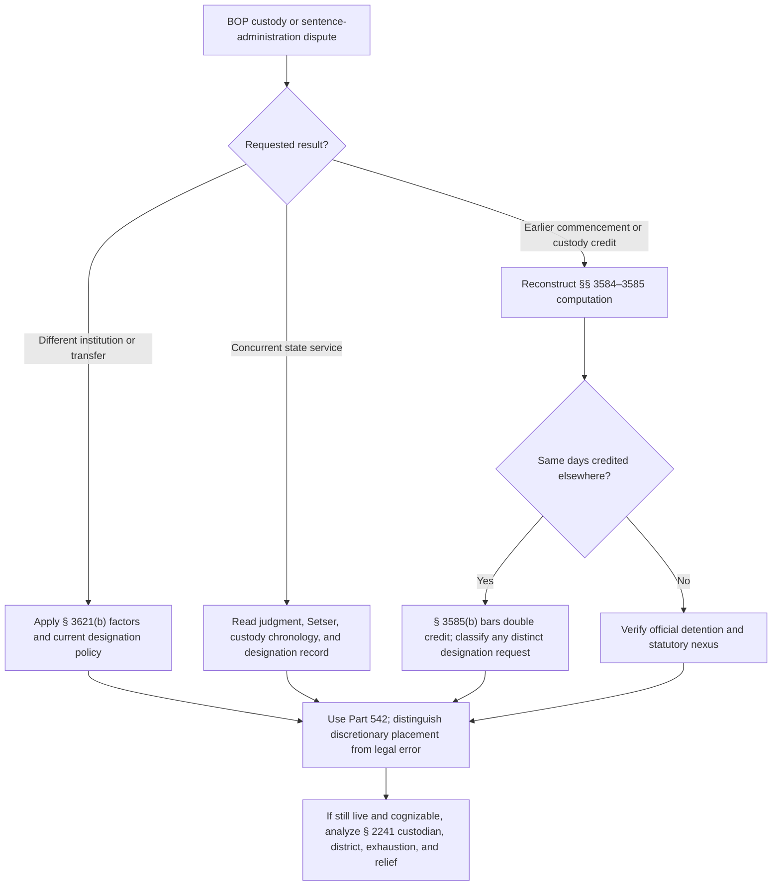

# BOP Designation, Sentence Commencement, Aggregation, and Prior-Custody Credit

The sentencing court imposes the term; the Bureau of Prisons administers its place, commencement, aggregation, and statutory credit. Keep a judgment error, a sentence-execution computation, a designation request, and a discretionary placement disagreement in separate procedural lanes.

## Custody and designation

<!-- claim:CLM-BOPSC-001 authorities:AUTH-USC-18-3621 status:verified_current -->
A person sentenced to imprisonment under Chapter 227, Subchapter D is committed to Bureau of Prisons custody until the term expires or the person is earlier released for satisfactory behavior under § 3624. [18 U.S.C. § 3621(a)](https://www.govinfo.gov/link/uscode/18/3621)

<!-- claim:CLM-BOPSC-002 authorities:AUTH-USC-18-3621 status:verified_current -->
The Bureau designates the place of imprisonment and may select an available qualifying federal or nonfederal penal or correctional facility inside or outside the district of conviction. [18 U.S.C. § 3621(b)](https://www.govinfo.gov/link/uscode/18/3621)

<!-- claim:CLM-BOPSC-003 authorities:AUTH-USC-18-3621 status:verified_current -->
Designation requires consideration of facility resources, the offense, the prisoner's history and characteristics, relevant sentencing-court statements, and pertinent Sentencing Commission policy statements. [18 U.S.C. § 3621(b)(1)–(5)](https://www.govinfo.gov/link/uscode/18/3621)

<!-- claim:CLM-BOPSC-004 authorities:AUTH-USC-18-3621 status:verified_current -->
Subject to bed availability, security designation, programmatic, mental-health, medical, faith-based, court-recommendation, and other security considerations, the Bureau must place the prisoner as close as practicable to the primary residence and, to the extent practicable, within 500 driving miles. [18 U.S.C. § 3621(b)](https://www.govinfo.gov/link/uscode/18/3621)

<!-- claim:CLM-BOPSC-005 authorities:AUTH-USC-18-3621 status:verified_current -->
The proximity text also requires the Bureau, subject to the listed factors and the prisoner's stay-or-transfer preference, to transfer prisoners closer to the primary residence even when already within 500 miles; it does not create an unqualified right to a requested institution. [18 U.S.C. § 3621(b)](https://www.govinfo.gov/link/uscode/18/3621)

<!-- claim:CLM-BOPSC-006 authorities:AUTH-USC-18-3621 status:verified_current -->
A sentencing-court order, recommendation, or request about a community correctional facility has no binding effect on the Bureau's § 3621(b) authority. [18 U.S.C. § 3621(b)](https://www.govinfo.gov/link/uscode/18/3621)

<!-- claim:CLM-BOPSC-007 authorities:AUTH-USC-18-3621 status:verified_current -->
Section 3621(b) states that a designation made under that subsection is not reviewable by any court; whether a claim instead challenges a statutory computation, constitutional violation, or action outside the delegated authority must be classified separately. [18 U.S.C. § 3621(b)](https://www.govinfo.gov/link/uscode/18/3621)

<!-- claim:CLM-BOPSC-008 authorities:AUTH-BOP-PS-5100-08-CN3,AUTH-USC-18-3621 status:verified_current -->
BOP Program Statement 5100.08, as amended by Change Notice 3 (May 6, 2026), sets Bureau policy and procedure for security designation and custody classification and states that designation and redesignation shall be consistent with § 3621(b). CN-3's revised Section 1 also states that, under 28 U.S.C. § 509, the Attorney General may in certain circumstances designate or redesignate a prisoner's place of imprisonment, consistent with the requirements of § 3621(b), and that absent notice of that intention the Bureau's procedures should be followed. [BOP PS 5100.08 CN-3 § 1](https://www.bop.gov/policy/progstat/5100_008_cn-3.pdf); [18 U.S.C. § 3621(b)](https://www.govinfo.gov/link/uscode/18/3621)

<!-- claim:CLM-BOPSC-009 authorities:AUTH-BOP-PS-5160-06,AUTH-USC-18-3621 status:verified_current -->
Under PS 5160.06, the Bureau designates a state institution for concurrent service of a federal sentence when the federal sentencing court ordered, recommended, or expressed an intention of concurrency, or when it finds the designation appropriate after reviewing the five § 3621(b) factors. On an inmate's nunc pro tunc request, the Bureau must consider the request but has no obligation to grant it; it seeks the sentencing court's position and decides under the five § 3621(b) factors, deciding without the court's view if no response is received after at least 60 days. No letter to the court is needed if the court previously ordered, recommended, or made clear its intention for consecutive service, and the Bureau will not allow a concurrent designation if the sentencing court has already determined the order of service. A separate procedure applies to inmates sentenced in the Fourth Circuit between Dec. 29, 2006 and Mar. 27, 2012 (*Mangum II*). [BOP PS 5160.06 §§ 1.a, 5.d, 6](https://www.bop.gov/policy/progstat/5160_006.pdf); [18 U.S.C. § 3621(b)](https://www.govinfo.gov/link/uscode/18/3621)

<!-- claim:CLM-BOPSC-010 authorities:AUTH-SCOTUS-SETSER-566-US-231 status:verified_current -->
*Setser* holds that a federal sentencing court had discretion to order its sentence consecutive to an anticipated state sentence; the opinion also refers, in a footnote, to a district court's power to impose "anticipatory consecutive (or concurrent) sentences." When later events make the judgment difficult to implement, the Bureau "ultimately has to determine how long" the sentence authorizes confinement, and the prisoner may seek relief through the Administrative Remedy Program and then habeas under § 2241, though the Court expressed no view on whether those proceedings would succeed. [*Setser v. United States*, 566 U.S. 231, 236–44 (2012)](https://www.govinfo.gov/content/pkg/USREPORTS-566/pdf/USREPORTS-566-231.pdf)

## Multiple terms and aggregation

<!-- claim:CLM-BOPSC-011 authorities:AUTH-USC-18-3584 status:verified_current -->
Multiple imprisonment terms imposed at the same time run concurrently unless the court orders or a statute mandates consecutive service; terms imposed at different times run consecutively unless the court orders concurrency. [18 U.S.C. § 3584(a)](https://www.govinfo.gov/link/uscode/18/3584)

<!-- claim:CLM-BOPSC-012 authorities:AUTH-USC-18-3584 status:verified_current -->
The sentencing court considers the § 3553(a) factors when choosing concurrent or consecutive terms under § 3584. [18 U.S.C. § 3584(b)](https://www.govinfo.gov/link/uscode/18/3584)

<!-- claim:CLM-BOPSC-013 authorities:AUTH-USC-18-3584 status:verified_current -->
For administrative purposes, multiple concurrent or consecutive terms are treated as a single aggregate term; aggregation does not erase count-specific statutory commands or rewrite the judgments. [18 U.S.C. § 3584(c)](https://www.govinfo.gov/link/uscode/18/3584)

<!-- claim:CLM-BOPSC-014 authorities:AUTH-SCOTUS-SETSER-566-US-231,AUTH-USC-18-3584,AUTH-USC-18-3585 status:verified_current -->
The judgment, later state disposition, any statutory consecutive command, and the actual custody chronology must be reconciled, because the Bureau "ultimately has to determine how long" the sentence authorizes confinement; a prisoner "is free to urge the Bureau to credit his time served in state court based on" a concurrency judgment, through the Administrative Remedy Program and then § 2241. "Concurrent" does not itself grant credit for pre-commencement detention already credited to another sentence, because § 3585(b) allows credit only for time "that has not been credited against another sentence." [*Setser*, 566 U.S. at 239–44](https://www.govinfo.gov/content/pkg/USREPORTS-566/pdf/USREPORTS-566-231.pdf); [18 U.S.C. § 3584(a)](https://www.govinfo.gov/link/uscode/18/3584); [18 U.S.C. § 3585(b)](https://www.govinfo.gov/link/uscode/18/3585)

## Commencement and prior-custody credit

<!-- claim:CLM-BOPSC-015 authorities:AUTH-USC-18-3585 status:verified_current -->
Section 3585(a) commences a federal imprisonment term on the date the defendant is received in custody awaiting transport to, or voluntarily arrives at, the official detention facility where the sentence is to be served. [18 U.S.C. § 3585(a)](https://www.govinfo.gov/link/uscode/18/3585)

<!-- claim:CLM-BOPSC-016 authorities:AUTH-SCOTUS-WILSON-503-US-329,AUTH-USC-18-3585 status:verified_current -->
The Attorney General through the Bureau, not the sentencing court at the sentencing hearing, initially computes § 3585(b) prior-custody credit after the defendant begins serving the federal sentence. [*United States v. Wilson*, 503 U.S. 329, 333–35 (1992)](https://www.govinfo.gov/content/pkg/USREPORTS-503/pdf/USREPORTS-503-329.pdf)

<!-- claim:CLM-BOPSC-017 authorities:AUTH-USC-18-3585 status:verified_current -->
Prior-custody credit covers official detention before the sentence commences that resulted from the federal offense or from another charge for which the defendant was arrested after commission of that offense, but only for time "that has not been credited against another sentence." [18 U.S.C. § 3585(b)](https://www.govinfo.gov/link/uscode/18/3585)

<!-- claim:CLM-BOPSC-018 authorities:AUTH-USC-18-3585,AUTH-SCOTUS-WILSON-503-US-329 status:verified_current -->
Section 3585(b) forbids crediting a detention period that has been credited against another sentence; a general fairness or concurrency label cannot override that enacted anti-double-credit limit. [18 U.S.C. § 3585(b)](https://www.govinfo.gov/link/uscode/18/3585); [*Wilson*, 503 U.S. at 337](https://www.govinfo.gov/content/pkg/USREPORTS-503/pdf/USREPORTS-503-329.pdf)

<!-- claim:CLM-BOPSC-019 authorities:AUTH-SCOTUS-KORAY-515-US-50,AUTH-USC-18-3585 status:verified_current -->
*Reno v. Koray* holds that restrictive confinement in a community treatment center while “released” on bail was not “official detention” under § 3585(b). [*Reno v. Koray*, 515 U.S. 50, 56–65 (1995)](https://www.govinfo.gov/content/pkg/USREPORTS-515/pdf/USREPORTS-515-50.pdf)

<!-- claim:CLM-BOPSC-020 authorities:AUTH-SCOTUS-KORAY-515-US-50 status:verified_current -->
The Bail Reform Act's release-versus-detention classification, not merely how restrictive a location feels, controlled *Koray*; electronic monitoring, curfew, treatment, or residence conditions require the actual custody order and governing law. [*Koray*, 515 U.S. at 57–65](https://www.govinfo.gov/content/pkg/USREPORTS-515/pdf/USREPORTS-515-50.pdf)

<!-- claim:CLM-BOPSC-021 authorities:AUTH-BOP-PS-5880-28,AUTH-BOP-SENTENCE-COMPUTATIONS status:verified_current -->
The Bureau's public sentence-computation page identifies the Designation and Sentence Computation Center and current public computation manuals, including Program Statement 5880.28 for CCCA sentences; these operational materials do not displace §§ 3584–3585 or controlling decisions. [BOP Sentence Computations](https://www.bop.gov/inmates/custody_and_care/sentence_computations.jsp); [PS 5880.28](https://www.bop.gov/policy/progstat/5880_028.pdf)

<!-- claim:CLM-BOPSC-022 authorities:AUTH-USC-18-3585,AUTH-BOP-PS-5880-28 status:verified_current -->
For an offense within the current-law branch, Bureau policy does not backdate commencement to a day before the federal sentence existed; a requested earlier effective result must be analyzed through the judgment, § 3584, designation authority, and any other lawful sentencing mechanism rather than invented § 3585 credit. [18 U.S.C. § 3585(a)](https://www.govinfo.gov/link/uscode/18/3585); [PS 5880.28](https://www.bop.gov/policy/progstat/5880_028.pdf)

<!-- claim:CLM-BOPSC-023 authorities:AUTH-BOP-PS-5160-06,AUTH-USC-18-3585 status:verified_current -->
Under PS 5160.06, the Bureau treats an inmate's request for federal credit for time spent in state custody and credited to a state sentence as a request for a nunc pro tunc designation, and that § 3621(b) designation decision effectively determines when the federal sentence commences under § 3585(a). Prior-custody credit under § 3585(b) is different: it covers only time spent in official detention before the sentence commences, as a result of the offense for which the sentence was imposed or of any other charge for which the defendant was arrested after the commission of that offense, "that has not been credited against another sentence." [BOP PS 5160.06 §§ 5.d, 8.b](https://www.bop.gov/policy/progstat/5160_006.pdf); [18 U.S.C. § 3585(a)–(b)](https://www.govinfo.gov/link/uscode/18/3585)

<!-- claim:CLM-BOPSC-024 authorities:AUTH-USC-18-3585,AUTH-BOP-PS-5160-06,AUTH-BOP-PS-5880-28 status:verified_current -->
"Primary jurisdiction" and the effect of a writ borrowing a prisoner are not stated in § 3585's text; they appear in Bureau policy. Under PS 5160.06, the sovereign that first arrested the offender has primary jurisdiction unless it relinquishes it, and under PS 5880.28, time in custody under a writ of habeas corpus from non-federal custody is not by itself credited as presentence time because the federal court merely "borrows" the prisoner. [18 U.S.C. § 3585](https://www.govinfo.gov/link/uscode/18/3585); [BOP PS 5160.06 § 7.a](https://www.bop.gov/policy/progstat/5160_006.pdf); [BOP PS 5880.28, p. 1-20B](https://www.bop.gov/policy/progstat/5880_028.pdf)

<!-- claim:CLM-BOPSC-025 authorities:AUTH-USC-18-3585,AUTH-USC-18-3621,AUTH-USC-18-3624,AUTH-USC-18-3632 status:verified_current -->
Prior-custody credit (§ 3585(b)), good-conduct time (§ 3624(b)), First Step Act time credits (§ 3632(d)(4)), the RDAP reduction of not more than one year for a prisoner convicted of a nonviolent offense (§ 3621(e)(2)(B)), and prerelease placement (§ 3624(c), (g)) rest on separate provisions with their own day counts and eligibility rules. The statute links two of them: FSA time credits "shall be applied toward time in prerelease custody or supervised release," with eligible prisoners transferred as determined under § 3624(g), and the time limits in § 3624(b) and (c) do not apply to prerelease custody under § 3624(g). [18 U.S.C. § 3585(b)](https://www.govinfo.gov/link/uscode/18/3585); [18 U.S.C. § 3621(e)(2)(B)](https://www.govinfo.gov/link/uscode/18/3621); [18 U.S.C. § 3624(b), (c), (g)](https://www.govinfo.gov/link/uscode/18/3624); [18 U.S.C. § 3632(d)(4)](https://www.govinfo.gov/link/uscode/18/3632)

## Challenge route and remedy

<!-- claim:CLM-BOPSC-026 authorities:AUTH-SCOTUS-WILSON-503-US-329,AUTH-CFR-28-542 status:verified_current -->
The Bureau's computation should first be presented through the applicable correction and Administrative Remedy Program processes; *Wilson* identifies judicial review after administrative exhaustion rather than a sentencing-court credit award. [*Wilson*, 503 U.S. at 335–36](https://www.govinfo.gov/content/pkg/USREPORTS-503/pdf/USREPORTS-503-329.pdf); [28 C.F.R. pt. 542, subpt. B](https://www.ecfr.gov/current/title-28/chapter-V/subchapter-C/part-542/subpart-B)

<!-- claim:CLM-BOPSC-027 authorities:AUTH-USC-28-2241,AUTH-SCOTUS-RUMSFELD-PADILLA-542-US-426 status:verified_current -->
When a § 2241 habeas petitioner challenges present physical custody within the United States, the default rule is that the proper respondent is the warden of the facility where the prisoner is being held, and the petition should be filed in the district of confinement. [28 U.S.C. § 2241](https://www.govinfo.gov/link/uscode/28/2241); [*Rumsfeld v. Padilla*, 542 U.S. 426, 434–47 (2004)](https://www.govinfo.gov/content/pkg/USREPORTS-542/pdf/USREPORTS-542-426.pdf)

<!-- claim:CLM-BOPSC-028 authorities:AUTH-CFR-28-542,AUTH-USC-28-2241 status:verified_current -->
Part 542 supplies the agency filing rules, while the effect of nonexhaustion in § 2241 litigation is governed by controlling circuit law; the regulation itself does not create a universal federal habeas jurisdictional bar. [28 C.F.R. pt. 542, subpt. B](https://www.ecfr.gov/current/title-28/chapter-V/subchapter-C/part-542/subpart-B); [28 U.S.C. § 2241](https://www.govinfo.gov/link/uscode/28/2241)

<!-- claim:CLM-BOPSC-029 authorities:AUTH-SCOTUS-WILSON-503-US-329,AUTH-USC-18-3621,AUTH-USC-18-3585 status:verified_current -->
*Wilson* notes that prisoners have been able to seek judicial review of the Bureau's credit computations after exhausting administrative remedies, but a designation of a place of imprisonment under § 3621(b) "is not reviewable by any court" and the Bureau "may at any time" direct a transfer; a request to recalculate under § 3585 is therefore different relief from a request for a particular designation or transfer. [*Wilson*, 503 U.S. at 335](https://www.govinfo.gov/content/pkg/USREPORTS-503/pdf/USREPORTS-503-329.pdf); [18 U.S.C. § 3621(b)](https://www.govinfo.gov/link/uscode/18/3621); [18 U.S.C. § 3585](https://www.govinfo.gov/link/uscode/18/3585)

<!-- claim:CLM-BOPSC-030 authorities:AUTH-SCOTUS-EX-PARTE-ENDO-323-US-283,AUTH-SCOTUS-RUMSFELD-PADILLA-542-US-426 status:verified_current -->
A transfer after a properly filed habeas case does not automatically erase jurisdiction, but the remaining custodian, substitution, redressability, and circuit procedure must be verified from the actual transfer and docket. [*Ex parte Endo*, 323 U.S. 283, 304–07 (1944)](https://www.govinfo.gov/content/pkg/USREPORTS-323/pdf/USREPORTS-323-283.pdf); [*Padilla*, 542 U.S. at 440–41](https://www.govinfo.gov/content/pkg/USREPORTS-542/pdf/USREPORTS-542-426.pdf)

<!-- claim:CLM-BOPSC-031 authorities:AUTH-SCOTUS-SPENCER-523-US-1 status:verified_current -->
In *Spencer*, release after filing did not defeat the § 2254 "in custody" requirement, but once the sentence has expired "some concrete and continuing injury" (some "collateral consequence") must exist for the case to continue, and the party seeking jurisdiction bears the burden "clearly to allege facts" showing it. The Court declined to presume collateral consequences from a parole revocation, and the capable-of-repetition exception "applies only in exceptional situations" where the challenged action is too short to be fully litigated and the same party reasonably expects to face it again. [*Spencer v. Kemna*, 523 U.S. 1, 7–18 (1998)](https://www.govinfo.gov/content/pkg/USREPORTS-523/pdf/USREPORTS-523-1.pdf)

<!-- claim:CLM-BOPSC-032 authorities:AUTH-USC-18-3585,AUTH-BOP-SENTENCE-COMPUTATIONS status:verified_current -->
Under § 3585, prior-custody credit turns on when the sentence commenced, what official detention preceded that date and on what charge, and whether that time was credited against another sentence. The Bureau's Sentence Computations page states that information such as arrests or periods of prior custody is not public information and may not be released by telephone or internet, and that its release "can only be obtained by submitting a written request with an original authorization form that has been signed by the inmate"; an inmate housed at a Bureau institution should raise computation questions with Correctional Systems staff and, if not satisfied, may appeal through the Administrative Remedy process. [18 U.S.C. § 3585](https://www.govinfo.gov/link/uscode/18/3585); [BOP Sentence Computations](https://www.bop.gov/inmates/custody_and_care/sentence_computations.jsp)

<!-- claim:CLM-BOPSC-033 authorities:AUTH-USC-18-3584,AUTH-USC-18-3585,AUTH-USC-18-3624,AUTH-CFR-28-523-20 status:verified_current -->
A sentence computation involves distinct statutory steps: the concurrent or consecutive relationship of the terms (§ 3584(a)), treatment of multiple terms as a single aggregate term for administrative purposes (§ 3584(c)), commencement (§ 3585(a)), and prior-custody credit (§ 3585(b)), with good-conduct time credited separately (§ 3624(b)). For offenses committed on or after November 1, 1987, the Bureau's initial projected release date assumes the maximum possible good-conduct time and "is subject to change during the inmate's incarceration." [18 U.S.C. § 3584(a), (c)](https://www.govinfo.gov/link/uscode/18/3584); [18 U.S.C. § 3585(a)–(b)](https://www.govinfo.gov/link/uscode/18/3585); [18 U.S.C. § 3624(b)](https://www.govinfo.gov/link/uscode/18/3624); [28 C.F.R. § 523.20(b)(1)](https://www.govinfo.gov/content/pkg/CFR-2025-title28-vol2/pdf/CFR-2025-title28-vol2-sec523-30.pdf)

<!-- claim:CLM-BOPSC-034 authorities:AUTH-USC-18-3621,AUTH-USC-18-3584,AUTH-SCOTUS-SETSER-566-US-231 status:verified_current -->
A sentencing-court recommendation is one of the matters the Bureau considers in designating a place of imprisonment, a court order or recommendation for community-corrections placement has "no binding effect" on the Bureau's placement authority, and a designation "is not reviewable by any court." Judgment silence about another sovereign's sentence has no single effect: § 3584(a) makes terms imposed at different times run consecutively unless the court orders otherwise, but under *Setser* § 3584(a) does not cover a state sentence not yet imposed when the federal sentence is imposed. [18 U.S.C. § 3621(b)](https://www.govinfo.gov/link/uscode/18/3621); [18 U.S.C. § 3584(a)](https://www.govinfo.gov/link/uscode/18/3584); [*Setser*, 566 U.S. at 234–35](https://www.govinfo.gov/content/pkg/USREPORTS-566/pdf/USREPORTS-566-231.pdf)

## Decision path

## Required records and limits

- Every judgment and later modification from each sovereign.
- Chronology of arrest, temporary writ custody, sentence imposition, release, parole, and facility receipt.
- Official jail-credit certifications and proof of credit against other terms.
- BOP computation, aggregation, designation, classification, and administrative-remedy records.
- Current circuit law for primary custody, retroactive designation review, exhaustion, transfer, remedy, and standard of review.
