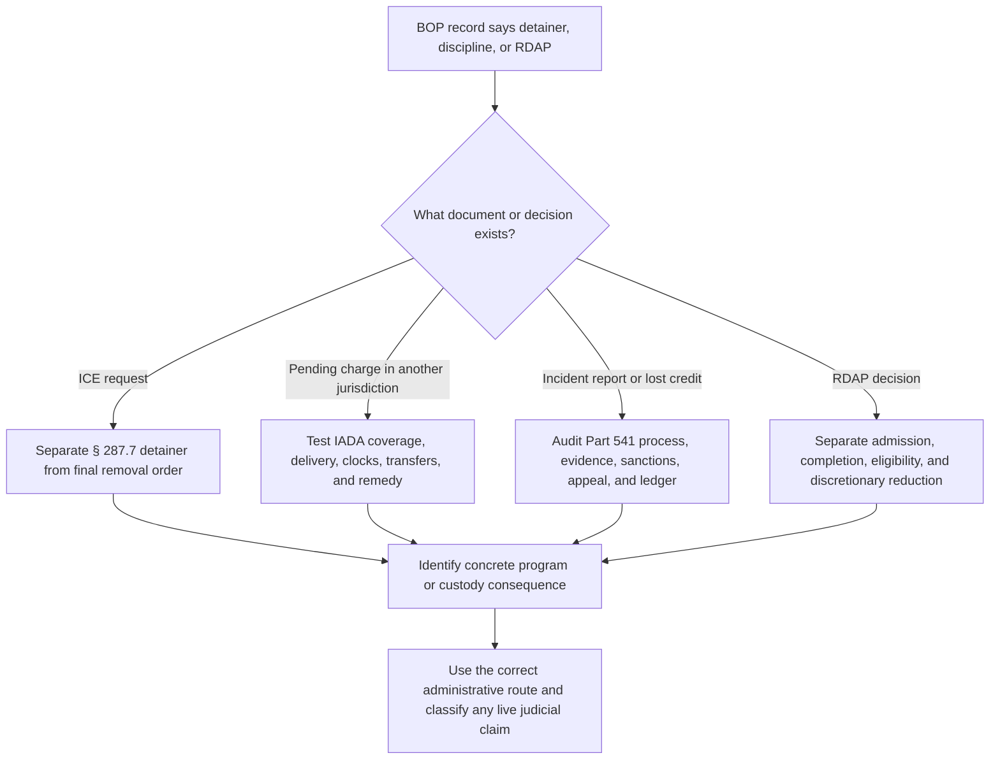

# Detainers, Prison Discipline, Good-Time Consequences, and RDAP

A detainer, a final removal order, a disciplinary charge, a loss of sentence credit, and RDAP early-release eligibility are different legal events. Identify the document, issuing sovereign, governing authority, and requested remedy before selecting a procedure.

## Detainer classification

<!-- claim:CLM-BOPDDR-001 authorities:AUTH-CFR-8-287-7 status:verified_current -->
An immigration detainer under 8 C.F.R. § 287.7 is a Department of Homeland Security request that another law-enforcement agency notify DHS before release and maintain custody temporarily so DHS can assume custody; it is not itself a criminal judgment or final removal order. [8 C.F.R. § 287.7(a)–(d)](https://www.ecfr.gov/current/title-8/chapter-I/subchapter-B/part-287/section-287.7)

<!-- claim:CLM-BOPDDR-002 authorities:AUTH-CFR-8-287-7 status:verified_current -->
Section 287.7(d) authorizes detention under an immigration detainer for no more than 48 hours, excluding Saturdays, Sundays, and holidays, after the person otherwise would have been released; custody beyond that regulatory period requires an independent lawful basis. [8 C.F.R. § 287.7(d)](https://www.ecfr.gov/current/title-8/chapter-I/subchapter-B/part-287/section-287.7)

<!-- claim:CLM-BOPDDR-003 authorities:AUTH-CFR-8-287-7 status:verified_current -->
The detainer regulation does not direct the receiving agency to disregard its own discretion concerning confinement before the person's ordinary release date. [8 C.F.R. § 287.7(a)](https://www.ecfr.gov/current/title-8/chapter-I/subchapter-B/part-287/section-287.7)

<!-- claim:CLM-BOPDDR-004 authorities:AUTH-USC-18-3632,AUTH-CFR-28-523-SUBPART-E status:verified_current -->
The First Step Act bars application of earned time credits to a prisoner who is the subject of a final order of removal under immigration law; a database flag or detainer must not be substituted for the final-order finding required by the statute and regulation. [18 U.S.C. § 3632(d)(4)(E)](https://www.govinfo.gov/link/uscode/18/3632); [28 C.F.R. § 523.44(a)(2)](https://www.ecfr.gov/current/title-28/chapter-V/subchapter-B/part-523/subpart-E/section-523.44)

<!-- claim:CLM-BOPDDR-005 authorities:AUTH-USC-18-3632,AUTH-CFR-8-287-7,AUTH-BOP-PS-5100-08-CN3,AUTH-CFR-28-550-RDAP status:verified_current -->
Immigration status has no single consequence shared by every case: a prisoner is ineligible to apply FSA time credits if subject to a final order of removal, while an immigration detainer is a request that the custodial agency advise DHS before the alien's release. For designation, BOP policy awards no points for ICE detainers but reviews each case to determine whether the Deportable Alien public safety factor applies; that factor covers an inmate who is not a U.S. citizen, is not applied (or is removed) when ICE or the Executive Office for Immigration Review has determined that deportation proceedings are unwarranted or there is a finding not to deport, is not applied if the inmate has been naturalized, and when applied requires housing in at least a Low security level institution. Immigration and Customs Enforcement detainees are not eligible for RDAP early release. [18 U.S.C. § 3632(d)(4)(E)](https://www.govinfo.gov/link/uscode/18/3632); [8 C.F.R. § 287.7(a)](https://www.ecfr.gov/current/title-8/chapter-I/subchapter-B/part-287/section-287.7); [BOP PS 5100.08 CN-3, ch. 4, p. 12; ch. 5, p. 9](https://www.bop.gov/policy/progstat/5100_008_cn-3.pdf); [28 C.F.R. § 550.55(b)(1)](https://www.ecfr.gov/current/title-28/chapter-V/subchapter-C/part-550/subpart-F)

## Interstate Agreement on Detainers

<!-- claim:CLM-BOPDDR-006 authorities:AUTH-IADA-PL-91-538 status:verified_current -->
The Interstate Agreement on Detainers Act governs qualifying detainers based on an untried indictment, information, or complaint lodged against a person already serving a term of imprisonment in a party jurisdiction; its text and the jurisdictions' party status must be checked. [IADA arts. I, III–IV, Pub. L. No. 91-538, 84 Stat. 1397](https://www.govinfo.gov/content/pkg/STATUTE-84/pdf/STATUTE-84-Pg1397.pdf)

<!-- claim:CLM-BOPDDR-007 authorities:AUTH-IADA-PL-91-538 status:verified_current -->
Article III permits a prisoner serving a term of imprisonment, against whom a detainer has been lodged on an untried charge pending in another party State, to request final disposition; trial must occur within 180 days after the prisoner has caused written notice and the request, accompanied by the custodian's certificate and forwarded through the warden by registered or certified mail, return receipt requested, to be delivered to the prosecuting officer and the appropriate court. The court may grant a necessary or reasonable continuance only for good cause shown in open court, the prisoner or counsel being present, and the period is tolled whenever and for as long as the prisoner is unable to stand trial. [IADA arts. III(a)–(b), VI(a)](https://www.govinfo.gov/content/pkg/STATUTE-84/pdf/STATUTE-84-Pg1397.pdf)

<!-- claim:CLM-BOPDDR-008 authorities:AUTH-SCOTUS-FEX-507-US-43,AUTH-IADA-PL-91-538 status:verified_current -->
*Fex v. Michigan* holds that Article III's 180-day clock begins when the prisoner's request actually is delivered to both the prosecuting officer and the appropriate court, not when the prisoner gives it to custodial officials. [507 U.S. 43, 47–52 (1993)](https://www.govinfo.gov/content/pkg/USREPORTS-507/pdf/USREPORTS-507-43.pdf)

<!-- claim:CLM-BOPDDR-009 authorities:AUTH-IADA-PL-91-538 status:verified_current -->
Article IV entitles the prosecutor who has lodged a detainer to obtain temporary custody on a written request, provided the court having jurisdiction has duly approved, recorded, and transmitted the request and a 30-day period has passed in which the Governor of the sending State (for the United States, the Attorney General) may disapprove it on his own motion or the prisoner's. Trial must commence within 120 days of the prisoner's arrival in the receiving State, subject to a necessary or reasonable continuance for good cause shown in open court with the prisoner or counsel present and to Article VI(a) tolling, and Article IV(e) contains an anti-shuttling rule. [IADA arts. IV(a), (c)–(e), VI(a); Pub. L. No. 91-538, § 3](https://www.govinfo.gov/content/pkg/STATUTE-84/pdf/STATUTE-84-Pg1397.pdf)

<!-- claim:CLM-BOPDDR-010 authorities:AUTH-SCOTUS-MAURO-436-US-340,AUTH-IADA-PL-91-538 status:verified_current -->
*United States v. Mauro* holds that a federal writ of habeas corpus ad prosequendum is not itself a detainer, but after the United States files a detainer its use of the writ can constitute the Article IV written request for temporary custody. [436 U.S. 340, 349–61 (1978)](https://www.govinfo.gov/content/pkg/USREPORTS-436/pdf/USREPORTS-436-340.pdf)

<!-- claim:CLM-BOPDDR-011 authorities:AUTH-SCOTUS-CARCHMAN-473-US-716,AUTH-IADA-PL-91-538 status:verified_current -->
*Carchman v. Nash* holds that Article III does not cover a detainer based on a probation-violation charge because it is not an untried indictment, information, or complaint within the Agreement. [473 U.S. 716, 725–34 (1985)](https://www.govinfo.gov/content/pkg/USREPORTS-473/pdf/USREPORTS-473-716.pdf)

<!-- claim:CLM-BOPDDR-012 authorities:AUTH-SCOTUS-BOZEMAN-533-US-146,AUTH-IADA-PL-91-538 status:verified_current -->
*Alabama v. Bozeman* enforces Article IV(e)'s anti-shuttling command according to its text: returning the prisoner to the original place of imprisonment before trial required dismissal of the covered charges even though the interruption of the original imprisonment lasted only one day. The Court noted that 18 U.S.C. App. § 9(1), which governs only when the United States is a receiving State, allows dismissal with or without prejudice, and said its decision does not bar a return when it would be mutually advantageous and the prisoner accordingly waives Article IV(e) rights. [533 U.S. 146, 149, 153–57 (2001)](https://www.govinfo.gov/content/pkg/USREPORTS-533/pdf/USREPORTS-533-146.pdf); [IADA art. IV(e)](https://www.govinfo.gov/content/pkg/STATUTE-84/pdf/STATUTE-84-Pg1397.pdf)

<!-- claim:CLM-BOPDDR-013 authorities:AUTH-SCOTUS-MOODY-429-US-78 status:verified_current -->
*Moody v. Daggett* holds, in the federal-parole setting, that a parolee imprisoned for a later offense was not constitutionally entitled to an immediate revocation hearing on an unexecuted parole-violator warrant lodged as a detainer; that narrow holding does not decide every detainer regime. [429 U.S. 78, 86–89 (1976)](https://www.govinfo.gov/content/pkg/USREPORTS-429/pdf/USREPORTS-429-78.pdf)

<!-- claim:CLM-BOPDDR-014 authorities:AUTH-IADA-PL-91-538,AUTH-CFR-8-287-7 status:verified_current -->
For an IADA detainer, the custodian must promptly inform the prisoner of the source and contents of any detainer and of the right to request final disposition, and the prisoner's request must be accompanied by the custodian's certificate stating the term of commitment, time served, time remaining, good time earned, parole eligibility, and parole decisions, and be forwarded by registered or certified mail, return receipt requested. An immigration detainer is a request that the custodial agency advise DHS before the alien's release so that DHS can arrange to assume custody. [IADA art. III(a)–(c)](https://www.govinfo.gov/content/pkg/STATUTE-84/pdf/STATUTE-84-Pg1397.pdf); [8 C.F.R. § 287.7(a)](https://www.ecfr.gov/current/title-8/chapter-I/subchapter-B/part-287/section-287.7)

## Incident reports and discipline

<!-- claim:CLM-BOPDDR-015 authorities:AUTH-CFR-28-541 status:verified_current -->
When staff witness or reasonably believe that a prisoner committed a prohibited act, the prisoner will ordinarily receive the incident report within 24 hours of staff becoming aware of the prisoner's involvement. A staff member then investigates the report; § 541.5 sets no deadline for the investigation. [28 C.F.R. § 541.5(a)–(b)](https://www.ecfr.gov/current/title-28/chapter-V/subchapter-C/part-541)

<!-- claim:CLM-BOPDDR-016 authorities:AUTH-CFR-28-541 status:verified_current -->
The investigator will inform the prisoner of the charges and that the prisoner may remain silent at all stages of the discipline process, but that silence may be used to draw an adverse inference and cannot alone be the basis for finding that the prisoner committed the prohibited act. When asked for a statement, the prisoner may give an explanation, request that witnesses be interviewed, or request that other evidence be obtained and reviewed, though the investigation may be suspended before the statement is requested if the incident is being investigated for possible criminal prosecution. [28 C.F.R. § 541.5(b)](https://www.ecfr.gov/current/title-28/chapter-V/subchapter-C/part-541)

<!-- claim:CLM-BOPDDR-017 authorities:AUTH-CFR-28-541 status:verified_current -->
The UDC will ordinarily review an incident report within five work days after it is issued, not counting the day it was issued, weekends, and holidays (review may be suspended during a criminal-prosecution investigation), and may find that the prisoner committed the act, find that the prisoner did not, or refer the report to the DHO. The UDC will automatically refer a Greatest or High severity charge, or the report of an inmate covered by § 541.4, to the DHO. The UDC cannot impose loss of good conduct time credit, FSA Time Credits, disciplinary segregation, or monetary fines; if the DHO finds that the prisoner committed a prohibited act, the DHO can impose any of the available sanctions listed in Tables 1 and 2. [28 C.F.R. §§ 541.7(a), (c), (f), 541.8(g)](https://www.ecfr.gov/current/title-28/chapter-V/subchapter-C/part-541)

<!-- claim:CLM-BOPDDR-018 authorities:AUTH-CFR-28-541 status:verified_current -->
The prisoner will receive written notice of the charges at least 24 hours before the DHO hearing, unless the prisoner waives that requirement, in which case the hearing can be held sooner. On referral, the UDC will advise the prisoner of the rights at the upcoming DHO hearing. [28 C.F.R. §§ 541.7(g), 541.8(c)](https://www.ecfr.gov/current/title-28/chapter-V/subchapter-C/part-541)

<!-- claim:CLM-BOPDDR-019 authorities:AUTH-CFR-28-541 status:verified_current -->
The prisoner may request a staff representative and witnesses; the Warden will appoint a representative if the request cannot be fulfilled or the prisoner appears unable to adequately self-represent, and the DHO will call witnesses who have directly relevant information and are reasonably available but need not call adverse witnesses whose testimony is adequately summarized in the investigation materials. The regulation lists the grounds on which requested witnesses may not appear: in the DHO's discretion, they are not reasonably available, their presence would jeopardize institution security, or they would present repetitive evidence; if they are unavailable, the DHO or staff representative can request written statements. The DHO will consider all evidence presented. [28 C.F.R. § 541.8(d), (f)](https://www.ecfr.gov/current/title-28/chapter-V/subchapter-C/part-541)

<!-- claim:CLM-BOPDDR-020 authorities:AUTH-CFR-28-541 status:verified_current -->
The DHO must be an impartial decisionmaker who was not a victim, witness, investigator, or otherwise significantly involved in the charged incident. [28 C.F.R. § 541.8(b)](https://www.ecfr.gov/current/title-28/chapter-V/subchapter-C/part-541/section-541.8)

<!-- claim:CLM-BOPDDR-021 authorities:AUTH-CFR-28-541 status:verified_current -->
The DHO's decision will be based on at least some facts and, if there is conflicting evidence, on the greater weight of the evidence. The DHO's written report will document whether the prisoner was advised of rights during the DHO process, the evidence relied on, the decision, the sanction imposed, and the reasons for the sanctions imposed; the DHO is not required to prepare a verbatim record. [28 C.F.R. § 541.8(f), (h)](https://www.ecfr.gov/current/title-28/chapter-V/subchapter-C/part-541)

<!-- claim:CLM-BOPDDR-022 authorities:AUTH-CFR-28-541 status:verified_current -->
Prohibited acts are divided into four severity categories (Greatest, High, Moderate, and Low), and the available sanctions are listed in Table 1, with increased sanctions under Table 2 for repetitive prohibited acts within the same severity level. For VCCLEA-violent inmates (a VCCLEA crime of violence committed on or after September 13, 1994, but before April 26, 1996) and for PLRA inmates and D.C. Code offenders (a U.S. Code offense on or after April 26, 1996, or a D.C. Code offense on or after August 5, 2000), § 541.4 makes loss of good conduct sentence credit a mandatory disciplinary sanction, in a minimum amount set by severity level; for Moderate and Low severity acts, the mandatory loss applies only after two or more Moderate, or three or more Low, severity acts during the current year of good conduct sentence credit availability. [28 C.F.R. §§ 541.3, tbls. 1–2, 541.4](https://www.ecfr.gov/current/title-28/chapter-V/subchapter-C/part-541)

<!-- claim:CLM-BOPDDR-023 authorities:AUTH-SCOTUS-WOLFF-418-US-539 status:verified_current -->
When prison discipline threatens an already-created good-time interest, *Wolff v. McDonnell* requires advance written notice of the charges, with no less than 24 hours to prepare; an opportunity to call witnesses and present documentary evidence when doing so will not be unduly hazardous to institutional safety or correctional goals; and a written statement of the evidence relied on and reasons, but does not constitutionalize the full criminal-trial process. An illiterate inmate, or one facing an issue too complex to present alone, should be free to seek a fellow inmate's aid or, if that is forbidden, adequate substitute aid from staff or a sufficiently competent inmate designated by staff. [418 U.S. 539, 563–72 (1974)](https://www.govinfo.gov/content/pkg/USREPORTS-418/pdf/USREPORTS-418-539.pdf)

<!-- claim:CLM-BOPDDR-024 authorities:AUTH-SCOTUS-WOLFF-418-US-539 status:verified_current -->
*Wolff* declined to hold that inmates have a right to either retained or appointed counsel in prison disciplinary proceedings and held that the Constitution should not be read to impose confrontation and cross-examination at the present time; it did say that an illiterate inmate, or one facing a complex issue, should be free to seek a fellow inmate's aid or, if that is forbidden, adequate substitute aid from staff or a sufficiently competent inmate designated by staff. Any additional regulatory or policy protections must be analyzed on their own terms. [418 U.S. at 567–70](https://www.govinfo.gov/content/pkg/USREPORTS-418/pdf/USREPORTS-418-539.pdf)

<!-- claim:CLM-BOPDDR-025 authorities:AUTH-SCOTUS-SUPERINTENDENT-HILL-472-US-445 status:verified_current -->
Due process for a disciplinary loss of good time is satisfied only if some evidence in the record supports the decision; *Superintendent v. Hill* does not authorize a court to reweigh the record as the original factfinder. [472 U.S. 445, 454–57 (1985)](https://www.govinfo.gov/content/pkg/USREPORTS-472/pdf/USREPORTS-472-445.pdf)

<!-- claim:CLM-BOPDDR-026 authorities:AUTH-CFR-28-541,AUTH-CFR-28-542 status:verified_current -->
A DHO decision may be appealed through the Administrative Remedy Program; the appeal is submitted initially to the Regional Director for the region where the prisoner is currently located, rather than through an institution BP-9, and each incident report number must be appealed on a separate form. [28 C.F.R. § 541.8(i)](https://www.ecfr.gov/current/title-28/chapter-V/subchapter-C/part-541); [28 C.F.R. § 542.14(c)(2), (d)(2)](https://www.ecfr.gov/current/title-28/chapter-V/subchapter-C/part-542/subpart-B)

## Lost credit and restoration

<!-- claim:CLM-BOPDDR-027 authorities:AUTH-USC-18-3624,AUTH-CFR-28-523-20 status:verified_current -->
Good-conduct time under § 3624(b) and 28 C.F.R. § 523.20 is distinct from First Step Act time credit; forfeited, withheld, vested, and restored good-conduct time must be matched to the prisoner's sentence regime and disciplinary record. [18 U.S.C. § 3624(b)](https://www.govinfo.gov/link/uscode/18/3624); [28 C.F.R. § 523.20](https://www.ecfr.gov/current/title-28/chapter-V/subchapter-B/part-523/section-523.20)

<!-- claim:CLM-BOPDDR-028 authorities:AUTH-CFR-28-523-SUBPART-E-CURRENT,AUTH-CFR-28-541,AUTH-USC-18-3632 status:verified_current -->
Under the First Step Act regulation, a prisoner may lose earned FSA Time Credits for violating the requirements or rules of an evidence-based recidivism reduction program or productive activity, through the part 541 discipline procedures, whose sanctions table also lists forfeiture of earned FSA Time Credits as a sanction for prohibited acts; by statute, any loss requires written notice and is limited to credits earned as of the date of the rule violation. The prisoner may seek review through the Administrative Remedy Program and may have part or all of the lost credits restored, case by case, after clear conduct for two consecutive risk and needs assessments. [28 C.F.R. § 523.43](https://www.ecfr.gov/current/title-28/chapter-V/subchapter-B/part-523/subpart-E/section-523.43); [28 C.F.R. § 541.3, tbl. 1](https://www.ecfr.gov/current/title-28/chapter-V/subchapter-C/part-541); [18 U.S.C. § 3632(e)(2)](https://www.govinfo.gov/link/uscode/18/3632)

<!-- claim:CLM-BOPDDR-029 authorities:AUTH-USC-18-3624,AUTH-USC-18-3632,AUTH-CFR-28-541 status:verified_current -->
Good conduct time and FSA Time Credits carry separate disciplinary consequences: § 3624(b) good conduct time is subject to the Bureau's determination that the prisoner displayed exemplary compliance with institutional disciplinary regulations, the part 541 sanctions table lists good-conduct-time and FSA Time Credit sanctions separately, and § 3632(e) requires written notice of any loss of time credits and a procedure to restore time credits lost for a rule violation. [18 U.S.C. § 3624(b)](https://www.govinfo.gov/link/uscode/18/3624); [18 U.S.C. § 3632(d)(4), (e)](https://www.govinfo.gov/link/uscode/18/3632); [28 C.F.R. § 541.3, tbl. 1](https://www.ecfr.gov/current/title-28/chapter-V/subchapter-C/part-541)

## RDAP and § 3621(e) reduction

<!-- claim:CLM-BOPDDR-030 authorities:AUTH-USC-18-3621 status:verified_current -->
Section 3621(e) directs the Bureau, subject to the availability of appropriations, to provide residential substance-abuse treatment for eligible prisoners (those the Bureau determines to have a substance abuse problem who are willing to participate), with priority based on proximity to release date, but it makes a nonviolent prisoner's post-completion custody reduction discretionary and caps it at one year. [18 U.S.C. § 3621(e)(1)–(2), (5)(B)](https://www.govinfo.gov/link/uscode/18/3621)

<!-- claim:CLM-BOPDDR-031 authorities:AUTH-CFR-28-550-RDAP status:verified_current -->
To be admitted to RDAP, a prisoner must meet all of the regulatory criteria: a verifiable substance use disorder, a signed agreement acknowledging program responsibility, and, when beginning the program, the ability to complete all three components (the unit-based component, follow-up services, and Community Treatment Services). The Drug Abuse Program Coordinator decides placement based on those criteria, so a treatment recommendation is not automatic admission. [28 C.F.R. § 550.53(a)–(b), (e)](https://www.ecfr.gov/current/title-28/chapter-V/subchapter-C/part-550/subpart-F)

<!-- claim:CLM-BOPDDR-032 authorities:AUTH-CFR-28-550-RDAP status:verified_current -->
RDAP has unit-based, follow-up, and community-treatment components, and successful completion requires satisfying the regulation's components rather than merely entering or completing classroom hours. [28 C.F.R. §§ 550.53–550.56](https://www.ecfr.gov/current/title-28/chapter-V/subchapter-C/part-550/subpart-F)

<!-- claim:CLM-BOPDDR-033 authorities:AUTH-CFR-28-550-RDAP,AUTH-USC-18-3621 status:verified_current -->
Early-release eligibility is narrower than RDAP admission and is governed by § 3621(e)(2)(B), 28 C.F.R. § 550.55, the conviction and sentence record, program completion, and the prisoner's ability to complete community-based treatment. [28 C.F.R. § 550.55](https://www.ecfr.gov/current/title-28/chapter-V/subchapter-C/part-550/subpart-F/section-550.55)

<!-- claim:CLM-BOPDDR-034 authorities:AUTH-SCOTUS-LOPEZ-DAVIS-531-US-230,AUTH-USC-18-3621 status:verified_current -->
*Lopez v. Davis* holds that § 3621(e)(2)(B) permits the Bureau to exercise discretion categorically, including excluding otherwise eligible prisoners based on preconviction conduct involving a firearm. [531 U.S. 230, 238–44 (2001)](https://www.govinfo.gov/content/pkg/USREPORTS-531/pdf/USREPORTS-531-230.pdf)

<!-- claim:CLM-BOPDDR-035 authorities:AUTH-BOP-PS-5331-02-CN3,AUTH-CFR-28-550-RDAP status:verified_current -->
BOP Program Statement 5331.02, Early Release Procedures Under 18 U.S.C. § 3621(e) (Mar. 16, 2009), as amended through Change Notice 3 (May 7, 2026), is the current public early-release procedure; CN-3 rescinds CN-2 and inserts a new reference to the Program Statement Categorization of Offenses, and the policy must be read with the statute and current regulation. [BOP PS 5331.02 CN-3](https://www2.fed.bop.gov/policy/progstat/5331_002_CN-3.pdf); [28 C.F.R. pt. 550, subpt. F](https://www.ecfr.gov/current/title-28/chapter-V/subchapter-C/part-550/subpart-F)

<!-- claim:CLM-BOPDDR-036 authorities:AUTH-BOP-PS-5331-02-CN3,AUTH-USC-18-3621 status:verified_current -->
The current public policy uses a maximum provisional reduction of six months for sentences of 30 months or less, nine months for 31 through 36 months, and 12 months for 37 months or more; the final reduction remains subject to continued eligibility, completion, and Bureau discretion. [BOP PS 5331.02 CN-3](https://www2.fed.bop.gov/policy/progstat/5331_002_CN-3.pdf)

<!-- claim:CLM-BOPDDR-037 authorities:AUTH-BOP-PS-5331-02-CN3,AUTH-CFR-28-550-RDAP status:verified_current -->
A detainer matters to RDAP early release only to the extent the verified detainer and custody plan prevent the required community-based component or trigger another stated exclusion; “has a detainer” is not a sufficient legal analysis. [28 C.F.R. §§ 550.53–550.55](https://www.ecfr.gov/current/title-28/chapter-V/subchapter-C/part-550/subpart-F); [BOP PS 5331.02 CN-3](https://www2.fed.bop.gov/policy/progstat/5331_002_CN-3.pdf)

<!-- claim:CLM-BOPDDR-038 authorities:AUTH-SCOTUS-TAPIA-564-US-319,AUTH-USC-18-3621 status:verified_current -->
A sentencing court may recommend treatment, but *Tapia* prohibits imposing or lengthening imprisonment to promote rehabilitation and does not transfer RDAP admission or § 3621(e) reduction authority from the Bureau to the court. [*Tapia v. United States*, 564 U.S. 319, 326–35 (2011)](https://www.govinfo.gov/content/pkg/USREPORTS-564/pdf/USREPORTS-564-319.pdf); [18 U.S.C. § 3621(e)](https://www.govinfo.gov/link/uscode/18/3621)

<!-- claim:CLM-BOPDDR-039 authorities:AUTH-USC-18-3621,AUTH-CFR-28-550-RDAP status:verified_current -->
An RDAP dispute must distinguish treatment access, clinical diagnosis, program removal, successful completion, early-release eligibility, provisional reduction, final reduction, and community placement because each asks a different factual and remedial question. [18 U.S.C. § 3621(e)](https://www.govinfo.gov/link/uscode/18/3621); [28 C.F.R. pt. 550, subpt. F](https://www.ecfr.gov/current/title-28/chapter-V/subchapter-C/part-550/subpart-F)

<!-- claim:CLM-BOPDDR-040 authorities:AUTH-USC-18-3625,AUTH-SCOTUS-LOPEZ-DAVIS-531-US-230 status:verified_current -->
Section 3625 makes 5 U.S.C. §§ 554, 555, and 701–706 inapplicable to any determination, decision, or order under its subchapter, and applies only to offenses committed after its November 1, 1987 effective date. *Lopez* held that the Bureau may categorically exclude prisoners from § 3621(e)(2)(B) early release based on their preconviction conduct, but declined to address an APA notice-and-comment challenge that was not raised below. [18 U.S.C. § 3625 & Effective Date note](https://www.govinfo.gov/link/uscode/18/3625); [*Lopez v. Davis*, 531 U.S. 230, 238–44 & n.6 (2001)](https://www.govinfo.gov/content/pkg/USREPORTS-531/pdf/USREPORTS-531-230.pdf)

## Decision path

## Required records and limits

- The actual detainer, warrant, charging paper, final removal order if any, and issuing-jurisdiction docket.
- Custody, delivery, transport, return, sentence, and release chronology.
- Incident report, investigation, UDC and DHO packets, hearing recording if available, sanctions, credit ledgers, and appeals.
- RDAP diagnosis, referrals, eligibility reviews, offense review, participation and removal records, provisional and final reduction decisions, and community-treatment plan.
- Current circuit law governing the asserted judicial claim, exhaustion, remedy, and standard of review.

