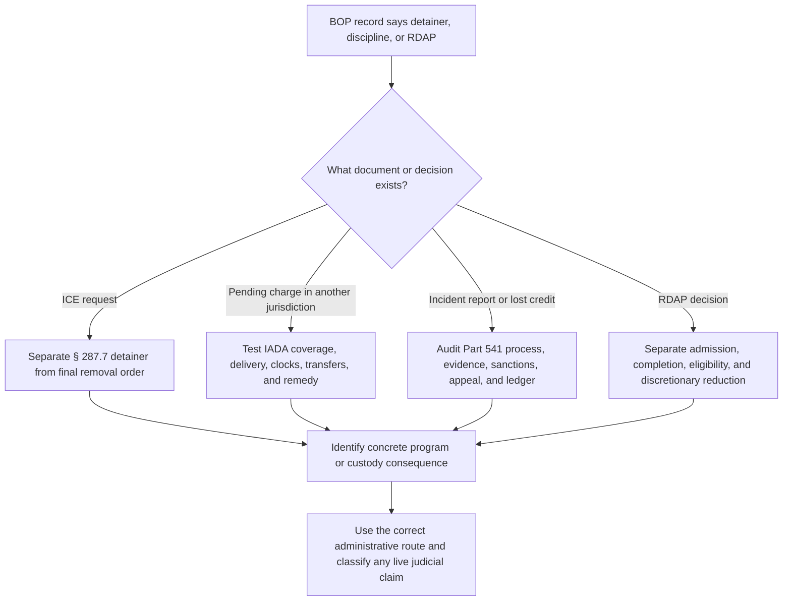

# Detainers, Prison Discipline, Good-Time Consequences, and RDAP

A detainer, a final removal order, a disciplinary charge, a loss of sentence credit, and RDAP early-release eligibility are different legal events. Identify the document, issuing sovereign, governing authority, and requested remedy before selecting a procedure.

## Detainer classification

<!-- claim:CLM-BOPDDR-001 authorities:AUTH-CFR-8-287-7 status:verified_current -->
An immigration detainer under 8 C.F.R. § 287.7 is a Department of Homeland Security request that another law-enforcement agency notify DHS before release and maintain custody temporarily so DHS can assume custody; it is not itself a criminal judgment or final removal order. [8 C.F.R. § 287.7(a)–(d)](https://www.ecfr.gov/current/title-8/chapter-I/subchapter-B/part-287/section-287.7)

<!-- claim:CLM-BOPDDR-002 authorities:AUTH-CFR-8-287-7 status:verified_current -->
Section 287.7(d) authorizes detention under an immigration detainer for no more than 48 hours, excluding Saturdays, Sundays, and holidays, after the person otherwise would have been released; custody beyond that regulatory period requires an independent lawful basis. [8 C.F.R. § 287.7(d)](https://www.ecfr.gov/current/title-8/chapter-I/subchapter-B/part-287/section-287.7)

<!-- claim:CLM-BOPDDR-003 authorities:AUTH-CFR-8-287-7 status:verified_current -->
The detainer regulation does not direct the receiving agency to disregard its own discretion concerning confinement before the person's ordinary release date. [8 C.F.R. § 287.7(a)](https://www.ecfr.gov/current/title-8/chapter-I/subchapter-B/part-287/section-287.7)

<!-- claim:CLM-BOPDDR-004 authorities:AUTH-USC-18-3632,AUTH-CFR-28-523-SUBPART-E status:verified_current -->
The First Step Act bars application of earned time credits to a prisoner who is the subject of a final order of removal under immigration law; a database flag or detainer must not be substituted for the final-order finding required by the statute and regulation. [18 U.S.C. § 3632(d)(4)(E)](https://uscode.house.gov/view.xhtml?req=%28title%3A18+section%3A3632+edition%3Aprelim%29); [28 C.F.R. § 523.44(a)(2)](https://www.ecfr.gov/current/title-28/chapter-V/subchapter-B/part-523/subpart-E/section-523.44)

<!-- claim:CLM-BOPDDR-005 authorities:AUTH-USC-18-3632,AUTH-CFR-8-287-7 status:verified_current -->
Whether immigration status affects designation, community placement, RDAP transition, or time-credit application must be tied to the exact statute, regulation, program criterion, and immigration record; there is no single consequence shared by every immigration detainer. [18 U.S.C. § 3632(d)(4)](https://uscode.house.gov/view.xhtml?req=%28title%3A18+section%3A3632+edition%3Aprelim%29); [8 C.F.R. § 287.7](https://www.ecfr.gov/current/title-8/chapter-I/subchapter-B/part-287/section-287.7)

## Interstate Agreement on Detainers

<!-- claim:CLM-BOPDDR-006 authorities:AUTH-IADA-PL-91-538 status:verified_current -->
The Interstate Agreement on Detainers Act governs qualifying detainers based on an untried indictment, information, or complaint lodged against a person already serving a term of imprisonment in a party jurisdiction; its text and the jurisdictions' party status must be checked. [IADA arts. I, III–IV, Pub. L. No. 91-538, 84 Stat. 1397](https://www.govinfo.gov/content/pkg/STATUTE-84/pdf/STATUTE-84-Pg1397.pdf)

<!-- claim:CLM-BOPDDR-007 authorities:AUTH-IADA-PL-91-538 status:verified_current -->
Article III permits the prisoner to request final disposition and provides a 180-day period only after the required written notice and request are delivered through the prescribed process, subject to a necessary-or-reasonable continuance for good cause in open court. [IADA art. III(a)–(b)](https://www.govinfo.gov/content/pkg/STATUTE-84/pdf/STATUTE-84-Pg1397.pdf)

<!-- claim:CLM-BOPDDR-008 authorities:AUTH-SCOTUS-FEX-507-US-43,AUTH-IADA-PL-91-538 status:verified_current -->
*Fex v. Michigan* holds that Article III's 180-day clock begins when the prisoner's request actually is delivered to both the prosecuting officer and the appropriate court, not when the prisoner gives it to custodial officials. [507 U.S. 43, 47–52 (1993)](https://www.govinfo.gov/content/pkg/USREPORTS-507/pdf/USREPORTS-507-43.pdf)

<!-- claim:CLM-BOPDDR-009 authorities:AUTH-IADA-PL-91-538 status:verified_current -->
Article IV authorizes the receiving prosecutor to obtain temporary custody after a detainer and written request, includes a 120-day trial period after arrival subject to qualifying continuances, and contains an anti-shuttling rule. [IADA art. IV(a), (c)–(e)](https://www.govinfo.gov/content/pkg/STATUTE-84/pdf/STATUTE-84-Pg1397.pdf)

<!-- claim:CLM-BOPDDR-010 authorities:AUTH-SCOTUS-MAURO-436-US-340,AUTH-IADA-PL-91-538 status:verified_current -->
*United States v. Mauro* holds that a federal writ of habeas corpus ad prosequendum is not itself a detainer, but after the United States files a detainer its use of the writ can constitute the Article IV written request for temporary custody. [436 U.S. 340, 349–61 (1978)](https://www.govinfo.gov/content/pkg/USREPORTS-436/pdf/USREPORTS-436-340.pdf)

<!-- claim:CLM-BOPDDR-011 authorities:AUTH-SCOTUS-CARCHMAN-473-US-716,AUTH-IADA-PL-91-538 status:verified_current -->
*Carchman v. Nash* holds that Article III does not cover a detainer based on a probation-violation charge because it is not an untried indictment, information, or complaint within the Agreement. [473 U.S. 716, 725–34 (1985)](https://www.govinfo.gov/content/pkg/USREPORTS-473/pdf/USREPORTS-473-716.pdf)

<!-- claim:CLM-BOPDDR-012 authorities:AUTH-SCOTUS-BOZEMAN-533-US-146,AUTH-IADA-PL-91-538 status:verified_current -->
*Alabama v. Bozeman* enforces Article IV(e)'s anti-shuttling command according to its text: returning the prisoner to the original place of imprisonment before trial required dismissal of the covered charges even when the return lasted only one day. [533 U.S. 146, 153–56 (2001)](https://www.govinfo.gov/content/pkg/USREPORTS-533/pdf/USREPORTS-533-146.pdf)

<!-- claim:CLM-BOPDDR-013 authorities:AUTH-SCOTUS-MOODY-429-US-78 status:verified_current -->
*Moody v. Daggett* holds, in the federal-parole setting, that a parolee imprisoned for a later offense was not constitutionally entitled to an immediate revocation hearing on an unexecuted parole-violator warrant lodged as a detainer; that narrow holding does not decide every detainer regime. [429 U.S. 78, 86–89 (1976)](https://www.govinfo.gov/content/pkg/USREPORTS-429/pdf/USREPORTS-429-78.pdf)

<!-- claim:CLM-BOPDDR-014 authorities:AUTH-IADA-PL-91-538,AUTH-CFR-8-287-7 status:verified_current -->
For any detainer, obtain the detainer, warrant or charging instrument, lodging date, issuing jurisdiction, custody status, sentence and release dates, notices, delivery proof, transfers, disposition, and removal-order record; labels in a prison database cannot establish those facts. [IADA arts. III–IV](https://www.govinfo.gov/content/pkg/STATUTE-84/pdf/STATUTE-84-Pg1397.pdf); [8 C.F.R. § 287.7](https://www.ecfr.gov/current/title-8/chapter-I/subchapter-B/part-287/section-287.7)

## Incident reports and discipline

<!-- claim:CLM-BOPDDR-015 authorities:AUTH-CFR-28-541 status:verified_current -->
When staff reasonably believe a prohibited act was committed, 28 C.F.R. § 541.5 ordinarily calls for an incident report within 24 hours after staff become aware of the involvement and an investigation ordinarily within 24 hours after the report, but the regulation's “ordinarily” language is not an automatic dismissal rule. [28 C.F.R. § 541.5](https://www.ecfr.gov/current/title-28/chapter-V/subchapter-C/part-541/section-541.5)

<!-- claim:CLM-BOPDDR-016 authorities:AUTH-CFR-28-541 status:verified_current -->
During investigation the prisoner must be advised of the right to remain silent and informed that silence may support an adverse inference but cannot alone support a finding; staff must investigate the explanation and relevant evidence. [28 C.F.R. § 541.5(b)](https://www.ecfr.gov/current/title-28/chapter-V/subchapter-C/part-541/section-541.5)

<!-- claim:CLM-BOPDDR-017 authorities:AUTH-CFR-28-541 status:verified_current -->
The Unit Discipline Committee ordinarily reviews an incident report within five workdays after issuance, excluding the issue day, weekends, and federal holidays, and may dispose of lower-level matters or refer greater- or high-severity matters to a Discipline Hearing Officer. [28 C.F.R. § 541.7(c), (f)](https://www.ecfr.gov/current/title-28/chapter-V/subchapter-C/part-541/section-541.7)

<!-- claim:CLM-BOPDDR-018 authorities:AUTH-CFR-28-541 status:verified_current -->
Before a Discipline Hearing Officer hearing, the prisoner ordinarily must receive written notice of the charges at least 24 hours in advance and written notice of rights, unless the prisoner waives the timing in writing. [28 C.F.R. §§ 541.7(g), 541.8(c)](https://www.ecfr.gov/current/title-28/chapter-V/subchapter-C/part-541/section-541.8)

<!-- claim:CLM-BOPDDR-019 authorities:AUTH-CFR-28-541 status:verified_current -->
The prisoner may request a staff representative and witnesses, but the DHO may limit witnesses or evidence for institutional safety, relevance, redundancy, unavailability, or similar stated reasons and must document the reason when a requested witness does not appear. [28 C.F.R. § 541.8(d)–(f)](https://www.ecfr.gov/current/title-28/chapter-V/subchapter-C/part-541/section-541.8)

<!-- claim:CLM-BOPDDR-020 authorities:AUTH-CFR-28-541 status:verified_current -->
The DHO must be an impartial decisionmaker who was not a victim, witness, investigator, or otherwise significantly involved in the charged incident. [28 C.F.R. § 541.8(b)](https://www.ecfr.gov/current/title-28/chapter-V/subchapter-C/part-541/section-541.8)

<!-- claim:CLM-BOPDDR-021 authorities:AUTH-CFR-28-541 status:verified_current -->
The DHO's decision must rest on at least some facts and, when the evidence conflicts, on the greater weight of the evidence; the DHO must provide a written report stating the evidence relied on, decision, sanctions, and reasons. [28 C.F.R. § 541.8(f)–(h)](https://www.ecfr.gov/current/title-28/chapter-V/subchapter-C/part-541/section-541.8)

<!-- claim:CLM-BOPDDR-022 authorities:AUTH-CFR-28-541 status:verified_current -->
Permitted sanctions depend on the prohibited act's severity level and the sanctions table; the charged code, proven code, sanction, credit type, amount, and statutory sentence regime must be recorded separately. [28 C.F.R. § 541.3, tbl. 1](https://www.ecfr.gov/current/title-28/chapter-V/subchapter-C/part-541/section-541.3)

<!-- claim:CLM-BOPDDR-023 authorities:AUTH-SCOTUS-WOLFF-418-US-539 status:verified_current -->
When prison discipline threatens an already-created good-time interest, *Wolff v. McDonnell* requires advance written notice, a qualified opportunity to present evidence consistent with institutional safety, and a written statement of evidence and reasons, but does not constitutionalize the full criminal-trial process. [418 U.S. 539, 563–72 (1974)](https://www.govinfo.gov/content/pkg/USREPORTS-418/pdf/USREPORTS-418-539.pdf)

<!-- claim:CLM-BOPDDR-024 authorities:AUTH-SCOTUS-WOLFF-418-US-539 status:verified_current -->
*Wolff* did not establish an unrestricted right to retained or appointed counsel, confrontation, or cross-examination in prison disciplinary hearings; any additional regulatory or policy protections must be analyzed on their own terms. [418 U.S. at 567–70](https://www.govinfo.gov/content/pkg/USREPORTS-418/pdf/USREPORTS-418-539.pdf)

<!-- claim:CLM-BOPDDR-025 authorities:AUTH-SCOTUS-SUPERINTENDENT-HILL-472-US-445 status:verified_current -->
Due process for a disciplinary loss of good time is satisfied only if some evidence in the record supports the decision; *Superintendent v. Hill* does not authorize a court to reweigh the record as the original factfinder. [472 U.S. 445, 454–57 (1985)](https://www.govinfo.gov/content/pkg/USREPORTS-472/pdf/USREPORTS-472-445.pdf)

<!-- claim:CLM-BOPDDR-026 authorities:AUTH-CFR-28-541,AUTH-CFR-28-542 status:verified_current -->
A DHO decision may be appealed through the Administrative Remedy Program; because the special route begins at the Regional Director rather than with an institution BP-9, the decision date, report receipt, region, filing, rejection, resubmission, and response history matter. [28 C.F.R. §§ 541.8(i), 542.14(d)(2)](https://www.ecfr.gov/current/title-28/chapter-V/subchapter-C/part-542/subpart-B)

## Lost credit and restoration

<!-- claim:CLM-BOPDDR-027 authorities:AUTH-USC-18-3624,AUTH-CFR-28-523-20 status:verified_current -->
Good-conduct time under § 3624(b) and 28 C.F.R. § 523.20 is distinct from First Step Act time credit; forfeited, withheld, vested, and restored good-conduct time must be matched to the prisoner's sentence regime and disciplinary record. [18 U.S.C. § 3624(b)](https://uscode.house.gov/view.xhtml?req=%28title%3A18+section%3A3624+edition%3Aprelim%29); [28 C.F.R. § 523.20](https://www.ecfr.gov/current/title-28/chapter-V/subchapter-B/part-523/section-523.20)

<!-- claim:CLM-BOPDDR-028 authorities:AUTH-CFR-28-523-SUBPART-E status:verified_current -->
Under the First Step Act regulation, a prisoner may lose earned time credits for violating prohibited-act rules, may appeal the loss through the Administrative Remedy Program, and may later be considered for restoration under the regulation and Bureau procedures; none of those events should be inferred from a projected-release-date change alone. [28 C.F.R. § 523.43](https://www.ecfr.gov/current/title-28/chapter-V/subchapter-B/part-523/subpart-E/section-523.43)

<!-- claim:CLM-BOPDDR-029 authorities:AUTH-USC-18-3624,AUTH-USC-18-3632,AUTH-CFR-28-541 status:verified_current -->
A disciplinary audit must reconcile the incident report, investigation, UDC and DHO records, code and severity, sanctions, appeals, restoration action, sentence computation, and separate GCT and FSA-credit ledgers. [18 U.S.C. §§ 3624(b), 3632(d)(4)](https://uscode.house.gov/view.xhtml?req=%28title%3A18+section%3A3632+edition%3Aprelim%29); [28 C.F.R. pt. 541](https://www.ecfr.gov/current/title-28/chapter-V/subchapter-C/part-541)

## RDAP and § 3621(e) reduction

<!-- claim:CLM-BOPDDR-030 authorities:AUTH-USC-18-3621 status:verified_current -->
Section 3621(e) directs the Bureau to provide residential substance-abuse treatment for eligible prisoners, but it makes an eligible nonviolent prisoner's post-completion sentence reduction discretionary and caps it at one year. [18 U.S.C. § 3621(e)(1)–(2)](https://uscode.house.gov/view.xhtml?edition=prelim&num=0&req=granuleid%3AUSC-prelim-title18-section3621)

<!-- claim:CLM-BOPDDR-031 authorities:AUTH-CFR-28-550-RDAP,AUTH-USC-18-3621 status:verified_current -->
Current RDAP admission requires the regulatory eligibility findings, including a verifiable substance-use disorder, willingness to participate, ability to complete all phases, and ordinarily enough time remaining to complete the program; a treatment recommendation is evidence, not automatic admission. [28 C.F.R. § 550.53](https://www.ecfr.gov/current/title-28/chapter-V/subchapter-C/part-550/subpart-F/section-550.53)

<!-- claim:CLM-BOPDDR-032 authorities:AUTH-CFR-28-550-RDAP status:verified_current -->
RDAP has unit-based, follow-up, and community-treatment components, and successful completion requires satisfying the regulation's components rather than merely entering or completing classroom hours. [28 C.F.R. §§ 550.53–550.56](https://www.ecfr.gov/current/title-28/chapter-V/subchapter-C/part-550/subpart-F)

<!-- claim:CLM-BOPDDR-033 authorities:AUTH-CFR-28-550-RDAP,AUTH-USC-18-3621 status:verified_current -->
Early-release eligibility is narrower than RDAP admission and is governed by § 3621(e)(2)(B), 28 C.F.R. § 550.55, the conviction and sentence record, program completion, and the prisoner's ability to complete community-based treatment. [28 C.F.R. § 550.55](https://www.ecfr.gov/current/title-28/chapter-V/subchapter-C/part-550/subpart-F/section-550.55)

<!-- claim:CLM-BOPDDR-034 authorities:AUTH-SCOTUS-LOPEZ-DAVIS-531-US-230,AUTH-USC-18-3621 status:verified_current -->
*Lopez v. Davis* holds that § 3621(e)(2)(B) permits the Bureau to exercise discretion categorically, including excluding otherwise eligible prisoners based on preconviction conduct involving a firearm. [531 U.S. 230, 238–44 (2001)](https://www.govinfo.gov/content/pkg/USREPORTS-531/pdf/USREPORTS-531-230.pdf)

<!-- claim:CLM-BOPDDR-035 authorities:AUTH-BOP-PS-5331-02-CN3,AUTH-CFR-28-550-RDAP status:verified_current -->
BOP Program Statement 5331.02 Change Notice 3, dated May 7, 2026, is the current public early-release procedure; it supersedes earlier change notices and must be read with the statute and current regulation. [BOP PS 5331.02 CN-3](https://www2.fed.bop.gov/policy/progstat/5331_002_CN-3.pdf)

<!-- claim:CLM-BOPDDR-036 authorities:AUTH-BOP-PS-5331-02-CN3,AUTH-USC-18-3621 status:verified_current -->
The current public policy uses a maximum provisional reduction of six months for sentences of 30 months or less, nine months for 31 through 36 months, and 12 months for 37 months or more; the final reduction remains subject to continued eligibility, completion, and Bureau discretion. [BOP PS 5331.02 CN-3](https://www2.fed.bop.gov/policy/progstat/5331_002_CN-3.pdf)

<!-- claim:CLM-BOPDDR-037 authorities:AUTH-BOP-PS-5331-02-CN3,AUTH-CFR-28-550-RDAP status:verified_current -->
A detainer matters to RDAP early release only to the extent the verified detainer and custody plan prevent the required community-based component or trigger another stated exclusion; “has a detainer” is not a sufficient legal analysis. [28 C.F.R. §§ 550.53–550.55](https://www.ecfr.gov/current/title-28/chapter-V/subchapter-C/part-550/subpart-F); [BOP PS 5331.02 CN-3](https://www2.fed.bop.gov/policy/progstat/5331_002_CN-3.pdf)

<!-- claim:CLM-BOPDDR-038 authorities:AUTH-SCOTUS-TAPIA-564-US-319,AUTH-USC-18-3621 status:verified_current -->
A sentencing court may recommend treatment, but *Tapia* prohibits imposing or lengthening imprisonment to promote rehabilitation and does not transfer RDAP admission or § 3621(e) reduction authority from the Bureau to the court. [*Tapia v. United States*, 564 U.S. 319, 326–35 (2011)](https://www.govinfo.gov/content/pkg/USREPORTS-564/pdf/USREPORTS-564-319.pdf); [18 U.S.C. § 3621(e)](https://uscode.house.gov/view.xhtml?edition=prelim&num=0&req=granuleid%3AUSC-prelim-title18-section3621)

<!-- claim:CLM-BOPDDR-039 authorities:AUTH-USC-18-3621,AUTH-CFR-28-550-RDAP status:verified_current -->
An RDAP dispute must distinguish treatment access, clinical diagnosis, program removal, successful completion, early-release eligibility, provisional reduction, final reduction, and community placement because each asks a different factual and remedial question. [18 U.S.C. § 3621(e)](https://uscode.house.gov/view.xhtml?edition=prelim&num=0&req=granuleid%3AUSC-prelim-title18-section3621); [28 C.F.R. pt. 550, subpt. F](https://www.ecfr.gov/current/title-28/chapter-V/subchapter-C/part-550/subpart-F)

<!-- claim:CLM-BOPDDR-040 authorities:AUTH-USC-18-3625,AUTH-SCOTUS-LOPEZ-DAVIS-531-US-230 status:verified_current -->
Review must identify whether the asserted error is statutory, regulatory, constitutional, evidentiary, or an exercise of placement or early-release discretion; § 3625 excludes specified APA provisions from subchapter-C determinations, while *Lopez* confirms the breadth of the Bureau's lawful § 3621(e) discretion. [18 U.S.C. § 3625](https://uscode.house.gov/view.xhtml?edition=prelim&num=0&req=granuleid%3AUSC-prelim-title18-section3625); [*Lopez*, 531 U.S. at 238–44](https://www.govinfo.gov/content/pkg/USREPORTS-531/pdf/USREPORTS-531-230.pdf)

## Decision path

## Required records and limits

- The actual detainer, warrant, charging paper, final removal order if any, and issuing-jurisdiction docket.
- Custody, delivery, transport, return, sentence, and release chronology.
- Incident report, investigation, UDC and DHO packets, hearing recording if available, sanctions, credit ledgers, and appeals.
- RDAP diagnosis, referrals, eligibility reviews, offense review, participation and removal records, provisional and final reduction decisions, and community-treatment plan.
- Current circuit law governing the asserted judicial claim, exhaustion, remedy, and standard of review.

