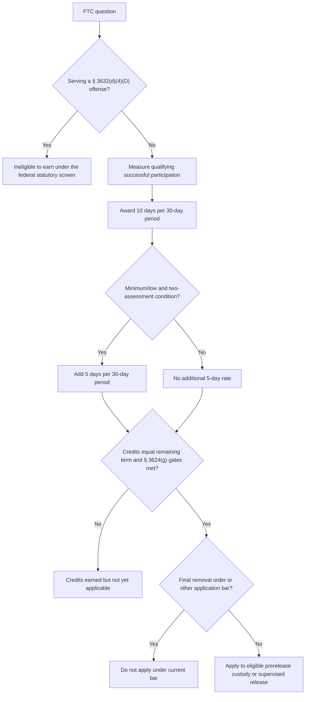

# 18 U.S.C. § 3632 — First Step Act Time Credits

## Verification boundary

This module verifies the current nationwide earning and application structure for First Step Act time credits (FTCs). It does not calculate a particular prisoner's credits, resolve an aggregated-sentence dispute, validate a PATTERN score, decide an offense under § 3632(d)(4)(D), or establish exhaustion, habeas jurisdiction, venue, or relief under 28 U.S.C. § 2241.

The legacy-control instruction calls for verification of a legacy “Maxwell” reference. Exhaustive repository and legacy-corpus searches found that name only in the instruction itself, not in any legal-content file. No Maxwell case identity, citation, proposition, or holding is therefore asserted here.

## System development and reassessment

<!-- claim:CLM-FTC-001 authorities:AUTH-USC-18-3632 status:verified_current -->
Section 3632(a) required the Attorney General, in consultation with the Independent Review Committee, to develop and publicly release the risk-and-needs assessment system no later than 210 days after enactment. [18 U.S.C. § 3632(a)](https://uscode.house.gov/view.xhtml?edition=prelim&num=0&req=granuleid%3AUSC-prelim-title18-section3632)

<!-- claim:CLM-FTC-002 authorities:AUTH-USC-18-3632 status:verified_current -->
The system must reassess each prisoner's recidivism risk periodically using indicators of progress and regression that are dynamic and reasonably expected to change in prison. [18 U.S.C. § 3632(a)(4)](https://uscode.house.gov/view.xhtml?edition=prelim&num=0&req=granuleid%3AUSC-prelim-title18-section3632)

<!-- claim:CLM-FTC-003 authorities:AUTH-DOJ-PATTERN-2019-RELEASE status:verified_historical -->
The Department of Justice published the initial risk-and-needs assessment system, PATTERN, on July 19, 2019; DOJ contemporaneously and subsequently identified that publication as meeting the statutory deadline. [DOJ release (July 19, 2019)](https://www.justice.gov/archives/opa/pr/department-justice-announces-release-3100-inmates-under-first-step-act-publishes-risk-and); [NIJ Director's implementation remarks](https://www.justice.gov/archives/opa/speech/national-institute-justice-director-david-muhlhausen-delivers-remarks-first-step-act)

The later January 2022 time-credit regulation is not evidence that the separate 210-day system-development and publication deadline was missed.

## Earning credits

<!-- claim:CLM-FTC-004 authorities:AUTH-USC-18-3632,AUTH-CFR-28-523-SUBPART-E status:verified_current -->
Except for a prisoner made ineligible by § 3632(d)(4)(D), successful participation earns ten days of FTCs for every thirty days of qualifying evidence-based recidivism-reduction programming or productive activities. [18 U.S.C. § 3632(d)(4)(A)(i)](https://uscode.house.gov/view.xhtml?edition=prelim&num=0&req=granuleid%3AUSC-prelim-title18-section3632); [28 C.F.R. § 523.42(c)(1)](https://www.ecfr.gov/current/title-28/chapter-V/subchapter-B/part-523/subpart-E)

<!-- claim:CLM-FTC-005 authorities:AUTH-USC-18-3632,AUTH-CFR-28-523-SUBPART-E status:verified_current -->
A prisoner at minimum or low recidivism risk earns an additional five days for every thirty days of successful participation when the statutory two-assessment condition is met; the regulation expresses that condition as maintaining a consistent minimum or low risk over the two most recent consecutive assessments. [18 U.S.C. § 3632(d)(4)(A)(ii)](https://uscode.house.gov/view.xhtml?edition=prelim&num=0&req=granuleid%3AUSC-prelim-title18-section3632); [28 C.F.R. § 523.42(c)(2)](https://www.ecfr.gov/current/title-28/chapter-V/subchapter-B/part-523/subpart-E)

<!-- claim:CLM-FTC-006 authorities:AUTH-USC-18-3632 status:verified_current -->
The statute bars credit for a program successfully completed before December 21, 2018 and for a program completed during official detention before the prisoner's sentence commences under § 3585(a). [18 U.S.C. § 3632(d)(4)(B)](https://uscode.house.gov/view.xhtml?edition=prelim&num=0&req=granuleid%3AUSC-prelim-title18-section3632)

<!-- claim:CLM-FTC-007 authorities:AUTH-CFR-28-523-SUBPART-E status:verified_current -->
The regulation allows an otherwise eligible inmate to earn for programming and activities from December 21, 2018 through January 14, 2020; beginning January 15, 2020, earning requires successful participation in programs or activities recommended from the individualized risk-and-needs assessment. [28 C.F.R. § 523.42(b)](https://www.ecfr.gov/current/title-28/chapter-V/subchapter-B/part-523/subpart-E)

<!-- claim:CLM-FTC-008 authorities:AUTH-CFR-28-523-SUBPART-E status:verified_current -->
For the current regulatory period, an eligible inmate begins earning only after the term of imprisonment commences, which the regulation identifies as arrival or voluntary surrender at the designated Bureau facility. [28 C.F.R. § 523.42(a)](https://www.ecfr.gov/current/title-28/chapter-V/subchapter-B/part-523/subpart-E)

## Eligibility to earn

<!-- claim:CLM-FTC-009 authorities:AUTH-USC-18-3632,AUTH-CFR-28-523-SUBPART-E status:verified_current -->
Section 3632(d)(4)(D) makes a prisoner ineligible to earn FTCs when the prisoner is serving a sentence for a conviction under an enumerated provision; the current exact statutory list—not a category label or a fixed estimate of the number of offenses—controls the federal offense screen. [18 U.S.C. § 3632(d)(4)(D)](https://uscode.house.gov/view.xhtml?edition=prelim&num=0&req=granuleid%3AUSC-prelim-title18-section3632); [28 C.F.R. § 523.41(d)](https://www.ecfr.gov/current/title-28/chapter-V/subchapter-B/part-523/subpart-E)

An individualized screen requires the judgment, conviction statutes, sentence structure, and current governing authority. This module does not resolve how an aggregated term containing eligible and ineligible counts is treated.

<!-- claim:CLM-FTC-010 authorities:AUTH-USC-18-3632,AUTH-CFR-28-523-SUBPART-E status:verified_current -->
A final removal order is an application bar, not one of § 3632(d)(4)(D)'s earning exclusions: the regulation's earning rule excludes the enumerated-offense category, while § 3632(d)(4)(E) and § 523.44(a)(2) prohibit applying FTCs for a prisoner subject to a final order of removal. [18 U.S.C. § 3632(d)(4)(D)–(E)](https://uscode.house.gov/view.xhtml?edition=prelim&num=0&req=granuleid%3AUSC-prelim-title18-section3632); [28 C.F.R. §§ 523.41(d), 523.44(a)(2)](https://www.ecfr.gov/current/title-28/chapter-V/subchapter-B/part-523/subpart-E)

## Application is a separate gate

<!-- claim:CLM-FTC-011 authorities:AUTH-USC-18-3632,AUTH-USC-18-3624 status:verified_current -->
Section 3632(d)(4)(C) directs that earned FTCs be applied toward prerelease custody or supervised release and requires transfer of prisoners who are eligible under § 3624(g); earning a credit and qualifying to apply it are therefore separate determinations. [18 U.S.C. § 3632(d)(4)(C)](https://uscode.house.gov/view.xhtml?edition=prelim&num=0&req=granuleid%3AUSC-prelim-title18-section3632); [18 U.S.C. § 3624(g)](https://uscode.house.gov/view.xhtml?req=%28title%3A18+section%3A3624+edition%3Aprelim%29)

<!-- claim:CLM-FTC-012 authorities:AUTH-USC-18-3624,AUTH-CFR-28-523-SUBPART-E status:verified_current -->
Before application, the prisoner must have credits equal to the remainder of the imposed term, must have demonstrated risk reduction or maintained minimum or low risk during imprisonment, and must have had the remainder of the term computed under applicable law. [18 U.S.C. § 3624(g)(1)(A)–(C)](https://uscode.house.gov/view.xhtml?req=%28title%3A18+section%3A3624+edition%3Aprelim%29); [28 C.F.R. § 523.44(b)](https://www.ecfr.gov/current/title-28/chapter-V/subchapter-B/part-523/subpart-E)

<!-- claim:CLM-FTC-013 authorities:AUTH-USC-18-3624,AUTH-CFR-28-523-SUBPART-E status:verified_current -->
For prerelease custody, § 3624(g) and § 523.44(c) additionally require minimum or low risk in the last two assessments, unless the warden approves the statutory petition after making the required danger, good-faith-effort, and recidivism findings. [18 U.S.C. § 3624(g)(1)(D)(i)](https://uscode.house.gov/view.xhtml?req=%28title%3A18+section%3A3624+edition%3Aprelim%29); [28 C.F.R. § 523.44(c)](https://www.ecfr.gov/current/title-28/chapter-V/subchapter-B/part-523/subpart-E)

<!-- claim:CLM-FTC-014 authorities:AUTH-USC-18-3624,AUTH-CFR-28-523-SUBPART-E status:verified_current -->
For early transfer to supervised release, the prisoner must satisfy the general application criteria, have minimum or low risk at the last assessment, and have a court-imposed supervised-release term; FTCs cannot advance that transfer by more than twelve months. [18 U.S.C. § 3624(g)(1)(D)(ii)](https://uscode.house.gov/view.xhtml?req=%28title%3A18+section%3A3624+edition%3Aprelim%29); [28 C.F.R. § 523.44(d)](https://www.ecfr.gov/current/title-28/chapter-V/subchapter-B/part-523/subpart-E)

## Loss, review, and agency implementation

<!-- claim:CLM-FTC-015 authorities:AUTH-CFR-28-523-SUBPART-E status:verified_current -->
An inmate may lose earned FTCs for violating program or activity requirements under Part 541 procedures, may seek review through the Bureau's Part 542 Administrative Remedy Program, and may receive case-specific restoration after clear conduct for two consecutive risk-and-needs assessments. [28 C.F.R. § 523.43](https://www.ecfr.gov/current/title-28/chapter-V/subchapter-B/part-523/subpart-E)

<!-- claim:CLM-FTC-016 authorities:AUTH-BOP-PS-5410-01-CN2 status:verified_current -->
BOP Program Statement 5410.01, Change Notice 2, dated March 10, 2023, is official agency implementation policy for § 3632(d)(4); it does not displace the statute or regulation. [BOP Program Statement 5410.01 CN-2](https://www.bop.gov/policy/progstat/5410.01_cn2.pdf)

## Individual audit checklist

1. Obtain the judgment, conviction statutes, presentence report where lawfully available, and Bureau FTC worksheet.
2. Separate eligibility to earn, actual successful-participation days, the ten- versus fifteen-day rate, loss or restoration, and eligibility to apply.
3. Check the precise current text of § 3632(d)(4)(D); do not rely on an offense label or an estimated number of categories.
4. Identify any final removal order, detainer, non-U.S.-Code sentence issue, PATTERN assessments, and warden-petition record.
5. Compare the worksheet against §§ 523.41–523.44 and the current Program Statement.
6. Preserve all administrative-remedy submissions, receipts, rejections, extensions, and responses before researching a § 2241 claim.

## Decision path

## Matters not yet verified in this module

- Particular offense eligibility and aggregated or concurrent sentence treatment.
- The validity of a particular PATTERN or needs assessment and program assignment.
- Day-level Bureau computation, waitlist treatment, interruptions, detainers, D.C. Code sentences, and combinations with RDAP.
- Administrative-remedy deadlines and exceptions, § 2241 exhaustion, proper respondent, venue, certificate-of-appealability rules, and available relief.
- Any case supposedly named “Maxwell”; no such legal-content reference exists in the inventoried legacy corpus.

Those matters remain open in `data/coverage_matrix.yaml`; this bounded correction does not validate the legacy § 3632 file as a whole.
