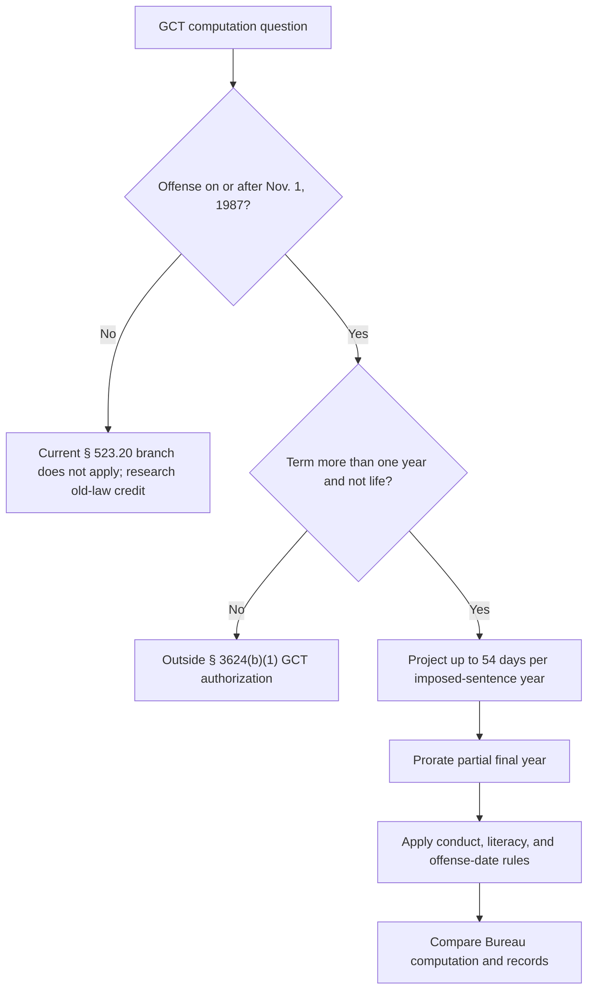

# 18 U.S.C. § 3624(b) — Good Conduct Time

## Verification boundary

This module verifies the current nationwide statutory and regulatory calculation structure for good-conduct time (GCT), the First Step Act change, and the historical boundary of *Barber v. Thomas*. It does not verify a particular prisoner's computation, disciplinary loss, restoration, administrative-exhaustion history, or § 2241 remedy.

## Current statutory rule

<!-- claim:CLM-GCT-001 authorities:AUTH-USC-18-3624 status:verified_current -->
Section 3624(a) directs the Bureau of Prisons to release a prisoner when the term of imprisonment expires, less credit toward service of the sentence provided by § 3624(b). [18 U.S.C. § 3624(a)](https://uscode.house.gov/view.xhtml?req=%28title%3A18+section%3A3624+edition%3Aprelim%29)

<!-- claim:CLM-GCT-002 authorities:AUTH-USC-18-3624 status:verified_current -->
A prisoner serving more than one year, other than a life term, may receive up to fifty-four days of GCT for each year of the sentence imposed by the court, subject to the Bureau's determination of exemplary compliance with institutional disciplinary regulations. [18 U.S.C. § 3624(b)(1)](https://uscode.house.gov/view.xhtml?req=%28title%3A18+section%3A3624+edition%3Aprelim%29)

“Up to” is consequential: the statute does not promise the maximum award. A sentence of one year or less and a life term fall outside this authorization.

<!-- claim:CLM-GCT-003 authorities:AUTH-USC-18-3624 status:verified_current -->
If the Bureau determines that the prisoner did not satisfactorily comply during the relevant year, the prisoner receives no GCT or a lesser amount the Bureau determines appropriate; the Bureau also must consider high-school-diploma progress, and credit not earned may not later be granted. [18 U.S.C. § 3624(b)(1)](https://uscode.house.gov/view.xhtml?req=%28title%3A18+section%3A3624+edition%3Aprelim%29)

<!-- claim:CLM-GCT-004 authorities:AUTH-USC-18-3624 status:verified_current -->
Subject to § 3624(b)(2), the statute directs that credit for the last year of a term be credited on the first day of the last year. [18 U.S.C. § 3624(b)(1)](https://uscode.house.gov/view.xhtml?req=%28title%3A18+section%3A3624+edition%3Aprelim%29)

That timing sentence does not eliminate partial-final-year proration. The current regulation separately addresses both proration and the anniversary-period mechanics.

<!-- claim:CLM-GCT-005 authorities:AUTH-USC-18-3624 status:verified_current -->
GCT awarded under § 3624(b) after enactment of the Prison Litigation Reform Act vests on the date the prisoner is released from custody. [18 U.S.C. § 3624(b)(2)](https://uscode.house.gov/view.xhtml?req=%28title%3A18+section%3A3624+edition%3Aprelim%29)

## Current regulatory calculation

<!-- claim:CLM-GCT-006 authorities:AUTH-CFR-28-523-20 status:verified_current -->
For offenses committed on or after November 1, 1987, 28 C.F.R. § 523.20(b)(1) directs the Bureau to project the maximum possible GCT from the imposed sentence while recognizing that the projected release date can change during incarceration. [28 C.F.R. § 523.20(b)(1)](https://www.govinfo.gov/content/pkg/CFR-2025-title28-vol2/pdf/CFR-2025-title28-vol2-sec523-30.pdf)

<!-- claim:CLM-GCT-007 authorities:AUTH-CFR-28-523-20 status:verified_current -->
The Bureau awards prorated GCT for a partial final year of the sentence imposed. [28 C.F.R. § 523.20(b)(2)](https://www.govinfo.gov/content/pkg/CFR-2025-title28-vol2/pdf/CFR-2025-title28-vol2-sec523-30.pdf)

This corrects the legacy statement that the First Step Act's timing change replaced proration. The 2022 final rule expressly chose proration for a partial final year.

<!-- claim:CLM-GCT-008 authorities:AUTH-CFR-28-523-20 status:verified_current -->
Under the regulation, an inmate may receive up to fifty-four days on each anniversary date; last-year credit is awarded after the final anniversary period unless the final year is complete, in which case it is awarded on the first day of that final anniversary period. [28 C.F.R. § 523.20(b)(3)](https://www.govinfo.gov/content/pkg/CFR-2025-title28-vol2/pdf/CFR-2025-title28-vol2-sec523-30.pdf)

<!-- claim:CLM-GCT-009 authorities:AUTH-CFR-28-523-20 status:verified_current -->
For an offense committed on or after April 26, 1996, the regulation sets a maximum of fifty-four days per imposed-sentence year when the literacy condition is met and forty-two days when it is not, subject to the regulation's final-removal-order exception. [28 C.F.R. § 523.20(d)(2)–(3)](https://www.govinfo.gov/content/pkg/CFR-2025-title28-vol2/pdf/CFR-2025-title28-vol2-sec523-30.pdf)

<!-- claim:CLM-GCT-012 authorities:AUTH-CFR-28-523-20 status:verified_current -->
The regulation permits GCT reduction for qualifying disciplinary sanctions or failure to comply with applicable literacy requirements. [28 C.F.R. § 523.20(a)](https://www.govinfo.gov/content/pkg/CFR-2025-title28-vol2/pdf/CFR-2025-title28-vol2-sec523-30.pdf)

Actual loss, disallowance, forfeiture, and restoration require the disciplinary record, the offense-date branch, and the current rules in Parts 541 and 544; they are not calculated by this module.

## First Step Act change and historical rule

<!-- claim:CLM-GCT-010 authorities:AUTH-PL-115-391-SEC-102-B,AUTH-BOP-FSA-GCT-FAQ status:verified_current -->
The First Step Act changed GCT from a time-served calculation to a sentence-imposed calculation, made the amendment applicable to offenses committed before, on, or after enactment except offenses before November 1, 1987, and the change took effect when the risk-and-needs system was released on July 19, 2019. [First Step Act § 102(b), 132 Stat. 5210–11](https://uscode.house.gov/statutes/pl/115/391.pdf); [BOP First Step Act FAQ](https://www.bop.gov/inmates/fsa/faq.jsp)

The correct dividing fact is therefore amendment coverage—especially offense date—not whether a particular day of the sentence was served before July 19, 2019. Covered computations were recalculated under the amended rule.

<!-- claim:CLM-GCT-011 authorities:AUTH-SCOTUS-BARBER-560-US-474,AUTH-PL-115-391-SEC-102-B status:verified_historical -->
Barber v. Thomas upheld the Bureau's time-served method under the pre-First Step Act text, but the First Step Act superseded that calculation rule for covered current sentences. [*Barber v. Thomas*, 560 U.S. 474, 476–87 (2010)](https://www.govinfo.gov/content/pkg/USREPORTS-560/pdf/USREPORTS-560-474.pdf); [First Step Act § 102(b)](https://uscode.house.gov/statutes/pl/115/391.pdf)

<!-- claim:CLM-GCT-013 authorities:AUTH-CFR-28-523-20 status:verified_current -->
Good-conduct-time credit under § 3624(b) is distinct from First Step Act time credits earned through recidivism-reduction programs and applied under §§ 3632(d)(4) and 3624(g). [Good Conduct Time Credit Under the First Step Act, 87 Fed. Reg. 7938, 7941 (Feb. 11, 2022)](https://www.federalregister.gov/documents/2022/02/11/2022-02876/good-conduct-time-credit-under-the-first-step-act)

## Computation audit checklist

1. Obtain the judgment, statement of reasons if relevant, and the Bureau sentence-computation sheet.
2. Record the offense date, imposed term, and whether the sentence is life or no more than one year.
3. Separate GCT from prior-custody credit, RDAP reduction, First Step Act time credits, and prerelease-placement dates.
4. Check the maximum projection, each disciplinary adjustment, literacy status, anniversary periods, and partial-final-year proration.
5. Do not switch to the historical *Barber* formula merely because some custody occurred before July 19, 2019.
6. Preserve the Bureau's actual calculation and administrative record before researching exhaustion and a possible § 2241 challenge.

## Decision path

## Matters not yet verified in this module

- Old-law credit for offenses before November 1, 1987 and D.C. Code credit.
- Particular disciplinary procedures, restoration standards, and due-process claims.
- Administrative-remedy deadlines, exceptions to exhaustion, proper § 2241 respondent, venue, and available relief.
- Interaction with prior-custody credit, aggregated sentences, RDAP, and First Step Act time credits in a particular computation.

Those matters remain open in `data/coverage_matrix.yaml`; this bounded correction does not validate the legacy file as a whole.
