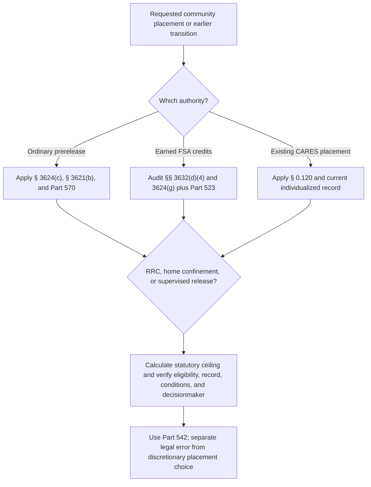

# Prerelease Custody, Residential Reentry, Home Confinement, and the CARES Act

Residential reentry-center placement, ordinary home confinement, First Step Act prerelease custody, transfer to supervised release, and CARES Act home confinement are related but noninterchangeable authorities. A valid analysis identifies the governing lane, eligibility date, placement decision, and decisionmaker.

## Ordinary prerelease custody under § 3624(c)

<!-- claim:CLM-BOPPRE-001 authorities:AUTH-USC-18-3624 status:verified_current -->
Section 3624(c)(1) directs the Bureau, to the extent practicable, to ensure that a prisoner spends a reasonable part of the final portion of the term—up to 12 months—under conditions that afford a reasonable opportunity to adjust to and prepare for reentry. [18 U.S.C. § 3624(c)(1)](https://uscode.house.gov/view.xhtml?req=%28title%3A18+section%3A3624+edition%3Aprelim%29)

<!-- claim:CLM-BOPPRE-002 authorities:AUTH-USC-18-3624 status:verified_current -->
The 12-month language is a ceiling for prerelease conditions, not a guaranteed residential reentry-center term; the statute retains practicability and individualized administration. [18 U.S.C. § 3624(c)(1), (6)](https://uscode.house.gov/view.xhtml?req=%28title%3A18+section%3A3624+edition%3Aprelim%29)

<!-- claim:CLM-BOPPRE-003 authorities:AUTH-USC-18-3624 status:verified_current -->
Under ordinary § 3624(c)(2), the Bureau may place a prisoner in home confinement for the shorter of ten percent of the imprisonment term or six months, and, to the extent practicable, must place lower-risk and lower-needs prisoners in home confinement for the maximum time permitted. [18 U.S.C. § 3624(c)(2)](https://uscode.house.gov/view.xhtml?req=%28title%3A18+section%3A3624+edition%3Aprelim%29)

<!-- claim:CLM-BOPPRE-004 authorities:AUTH-USC-18-3624 status:verified_current -->
The Bureau retains authority to return a prisoner from prerelease custody to a correctional facility when the statutory or placement conditions are violated. [18 U.S.C. § 3624(c)(4)](https://uscode.house.gov/view.xhtml?req=%28title%3A18+section%3A3624+edition%3Aprelim%29)

<!-- claim:CLM-BOPPRE-005 authorities:AUTH-USC-18-3624,AUTH-USC-18-3621 status:verified_current -->
Prerelease placement must be administered consistently with § 3621(b)'s individualized designation factors, the available facility and community resources, the judgment, public-safety constraints, and the prisoner's circumstances. [18 U.S.C. §§ 3621(b), 3624(c)(6)](https://uscode.house.gov/view.xhtml?req=%28title%3A18+section%3A3624+edition%3Aprelim%29)

<!-- claim:CLM-BOPPRE-006 authorities:AUTH-PL-110-199-SEC-251,AUTH-USC-18-3624 status:verified_current -->
Section 251 of the Second Chance Act of 2007 expanded ordinary prerelease custody to a maximum of 12 months and required regulations assuring individualized decisions; it did not guarantee 12 months or replace later First Step Act mechanisms. [Pub. L. No. 110-199, § 251, 122 Stat. 657, 692–94](https://www.govinfo.gov/content/pkg/PLAW-110publ199/pdf/PLAW-110publ199.pdf)

<!-- claim:CLM-BOPPRE-007 authorities:AUTH-CFR-28-570-SUBPART-B,AUTH-USC-18-3621 status:verified_current -->
The Bureau's community-confinement regulation requires individual determinations of duration consistent with § 3621(b), ordinarily made with enough time for planning, and confirms that an inmate may be considered for up to 12 months. [28 C.F.R. §§ 570.20–570.22](https://www.ecfr.gov/current/title-28/chapter-V/subchapter-D/part-570/subpart-B)

<!-- claim:CLM-BOPPRE-008 authorities:AUTH-CFR-28-570-SUBPART-B status:verified_current -->
The regulation does not impose a categorical six-month cap on residential reentry-center placement; it also does not create a right to the maximum statutory period. [28 C.F.R. §§ 570.21–570.22](https://www.ecfr.gov/current/title-28/chapter-V/subchapter-D/part-570/subpart-B)

## First Step Act prerelease custody and supervised-release transfer

<!-- claim:CLM-BOPPRE-009 authorities:AUTH-USC-18-3624,AUTH-USC-18-3632 status:verified_current -->
First Step Act time credits are earned under § 3632(d)(4), but they are applied through the separate eligibility and placement rules in § 3624(g); earning a credit and becoming eligible to apply it are not the same event. [18 U.S.C. §§ 3624(g), 3632(d)(4)](https://uscode.house.gov/view.xhtml?req=%28title%3A18+section%3A3624+edition%3Aprelim%29)

<!-- claim:CLM-BOPPRE-010 authorities:AUTH-USC-18-3624 status:verified_current -->
For prerelease custody under § 3624(g), the prisoner must have earned credits equal to the remainder of the imposed term, shown reduced recidivism risk or maintained minimum or low risk over the specified assessments, and had the remainder computed under applicable law. [18 U.S.C. § 3624(g)(1)(A)–(D)(i)](https://uscode.house.gov/view.xhtml?req=%28title%3A18+section%3A3624+edition%3Aprelim%29)

<!-- claim:CLM-BOPPRE-011 authorities:AUTH-USC-18-3624 status:verified_current -->
A prisoner who does not satisfy the minimum-or-low-risk route may seek approval through the warden-petition route if the statutory prerequisites, including a determination that the prisoner would not endanger society and made a good-faith effort to lower risk, are met. [18 U.S.C. § 3624(g)(1)(D)(i)(II)](https://uscode.house.gov/view.xhtml?req=%28title%3A18+section%3A3624+edition%3Aprelim%29)

<!-- claim:CLM-BOPPRE-012 authorities:AUTH-USC-18-3624 status:verified_current -->
Section 3624(g)(2) defines prerelease custody for this lane as home confinement or placement in a residential reentry center, subject to the subsection's conditions and Bureau administration. [18 U.S.C. § 3624(g)(2)](https://uscode.house.gov/view.xhtml?req=%28title%3A18+section%3A3624+edition%3Aprelim%29)

<!-- claim:CLM-BOPPRE-013 authorities:AUTH-USC-18-3624 status:verified_current -->
First Step Act home confinement includes monitoring requirements and permits the Bureau to reduce monitoring after a prisoner demonstrates compliance; the statute separately authorizes return to prison for violations. [18 U.S.C. § 3624(g)(2)(A)](https://uscode.house.gov/view.xhtml?req=%28title%3A18+section%3A3624+edition%3Aprelim%29)

<!-- claim:CLM-BOPPRE-014 authorities:AUTH-USC-18-3624 status:verified_current -->
First Step Act residential reentry-center placement must provide 24-hour staff, safe and adequate conditions, accountability, employment and family services, and substance-abuse and mental-health treatment access as specified by statute. [18 U.S.C. § 3624(g)(2)(B)](https://uscode.house.gov/view.xhtml?req=%28title%3A18+section%3A3624+edition%3Aprelim%29)

<!-- claim:CLM-BOPPRE-015 authorities:AUTH-USC-18-3624 status:verified_current -->
Section 3624(g)(3) permits the Bureau to transfer an eligible prisoner to begin a court-imposed supervised-release term up to 12 months before the ordinary release date; it does not create supervised release when the judgment imposed none. [18 U.S.C. § 3624(g)(3)](https://uscode.house.gov/view.xhtml?req=%28title%3A18+section%3A3624+edition%3Aprelim%29)

<!-- claim:CLM-BOPPRE-016 authorities:AUTH-USC-18-3624 status:verified_current -->
The early supervised-release transfer cannot exceed the prisoner's earned time credits, and the resulting supervision remains governed by the judgment and Chapter 229 rather than by BOP institutional rules. [18 U.S.C. § 3624(g)(3)](https://uscode.house.gov/view.xhtml?req=%28title%3A18+section%3A3624+edition%3Aprelim%29)

<!-- claim:CLM-BOPPRE-017 authorities:AUTH-CFR-28-523-SUBPART-E,AUTH-USC-18-3624 status:verified_current -->
The current First Step Act regulation implements credit application, including prerelease-custody and supervised-release transfer requirements, exclusions, risk criteria, and restoration; the official computation record controls the individualized credit balance. [28 C.F.R. §§ 523.42–523.44](https://www.ecfr.gov/current/title-28/chapter-V/subchapter-B/part-523/subpart-E)

<!-- claim:CLM-BOPPRE-018 authorities:AUTH-BOP-FTC-APPLICATION-GUIDE-2025,AUTH-USC-18-3624 status:verified_current -->
The Bureau's October 16, 2025 Federal Time Credit Application Guide describes its current public operational framework for maximizing lawful application of credits, but it cannot enlarge or narrow the governing statute and regulation. [BOP Federal Time Credit Application Guide](https://www.bop.gov/news/20251016-federal-time-credit-application-guide.jsp)

## Ordinary home confinement administration

<!-- claim:CLM-BOPPRE-019 authorities:AUTH-BOP-HOME-CONFINEMENT-DIRECTIVE-2025,AUTH-USC-18-3624 status:verified_current -->
The Bureau's May 28, 2025 home-confinement directive instructs staff to maximize lawful home-confinement use, make individualized assessments, and avoid adding categorical barriers not found in statute or policy; it remains subordinate to governing law. [BOP, Expanding Home Confinement](https://www.bop.gov/news/pdfs/20250528-home-confinement-expansioin.pdf)

<!-- claim:CLM-BOPPRE-020 authorities:AUTH-USC-18-3624,AUTH-USC-18-3621 status:verified_current -->
A sentencing-court recommendation may inform placement but does not itself order the Bureau to place a prisoner in home confinement or an RRC; the Bureau administers place of imprisonment and prerelease custody under the governing statutes. [18 U.S.C. §§ 3621(b), 3624(c)](https://uscode.house.gov/view.xhtml?req=%28title%3A18+section%3A3624+edition%3Aprelim%29)

<!-- claim:CLM-BOPPRE-021 authorities:AUTH-USC-18-3624 status:verified_current -->
Home confinement is still service of the imprisonment term under Bureau custody and conditions; it is not the same as release from imprisonment, probation, or supervised release. [18 U.S.C. § 3624(c), (g)](https://uscode.house.gov/view.xhtml?req=%28title%3A18+section%3A3624+edition%3Aprelim%29)

<!-- claim:CLM-BOPPRE-022 authorities:AUTH-USC-18-3624,AUTH-CFR-28-570-SUBPART-B status:verified_current -->
An individualized placement review requires the projected release date, statutory eligibility calculation, earned-credit ledger, PATTERN history, needs, discipline, detainers and unresolved charges, residence, treatment and employment plan, accessibility and medical needs, community resources, and reasons for the decision. [18 U.S.C. §§ 3621(b), 3624(c), (g)](https://uscode.house.gov/view.xhtml?req=%28title%3A18+section%3A3624+edition%3Aprelim%29); [28 C.F.R. pt. 570, subpt. B](https://www.ecfr.gov/current/title-28/chapter-V/subchapter-D/part-570/subpart-B)

## CARES Act home confinement

<!-- claim:CLM-BOPPRE-023 authorities:AUTH-PL-116-136-SEC-12003 status:verified_current -->
CARES Act § 12003(b)(2) temporarily authorized the Bureau Director, after the Attorney General's emergency finding and during the defined covered emergency period, to lengthen the maximum home-confinement period otherwise authorized by § 3624(c)(2). [Pub. L. No. 116-136, § 12003(b)(2), 134 Stat. 281, 516](https://www.govinfo.gov/content/pkg/PLAW-116publ136/pdf/PLAW-116publ136.pdf)

<!-- claim:CLM-BOPPRE-024 authorities:AUTH-PL-116-136-SEC-12003,AUTH-PL-118-3 status:verified_current -->
The CARES Act defined the covered emergency period by reference to the March 13, 2020 national emergency and 30 days after its termination; Public Law 118-3 terminated that national emergency on April 10, 2023, so the temporary authority to make new expanded-period placements is not an open-ended present authority. [Pub. L. No. 116-136, § 12003(a)(2)](https://www.govinfo.gov/content/pkg/PLAW-116publ136/pdf/PLAW-116publ136.pdf); [Pub. L. No. 118-3, 137 Stat. 6](https://www.govinfo.gov/content/pkg/PLAW-118publ3/pdf/PLAW-118publ3.pdf)

<!-- claim:CLM-BOPPRE-025 authorities:AUTH-CFR-28-0-120,AUTH-PL-116-136-SEC-12003 status:verified_current -->
The 2023 final rule confirms that, after the covered emergency period, the Director retains discretion to allow prisoners already placed in CARES Act home confinement to remain there or to return them to secure custody, consistent with law and individualized administration. [28 C.F.R. § 0.120](https://www.ecfr.gov/current/title-28/chapter-I/part-0/subpart-R/section-0.120); [88 Fed. Reg. 19830 (Apr. 4, 2023)](https://www.govinfo.gov/content/pkg/FR-2023-04-04/pdf/2023-07063.pdf)

<!-- claim:CLM-BOPPRE-026 authorities:AUTH-CFR-28-0-120 status:verified_current -->
The final rule does not convert CARES Act home confinement into a judicial sentence reduction or a guarantee against return; it preserves Bureau discretion and permits proportional sanctions, RRC transfer, or secure-custody return under applicable criteria. [28 C.F.R. § 0.120](https://www.ecfr.gov/current/title-28/chapter-I/part-0/subpart-R/section-0.120); [88 Fed. Reg. 19830](https://www.govinfo.gov/content/pkg/FR-2023-04-04/pdf/2023-07063.pdf)

<!-- claim:CLM-BOPPRE-027 authorities:AUTH-USC-18-3624,AUTH-PL-116-136-SEC-12003,AUTH-CFR-28-0-120 status:verified_current -->
For a person now in CARES Act home confinement, distinguish the historical placement authority, present custody status, remaining imprisonment term, imposed supervised-release term, alleged violation, sanction process, and any requested return or continuation decision. [18 U.S.C. § 3624](https://uscode.house.gov/view.xhtml?req=%28title%3A18+section%3A3624+edition%3Aprelim%29); [28 C.F.R. § 0.120](https://www.ecfr.gov/current/title-28/chapter-I/part-0/subpart-R/section-0.120)

## Review and remedy classification

<!-- claim:CLM-BOPPRE-028 authorities:AUTH-USC-18-3625,AUTH-USC-18-3624 status:verified_current -->
Section 3625 excludes specified APA provisions from determinations under §§ 3621–3624; a challenge therefore must identify a reviewable statutory, regulatory, or constitutional error rather than ask a court to make the placement choice entrusted to the Bureau. [18 U.S.C. § 3625](https://uscode.house.gov/view.xhtml?edition=prelim&num=0&req=granuleid%3AUSC-prelim-title18-section3625)

<!-- claim:CLM-BOPPRE-029 authorities:AUTH-CFR-28-542 status:verified_current -->
A prisoner ordinarily should present a disputed eligibility calculation, omitted individualized consideration, or asserted legal error through the Administrative Remedy Program with the supporting computation and placement records. [28 C.F.R. pt. 542, subpt. B](https://www.ecfr.gov/current/title-28/chapter-V/subchapter-C/part-542/subpart-B)

<!-- claim:CLM-BOPPRE-030 authorities:AUTH-USC-28-2241,AUTH-SCOTUS-RUMSFELD-PADILLA-542-US-426 status:verified_current -->
If a live claim challenges the execution of physical custody and is cognizable in habeas, § 2241's immediate-custodian and territorial-jurisdiction rules ordinarily govern; the requested relief still cannot exceed the court's lawful authority. [28 U.S.C. § 2241](https://uscode.house.gov/view.xhtml?req=%28title%3A28+section%3A2241+edition%3Aprelim%29); [*Rumsfeld v. Padilla*, 542 U.S. 426, 434–47 (2004)](https://www.govinfo.gov/content/pkg/USREPORTS-542/pdf/USREPORTS-542-426.pdf)

<!-- claim:CLM-BOPPRE-031 authorities:AUTH-USC-18-3624,AUTH-USC-18-3625 status:verified_current -->
The requested remedy must be stated precisely: correct a credit balance or eligibility date, perform an omitted individualized review, comply with a governing legal limit, or reverse a procedurally defective return—not “order home confinement” without identifying a source of judicial power. [18 U.S.C. §§ 3624–3625](https://uscode.house.gov/view.xhtml?req=%28title%3A18+section%3A3624+edition%3Aprelim%29)

<!-- claim:CLM-BOPPRE-032 authorities:AUTH-USC-18-3624,AUTH-USC-18-3632 status:verified_current -->
No release date or placement follows from the phrase “First Step Act eligible” alone; the conviction exclusions, earning periods, assessment history, credit ledger, disciplinary adjustments, final removal order, sentence remainder, residence and community plan, and current custody authority all require verification. [18 U.S.C. §§ 3624(g), 3632(d)(4)](https://uscode.house.gov/view.xhtml?req=%28title%3A18+section%3A3632+edition%3Aprelim%29)

## Release and the supervised-release boundary

<!-- claim:CLM-BOPPRE-033 authorities:AUTH-USC-18-3624 status:verified_current -->
Section 3624(a) directs release when the imprisonment term expires, less properly credited time, and § 3624(d) specifies release planning and identification duties; neither provision authorizes an unverified release-date estimate. [18 U.S.C. § 3624(a), (d)](https://uscode.house.gov/view.xhtml?req=%28title%3A18+section%3A3624+edition%3Aprelim%29)

<!-- claim:CLM-BOPPRE-034 authorities:AUTH-USC-18-3624 status:verified_current -->
A supervised-release term commences on the day the person is released from imprisonment and does not run during imprisonment of more than 30 consecutive days in connection with a conviction unless the imprisonment runs concurrently with supervised release. [18 U.S.C. § 3624(e)](https://uscode.house.gov/view.xhtml?req=%28title%3A18+section%3A3624+edition%3Aprelim%29)

<!-- claim:CLM-BOPPRE-035 authorities:AUTH-SCOTUS-JOHNSON-529-US-53,AUTH-USC-18-3624,AUTH-USC-18-3582-3583 status:verified_current -->
*United States v. Johnson* holds that excess prison time does not reduce a supervised-release term under § 3624(e), while identifying § 3583(e)'s modification and early-termination mechanisms as the statutory tools for equitable concerns after supervision begins. [529 U.S. 53, 57–60 (2000)](https://www.govinfo.gov/content/pkg/USREPORTS-529/pdf/USREPORTS-529-53.pdf)

<!-- claim:CLM-BOPPRE-036 authorities:AUTH-SCOTUS-MONT-587-US-514,AUTH-USC-18-3624 status:verified_current -->
*Mont v. United States* holds that pretrial detention later credited toward a new conviction qualifies as imprisonment “in connection with a conviction” and tolls supervised release under § 3624(e), even though the credit determination occurs later. [587 U.S. 514, 518–24 (2019)](https://www.govinfo.gov/content/pkg/USREPORTS-587/pdf/USREPORTS-587-514.pdf)

## Decision path

## Required records and limits

- Judgment, sentence computation, projected release date, good-time and FSA-credit ledgers.
- PATTERN assessments, needs assessments, programming and discipline records, detainers, and final removal order if any.
- RRC and home-confinement referrals, reviews, reasons, bed or monitoring availability, residence and reentry plans.
- CARES Act placement and conditions, incident and sanction record, and current custody decision.
- Current circuit authority on cognizability, exhaustion, § 3625, available relief, and mootness.
