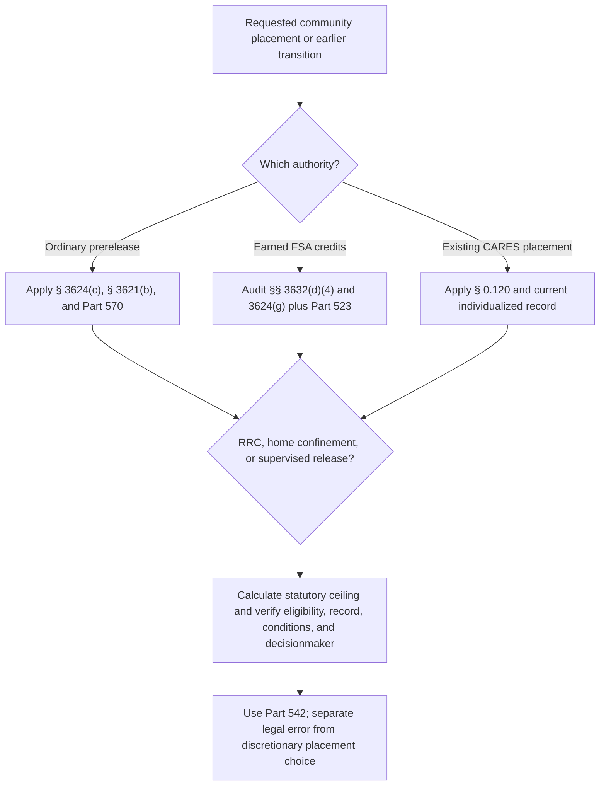

# Prerelease Custody, Residential Reentry, Home Confinement, and the CARES Act

Residential reentry-center placement, ordinary home confinement, First Step Act prerelease custody, transfer to supervised release, and CARES Act home confinement are related but noninterchangeable authorities. A valid analysis identifies the governing lane, eligibility date, placement decision, and decisionmaker.

## Ordinary prerelease custody under § 3624(c)

<!-- claim:CLM-BOPPRE-001 authorities:AUTH-USC-18-3624 status:verified_current -->
Section 3624(c)(1) directs the BOP Director, to the extent practicable, to ensure that a prisoner spends a portion of the final months of the term (not to exceed 12 months) under conditions that will afford a reasonable opportunity to adjust to and prepare for reentry into the community; those conditions may include a community correctional facility. [18 U.S.C. § 3624(c)(1)](https://www.govinfo.gov/link/uscode/18/3624)

<!-- claim:CLM-BOPPRE-002 authorities:AUTH-USC-18-3624 status:verified_current -->
The 12-month language is a ceiling for prerelease conditions, not a guaranteed residential reentry-center term; the statute retains practicability and individualized administration. [18 U.S.C. § 3624(c)(1), (6)](https://www.govinfo.gov/link/uscode/18/3624)

<!-- claim:CLM-BOPPRE-003 authorities:AUTH-USC-18-3624 status:verified_current -->
Under ordinary § 3624(c)(2), the Bureau may place a prisoner in home confinement for the shorter of ten percent of the imprisonment term or six months, and, to the extent practicable, must place lower-risk and lower-needs prisoners in home confinement for the maximum time permitted. [18 U.S.C. § 3624(c)(2)](https://www.govinfo.gov/link/uscode/18/3624)

<!-- claim:CLM-BOPPRE-004 authorities:AUTH-USC-18-3624 status:verified_current -->
For First Step Act prerelease custody under § 3624(g), if a prisoner violates a condition, the BOP Director may impose additional conditions or revoke prerelease custody and require the prisoner to serve the remainder of the term, or any portion of it, in prison, and shall revoke it if the violation is nontechnical. [18 U.S.C. § 3624(g)(5)](https://www.govinfo.gov/link/uscode/18/3624) Section 3624(c)(4) does not address violations; it provides that nothing in subsection (c) limits or restricts the Director's authority under § 3621. [18 U.S.C. § 3624(c)(4)](https://www.govinfo.gov/link/uscode/18/3624)

<!-- claim:CLM-BOPPRE-005 authorities:AUTH-USC-18-3624,AUTH-USC-18-3621 status:verified_current -->
Section 3624(c)(6) requires regulations ensuring that placement in a community correctional facility is conducted consistently with § 3621(b), determined on an individual basis, and of sufficient duration to provide the greatest likelihood of successful reintegration into the community. [18 U.S.C. § 3624(c)(6)](https://www.govinfo.gov/link/uscode/18/3624) The § 3621(b) factors are the resources of the facility contemplated, the nature and circumstances of the offense, the prisoner's history and characteristics, any statement by the sentencing court concerning the purposes of the sentence or recommending a type of facility, and any pertinent Sentencing Commission policy statement; § 3621(b) also provides that a designation of a place of imprisonment under that subsection is not reviewable by any court. [18 U.S.C. § 3621(b)](https://www.govinfo.gov/link/uscode/18/3621)

<!-- claim:CLM-BOPPRE-006 authorities:AUTH-PL-110-199-SEC-251,AUTH-USC-18-3624 status:verified_current -->
Section 251 of the Second Chance Act of 2007 expanded ordinary prerelease custody to a maximum of 12 months and required regulations assuring individualized decisions; it did not guarantee 12 months or replace later First Step Act mechanisms. [Pub. L. No. 110-199, § 251, 122 Stat. 657, 692–94](https://www.govinfo.gov/content/pkg/PLAW-110publ199/pdf/PLAW-110publ199.pdf)

<!-- claim:CLM-BOPPRE-007 authorities:AUTH-CFR-28-570-SUBPART-B status:verified_current -->
The Bureau's community-confinement regulation provides that inmates will be considered for pre-release community confinement in a manner consistent with § 3621(b), determined on an individual basis, and of sufficient duration to provide the greatest likelihood of successful reintegration, within the regulation's time-frames. Community confinement may be designated during the final months of the term, not to exceed twelve months, but those time-frames may be exceeded when separate statutory authority allows greater periods of community confinement as a condition of pre-release custody. [28 C.F.R. §§ 570.21(a), (c), 570.22](https://www.ecfr.gov/current/title-28/chapter-V/subchapter-D/part-570/subpart-B)

<!-- claim:CLM-BOPPRE-008 authorities:AUTH-CFR-28-570-SUBPART-B status:verified_current -->
The regulation does not impose a categorical six-month cap on residential reentry-center placement; it also does not create a right to the maximum statutory period. [28 C.F.R. §§ 570.21–570.22](https://www.ecfr.gov/current/title-28/chapter-V/subchapter-D/part-570/subpart-B)

## First Step Act prerelease custody and supervised-release transfer

<!-- claim:CLM-BOPPRE-009 authorities:AUTH-USC-18-3632,AUTH-USC-18-3624 status:verified_current -->
First Step Act time credits are earned under § 3632(d)(4), but they are applied through the separate eligibility and placement rules in § 3624(g); earning a credit and becoming eligible to apply it are not the same event. A prisoner serving a sentence for an offense listed in § 3632(d)(4)(D) is ineligible to receive time credits, and a prisoner who is the subject of a final order of removal under the immigration laws is ineligible to apply them. [18 U.S.C. § 3632(d)(4)(A), (C)–(E)](https://www.govinfo.gov/link/uscode/18/3632); [18 U.S.C. § 3624(g)](https://www.govinfo.gov/link/uscode/18/3624)

<!-- claim:CLM-BOPPRE-010 authorities:AUTH-USC-18-3624,AUTH-USC-18-3632 status:verified_current -->
For prerelease custody under § 3624(g), the prisoner must have earned time credits equal to the remainder of the imposed term, shown through periodic risk reassessments a demonstrated recidivism risk reduction or maintained a minimum or low recidivism risk, had the remainder computed under applicable law, and either been determined to be a minimum or low risk to recidivate pursuant to the last 2 reassessments or had a transfer petition approved by the warden after the findings in § 3624(g)(1)(D)(i)(II). [18 U.S.C. § 3624(g)(1)(A)–(D)(i)](https://www.govinfo.gov/link/uscode/18/3624) A prisoner who is the subject of a final order of removal is ineligible to apply time credits. [18 U.S.C. § 3632(d)(4)(E)](https://www.govinfo.gov/link/uscode/18/3632)

<!-- claim:CLM-BOPPRE-011 authorities:AUTH-USC-18-3624 status:verified_current -->
A prisoner being placed in prerelease custody who does not satisfy the minimum-or-low-risk route may instead qualify through a petition approved by the warden after the warden determines that the prisoner would not be a danger to society if transferred, has made a good faith effort to lower their recidivism risk through participation in recidivism reduction programs or productive activities, and is unlikely to recidivate; the requirements of § 3624(g)(1)(A)–(C) still apply. For early transfer to supervised release, § 3624(g)(1)(D)(ii) instead requires a determination that the prisoner is a minimum or low risk to recidivate pursuant to the last reassessment. [18 U.S.C. § 3624(g)(1)(A)–(D)](https://www.govinfo.gov/link/uscode/18/3624)

<!-- claim:CLM-BOPPRE-012 authorities:AUTH-USC-18-3624 status:verified_current -->
Section 3624(g)(2) defines prerelease custody for this lane as home confinement or placement in a residential reentry center, subject to the subsection's conditions and Bureau administration. [18 U.S.C. § 3624(g)(2)](https://www.govinfo.gov/link/uscode/18/3624)

<!-- claim:CLM-BOPPRE-013 authorities:AUTH-USC-18-3624 status:verified_current -->
First Step Act home confinement requires 24-hour electronic monitoring (or, if electronic monitoring is infeasible for technical or religious reasons, alternative means that the Director determines are as effective or more effective), requires the prisoner to remain in the residence except to leave, subject to the Director's approval, for the purposes the statute lists: a job or job-related activities or job-seeking, assigned recidivism-reduction programming or productive activities (or similar activities), community service, crime victim restoration activities, medical treatment, religious activities, and family-related activities that facilitate reentry, and, except as provided in § 3624(g)(4), requires the prisoner to remain in home confinement until serving not less than 85 percent of the imposed term. The Director may modify the § 3624(g)(2)(A)(i) monitoring, residence, and other conditions if the Director determines that a compelling reason exists and that the prisoner has demonstrated exemplary compliance, and shall, to the extent practicable, provide that increasingly less restrictive conditions be imposed on prisoners who demonstrate continued compliance. For a violation, the Director may impose additional conditions or revoke prerelease custody, and shall revoke it for a nontechnical violation. [18 U.S.C. § 3624(g)(2)(A), (g)(4), (g)(5)](https://www.govinfo.gov/link/uscode/18/3624)

<!-- claim:CLM-BOPPRE-014 authorities:AUTH-USC-18-3624 status:verified_current -->
A prisoner placed in prerelease custody at a residential reentry center under § 3624(g) shall be subject to such conditions as the BOP Director determines appropriate; § 3624(g)(2)(B) does not itself list facility conditions or services. [18 U.S.C. § 3624(g)(2)(B)](https://www.govinfo.gov/link/uscode/18/3624)

<!-- claim:CLM-BOPPRE-015 authorities:AUTH-USC-18-3624 status:verified_current -->
Section 3624(g)(3) permits the Bureau to transfer an eligible prisoner to begin a court-imposed supervised-release term up to 12 months before the ordinary release date; it does not create supervised release when the judgment imposed none. [18 U.S.C. § 3624(g)(3)](https://www.govinfo.gov/link/uscode/18/3624)

<!-- claim:CLM-BOPPRE-016 authorities:AUTH-USC-18-3624 status:verified_current -->
If the sentence includes a term of supervised release under § 3583, the BOP Director may transfer the prisoner to begin supervised release at an earlier date, not to exceed 12 months, based on the application of time credits under § 3632. [18 U.S.C. § 3624(g)(3)](https://www.govinfo.gov/link/uscode/18/3624) On release, a probation officer supervises the person during the term to the degree warranted by the conditions specified by the sentencing court. [18 U.S.C. § 3624(e)](https://www.govinfo.gov/link/uscode/18/3624)

<!-- claim:CLM-BOPPRE-017 authorities:AUTH-CFR-28-523-SUBPART-E-CURRENT,AUTH-FR-91-55740 status:verified_current -->
The current First Step Act time-credit regulation, as amended effective September 30, 2026, provides that the Bureau may apply FSA Time Credits toward prerelease custody or early transfer to supervised release under § 3624(g) only if the inmate meets the § 523.44(b) criteria (credits equal to the remainder of the imposed term, demonstrated risk reduction or maintained minimum or low risk on periodic reassessments, and a computed remainder of the term). Prerelease custody also requires the § 523.44(c) criteria: minimum or low risk through the last two risk and needs assessments, or a warden-approved petition. Early transfer to supervised release requires the (c) criteria plus the § 523.44(d) criteria: minimum or low risk through the last assessment, a supervised-release term imposed by the sentencing court, and transfer no earlier than 12 months before it would otherwise have occurred. The Bureau may not apply credits for an inmate subject to a final order of removal. It also generally may not apply credits to a term imposed for an offense under laws other than the U.S. Code, but § 523.44(a)(3) recognizes exceptions for a D.C. Code sentence when application is authorized by the D.C. Code and for a sentence imposed in a foreign country for which the U.S. Parole Commission has determined an equivalent U.S. Code sentence under 18 U.S.C. § 4106A. Lost credits may be restored in part or in full, case by case, after clear conduct for two consecutive risk and needs assessments. [28 C.F.R. §§ 523.43(c), 523.44](https://www.ecfr.gov/current/title-28/chapter-V/subchapter-B/part-523/subpart-E); [91 Fed. Reg. 55,740, 55,743–44 (Aug. 31, 2026) (interim final rule)](https://www.govinfo.gov/content/pkg/FR-2026-08-31/pdf/2026-17752.pdf)

<!-- claim:CLM-BOPPRE-018 authorities:AUTH-BOP-PS-5410-01-CN2,AUTH-CFR-28-523-SUBPART-E-CURRENT,AUTH-FR-91-55740 status:verified_current -->
The Bureau's published procedures for First Step Act time credits are set out in Program Statement 5410.01, which establishes Bureau criteria and procedures for awarding time credits under 18 U.S.C. §§ 3632(d)(4) and 3624(g); as changed by CN-2, it states that "in all cases, earned time credits will be applied to prerelease custody (RRC and/or HC) as required by the First Step Act." The Program Statement predates the amendments to 28 C.F.R. §§ 523.42(a) and 523.44(a)(3) effective September 30, 2026, and must be read subject to the current regulation: § 523.42(a) now provides that earning begins after the term of imprisonment commences, without the former designated-facility parenthetical, and § 523.44(a)(3) now recognizes an exception for a qualifying foreign-country sentence under 18 U.S.C. § 4106A. [BOP Program Statement 5410.01 CN-2 (Mar. 10, 2023)](https://www.bop.gov/policy/progstat/5410.01_cn2.pdf); [28 C.F.R. §§ 523.42, 523.44](https://www.ecfr.gov/current/title-28/chapter-V/subchapter-B/part-523/subpart-E); [91 Fed. Reg. 55,740, 55,741, 55,743–44 (Aug. 31, 2026) (interim final rule)](https://www.govinfo.gov/content/pkg/FR-2026-08-31/pdf/2026-17752.pdf)

## Ordinary home confinement administration

<!-- claim:CLM-BOPPRE-019 authorities:AUTH-BOP-HOME-CONFINEMENT-DIRECTIVE-2025 status:verified_current -->
A May 28, 2025 BOP press release describes a directive from the Director instructing staff to expand the use of home confinement for eligible individuals under the First Step Act and Second Chance Act. It says the policy is meant to ensure that eligible individuals, particularly those who do not require transitional services at Residential Reentry Centers (RRCs), are transferred to home confinement as soon as statutorily possible. Home confinement is a priority for eligible individuals who do not require the structured support of an RRC, and RRC placement will be reserved for those with the greatest need. The release also says that decisions will be based on each person's needs, support systems and readiness for reintegration; that Unit Teams must use FSA and SCA Conditional Placement Dates to guide prerelease planning; and that staff must distinguish between FSA and SCA eligibility criteria and understand the limits of each statute, particularly when determining the duration of prerelease custody, while there is no restriction on how many FSA time credits may be applied toward home confinement. [BOP, Expanding Home Confinement (press release, May 28, 2025)](https://www.bop.gov/news/pdfs/20250528-home-confinement-expansioin.pdf)

<!-- claim:CLM-BOPPRE-020 authorities:AUTH-USC-18-3624,AUTH-USC-18-3621 status:verified_current -->
A sentencing-court recommendation may inform placement but does not itself order the Bureau to place a prisoner in home confinement or an RRC; the Bureau administers place of imprisonment and prerelease custody under the governing statutes. [18 U.S.C. §§ 3621(b), 3624(c)](https://www.govinfo.gov/link/uscode/18/3624)

<!-- claim:CLM-BOPPRE-021 authorities:AUTH-USC-18-3624 status:verified_current -->
Home confinement is still service of the imprisonment term under Bureau custody and conditions; it is not the same as release from imprisonment, probation, or supervised release. [18 U.S.C. § 3624(c), (g)](https://www.govinfo.gov/link/uscode/18/3624)

<!-- claim:CLM-BOPPRE-022 authorities:AUTH-CFR-28-570-SUBPART-B,AUTH-USC-18-3621,AUTH-USC-18-3624 status:verified_current -->
For pre-release community confinement, the regulation provides that inmates will be considered in a manner consistent with § 3621(b), on an individual basis, and for a sufficient duration to provide the greatest likelihood of successful reintegration. [28 C.F.R. § 570.22](https://www.ecfr.gov/current/title-28/chapter-V/subchapter-D/part-570/subpart-B) The five numbered factors that § 3621(b) directs the Bureau to consider in designating a facility are the resources of the facility contemplated, the nature and circumstances of the offense, the prisoner's history and characteristics, any statement by the sentencing court, and any pertinent Sentencing Commission policy statement. [18 U.S.C. § 3621(b)](https://www.govinfo.gov/link/uscode/18/3621) Separately, First Step Act prerelease custody under § 3624(g) applies only to a prisoner who meets all of the § 3624(g)(1) criteria: (1) time credits equal to the remainder of the imposed term; (2) demonstrated risk reduction, or maintained minimum or low risk, on periodic reassessments; (3) a computed remainder of the term; and (4) either minimum or low risk on the last 2 reassessments or a warden-approved petition. [18 U.S.C. § 3624(g)(1)](https://www.govinfo.gov/link/uscode/18/3624)

## CARES Act home confinement

<!-- claim:CLM-BOPPRE-023 authorities:AUTH-PL-116-136-SEC-12003 status:verified_current -->
CARES Act § 12003(b)(2) temporarily authorized the Bureau Director, after the Attorney General's emergency finding and during the defined covered emergency period, to lengthen the maximum home-confinement period otherwise authorized by § 3624(c)(2). [Pub. L. No. 116-136, § 12003(b)(2), 134 Stat. 281, 516](https://www.govinfo.gov/content/pkg/PLAW-116publ136/pdf/PLAW-116publ136.pdf)

<!-- claim:CLM-BOPPRE-024 authorities:AUTH-PL-116-136-SEC-12003,AUTH-PL-118-3 status:verified_current -->
The CARES Act defined the covered emergency period by reference to the March 13, 2020 national emergency and 30 days after its termination; Public Law 118-3 terminated that national emergency on April 10, 2023, so the temporary authority to make new expanded-period placements is not an open-ended present authority. [Pub. L. No. 116-136, § 12003(a)(2)](https://www.govinfo.gov/content/pkg/PLAW-116publ136/pdf/PLAW-116publ136.pdf); [Pub. L. No. 118-3, 137 Stat. 6](https://www.govinfo.gov/content/pkg/PLAW-118publ3/pdf/PLAW-118publ3.pdf)

<!-- claim:CLM-BOPPRE-025 authorities:AUTH-CFR-28-0-96-U,AUTH-PL-116-136-SEC-12003 status:verified_current -->
The 2023 final rule provides that, after the CARES Act's covered emergency period, the Director may permit a prisoner placed in CARES Act home confinement who is not yet otherwise eligible for home confinement under separate statutory authority to remain there for the remainder of the sentence, as the Director determines appropriate, provided the prisoner is compliant with all conditions of supervision; on a violation, Bureau staff may return the prisoner to secure custody or use progressive discipline under the Residential Reentry Center contract. [28 C.F.R. § 0.96(u)(2)](https://www.ecfr.gov/current/title-28/chapter-I/part-0/subpart-Q/section-0.96); [Pub. L. No. 116-136, § 12003(a)(2), (b)(2), 134 Stat. 281, 516 (2020)](https://www.govinfo.gov/content/pkg/PLAW-116publ136/pdf/PLAW-116publ136.pdf)

<!-- claim:CLM-BOPPRE-026 authorities:AUTH-CFR-28-0-96-U status:verified_current -->
The final rule does not guarantee continued home confinement: it permits a prisoner to remain in CARES Act home confinement for the remainder of the prisoner's sentence only as the Director determines appropriate and provided the prisoner is compliant with all conditions of supervision, and on a violation Bureau staff may return the prisoner to secure custody or use progressive discipline under the RRC contract, which may include placement in an RRC or contract facility instead of direct return to secure custody. [28 C.F.R. § 0.96(u)(2)](https://www.ecfr.gov/current/title-28/chapter-I/part-0/subpart-Q/section-0.96)

<!-- claim:CLM-BOPPRE-027 authorities:AUTH-PL-116-136-SEC-12003,AUTH-USC-18-3624,AUTH-CFR-28-0-96-U status:verified_current -->
For a person now in CARES Act home confinement, the placement authority matters: during the covered emergency period, if the Attorney General found that emergency conditions would materially affect the functioning of the Bureau, the CARES Act let the Director lengthen, as the Director determined appropriate, the maximum home-confinement period under the first sentence of 18 U.S.C. § 3624(c)(2), which otherwise allows home confinement for the shorter of 10 percent of the term of imprisonment or 6 months. Section 0.96(u) concerns only inmates placed in home confinement under the CARES Act and has no effect on any other inmate, including those placed in home confinement under separate statutory authorities. [Pub. L. No. 116-136, § 12003(b)(2), 134 Stat. 281, 516 (2020)](https://www.govinfo.gov/content/pkg/PLAW-116publ136/pdf/PLAW-116publ136.pdf); [18 U.S.C. § 3624(c)(2)](https://www.govinfo.gov/link/uscode/18/3624); [28 C.F.R. § 0.96(u)(3)](https://www.ecfr.gov/current/title-28/chapter-I/part-0/subpart-Q/section-0.96)

## Review and remedy classification

<!-- claim:CLM-BOPPRE-028 authorities:AUTH-USC-18-3625 status:verified_current -->
Section 3625 provides that 5 U.S.C. §§ 554, 555, and 701 through 706 "do not apply to the making of any determination, decision, or order under this subchapter." [18 U.S.C. § 3625](https://www.govinfo.gov/link/uscode/18/3625)

<!-- claim:CLM-BOPPRE-029 authorities:AUTH-CFR-28-542 status:verified_current -->
A prisoner ordinarily should present a disputed eligibility calculation, omitted individualized consideration, or asserted legal error through the Administrative Remedy Program with the supporting computation and placement records. [28 C.F.R. pt. 542, subpt. B](https://www.ecfr.gov/current/title-28/chapter-V/subchapter-C/part-542/subpart-B)

<!-- claim:CLM-BOPPRE-030 authorities:AUTH-USC-28-2241,AUTH-SCOTUS-RUMSFELD-PADILLA-542-US-426 status:verified_current -->
When a § 2241 habeas petitioner challenges his present physical custody within the United States, the default rule is that the proper respondent is the warden of the facility where the prisoner is being held, and he should file the petition in the district of confinement. District courts are limited to granting habeas relief within their respective jurisdictions, which requires nothing more than that the court issuing the writ have jurisdiction over the custodian. [28 U.S.C. § 2241](https://www.govinfo.gov/link/uscode/28/2241); [*Rumsfeld v. Padilla*, 542 U.S. 426, 434–47 (2004)](https://www.govinfo.gov/content/pkg/USREPORTS-542/pdf/USREPORTS-542-426.pdf)

<!-- claim:CLM-BOPPRE-031 authorities:AUTH-USC-18-3624,AUTH-USC-18-3621,AUTH-USC-18-3625 status:verified_current -->
Sections 3624(c) and (g) assign prerelease-custody and early-transfer functions to the Bureau of Prisons Director. Section 3621(b) provides that a designation of a place of imprisonment under that subsection is not reviewable by any court, and § 3625 makes 5 U.S.C. §§ 554, 555, and 701–706 inapplicable to determinations, decisions, and orders under its subchapter. None of those provisions itself grants a court authority to select home confinement or residential reentry-center placement. Any further statement about an available judicial remedy requires claim-specific authority. [18 U.S.C. § 3624(c), (g)](https://www.govinfo.gov/link/uscode/18/3624); [18 U.S.C. § 3621(b)](https://www.govinfo.gov/link/uscode/18/3621); [18 U.S.C. § 3625](https://www.govinfo.gov/link/uscode/18/3625)

<!-- claim:CLM-BOPPRE-032 authorities:AUTH-USC-18-3624,AUTH-USC-18-3632 status:verified_current -->
No release date or placement follows from the phrase “First Step Act eligible” alone; the conviction exclusions, earning periods, assessment history, credit ledger, disciplinary adjustments, final removal order, sentence remainder, residence and community plan, and current custody authority all require verification. [18 U.S.C. §§ 3624(g), 3632(d)(4)](https://www.govinfo.gov/link/uscode/18/3632)

## Release and the supervised-release boundary

<!-- claim:CLM-BOPPRE-033 authorities:AUTH-USC-18-3624 status:verified_current -->
Section 3624(a) directs the Bureau to release a prisoner on the date the term of imprisonment expires, less any time credited under § 3624(b). Section 3624(d) requires the Bureau, on release at the expiration of the term, to furnish the prisoner with: (1) suitable clothing; (2) an amount of money, not more than $500, that the Director determines is consistent with the offender's needs and the public interest, unless the Director determines that the offender's financial position is such that no sum should be furnished; and (3) transportation to the place of conviction, to the prisoner's bona fide residence within the United States, or to another place within the United States that the Director authorizes. [18 U.S.C. § 3624(a), (d)](https://www.govinfo.gov/link/uscode/18/3624)

<!-- claim:CLM-BOPPRE-034 authorities:AUTH-USC-18-3624 status:verified_current -->
A supervised-release term commences on the day the person is released from imprisonment and runs concurrently with any federal, state, or local term of probation, supervised release, or parole for another offense; it does not run during any period in which the person is imprisoned in connection with a conviction for a federal, state, or local crime unless the imprisonment is for a period of less than 30 consecutive days. [18 U.S.C. § 3624(e)](https://www.govinfo.gov/link/uscode/18/3624)

<!-- claim:CLM-BOPPRE-035 authorities:AUTH-SCOTUS-JOHNSON-529-US-53,AUTH-USC-18-3582-3583 status:verified_current -->
*United States v. Johnson* holds that excess prison time does not reduce a supervised-release term under § 3624(e), and observes that the statutory structure addresses the resulting equitable concerns "in large part" through the court's discretion to modify conditions under § 3583(e)(2) and to terminate supervised release at any time after the expiration of one year if warranted by the defendant's conduct and the interest of justice under § 3583(e)(1). [529 U.S. 53, 57–60 (2000)](https://www.govinfo.gov/content/pkg/USREPORTS-529/pdf/USREPORTS-529-53.pdf); [18 U.S.C. § 3583(e)(1)–(2)](https://www.govinfo.gov/link/uscode/18/3583)

<!-- claim:CLM-BOPPRE-036 authorities:AUTH-SCOTUS-MONT-587-US-514,AUTH-USC-18-3624 status:verified_current -->
*Mont v. United States* holds that pretrial detention later credited toward a new conviction qualifies as imprisonment “in connection with a conviction” and tolls supervised release under § 3624(e), even though the credit determination occurs later. [587 U.S. 514, 518–24 (2019)](https://www.govinfo.gov/content/pkg/USREPORTS-587/pdf/USREPORTS-587-514.pdf)

## Decision path

## Required records and limits

- Judgment, sentence computation, projected release date, good-time and FSA-credit ledgers.
- PATTERN assessments, needs assessments, programming and discipline records, detainers, and final removal order if any.
- RRC and home-confinement referrals, reviews, reasons, bed or monitoring availability, residence and reentry plans.
- CARES Act placement and conditions, incident and sanction record, and current custody decision.
- Current circuit authority on cognizability, exhaustion, § 3625, available relief, and mootness.
